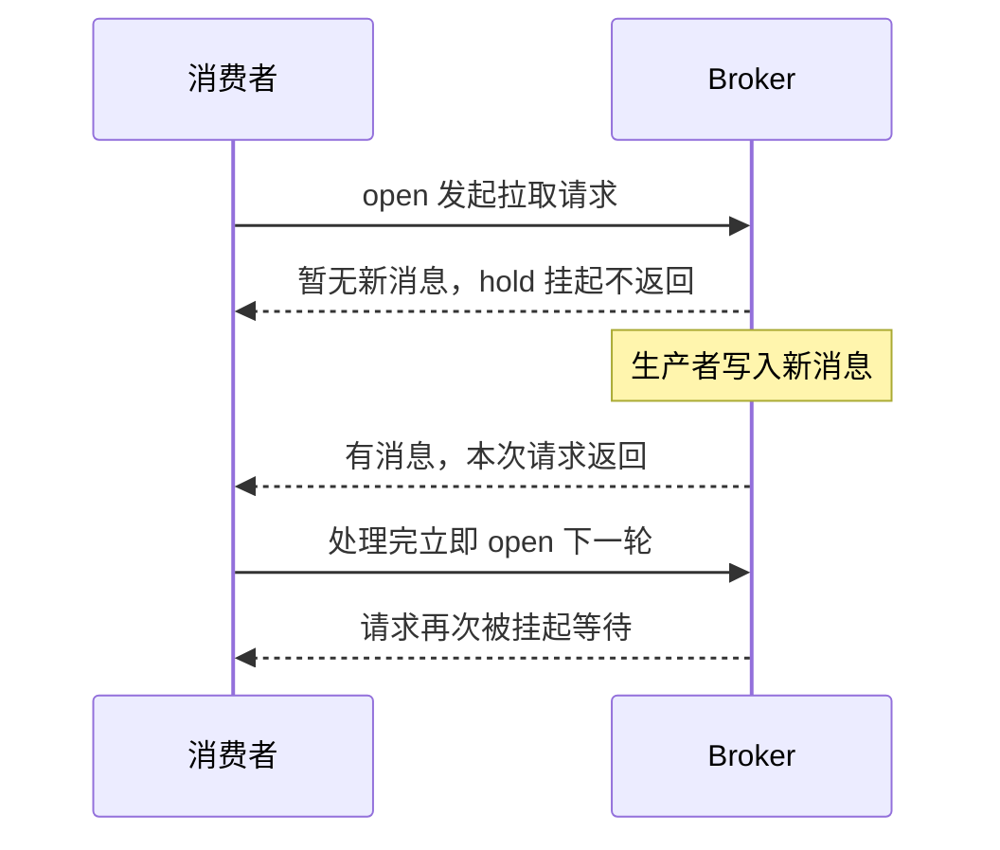
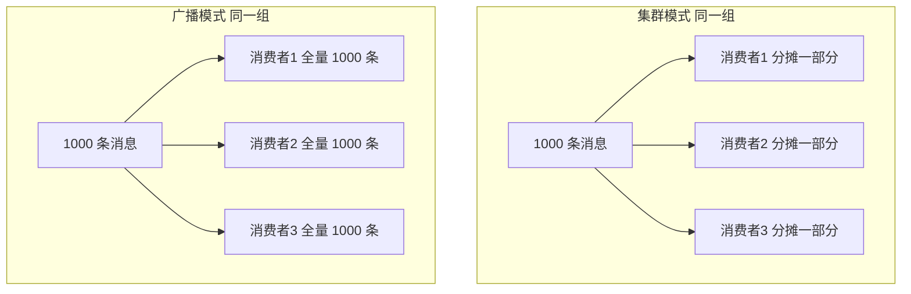
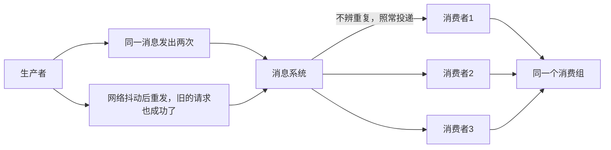

# RocketMQ的Consumer详解之三讲：push 与 pull 长轮询、集群与广播消息模式、重复消息的幂等方案

## 先给结论

消费端有三连问迟早要面对：消息是怎么到达消费者的？同一个消费组里多个实例怎么分摊？收到两条一模一样的消息怎么办？RocketMQ的Consumer详解之三讲就把这三问一次讲透，每一问都藏着一个反直觉的真相。
第一问的答案是长轮询：无论 push 还是 pull，取消息都是消费者主动向 Broker 发起，RocketMQ 根本没有真正的服务端推送，push 只是封装了轮询并在消息到达时唤醒监听器，实时性靠请求挂起的长轮询保证。第二问的答案是消息模式：集群模式组内分摊、位点由 Broker 管理并支持重试，广播模式每人全量、位点存本地且失败不重试，默认是集群模式。
第三问的答案是幂等：重复消息无法从根上避免，生产端 bug、网络抖动重发都可能造出内容相同的两条消息，中间件分不出真假，能做的是把业务逻辑写成天然幂等，或用业务唯一编号加去重记录兜底，去重必须做在业务端。
三讲依次是：
- push 和 pull 模式：长轮询原理、两种编码形态与怎么选。
- 消息模式：集群分摊还是广播全量、设置方式与广播的代价。
- 重复消息的解决方案：重复怎么产生、幂等与去重两种解法。

## 第1部分：RocketMQ 的 push 与 pull：看着是推，其实是长轮询拉取

写消费者时注册一个 `MessageListener`，消息就「自动」到达了，很多人由此认定 RocketMQ 的 push 是服务端主动推。真去翻实现会发现一个反直觉的事实：无论 push 还是 pull，取消息的动作都是消费者主动向 Broker 发起的，RocketMQ 根本没有做真正的服务端推送。那 push 的「实时到达」是哪来的？答案是长轮询。

### 一、两种模式的定义与背后的取舍

push 模式指客户端与服务端建立连接后，服务端一旦有消息就把消息推送到客户端；pull 模式指客户端不断轮询请求服务端，看有没有新消息，有就抓取。这是两个方向的极端：真 push 需要 Broker 与海量消费者各维持一条长连接，消费者规模一大，Broker 的连接与推送压力会非常重；单纯轮询则把主动权交给客户端，代价是请求间隔里消息到了也取不到，实时性打折，而且绝大多数请求是「没有消息」的空跑。

RocketMQ 的解法是把两者折中：取消息仍然是消费者主动拉（对 Broker 来说只有「被问到了才回话」一种工作方式），但把问话的间隔做到了极致。既然底层全是拉取，编码时的 push 和 pull 区别就只在于封装程度。

### 二、长轮询：把「没消息」的请求挂起来

长轮询的规则是：客户端照常发起请求，服务端如果暂时没有新数据，就把这个请求挂起（hold）不返回，直到有新数据才响应；响应结束、连接关闭，客户端像传统轮询一样立即发起下一轮请求。



关键在挂起那一步：请求不是被拒绝，而是被 Broker 握在手里等。消息一到，挂着的请求立刻醒来返回，等待间隔趋近于零，实时性接近真推送；没有消息时，一条挂起的连接胜过客户端成百上千次空轮询，无效请求的开销被消掉了。这个名字的由来也直白：长连接加轮询，合称长轮询。它同时继承了真 push 的实时与真 pull 的低压力，是理解 RocketMQ 消费端设计的一把钥匙。

### 三、编码差别：封装好的 push 与自己动手的 pull

push 模式的消费者前面课程一直在写，轮询、位点管理全部封装在客户端内部，业务代码只剩订阅和监听：

```java
DefaultMQPushConsumer consumer =
        new DefaultMQPushConsumer("haoke-consumer");
consumer.setNamesrvAddr("172.16.55.185:9876");
consumer.subscribe("my-topic", "*");
// 轮询取到消息后，框架自动唤醒监听器回调此方法
consumer.registerMessageListener(new MessageListenerConcurrently() {
    @Override
    public ConsumeConcurrentlyStatus consumeMessage(
            List<MessageExt> msgs, ConsumeConcurrentlyContext context) {
        System.out.println("消息：" + msgs);
        return ConsumeConcurrentlyStatus.CONSUME_SUCCESS;
    }
});
consumer.start();
```

pull 模式则把这些环节摊开给使用者。课程明确说了 pull 编码极少使用、不做演示，按本课写法补一份可运行的示例，用的正是 4.5.0 客户端的 `DefaultMQPullConsumer`：

```java
package com.example.rocketmq.pull;

import org.apache.rocketmq.client.consumer.DefaultMQPullConsumer;
import org.apache.rocketmq.client.consumer.PullResult;
import org.apache.rocketmq.client.consumer.PullStatus;
import org.apache.rocketmq.common.message.MessageExt;
import org.apache.rocketmq.common.message.MessageQueue;

import java.util.Set;

public class PullConsumerDemo {

    public static void main(String[] args) throws Exception {
        DefaultMQPullConsumer consumer =
                new DefaultMQPullConsumer("haoke-pull-consumer");
        consumer.setNamesrvAddr("172.16.55.185:9876");
        consumer.start();

        // 按主题拿到待消费的队列集合，逐个队列处理
        Set<MessageQueue> queues =
                consumer.fetchSubscribeMessageQueues("my-topic");
        for (MessageQueue mq : queues) {
            // 取该队列的当前消费位点，第一次从队首开始
            long offset = consumer.fetchConsumeOffset(mq, true);
            while (true) {
                // 对每个队列批量拉取，最多 32 条
                PullResult result = consumer.pull(mq, "*", offset, 32);
                if (result.getPullStatus() == PullStatus.FOUND) {
                    for (MessageExt msg : result.getMsgFoundList()) {
                        System.out.println("消息："
                                + new String(msg.getBody(), "UTF-8"));
                    }
                }
                // 记录下一次要取的开始位点，取完换下一个队列
                offset = result.getNextBeginOffset();
                consumer.updateConsumeOffset(mq, offset);
                if (result.getPullStatus() == PullStatus.NO_NEW_MSG) {
                    break;
                }
            }
        }
        consumer.shutdown();
    }
}
```

对照着看，pull 的每个环节都是 push 替你做掉的事：按 Topic 拿到 `MessageQueue` 集合，遍历每个队列批量拉取，一次取完记录该队列下一次要取的起始 offset，再换下一个队列。位点忘了更新，重启后要么重复消费要么跳过消息。这两份代码放在一起，就解释了为什么日常开发默认选 push。

### 四、怎么选

| 维度 | push | pull |
|---|---|---|
| 取消息控制权 | 客户端封装，业务无感 | 使用者自管队列、位点、节奏 |
| 实时性 | 长轮询，接近实时 | 取决于轮询间隔 |
| 开发成本 | 低，注册监听器即可 | 高，位点维护出错就丢消息或重复 |
| 适用场景 | 绝大多数在线业务消费 | 流控、批量搬运、离线任务等要自控节奏的场景 |

## 第2部分：RocketMQ 消息模式：同一消费组里，集群分摊还是广播全量

把消费者程序部署三个实例做负载均衡，配置同一个消费组，然后发现有的实例收不到消息，或者反过来，每个实例都收到了一遍全量消息。这两种「现象」都不是 bug，而是消息模式在起作用。`DefaultMQPushConsumer` 的消息模式决定了一条消息在组内怎么分，搞不清它，扩容和排查都会晕。

### 一、消费组引出的问题

消费者代码里都要传一个组名：`new DefaultMQPushConsumer("haoke-consumer")`。同一消费组的消费者共同消费该主题的消息，组成一个集群，`DefaultMQPushConsumer` 帮你自动保存消费位点 offset，并在多个 consumer 之间做负载均衡。组名相同，消息路由到队列，队列分配给组内成员，这套机制让「多实例部署」天然成为水平扩容手段。

问题随之而来：组里有消费者 1、消费者 2、消费者 3，消息系统来了一条消息，发给谁？三个都发，还是只发一个？这就到了消息模式的地盘。讲义对消费组的两种消费模式给出定义：集群模式是一个消费组内的消费者组成一个集群，主题下的一条消息只能被一个消费者消费；广播模式是主题下的一条消息能被消费组下的所有消费者消费。



图的左侧是集群模式，1000 条消息被三个消费者分摊，三个人消费的总和就是这 1000 条，吞吐随实例数上升；右侧是广播模式，每个消费者独立收到全量 1000 条，适合每个实例都必须知晓消息的场景。同一个组只能二选一，这正是组名相同的表现。

### 二、设置方式与默认值

设置入口是 `setMessageModel`，枚举 `MessageModel` 里就两个值。把课程演示的消费者骨架整理如下，订阅表达式 `add || update` 表示只收这两种 Tag：

```java
package com.example.rocketmq.model;

import org.apache.rocketmq.client.consumer.DefaultMQPushConsumer;
import org.apache.rocketmq.client.consumer.listener.ConsumeConcurrentlyContext;
import org.apache.rocketmq.client.consumer.listener.ConsumeConcurrentlyStatus;
import org.apache.rocketmq.client.consumer.listener.MessageListenerConcurrently;
import org.apache.rocketmq.common.message.MessageExt;
import org.apache.rocketmq.common.protocol.heartbeat.MessageModel;

import java.io.UnsupportedEncodingException;
import java.util.List;

public class ConsumerDemo {

    public static void main(String[] args) throws Exception {
        DefaultMQPushConsumer consumer =
                new DefaultMQPushConsumer("haoke-consumer");
        consumer.setNamesrvAddr("172.16.55.185:9876");
        // 订阅消息，接收 add 与 update 两种 Tag
        consumer.subscribe("my-topic", "add || update");
        // 集群模式：组内分摊，一条消息只被一个消费者消费
        consumer.setMessageModel(MessageModel.CLUSTERING);
        // 广播模式：组内每个消费者都收到全量消息
        // consumer.setMessageModel(MessageModel.BROADCASTING);
        consumer.registerMessageListener(new MessageListenerConcurrently() {
            @Override
            public ConsumeConcurrentlyStatus consumeMessage(
                    List<MessageExt> msgs, ConsumeConcurrentlyContext context) {
                try {
                    for (MessageExt msg : msgs) {
                        System.out.println("消息："
                                + new String(msg.getBody(), "UTF-8"));
                    }
                } catch (UnsupportedEncodingException e) {
                    e.printStackTrace();
                }
                return ConsumeConcurrentlyStatus.CONSUME_SUCCESS;
            }
        });
        consumer.start();
    }
}
```

不设置时是什么模式？直接进 `DefaultMQPushConsumer` 源码搜 `Model`，答案写在字段声明上：

```java
public class DefaultMQPushConsumer extends ClientConfig implements MQPushConsumer {
    // ...
    private MessageModel messageModel = MessageModel.CLUSTERING;
    // ...
}
```

字段默认值就是集群模式，所以前面所有课程代码从没设置过消息模式，行为一直是组内分摊。不确定某个行为时去翻客户端源码，比查资料更快，这也是课程补充这一段的用意。

### 三、广播模式的代价：位点、重试与告警

两种模式不只是「给谁」的区别，连带整套可靠性设施都不一样。集群模式下，消费位点由消费者定期上报 Broker 统一管理，消费失败的消息会进入重试队列按延迟等级反复重试，重试耗尽后落入死信队列，可以接入监控告警人工处理。广播模式下这些设施全部缺失，按主流实现：消费位点保存在消费者本地文件里，不上报 Broker；消息消费失败不重试，也没有重试队列和死信队列；Broker 侧看不到广播消费的进度，基于消费进度的告警自然覆盖不到它。这一部分课程资料未展开，属按主流写法补充的结论。

代价换来的收益是「组内每实例必达」。本地缓存刷新、配置下发、每台机器都要执行的日志采集任务，用广播模式很合适；凡是「一件事只做一次就够」的业务，用集群模式，不然每个实例执行一遍就是全量重复。

## 第3部分：消费端注定收到重复消息：幂等与去重两种解法兜住它

把消费者多部署几个实例做负载均衡，跑了一段时间发现同一笔业务被执行了两次：通知发了两条，库存扣了两份。查日志发现是两条一模一样的消息，消息 ID 都不同但内容完全相同。重复消息不是偶发事故，而是消息队列的常态，做开发时一定会遇到。这一课就把「消费端收到两条一样的消息应该怎样处理」这个问题拆开讲透。

### 一、重复是怎么产生的

先看一张课程里的结构图：生产者产生 1000 条消息进入消息系统，消息系统把它们投递给同一个消费组里的消费者 1、消费者 2、消费者 3。



图里两条进线就是最常见的重复来源：

**第一，生产端 bug 导致重复发送。** 业务代码因为异常捕获写得不对，同一个消息对象被发了两次甚至多次。消息系统收到的是两次独立的发送请求，它没有办法知道这两条其实是同一个业务事件，只能当作两条正常消息，继续往消费者组里投。

**第二，网络抖动下的重发叠加。** 生产者发消息时网络出问题了，没等到 Broker 的确认，于是触发重试再发一次。麻烦在于，之前那次「失败」的请求可能并没有真的失败，只是在响应回来的路上丢了。于是两次发送最终都成功了，消息系统里躺着两条同样的消息。

无论哪种原因，结果都一样：消息系统无法识别重复，消费者必然收到重复投递。原因是什么并不重要，重要的是消费端怎么处理。

### 二、方案一：把业务逻辑写成幂等的

幂等的意思用一句话说清：同一个操作，执行一次和执行一百次，最终结果完全一样。只要业务处理天然幂等，重复消息就伤不到你。

课程举的例子是消费逻辑为数据库更新操作的场景。给更新语句加一个状态前置条件：

```sql
-- 幂等的更新：带上状态前置条件
UPDATE house_info
SET status    = 1,            -- 目标状态
    update_time = NOW()
WHERE house_id = 1001
  AND status = 0;             -- 只有还是初始状态才允许改
```

这条语句的幂等性体现在两个层面：

**第一，重复消息到达时，数据已经是目标状态。** 第一次消费把 `status` 从 0 改成 1，之后无论再来多少条重复消息，`WHERE status = 0` 都匹配不到行，语句等于空跑，数据纹丝不动。

**第二，重复消息先于第一次处理到达也一样。** 就算两条消息挤在同一批里，MySQL 的行锁会保证它们排队执行，第二条同样匹配不到行。

把「有没有发生」转换成「状态是否已到位」，这是写幂等业务最省力的思路，凡是能找到状态字段的场景都优先考虑它。

### 三、方案二：消息唯一编号加去重记录

业务逻辑改不动的时候（比如消费逻辑是插入一条流水、调用一次外部接口），就用第二招：给每条消息一个唯一编号，处理前先查这个编号有没有出现过。

做法是把消息的唯一编号作为 key，处理状态作为标记，存进 Redis。消费时先查一次：处理过就跳过，没处理过就执行业务并写标记。讲义在 4.3 节还点了一句关键实现细节：要做出「恰好一次」的效果，前提是保证消息处理成功与去重日志同时出现，也就是业务执行和去重记录必须绑在一起，要么都成功，要么都不落。

```java
package com.example.rocketmq.dedup;

import org.apache.rocketmq.client.consumer.DefaultMQPushConsumer;
import org.apache.rocketmq.client.consumer.listener.ConsumeConcurrentlyContext;
import org.apache.rocketmq.client.consumer.listener.ConsumeConcurrentlyStatus;
import org.apache.rocketmq.client.consumer.listener.MessageListenerConcurrently;
import org.apache.rocketmq.common.message.MessageExt;
import org.springframework.data.redis.core.StringRedisTemplate;

import java.util.List;
import java.util.concurrent.TimeUnit;

/**
 * 消费端去重骨架：业务执行前先占位，占到位的才执行业务
 */
public class DedupConsumer {

    private final StringRedisTemplate redis;

    public DedupConsumer(StringRedisTemplate redis) {
        this.redis = redis;
    }

    public void start() throws Exception {
        DefaultMQPushConsumer consumer =
                new DefaultMQPushConsumer("haoke-dedup-consumer");
        consumer.setNamesrvAddr("127.0.0.1:9876");
        consumer.subscribe("pay_topic", "*");
        consumer.registerMessageListener((MessageListenerConcurrently) (msgs, ctx) -> {
            for (MessageExt msg : msgs) {
                // 唯一编号用业务流水号，发送端通过 message.setKeys(...) 写入
                String bizKey = msg.getKeys();
                String dedupKey = "consume:dedup:" + bizKey;
                // setNX 占位：占成功说明是第一次处理
                Boolean first = redis.opsForValue()
                        .setIfAbsent(dedupKey, "1", 24, TimeUnit.HOURS);
                if (Boolean.FALSE.equals(first)) {
                    continue;   // 已经处理过，直接跳过
                }
                handleBusiness(msg);   // 执行真正的业务
            }
            return ConsumeConcurrentlyStatus.CONSUME_SUCCESS;
        });
        consumer.start();
    }

    private void handleBusiness(MessageExt msg) {
        // 实际业务：写库、发通知、调接口……
    }
}
```

发送端要配合一步：发消息前用 `message.setKeys("订单号或业务流水号")` 把业务编号写进消息属性。唯一编号要锚定业务，不要锚定消息的 msgId，msgId 是每次发送行为产生的，同一条业务消息重发一次通常就是新的 msgId，只有订单号、支付流水号这类业务编号才稳定。

### 四、为什么去重必须做在业务端

两种方案对比着看：

| 维度 | 方案一：业务幂等 | 方案二：唯一编号去重 |
|---|---|---|
| 实现位置 | 只能在消费端业务代码里实现 | 消费系统、业务端都可以实现 |
| 适用场景 | 更新类操作，找得到状态字段 | 插入类、外部调用，状态字段缺失 |
| 额外成本 | 无存储成本 | 要维护去重记录（Redis 或去重表） |

有人会想：能不能让消息中间件自己保证每条消息只投递一次，消费端就不用操心了？课程在这里算了一笔账：正常情况下消息就是一条，重复只是小概率事件，为这个小概率让 Broker 每条消息都去维护全局去重记录，存储和性能的代价由所有业务分摊，而收益只是省掉偶尔一次的重复处理，不值。所以 RocketMQ 的立场很明确：不保证消息不重复，做到不重复是业务系统自己的责任。

还有一个容易被忽略的重复来源：消费重试。讲义在消费重试一节写得很清楚，消息被消费端成功接收但处理时抛了异常，消费端无法向 Broker 返回成功，Broker 就会按延迟等级不断重试投递。重试投出去的每一条，对业务来说都是一条重复消息。这更加说明幂等不是可选项，而是消费端代码的标配。

## 常见误区

- **以为 push 是 Broker 维持长连接实时推送。** 它的底层同样是消费者轮询拉取，只是客户端把轮询与位点管理封装了，再用长轮询把实时性补齐，对用户透明。
- **pull 示例取完一轮就退出。** `NO_NEW_MSG` 只表示这一瞬间没有新消息，真正的 pull 消费要循环拉取或按节奏再拉，否则程序跑完就停了。
- **pull 模式不调 `updateConsumeOffset`。** 位点不提交，下次要么从旧位点重复拉，要么手动算偏移出错跳过消息，pull 的位点纪律比 push 严格得多。
- **为了「性能更高」选 pull。** pull 增加的是控制力，不是性能。没有明确的自控需求时，push 加监听器是最省事也最不容易出错的选择。
- **以为消息模式是 Broker 或 Topic 的属性。** 它是消费者按组声明的行为，同一个 Topic 可以同时被集群组与广播组消费，互不干扰。
- **广播模式当负载均衡用。** 组里三个实例各收全量消息，业务又是写库操作，等于同一笔业务重复执行三遍。要多实例分摊压力，用默认的集群模式。
- **广播模式期待重试与告警兜底。** 广播消费失败不重试、无死信队列，消费进度 Broker 也不管，关键业务用广播要自己补对账与补偿机制。
- **忘记默认值就扩实例。** 不设置消息模式时默认集群分摊，新实例上线会分走一部分队列，原有实例收到的消息变少，看到「消息被抢了」不是异常，是负载均衡在工作。
- **以为 MQ 会帮忙去重。** 消息系统分不出两条内容相同但发送独立的消息，至少一次投递是它的承诺，去重靠业务端。
- **幂等键用 msgId。** msgId 跟着发送行为走，重发一次就换一个，去重形同虚设。用业务流水号，通过 `message.setKeys(...)` 传递。
- **去重占位和业务执行分成两步没有兜底。** 占位成功后业务执行失败，这条消息就被永久跳过了。要把占位放在业务事务成功之后提交，或者失败时删除占位标记，让重试有机会再来。
- **以为只有生产端会造成重复。** 消费失败触发 Broker 重试投递同样会产生重复消费，所以就算生产端一次不重发，消费端也必须幂等。

## 面试可能被问到的问题

1. 面试官追问：「RocketMQ 的 push 是真正的推送吗？」
   答：不是。push 和 pull 底层都是消费者主动从 Broker 拉取，push 只是把轮询过程封装起来并注册 MessageListener，取到消息自动回调，对用户而言感觉像被推送，本质仍是拉。

2. 面试官追问：「既然都是拉取，实时性怎么保证？」
   答：靠长轮询。消费者的拉取请求到达 Broker 后，如果没有新消息就挂起不返回，等有消息才响应，客户端处理完立刻发起下一轮。消息几乎一到就被取走，实时性接近推送，同时避免了短轮询的空请求开销。

3. 面试官追问：「为什么不干脆实现真 push？」
   答：真 push 要求 Broker 与每个消费者维持长连接并主动推送，消费者规模大时连接数与推送压力都落在 Broker 上。改为统一拉取，Broker 只需被动应答，配合长轮询补齐实时性，两侧的压力都可控。

4. 面试官追问：「pull 模式需要自己维护什么？」
   答：要按 Topic 拿队列集合并逐个遍历，对每个队列批量拉取，拉完记录下一次的起始 offset，并调用 updateConsumeOffset 提交位点。位点维护不当会造成重复消费或漏消费，这也是 pull 少用的主要原因。

5. 面试官追问：「什么场景才值得用 pull？」
   答：需要自己控制拉取节奏和批量的场景，比如消费速率要做流控、离线批量搬运数据、消费逻辑依赖外部资源需要错峰。这类需求下 pull 的控制权是优势，普通在线业务用 push 即可。

6. 面试官追问：「集群模式和广播模式的区别是什么？」
   答：集群模式下消费组内消费者组成集群，主题下一条消息只被组内一个消费者消费，用于分摊吞吐；广播模式下一条消息会被组内所有消费者各消费一次，用于每个实例都必须感知的场景。区别由 `consumer.setMessageModel` 声明，默认集群。

7. 面试官追问：「不设置 `MessageModel` 是什么模式？」
   答：集群模式。`DefaultMQPushConsumer` 源码中字段默认值是 `private MessageModel messageModel = MessageModel.CLUSTERING;`，所以日常代码不设置时，同一消费组的多实例就是在做负载均衡分摊。

8. 面试官追问：「广播模式下消费位点怎么管理？有什么影响？」
   答：位点保存在消费者本地，不上报 Broker，Broker 不感知广播消费进度。带来的影响是消费失败不重试、没有死信队列，基于 Broker 位点的监控告警也覆盖不到广播组，可靠性要业务自己兜底。

9. 面试官追问：「消费组和消息模式怎么配合做扩容？」
   答：多实例用同一组名部署即进入集群模式，Broker 把主题的多个队列分配给组内实例，一个队列同时只给一个消费者，实例数增加到超过队列数后多余实例空闲。扩容只提升消费并发，不复制消息；要每实例全量感知才换广播模式。

10. 面试官追问：「不同消费组订阅同一个 Topic，会互相抢消息吗？」
   答：不会。组间是相互独立的订阅关系，每个组各自拿到一份全量消息，组内再按各自的消息模式分摊或广播。抢消息只发生在同一组内部，跨组不会。

11. 面试官追问：「为什么 RocketMQ 不能保证消息不重复？」
   答：重复来源太多，生产端 bug 重发、网络抖动下重试后旧请求又成功、消费失败后的重试投递，任何一次网络交互都可能让「失败」和「成功」同时成立。中间件选择至少一次投递保证可靠，而全局去重的代价太大且只有小概率场景需要，于是把去重责任留给业务端。

12. 面试官追问：「幂等是什么？举个例子。」
   答：同一操作执行多次与执行一次效果相同。比如更新语句 `UPDATE ... SET status = 1 WHERE id = 1001 AND status = 0`，第一次执行生效，之后重复执行因为条件不满足而空跑，数据始终是目标状态，这就是天然幂等的写法。

13. 面试官追问：「消费端去重的具体方案有哪些？」
   答：主流两种。一是业务逻辑幂等，靠状态前置条件让重复执行无副作用；二是唯一编号去重，生产端把业务流水号写入消息，消费端用 Redis 的 setNX 或数据库去重表判断该编号是否已处理，处理过直接跳过。关键业务用去重表与业务操作放同一事务，保证消息处理成功与去重日志同时出现。

14. 面试官追问：「去重键为什么不用消息的 msgId？」
   答：msgId 由发送行为产生，同一条业务消息被代码重发一次就会得到新的 msgId，用它判重拦不住业务上的重复。要锚定业务事实，用订单号、支付流水号这类业务编号，由发送端写入消息的 keys 属性，重复消息会携带同一个业务编号。

15. 面试官追问：「消费重试和重复消费是什么关系？」
   答：消费重试本身就是重复投递的来源之一。消息被消费端接收但处理抛异常时，消费端不会返回成功，Broker 会按延迟等级从第 3 级开始不断重试，最多 16 次，重试期间每条投递对业务而言都是重复消息，所以幂等设计要考虑重试场景。

## 配套资料

- RocketMQ 发行包：`materials/code/10/rocketmq-all-4.5.0-bin-release/rocketmq-all-4.5.0-bin-release/`（课程所用 4.5.0 服务端，长轮询挂起与唤醒逻辑在其 Broker 端实现）
- RocketMQ 专题讲义：`materials/docs/10/RocketMQ研究v1.0.md`（「消息发送过程」小节对推模式与拉模式的定义：推模式即 Broker 推送给消费者，拉模式是消费者主动从 Broker 查询消息）
- Spring 集成的 push 消费真实工程：`materials/code/10/完整代码/完整代码/shanjupay/test-rocketmq/rocketmq-consumer/`（监听器注册由框架封装的写法可对照阅读）
- 本课（day09）资料包未提供源码：`materials/code/03/day09-分布式消息系统RocketMQ的入门/` 下仅有解压清单 `_extracted.json`，记录解压文件数为 0；push 骨架按课程视频屏幕代码整理，pull 示例课程未演示，为按本课写法补全的可运行示例，包名统一改为 `com.example`
- RocketMQ 发行包：`materials/code/10/rocketmq-all-4.5.0-bin-release/rocketmq-all-4.5.0-bin-release/`（课程所用 4.5.0 服务端与客户端运行环境，两种消息模式的队列分配在其 Broker 与客户端心跳协议中协商）
- RocketMQ 专题讲义：`materials/docs/10/RocketMQ研究v1.0.md`（「消息发送过程」小节给出消费组两种消费模式的定义：集群模式一条消息只被一个消费者消费，广播模式一条消息能被组内所有消费者消费，并指出一个队列同时只允许一个消费者消费）
- 本课（day09）资料包未提供源码：`materials/code/03/day09-分布式消息系统RocketMQ的入门/` 下仅有解压清单 `_extracted.json`，记录解压文件数为 0；文中 `ConsumerDemo` 与 `DefaultMQPushConsumer` 默认字段按课程视频屏幕代码整理，包名统一改为 `com.example`，广播模式位点与重试机制一节按主流写法补充
- RocketMQ 专题讲义：`materials/docs/10/RocketMQ研究v1.0.md`（4.3 重复消息的解决方案对应本课主线；「消费重试」小节说明消息被消费端接收但处理异常时会不断重试，是重复消费的另一来源；消费重试按延迟等级重试 16 次后进入死信队列）
- RocketMQ 发行包：`materials/code/10/rocketmq-all-4.5.0-bin-release/rocketmq-all-4.5.0-bin-release/`（课程所用 4.5.0 服务端与客户端运行环境）
- 本课（day09）资料包未提供源码：`materials/code/03/day09-分布式消息系统RocketMQ的入门/` 下仅有解压清单 `_extracted.json`，记录解压文件数为 0；文中 `DedupConsumer` 去重骨架与 SQL 幂等更新为按本课写法补全的可运行示例，包名统一改为 `com.example`
