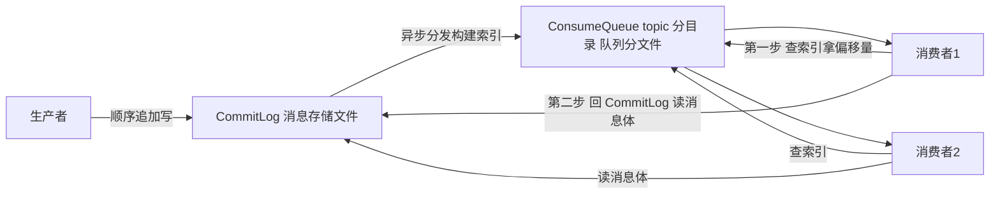

# CommitLog 顺序写加 ConsumeQueue 索引：一张图看懂 RocketMQ 的存储结构

RocketMQ 给人的印象是一对矛盾体：消息要可靠保存，可靠性意味着写文件；写磁盘又通常意味着慢。可它偏偏是出了名的快。矛盾的解释全在存储结构里：它把「写文件」这件事改造成了一种磁盘擅长的方式，再用一层索引把「读文件」的代价降到最低。这一课把这套结构拆开，用一张结构图讲透。

## 先给结论

- 速度和可靠性的平衡靠两条底层技术：零拷贝（mmap + write 方式，省去两次拷贝）和 Linux Ext4 文件系统。
- 存储由两类文件配合完成：CommitLog 存真正的消息数据，ConsumeQueue 存索引，指向消息在 CommitLog 里的物理位置。
- 所有 Topic 的消息混在一起，顺序追加写同一个 CommitLog 文件族，单文件 1 GB，写满再开下一个。
- 消费端找消息分两步：先查 ConsumeQueue 拿到偏移量，再回 CommitLog 读消息体。
- store 目录下还有 index 目录，由 IndexFile 提供按 Key 与时间维度的查询，本课只点到目录，展开部分按主流写法补充。

## 一、两个技术前提：零拷贝与顺序写

讲义在存储章节开篇给了两句定调的话：RocketMQ 中的消息存储采用了零拷贝技术，使用 mmap + write 方式；文件系统采用 Linux Ext4。零拷贝不展开，记住效果就够：它省去了数据在内核态和用户态之间的两次拷贝，读取文件的速度因此明显提升。

更关键的是写入方式。对于机械硬盘而言，写入速度天然低于读取速度，而随机写比顺序写慢得更多，两者相差几个数量级。RocketMQ 必须玩的玩法就是保证顺序写入：把所有消息拼成一条数据流，从头到尾只管往后追加。

这里要纠正一个流传很广的绝对化说法：数据保存到硬盘就一定慢，保存到内存才快。只要写入是顺序的，磁盘的写入速度同样非常可观，足以支撑消息队列的吞吐。RocketMQ 的存储设计就是把「随机写」问题消解成「顺序写」问题。

## 二、CommitLog 与 ConsumeQueue 怎么配合

生产者的消息进入 Broker 后全部落到 CommitLog；消费者要读消息时却不是直接翻这个大文件，而是先查索引。整个读写路径是下面这张图：



读图的关键在右边两步：消费者拿到一条消息的完整路径是「ConsumeQueue 查位置，CommitLog 取数据」。索引文件里存的是索引条目，指向 CommitLog 中的一条物理位置，消息体本身只在 CommitLog 一份存储。

ConsumeQueue 的组织方式与主题和队列一一对应：先按 Topic 分目录，再按队列号分文件。每个索引条目固定 20 字节，内容由三段构成：

| 字段 | 大小 | 含义 |
|---|---|---|
| CommitLog Offset | 8 字节 | 消息在 CommitLog 文件中的起始物理偏移量 |
| Size | 4 字节 | 消息的长度 |
| Message Tag HashCode | 8 字节 | 消息 Tag 的哈希值，用于服务端 Tag 过滤 |

一条索引只有 20 字节，一个队列的索引文件自然是紧凑的顺序结构，ConsumeQueue 的写入也成了顺序写。Tag 哈希放在索引里还有个妙用：消费者订阅了某个 Tag 时，Broker 先在索引层比对哈希，不匹配的消息连 CommitLog 都不用碰，过滤成本极低。

## 三、进 store 目录眼见为实

服务端运行一段时间后，登录部署机进入存储根目录，结构一目了然：

```bash
root@server:~# cd store/
root@server:store# ll
total 32
drwxr-xr-x 5 root root abort/          # 崩溃标记文件
drwxr-xr-x 2 root root checkpoint/     # 检查点
drwxr-xr-x 2 root root commitlog/      # 消息存储
drwxr-xr-x 10 root root config/        # Topic 等元数据
drwxr-xr-x 3 root root consumequeue/   # 消费索引
drwxr-xr-x 4 root root index/          # 按 Key 查询的 IndexFile
drwxr-xr-x 4 root root lock/           # 文件锁

root@server:store# cd commitlog/ && ll
-rw-r--r-- 2 root root 1073741824 Dec 18 21:42 00000000000000000000000000000000
```

commitlog 目录下的文件名是 32 位数字 `00000000000000000000000000000000`，它表示该文件在整条消息流中的起始偏移量；文件大小正好 1073741824 字节，即 1 GB，写满一个就滚动创建下一个，文件名随之变成新的偏移量。

打开这个文件会看到一片「乱码」。这不是文件坏了，而是消息体经过二进制序列化后的样子，中间偶尔能辨认出之前发送过的内容，比如 `Hello RocketMQ` 这类消息体明文，以及 `TopicTest` 等属性。能认出自己发过的消息，就足以确认这里存的就是消息数据本身。

索引目录则是另一番景象：

```bash
root@server:store# cd consumequeue/ && ll
drwxr-xr-x 7 root root haoko_order_topic/   # 每个 Topic 一个目录
drwxr-xr-x 6 root root my.topic/

root@server:store# cd consumequeue/my.topic/0/ && ll
-rw-r--r-- 2 root root 0 Dec 18 23:57 00000000000000000000000000000000
```

Topic 目录下的数字子目录就是队列编号，进入某个队列目录后又是以偏移量命名的索引文件。里面的内容是二进制索引条目，肉眼看不出含义，但每 20 字节就是一条指向 CommitLog 的定位信息。消费者按队列消费，就是在逐条读这些索引，再按索引去 CommitLog 拉数据。

## 四、IndexFile：第三类文件补全查询维度

CommitLog 按写入顺序组织，ConsumeQueue 按消费位置组织，两者都回答不了「找出某个 Key 的消息」这种查询，比如运维在控制台按消息 Key 追踪一笔订单的流转。这个职责由 index 目录下的 IndexFile 承担：它以消息的 Key 建哈希索引，支持按 Key 与时间区间定位消息，再把查询者引回 CommitLog。本课在实操中只确认了这个目录的存在，哈希槽与条目的内部结构课程未展开，此处按主流写法补充一句即可，不影响主线理解。

## 常见误区

- **把 ConsumeQueue 当成消息存储。** 它只存 20 字节的定位条目，消息体全量只在 CommitLog 一份，索引丢了还能依据 CommitLog 重建。
- **以为每个 Topic 各写各的存储文件。** 所有 Topic 混写同一个 CommitLog 文件族，正是这种设计保证了写入永远是追加式的顺序写，拆成每 Topic 一个文件就会退化为随机写。
- **以为数据落盘就必然慢。** 慢的是随机写，顺序追加写的磁盘吞吐相当可观，「落盘必然慢」这个说法过于绝对。
- **打开 commitlog 文件看到乱码以为文件损坏。** 消息体是二进制序列化数据，夹着可读的消息内容明文是正常现象。

## 面试可能被问到的问题

1. 面试官追问：「RocketMQ 存储为什么又可靠又快？」
   答：可靠性来自消息完整写入磁盘文件；速度来自两个设计，底层用 mmap + write 零拷贝省去两次内存拷贝，写入方式上把所有 Topic 的消息顺序追加到同一个 CommitLog，把随机写消解成顺序写，磁盘顺序写速度足够支撑高吞吐。

2. 面试官追问：「CommitLog 和 ConsumeQueue 是什么关系？」
   答：数据与索引的关系。CommitLog 存所有 Topic 的消息体，顺序追加；ConsumeQueue 按 Topic 分目录、按队列分文件，每条固定 20 字节，内容是 CommitLog 偏移量 8 字节、消息长度 4 字节、Tag 哈希 8 字节，指向 CommitLog 中的物理位置。

3. 面试官追问：「消费者如何定位一条消息？」
   答：两步。先读所消费队列对应的 ConsumeQueue 条目，拿到 CommitLog 偏移量与长度，再按偏移量回 CommitLog 读取完整消息体。索引条目里的 Tag 哈希还能在拉取阶段做服务端过滤，不匹配的消息不必读消息体。

4. 面试官追问：「为什么所有 Topic 混写一个 CommitLog？」
   答：为了保证写入永远是文件末尾的顺序追加。Topic 各写各的文件会产生大量随机写，机械硬盘随机写比顺序写慢几个数量级。混写之后单条消息的落盘开销与 Topic 数量无关，ConsumeQueue 再按 Topic 和队列把消费视图切分出来。

5. 面试官追问：「ConsumeQueue 条目里为什么存 Tag 哈希而不是 Tag 字符串？」
   答：条目固定 20 字节才能保证索引文件紧凑、读取高效，哈希定长 8 字节正合适。Broker 在索引层比对哈希即可完成 Tag 粗过滤，哈希理论上可能撞车，匹配后消费端还会用 Tag 字符串精确校验一次。

6. 面试官追问：「index 目录是干什么的？」
   答：IndexFile 提供按消息 Key 和时间区间查询消息的能力，弥补 CommitLog 顺序写、ConsumeQueue 按消费位置组织都无法按 Key 检索的问题，典型用途是控制台按 Key 追踪消息，查询结果最终仍引回 CommitLog 取消息体。

## 配套资料

- RocketMQ 专题讲义：`materials/docs/10/RocketMQ研究v1.0.md`（「消息发送过程」小节说明 Topic 默认自动创建 4 个写队列与 4 个读队列，对应 ConsumeQueue 按 Topic 分目录、按队列分文件的存储组织）
- RocketMQ 发行包：`materials/code/10/rocketmq-all-4.5.0-bin-release/rocketmq-all-4.5.0-bin-release/`（课程所用 4.5.0 服务端，Broker 启动后即在其存储目录生成 `commitlog`、`consumequeue`、`index` 等子目录）
- 本课（day09）资料包未提供源码：`materials/code/03/day09-分布式消息系统RocketMQ的入门/` 下仅有解压清单 `_extracted.json`，记录解压文件数为 0；文中 store 目录结构、文件名与 1 GB 文件大小按课程实操视频整理，IndexFile 内部结构按主流写法补充
