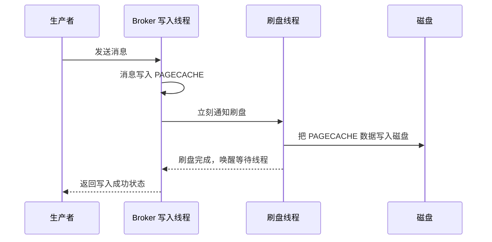
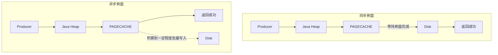

# 同步刷盘与异步刷盘：消息落地的两种方式，以及和主从复制的组合取舍

生产者拿到发送成功的返回，消息就一定安全了吗？不一定。返回成功的那一刻，消息可能已经写进磁盘，也可能只躺在内存里，差别就在 Broker 的刷盘配置。刷盘策略选错，轻则性能达不到预期，重则宕机时丢掉一批订单消息。这一课把同步刷盘、异步刷盘讲透，再把刷盘和主从复制的组合取舍一并说清。

## 先给结论

- 刷盘就是消息从内存落到磁盘的动作：生产者发送的消息写入 Broker 的 PAGECACHE（页缓存）后，需要一次「落地」才算真正持久化。
- 同步刷盘 `SYNC_FLUSH`：写入 PAGECACHE 后立刻通知刷盘线程，刷盘完成后才唤醒等待线程返回成功，收到成功响应时消息一定已在磁盘上。
- 异步刷盘 `ASYNC_FLUSH`：写入 PAGECACHE 就返回成功，等内存中的消息积累到一定程度再统一刷盘，吞吐大，宕机窗口内可能丢消息。
- 刷盘方式在 Broker 端的 `conf/broker.conf` 里用 `flushDiskType` 键配置，课程所用 4.5.0 发行包默认值就是 `ASYNC_FLUSH`。
- 生产环境的取舍要叠加主从复制维度 `brokerRole`（SYNC_MASTER 或 ASYNC_MASTER），课程在集群搭建时展开，这里按主流写法补齐四种组合的选择依据。

## 一、刷盘到底在刷什么

消息从生产者到磁盘，中间隔着两层内存。课程给的路径图是：Producer 写入 Java Heap，再写入 Memory，最后到 Disk。这里的 Memory 指操作系统的页缓存 PAGECACHE，它是内核为了加速文件读写而在内存里留的缓存层：写文件时数据先进 PAGECACHE，内核攒一批再真正写盘。

上一篇讲存储结构时提到的零拷贝（mmap + write）正好在这里接上：mmap 把文件映射进内存，写 mmap 区域本质上就是在写 PAGECACHE，所以「消息写入内存」很快。但 PAGECACHE 是内存，断电就没了，把 PAGECACHE 里的数据真正写到磁盘的动作，就是刷盘。

搞清楚这一点，两种刷盘方式的取舍就变成了一个纯粹的问题：返回成功的时间点，放在 PAGECACHE 之后，还是放在磁盘之后。

## 二、同步刷盘：ACK 到手，消息已在磁盘

同步刷盘的流程可以逐帧拆开：



消息写入内存的 PAGECACHE 之后，写入线程立刻通知刷盘线程进行刷盘，然后自己挂起等待；刷盘线程执行结束后，唤醒前面等待的线程，由它返回消息写入成功的状态。整条链走完才回 ACK，所以只要生产者收到成功响应，数据就一定保存到了磁盘上，这就是它最大的优点：最大程度保障数据不丢失。

代价同样直白：生产者的每次发送都要等整个刷盘动作完成，往返耗时里多了一整段磁盘写入时间，速度要慢一些，吞吐上不去。

## 三、异步刷盘：写内存即返回，攒一批再落地

异步刷盘把返回点提前了。生产者把消息发进 Broker，消息写入 PAGECACHE 后就直接返回成功，生产者得到快速响应；刷盘线程等内存中的消息积累到一定程度，才统一触发一次批量写入磁盘。

这样的好处是吞吐量大，写操作的返回快，Broker 的接收能力不再被磁盘速度卡住。风险也明确：返回成功时消息可能只被写入了 PAGECACHE，如果这时突然断电或进程被杀，PAGECACHE 里还没来得及落盘的那一小批消息就丢了。

把两条路径画在一张图里对比，差异一目了然：



同步刷盘这条链上 Disk 是必经之路，走完才返回；异步刷盘这条链在 PAGECACHE 处就拐弯返回了，落盘动作被推迟成虚线那一步。

## 四、配置在哪：broker.conf 的 flushDiskType

刷盘方式不是代码里设置的，而是 Broker 端的配置项。课程所用 4.5.0 发行包的 `conf/broker.conf` 里，这个键原样就在，默认值是异步刷盘：

```properties
# 引自 materials/code/10/rocketmq-all-4.5.0-bin-release/rocketmq-all-4.5.0-bin-release/conf/broker.conf
brokerClusterName = DefaultCluster
brokerName = broker-a
brokerId = 0
deleteWhen = 04
fileReservedTime = 48
brokerRole = ASYNC_MASTER      # 主从复制角色：异步复制主节点
flushDiskType = ASYNC_FLUSH    # 刷盘方式：异步刷盘
autoCreateTopicEnable=true
namesrvAddr=127.0.0.1:9876
```

`flushDiskType` 只有两个可选值：`SYNC_FLUSH` 同步刷盘、`ASYNC_FLUSH` 异步刷盘，改成同步后重启 Broker 生效。注意它是 Broker 端配置，在 Producer 或 Consumer 代码里设置无效。文件里同时出现的 `brokerRole` 是主从复制的角色配置，它与刷盘一起构成可靠性矩阵，下一节展开。

## 五、怎么选：单看刷盘，再看组合

课程在补充视频里把选择标准讲得很直白：两种方式各有优缺点，按业务场景选。

**第一，对数据可靠性要求非常高，选同步刷盘。** 宁愿牺牲一些速度换取可靠性，典型如支付、下单、扣款这类丢了就是资损的消息，每一笔都要确认落地才算数。

**第二，追求快速响应、偶尔丢几条也无所谓，选异步刷盘。** 典型如日志传输、行为埋点这类场景，丢一小段日志对业务没有实质影响，吞吐和响应速度才是第一位。

单看刷盘只有两个档位，叠加主从复制后就是完整的四种组合。Broker 主从复制指主节点把消息同步给从节点，`SYNC_MASTER` 表示主从都写成功才向生产者返回成功，`ASYNC_MASTER` 表示复制动作异步进行。四种组合的可靠性与性能如下表（课程在本课只铺垫了刷盘维度与 `brokerRole` 配置键，集群搭建在下一章展开，组合结论按主流写法补充）：

| 刷盘 | 复制 | 丢消息风险 | 性能 | 适用场景 |
|---|---|---|---|---|
| SYNC_FLUSH | SYNC_MASTER | 几乎不丢（单机整体损毁除外） | 最低 | 支付、账务等强可靠场景 |
| SYNC_FLUSH | ASYNC_MASTER | 磁盘已保证，主节点磁盘损毁时可能丢 | 中 | 可靠优先，容忍极端场景风险 |
| ASYNC_FLUSH | SYNC_MASTER | 副本齐了但主盘可能未刷，断电窗口可能丢 | 中高 | 少见的折中配置 |
| ASYNC_FLUSH | ASYNC_MASTER | 断电窗口与主从延迟都可能丢 | 最高 | 日志、埋点等吞吐优先场景 |

规律可以压缩成两句话：可靠性由「数据在几台机器上、在什么介质上」决定，磁盘（刷盘）和远端内存（复制）各挡一层风险；性能每向可靠性让一步就降一档，所以没有万金油配置，只有和业务对齐的选择。

## 常见误区

- **以为同步刷盘就绝对不会丢消息。** 它保证的是收到 ACK 时数据已写入本机磁盘，整台机器损毁、磁盘物理损坏仍可能丢，所以强可靠场景还要叠加主从复制甚至多副本。
- **以为异步刷盘天天丢数据。** 正常停机时 Broker 会把 PAGECACHE 刷干净，丢的只是断电或进程被杀那一瞬还没落盘的一小批，是窗口性风险而非常态。
- **把 `flushDiskType` 配到 Producer 或 Consumer 端。** 刷盘是 Broker 落盘行为，只认 Broker 端 `conf/broker.conf`，客户端配置里写它没有任何效果。
- **为了「更安全」把所有 Broker 都配成 SYNC_FLUSH 加 SYNC_MASTER。** 吞吐会掉一个量级，先问业务到底能接受丢什么、丢多少，再决定钱花在哪一层。

## 面试可能被问到的问题

1. 面试官追问：「同步刷盘和异步刷盘的区别是什么？」
   答：同步刷盘在消息写入 PAGECACHE 后立刻通知刷盘线程刷盘，等刷盘完成才唤醒等待线程返回成功，收到 ACK 时消息一定已在磁盘；异步刷盘写入 PAGECACHE 就返回成功，消息积累到一定程度再批量落盘，吞吐大，但宕机窗口内未落盘的消息可能丢失。

2. 面试官追问：「刷盘方式在哪个配置项里设置？」
   答：Broker 端 `conf/broker.conf` 的 `flushDiskType`，可选 `SYNC_FLUSH` 与 `ASYNC_FLUSH`，4.5.0 发行包默认 `ASYNC_FLUSH`。改完重启 Broker 生效，属于服务端行为，与客户端代码无关。

3. 面试官追问：「PAGECACHE 是什么？为什么写它快？」
   答：操作系统内核为文件读写保留的内存缓存层，写文件先写缓存由内核异步落盘。Broker 收到消息写入 PAGECACHE 是纯内存操作，速度接近内存写，异步刷盘正是利用这一点换吞吐，同步刷盘则要等这一层真正落盘。

4. 面试官追问：「消息可靠性和主从复制怎么配合刷盘做取舍？」
   答：刷盘管数据在本机磁盘上是否落地，主从复制管数据是否在另一台机器上有副本。`SYNC_FLUSH` 加 `SYNC_MASTER` 几乎不丢但性能最低，`ASYNC_FLUSH` 加 `ASYNC_MASTER` 性能最高但断电窗口和复制延迟都可能丢，中间两种按业务对极端场景的容忍度选择。

5. 面试官追问：「日志采集类消息你们怎么配置？」
   答：吞吐优先，`ASYNC_FLUSH` 加 `ASYNC_MASTER`。日志丢一小段可接受，不值得为它付出同步刷盘的延迟；同时做好监控，如果某类日志其实影响业务，再单独为其拆 Topic 换可靠性更高的配置。

6. 面试官追问：「生产者怎么感知 Broker 的刷盘策略？」
   答：感知不到也不需要感知。刷盘是 Broker 端行为，生产者只按发送方式（同步发送、异步发送）等待响应；同步发送配合同步刷盘是最强可靠的组合，发送侧想提升吞吐应改用异步发送或批量发送，而不是假设服务端配置。

## 配套资料

- RocketMQ 发行包：`materials/code/10/rocketmq-all-4.5.0-bin-release/rocketmq-all-4.5.0-bin-release/conf/broker.conf`（真实配置文件，`flushDiskType = ASYNC_FLUSH` 与 `brokerRole = ASYNC_MASTER` 两键原文引用于正文第四节，另含 `deleteWhen`、`fileReservedTime` 等磁盘清理配置）
- RocketMQ 专题讲义：`materials/docs/10/RocketMQ研究v1.0.md`（服务端安装与 Broker 启动章节对应本课 broker.conf 的使用背景）
- 本课（day09）资料包未提供源码：`materials/code/03/day09-分布式消息系统RocketMQ的入门/` 下仅有解压清单 `_extracted.json`，记录解压文件数为 0；同步刷盘与异步刷盘的流程按课程 PPT 图示整理，主从复制的 `brokerRole` 四种组合取舍按主流写法补充（课程在集群搭建章节再展开）
