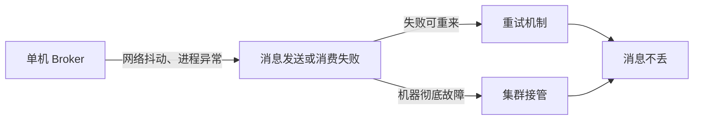

# RocketMQ 从工具变成地基：day10 把重试、集群与地图找房一次补齐

day09 收尾时，RocketMQ 已经装好、能发能收，但离「放心用」还差两层：消息发出去没等到应答怎么办、消费时抛了异常怎么办，都还没有答案；Broker 也只有一台，挂了消息系统就整体下线。另一头，day08 收尾留下的那笔债还没还：分布式 WebSocket 只有一个「用消息系统解决」的口头方案。day10 的五件事，正好把这两条线一起收掉。

课程导览页列出的五项是：RocketMQ 的错误消息重试策略、RocketMQ 的集群搭建、Spring Boot 整合 RocketMQ、实现分布式的 WebSocket、实现地图找房功能。前三项是给 RocketMQ 补课，后两项是往项目里落功能，一天之内从中间件原理走到业务特性，节奏相当满。

## 先给结论

- day10 五件事是一条因果链：重试解决「失败了怎么办」，集群解决「机器挂了怎么办」，Spring Boot 整合解决「写起来太啰嗦怎么办」，WebSocket 与地图找房是前面所有铺垫的业务出口。
- 重试与集群是一对搭档：重试对付软件层面的偶发失败，集群对付机器层面的彻底故障，只学重试不学集群，消息会在重试一个已经死掉的 Broker。
- Spring Boot 整合是写法升级：`DefaultMQProducer` 那套样板代码被 `RocketMQTemplate` 与注解收编，目的就是简化开发。
- 分布式 WebSocket 是 day08 方案的兑现：进程内的会话登记表出不了 JVM，用 RocketMQ 广播让各节点自查登记表。
- 地图找房是本日的项目特色功能：结合百度地图，按区域展示该区域的房源数量，day10 资料包里唯一的文件就是为它准备的。

## 一、前两站：把消息的可靠性补齐

day09 学完了发送、消费、存储，但所有演示都建立在「一切顺利」的前提上。真实网络不是这样：生产者可能连不上 Broker，连上了也可能等不到应答；消费者可能拿到消息就抛异常，也可能干脆没有任何反馈。错误消息重试策略这一站，就是回答每一种失败之后消息的去向。

重试要真正兜得住，离不开紧随其后的集群搭建。把这两站连起来看：



这张图的关键在于两条出路各管一段：偶发失败交给重试，机器故障交给集群。RocketMQ 天生就是分布式架构，官方发行包的 `conf` 目录下直接躺着 `2m-2s-async`、`2m-2s-sync`、`2m-noslave` 等一组成套配置样例，两主两从、同步复制、异步复制都有现成模板，说它的集群模式非常丰富并不夸张。具体怎么搭，本日的集群两讲展开。

## 二、第三站：Spring Boot 整合，把样板代码收编

手写原生客户端的日子是这样的：`new DefaultMQProducer`、`setNamesrvAddr`、`start`、构造 `Message`、`send`、最后 `shutdown`，收发各写一遍，全是不变的仪式。Spring 最擅长的就是整合第三方框架，把这套仪式吃进框架里。

整合之后，发送端注入一个 `RocketMQTemplate` 就够了：

```java
// 注入 RocketMQTemplate 后，一行完成同步发送
rocketMQTemplate.syncSend("haoke_im_topic", "用户A发送消息给用户B");
```

消费端更彻底，一个注解加一个接口方法，订阅、监听器注册、应答全部由框架代劳。这一站学完，后面的分布式 WebSocket 代码才能写得清爽，否则业务逻辑会被样板淹没。

## 三、第四站：分布式 WebSocket，还 day08 的债

day08 实现微聊系统时，所有在线用户的 `WebSocketSession` 都挂在一张进程内的登记表上：

```java
// day08 的单机做法：每个 JVM 各有一份，互相看不见
private static final Map<Long, WebSocketSession> SESSIONS = new HashMap<>();
```

当时的结论是：服务一旦部署多个实例，A 发给 B 的消息可能落在没有 B 连接的节点上，因为这张 Map 出不了 JVM，跨实例查询根本做不到。提出来的方案是借助消息系统做广播，而 day09 与 day10 前半程学的一切，恰好凑齐了实现条件：消息能可靠送达，靠重试；消息系统本身不宕机，靠集群；代码写起来不啰嗦，靠 Spring Boot 整合。

于是在 day10 的实现环节，发消息的节点不再关心 B 到底连在哪个实例上，只管把消息投进 Topic，所有实例订阅同一主题，收到后各查各的登记表，有 B 就推送，没有就忽略。这正是 day08 画过的那张方案图的落地版。

## 四、第五站：地图找房，把房源铺到地图上

最后一站是本项目比较有特色的功能：结合百度地图，在地图的各个区域上直接标出该区域有多少套房源，用户一眼就能看出哪里房源密集。实现路径是前端用地图组件渲染覆盖物，后端按区域聚合房源数量，数据来自 MongoDB 的地理位置索引。

一个佐证细节：day10 资料包里唯一随包分发的文件就是 `textIconOverlay.js`，它是百度地图 API 的一个覆盖物库，负责在地图上渲染「文字加图标」的组合标注，区域房源数量的角标正是靠它画出来的。资料包虽薄，用途却很精准。

## 常见误区

- **以为 day10 还是纯中间件课。** 前三讲确实在补 RocketMQ 的课，但重试与集群学完立刻被用于 WebSocket 分布式方案，学习时带着「这个知识点往哪个功能落」的问题去听，效率高得多。
- **以为重试能替代集群。** 重试重发的对象还是那台 Broker，机器真的宕机了，重试只是在反复撞墙，必须靠集群把流量切到存活的节点上。
- **以为整合 RocketMQ 之后原生客户端就没用了。** `RocketMQTemplate` 封装的正是原生 API，遇到模板没有覆盖的能力（比如发送进度、底层参数微调），还是要回到原生写法，两者是皮与骨的关系。
- **低估地图找房的实现成本。** 它看起来只是「在地图上摆数字」，背后要打通区域聚合查询、地理位置索引与前端覆盖物渲染三层，是本日代码量最大的一站。

## 面试可能被问到的问题

1. 面试官追问：「重试机制和集群高可用是什么关系？」
   答：重试解决的是单次调用失败的偶发问题，比如网络抖动，重发一次大概率就成功；集群解决的是节点级故障，Broker 宕机后路由切换到从节点或其他主节点。两者配合才能保证消息不丢，单靠任何一个都有盲区。

2. 面试官追问：「为什么要用 Spring Boot 整合 RocketMQ，直接用原生客户端不行吗？」
   答：原生客户端需要手工管理生产者实例、启动关闭、订阅与监听器注册，样板代码多且容易漏。Spring Boot 整合后由容器管理生命周期，`RocketMQTemplate` 与 `@RocketMQMessageListener` 把收发简化成一行调用与一个注解，配置也统一进了 `application.yml`。

3. 面试官追问：「单机版 WebSocket 在多实例部署下为什么失效？」
   答：会话对象保存在进程内的静态 Map 里，JVM 之间互相隔离。用户 A 与用户 B 分别连在两个实例上时，A 所在实例的 Map 里没有 B 的会话，消息推不出去。解法是通过消息队列广播聊天消息，各实例收到后自查本地会话表。

4. 面试官追问：「地图找房里按区域统计房源数量，数据层怎么做？」
   答：房源表里存经纬度，MongoDB 建地理位置索引后，可以按区域做聚合查询拿到每片区域的房源数量；前端用地图组件把这些数量渲染成区域覆盖物，点击区域再进入房源列表。数量统计放服务端，地图只负责展示。

## 配套资料

- RocketMQ 专题讲义：`materials/docs/10/RocketMQ研究v1.0.md`（MQ 应用场景、组成结构、安装与快速入门、消息发送方式与消费重试的成文结论都在其中）
- RocketMQ 官方发行包：`materials/code/10/rocketmq-all-4.5.0-bin-release/rocketmq-all-4.5.0-bin-release/`（`conf/2m-2s-async`、`conf/2m-2s-sync`、`conf/2m-noslave` 等集群配置样例即集群搭建两讲的素材来源）
- 本日资料包：`materials/code/03/day10-RocketMQ集群、分布式WebSocket实现以及地图找房功能实现/`（仅含 `资料/textIconOverlay.js`，为地图找房的前端覆盖物准备；其余内容资料包无源码，文中代码示例按本课写法补全）
