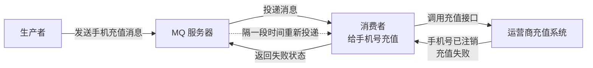
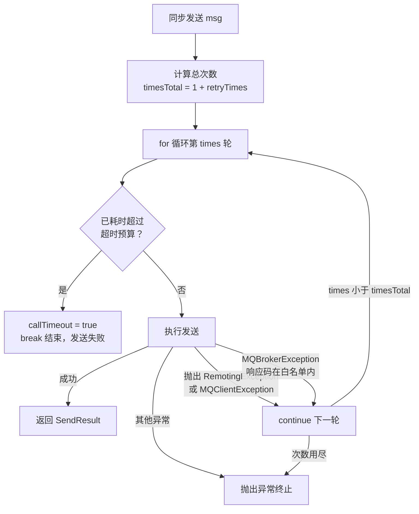
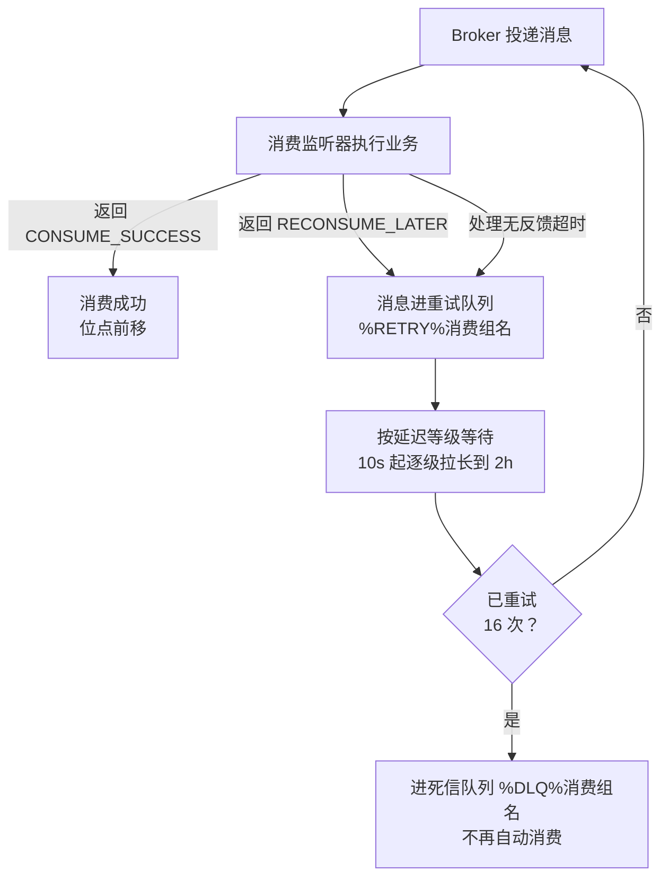

# RocketMQ 错误消息重试策略之全景：Producer 重发与 Consumer 重投到死信

## 先给结论

- 失败点四类：生产者发不出去、发出去了没等到 ACK、消费者处理抛异常、消费端无反馈超时；两条重试线 RocketMQ 都内置了，业务代码不需要自己实现重试框架。
- 生产者重试只对同步发送生效：`setRetryTimesWhenSendFailed` 设次数，源码总次数是 `1 + retryTimes`，设 3 是最多 4 次发送机会；超时预算从首发开始累计，设太小会架空重试。
- 不是所有异常都会重试：远程调用异常、客户端异常与部分 Broker 响应码才 `continue` 再试，其余直接抛出；重试可能造成重复消息，保证不丢优先，幂等交给消费端。
- 消费端重试的开关是监听器返回值：`CONSUME_SUCCESS` 终止、`RECONSUME_LATER` 开启；重投的是重新存储的新消息，`offsetMsgId` 每次都变，串联排查靠原消息的 `msgId` 属性。
- 重试间隔按延迟等级逐级拉长，首次等 10 秒，一直拉到最长 2 小时，默认最多 16 次，用尽后进死信队列 `%DLQ%消费组名`，不再被自动消费。
- 业务要自己设重试上限：`getReconsumeTimes()` 达到阈值就返回成功并落库转人工，这个返回成功只是退出重试循环，不代表业务办成，后续补偿动作必须自己接上。
- 立刻重试大概率撞上同一个故障，延迟重投给故障留自愈时间；死信队列要当作线上告警的必备项，不设监控的话业务静默丢数据都没人知道。

## 第1部分：RocketMQ错误消息重试策略之重试情况的分析

消息队列的收发链路全程走网络，而网络从不承诺一切顺利。生产者可能连不上 Broker，连上了也可能等不到应答；消费者可能拿到消息就抛异常，也可能根本没有反馈。任何一处失败，如果没有约定的补救动作，丢的就是业务数据。这一篇把「哪些情况会触发重试、重试由谁来做、重试到头了怎么办」一次分析清楚，后面两篇再分别进入生产者与消费者的实现细节。

### 一、生产者这一头：发出去不等于送达
生产者的职责是把消息写进 Broker，而这一步隔着网络。网络不稳定、带宽饱和、Broker 本身抖动，任何一种都可能让发送卡壳。失败会以两种面貌出现：

**第一种，连接都建立不起来。** 消息还留在生产者手里，Broker 压根不知道有这回事，这种失败最直白，重发一次就是全部的补救。

**第二种，消息发出去了，应答没回来。** Broker 与生产者之间靠 ACK 机制确认：消息收到后，服务端要给生产者一个响应。响应在网络里同样可能丢，生产者等到超时也没见着 ACK，只能认定发送失败。此时它该做什么？把这条消息重新发送一遍。不重发的后果很实际：这条消息可能已经写进 Broker，也可能根本没写进去，生产者不重发，业务侧就真的丢了。

重发这个动作由谁来做？如果使用的消息系统没有内置重试，就只能业务代码自己实现：发一次失败，循环再发，还要控制次数与间隔，写的人头疼，写完还要测。RocketMQ 把这套机制内置在客户端里，配置一个重试次数即可，这一篇之后的生产者重试一讲会进源码看它的实现。

### 二、消费者这一头：拿到消息不等于办成事
消费者端的失败场景更多。拉取消息本身可能因为网络原因失败，消息没拿到；更值得注意的是另一种：消息拿到了，处理的时候出了岔子。课程里给了一个非常好懂的例子，手机充值：



按这条链路走一遍：消费者收到充值消息，调用运营商的充值系统给手机号充值，返回结果是充值失败，手机号已经注销、停机或者被拉黑，总之这个号充不进钱。消息处理失败了，消费者手里的应对就是重试。但这里有一个关键的分寸：重试不是立刻进行。马上重试一次，运营商大概率还是返回同一个结果，号不会在一秒钟内复活。合理的做法是隔一段时间再试，给故障一个自愈的时间窗。

抛异常之外，反序列化失败、业务规则校验不过，都属于同一类：消息在消费者手里，处理不下去，需要重试。RocketMQ 对这类失败的处理方式是让消费监听器返回一个失败状态，Broker 收到失败状态后负责把消息重新投递，重试的调度权在服务端，消费端只需要如实汇报成功还是失败。

### 三、消费状态的开关：两个枚举值
消费端汇报失败的方式，落在一枚举上。监听器的返回值类型是 `ConsumeConcurrentlyStatus`，只有两个取值，源码注释写得明明白白：

```java
public enum ConsumeConcurrentlyStatus {
    /**
     * Success consumption
     */
    CONSUME_SUCCESS,
    /**
     * Failure consumption, later try to consume
     */
    RECONSUME_LATER;
}
```

`CONSUME_SUCCESS` 表示消费成功，Broker 推进消费位点，这条消息从此两清；`RECONSUME_LATER` 的注释直译过来就是「稍后再试消费」，返回它等于告诉 Broker 这条消息我没办好，晚点再来。消费重试的整套机制就挂在这一个返回值上，它也是后面 Consumer 重试实战的主角。

### 四、重试与死信的关系总览
把前面所有场景收进一张总图，失败从哪里发生、由谁重试、终点在哪一目了然：

| 失败场景 | 失败的表现 | 重试的执行者 | 重试的终点 |
|---|---|---|---|
| 生产者连不上 Broker | 发送抛出连接类异常 | 客户端重发 | 同步发送最多重试配置次数 |
| 发出消息没等到 ACK | 超时异常，不确定是否已入库 | 客户端重发 | 同上，可能产生重复消息 |
| 消费处理抛异常 | 业务异常或反序列化失败 | Broker 重新投递 | 默认 16 次后进死信队列 |
| 消费过程无反馈超时 | 服务端既收不到成功也收不到失败 | Broker 反复重投 | 送达为止，无需消费端干预 |

两条重试线共享同一个原则：重试不是无限的。生产端的次数由配置项控制，重试到上限后由业务决定补偿策略；消费端默认重试 16 次，间隔逐级拉长，到头还失败就投进死信队列。死信队列的名字里带个「死」字，意思是自动消费到此为止，这些消息要在控制台里人工检索、排查原因，或者由单独的补偿程序接手处理。

另外要认清一件事：重试解决的是「不丢」，不是「不重」。发出去了但没等到 ACK 的消息，重发后 Broker 里可能存两份；消费重试期间，同一条消息也可能被投递多次。消费端必须按幂等来设计，这一点在 day09 的重复消息一课已经专门处理过。
## 第2部分：RocketMQ错误消息重试策略之Producer的重试机制

发送失败这种事，出了问题才有感觉，平时怎么测都测不出来：网络好好的、Broker 好好的，重试机制永远不会被触发。所以这一课的打法很聪明，先给配置，再直接进客户端源码，把重试到底怎么触发、什么情况下不触发读清楚。读完源码你会发现，生产者的重试就是 `send` 方法里的一个 for 循环，外加几个精心挑选的异常分支。

### 一、两个配置项，把重试开关打开
课程在 `error` 包下改造了之前写过的同步发送代码，改动只有两行，先看完整写法：

```java
package com.example.rocketmq.error;

import org.apache.rocketmq.client.producer.DefaultMQProducer;
import org.apache.rocketmq.client.producer.SendResult;
import org.apache.rocketmq.common.message.Message;
import org.apache.rocketmq.remoting.common.RemotingHelper;

public class SyncProducer {

    public static void main(String[] args) throws Exception {
        DefaultMQProducer producer = new DefaultMQProducer("HAOKE_IM");
        producer.setNamesrvAddr("172.16.55.185:9876");
        // 消息发送失败时，重试 3 次
        producer.setRetryTimesWhenSendFailed(3);
        producer.start();
        String msgStr = "用户A发送消息给用户B";
        Message msg = new Message("haoke_im_topic", "SEND_MSG",
                msgStr.getBytes(RemotingHelper.DEFAULT_CHARSET));
        // 发送消息，并指定超时时间为 1000 毫秒
        SendResult sendResult = producer.send(msg, 1000);
        System.out.println("消息状态：" + sendResult.getSendStatus());
        System.out.println("消息id：" + sendResult.getMsgId());
        System.out.println("消息queue：" + sendResult.getMessageQueue());
        System.out.println("消息offset：" + sendResult.getQueueOffset());
        producer.shutdown();
    }
}
```

**第一件事，`setRetryTimesWhenSendFailed(3)`。** 这行代码的注释写着「重试 3 次」，注意别读成「总共发 3 次」，源码的公式是 `1 + retryTimes`，首发永远单独算一次，设 3 次重试意味着这条消息最多有 4 次发送机会。不设的话默认值是 2，也就是默认最多发 3 次。

**第二件事，`producer.send(msg, 1000)`。** 发送时指定 1000 毫秒超时。重试发生在「发送失败之后」，而失败与否的判定依赖超时时间，等不到应答到了期限才算失败，所以这两个配置必须成对出现。`send` 不带超时参数时走默认值 3000 毫秒。

直接运行这段代码，控制台抛出一个超时异常，`Process finished with exit code -1`。这正是重试效果难演示的地方：想让重试真实发生，得精确制造「第一次失败、第二次成功」的现场，门槛很高，所以课程选择进源码看它的生效逻辑。

### 二、数次数：一个三目运算符定下重试资格
进入 `send(msg, timeout)` 会一路走到 `sendDefaultImpl` 方法，第一段关键代码就是给重试定资格：

```java
// 只有同步模式才把重试次数算进总发送次数
int timesTotal = communicationMode == CommunicationMode.SYNC
        ? 1 + this.defaultMQProducer.getRetryTimesWhenSendFailed() : 1;
```

同步模式下总次数是 `1 + 重试次数`，其他模式一律是 1。这一个三目运算符就把适用范围说死了：**这套重试机制只保护同步发送。** 异步发送的结果走回调，单向发送根本不等结果，它们在这条发送主流程里都只有一次机会，失败了由回调里的 `onException` 或业务补偿去兜底。

### 三、看循环：重试就是 for 循环里的 continue
紧跟着的总发送循环，就是重试的本体：

```java
for (int times = 0; times < timesTotal; times++) {
    String lastBrokerName = null;
    if (mqSelected != null) {
        mq = mqSelected;
        lastBrokerName = mq.getBrokerName();
    }
    try {
        beginTimestampPrev = System.currentTimeMillis();
        // 本次发送前先核对超时预算
        long costTime = beginTimestampPrev - beginTimestampFirst;
        if (timeout < costTime) {
            callTimeout = true;
            break;
        }
        // ... 真正的发送动作，捕获异常后决定 continue 还是抛出
    } catch (RemotingException e) {
        // 远程调用异常：清空选择结果，continue 进入下一轮重试
        continue;
    } catch (MQClientException e) {
        // 客户端异常：同样 continue 重试
        continue;
    } catch (MQBrokerException e) {
        // Broker 返回特定响应码才重试
        switch (e.getResponseCode()) {
            case ResponseCode.TOPIC_NOT_EXIST:
            case ResponseCode.SERVICE_NOT_AVAILABLE:
            case ResponseCode.SYSTEM_ERROR:
            case ResponseCode.NO_PERMISSION:
            case ResponseCode.NO_BUYER_ID:
            case ResponseCode.NOT_IN_CURRENT_UNIT:
                continue;
            default:
                if (sendResult != null) {
                    return sendResult;
                }
                throw e;
        }
    } catch (InterruptedException e) {
        throw e;
    }
}
```

把这段循环读薄，就是三句话：

**第一，能 `continue` 的才有资格重试。** `RemotingException` 与 `MQClientException` 这两类网络与客户端侧的异常，捕获后直接进入下一轮循环，这就是重试的关键落点。`MQBrokerException` 走的是响应码白名单：主题不存在、服务不可用、系统错误、无权限等六种 Broker 明确告知的失败，同样 `continue` 再试。

**第二，不在白名单里的异常直接终止。** `default` 分支里要么把已经拿到的结果返回，要么把异常抛出去，`InterruptedException` 也是直接抛出。换句话说，重试只认它认识的失败，中断这类异常意味着调用方已经不想等了，再试反倒是错的。

**第三，循环之前先核对超时预算。** 每一轮发送前算一次 `costTime`，从首轮开始到现在的耗时一旦超过超时时间，就置 `callTimeout` 并 `break`。跳出了循环，后面的重试次数再也没机会用，直接以失败收场。这也是为什么超时时间设得太小时，配置了重试也形同虚设：第一次发送就把预算花光了。

整条判定链路画出来是这样：



图中两条退出失败的路值得记住：异常白名单外直接抛出，以及超时预算耗尽后 `break`。重试机制保护的是「值得再试」的失败，而不是所有失败。

### 四、为什么这个效果不好演示
课程现场跑了一次，直接抛超时异常收场，然后转向源码分析，原因有两个。其一，制造「第一次失败、第二次成功」需要精准控制网络，比如起两个 Broker 再掐掉一个，演示成本高；其二，就算第一次真的失败，超时预算 1000 毫秒很容易在重试前就被耗尽，`break` 之后看到的还是失败，和没配重试看不出差别。

但结论是确定的：只要设置好重试次数与超时时间这两个点，同步消息就具备了「失败后再来几次」的能力，这个能力平时看不见，故障时刻就是它站出来兜底的时刻。
## 第3部分：RocketMQ错误消息重试策略之Consumer的重试机制(Exception情况)

消费者端的失败和生产者端不一样：生产者失败发生在「送」的路上，消费者失败发生在「办」的过程中，而且办不成还有两种完全不同的形态。一种是处理时抛了异常，比如给手机号充值时发现号码已注销；另一种是干脆没有任何反馈，网络把应答吞了，服务端既没等到成功也没等到失败。这两种形态对应的重试机制差别很大，一种要消费端配合，另一种消费端什么都不用做。这一篇把异常触发重试的完整链路实测一遍，再讲清楚重试队列、16 次节奏与死信队列的关系。

### 一、两种失败形态，一个状态开关
消费重试的两种场景在讲义里划分得很清楚：一是消息没有被消费者接收，比如消费者与 Broker 之间存在网络异常，这种情况消息会被一直重试投递；二是消息已经被消费者接收，处理时出现异常，消费端无法向 Broker 返回成功，这种情况下 RocketMQ 会不断重试。前者就是超时形态，后者就是异常形态。

异常形态下，消费端有一个必须配合的动作：如实汇报。监听器的返回值 `ConsumeConcurrentlyStatus` 只有两个取值，返回 `CONSUME_SUCCESS` 表示成功，Broker 推进消费位点；返回 `RECONSUME_LATER` 表示失败，注释原话是「稍后再试消费」。Broker 收到失败状态后，把消息重新组织、延迟投递，重试的调度全部在服务端完成。消费端的责任边界就一句话：办成了说成功，没办成说失败，其余交给机制。

### 二、Exception 情况实测：看着一条消息变成四条
课程在 `error` 包下新建了 `ConsumerDemo`，骨架与之前的消费者一致，改动集中在监听器里：

```java
package com.example.rocketmq.error;

import org.apache.rocketmq.client.consumer.DefaultMQPushConsumer;
import org.apache.rocketmq.client.consumer.listener.ConsumeConcurrentlyContext;
import org.apache.rocketmq.client.consumer.listener.ConsumeConcurrentlyStatus;
import org.apache.rocketmq.client.consumer.listener.MessageListenerConcurrently;
import org.apache.rocketmq.common.message.MessageExt;

import java.util.List;

public class ConsumerDemo {

    public static void main(String[] args) throws Exception {
        DefaultMQPushConsumer consumer = new DefaultMQPushConsumer("haoke-im-consumer");
        consumer.setNamesrvAddr("172.16.55.185:9876");
        consumer.subscribe("haoke_im_topic", "*");
        consumer.registerMessageListener(new MessageListenerConcurrently() {
            @Override
            public ConsumeConcurrentlyStatus consumeMessage(List<MessageExt> msgs,
                    ConsumeConcurrentlyContext context) {
                System.out.println("收到消息->" + msgs);
                // 重试 3 次后不再重试，返回成功让 Broker 推进位点
                if (msgs.get(0).getReconsumeTimes() >= 3) {
                    return ConsumeConcurrentlyStatus.CONSUME_SUCCESS;
                }
                // 否则返回失败，触发重试
                return ConsumeConcurrentlyStatus.RECONSUME_LATER;
            }
        });
        consumer.start();
        System.out.println("Consumer started.");
    }
}
```

这里人为制造了一个「永远办不成」的业务：不管消息内容是什么，只要重试次数不到 3 就返回失败。测试时先启动消费者，再用之前写好的 `SyncProducer` 把 Topic 改成 `haoke_im_topic` 发一条消息，然后观察消费者端的输出。整个过程被拉长到一分多钟，四次到达依次是：

| 到达次序 | 间隔 | `reconsumeTimes` | 监听器返回 |
|---|---|---|---|
| 第 1 次 | 发送后立即 | 0 | `RECONSUME_LATER`，失败 |
| 第 2 次 | 约 10 秒后 | 1 | `RECONSUME_LATER`，失败 |
| 第 3 次 | 约 30 秒后 | 2 | `RECONSUME_LATER`，失败 |
| 第 4 次 | 约 1 分钟后 | 3 | `CONSUME_SUCCESS`，成功 |

`reconsumeTimes` 从 0 起步，每重试一次加 1，第四次到达时值变成 3，命中 `>= 3` 的判断，返回成功，Broker 推进位点，这条消息的重试就此终止。间隔越来越长，正是重试按延迟等级逐级拉长的直接体现，下一节展开。

### 三、消息 ID 每次都变：重试队列里躺着的是新消息
实测里有个容易让人心里一紧的细节：把四次到达的消息 ID 摆在一起看，第 1 条的 `offsetMsgId` 尾号与生产者发出的那条完全一致，第 2、3、4 条的 ID 却全都不一样。难道 Broker 重投的是不同的消息？

答案是：**内容相同，但每次重试都是一条新的物理消息。** 返回失败状态后，Broker 会把这条消息重新存储一份、送进重试队列，主题名为 `%RETRY%消费组名`，并给它打上延迟等级，到期后再投递给消费组。重新存储意味着它在 CommitLog 里有了一个新的位点，`offsetMsgId` 就是存储位点的 ID，自然每次都不同。原消息的业务 ID 会作为属性一路带着走，内容本身一个字节都没变。排查重试问题时，拿最初的 `msgId` 去控制台检索，就能把整条重试链串起来。

这个细节也解释了重试队列为什么独立成主题：重试消息和正常消息走同一套存储与投递机制，靠独立主题隔离，消费组对它的订阅与应答和普通消息完全一致，机制上不需要任何特殊通道。

### 四、16 次的节奏与死信队列
重试间隔不是拍脑袋定的，它复用了延迟消息的等级刻度。Broker 启动日志里能看到这串默认配置：

```text
messageDelayLevel=1s 5s 10s 30s 1m 2m 3m 4m 5m 6m 7m 8m 9m 10m 20m 30m 1h 2h
```

18 个等级从 1 秒排到 2 小时。讲义给定的规则是：消费重试从第 3 级开始，也就是首次重试等 10 秒，之后再失败等级加 1，等 30 秒、1 分钟、2 分钟，如此递增，最多重试 16 次。等级表里的前两级 1 秒与 5 秒属于延迟消息的地盘，不参与消费重试。这套节奏是内置的，间隔本身没有配置项可调，能调的是重试的次数上限。

重试 16 次仍不成功，消息就被投进死信队列，主题名是 `%DLQ%` 加消费组名。到了死信的消息不再被任何消费者自动接收，自动消费的旅程到此为止，剩下的路只有两条：人工在控制台检索排查，或者写单独的补偿程序按业务逻辑重新处理。生产上不会真的放消息跑满 16 次，讲义给的建议是重试一定次数后就把消息写入数据库，由另外的程序或人工跟进，课程实测里 `>= 3` 返回成功就是这个思路的最简版：达到阈值就放行，让它退出重试循环，处理动作转由别的流程接手。

整条链路收进一张图：



图里最要紧的分叉是右下角那一个：重试次数用尽之前，消息永远在「等待、重投、失败、再等待」里循环；用尽之后直接出圈，进死信等待人工裁决。

### 五、timeout 情况：消费端什么都不用做
超时形态的定义很干脆：服务端向消费者投递消息后，既没收到成功反馈，也没收到失败反馈，什么都没有，这就被定义为超时。对比异常形态，异常时服务端至少拿到了一个明确的「失败」；超时时连失败都没有，服务端不知道消费者是没收到、收到了没处理完，还是进程已经没了。

这种情况消费者端不需要做任何事，事实上也做不了什么，消息压根没到达。重试的动作由 RocketMQ 内部逻辑承担：不断尝试重新投递，直到消息成功送达消费者为止。所以超时形态反而比异常形态简单，异常形态要消费端返回状态、必要时控制次数，超时形态只需要等，等 Broker 把消息重新送上门。

两种形态合在一起，消费重试的全貌就完整了：异常形态靠返回值驱动，超时形态靠无反馈触发，最终都汇入同一条重试队列、共用同一套延迟等级，跑满 16 次殊途同归进死信队列。
## 常见误区

- **消费失败后立刻原地重试。** 刚刚失败的故障不会在一瞬间消失，立刻重试只是白打一次下游。要么依赖 Broker 的延迟重投，要么自己在业务里设置退避间隔。
- **在监听器里把异常吞掉却返回成功。** `catch` 住异常后照样返回 `CONSUME_SUCCESS`，Broker 视为消费成功并推进位点，这条失败的消息就永远跳过了。处理失败就返回 `RECONSUME_LATER`，把重试交给机制而不是运气。
- **以为重试可以无限进行。** 消费端默认 16 次后就进死信队列，死信里的消息不会再被自动消费，不设监控的话，业务静默丢数据都没人知道。死信队列要当作线上告警的必备项。
- **把重试当成了可靠性的全部。** 重试只能救活偶发失败，Broker 宕机、磁盘损坏这类故障要靠集群解决，重试与集群缺一不可。
- **把 `setRetryTimesWhenSendFailed(3)` 读成「最多发 3 次」。** 源码公式是 `1 + retryTimes`，首发单独算，设 3 是最多 4 次发送机会；默认值 2 对应最多 3 次。
- **以为异步发送也有这个重试。** 总次数的三目运算只认同步模式，异步与单向恒为 1 次。异步失败的兜底是 `SendCallback` 的 `onException` 回调，由业务自己决定要不要补发。
- **以为所有异常都会重试。** 只有远程调用异常、客户端异常与 Broker 响应码白名单内的失败会 `continue`，中断等异常直接抛出。把「重试」理解成「万能的自动恢复」会耽误排障。
- **超时时间随手设得特别小。** 超时预算从首次发送开始累计，设 100 毫秒可能一轮都没发完就 `break` 了，重试次数配得再大也用不上。超时时间要给「最坏情况下几轮发送」留出余量。
- **以为重投的是原来那条消息。** 每次重试都是重新存储的新消息，`offsetMsgId` 每次都变；串联排查要靠原消息的 `msgId` 属性，别在控制台里按重试消息的 `offsetMsgId` 去找上一轮。
- **以为重试间隔可以随意配置。** 间隔复用延迟等级表，从第 3 级 10 秒起步逐级拉长到 2 小时，是内置节奏；能控制的是 `reconsumeTimes` 阈值，业务侧达到阈值就落库转人工，不必等满 16 次。
- **把返回成功当成「处理成功」。** 课程里 `>= 3` 后返回 `CONSUME_SUCCESS`，只是让消息退出重试循环，业务其实没办成，后续补偿动作（落库、告警、人工跟进）必须自己接上，否则消息是「成功」的，业务是丢的。
- **混淆异常与超时两种形态的处理责任。** 异常形态消费端要如实返回失败状态，超时形态消费端无事可做，服务端会一直重投。在超时场景里瞎加重试代码没有意义，等就是正确姿势。

## 面试可能被问到的问题

1. 面试官追问：「消息发送失败有哪些情况，分别怎么处理？」
   答：一类是连接失败，消息没发出去，客户端重发即可；一类是发出去了但没等到 ACK，超时后客户端重发，风险是 Broker 可能已入库，重发会造成重复消息，消费端要幂等。RocketMQ 的同步发送内置了这两种场景的重试。

2. 面试官追问：「生产者重试和消费者重试有什么本质区别？」
   答：生产者重试是客户端自己重发，重试逻辑跑在发送方进程里；消费者重试是 Broker 重新投递，消费端只通过返回状态汇报成败，重试的调度、间隔、次数上限都由服务端管理。控制权一在客户端一在服务端，这是两者最根本的区别。

3. 面试官追问：「`retryTimesWhenSendFailed` 设成 3，消息会被发送几次？」
   答：最多 4 次。这个参数控制的是重试次数，源码里总发送次数是 `1 + retryTimes`，首发不算重试。参数默认值是 2，所以默认最多发 3 次。

4. 面试官追问：「生产者重试对异步发送生效吗？」
   答：不生效。`sendDefaultImpl` 里总次数的计算是同步模式取 `1 + retryTimes`、其他模式取 1，异步与单向在这条主流程里只有一次机会。异步发送失败通过 `SendCallback` 的 `onException` 回调暴露给业务，由业务决定补偿策略。

5. 面试官追问：「发送过程中抛了异常，RocketMQ 会怎么决定是否重试？」
   答：客户端循环发送，捕获 `RemotingException` 与 `MQClientException` 后 `continue` 进入下一轮；`MQBrokerException` 按响应码白名单判断，主题不存在、服务不可用、系统错误等才重试，其余异常直接抛出终止。设计思路是只对「再试有意义」的失败重试。

6. 面试官追问：「重试期间超时时间是怎么参与计算的？」
   答：超时预算从第一次发送开始累计，每一轮发送前核对已耗时，一旦超过指定的超时时间就置 `callTimeout` 并跳出循环，剩余的重试机会作废。所以超时时间与重试次数要配套设置，超时太小会架空重试。

7. 面试官追问：「发送失败但不确定消息是否已入库，重试会有什么后果？」
   答：可能产生重复消息。Broker 已经落盘但应答丢失时，重发会让同一消息存两份。生产端不为此纠结，保证不丢优先，重复问题交给消费端幂等去重解决，这是 RocketMQ 可靠性设计的基本分工。

8. 面试官追问：「消费失败后消息会立刻重新投递吗？」
   答：不会。返回 RECONSUME_LATER 后消息进入重试队列，按延迟等级定时重投，首次等 10 秒，之后 30 秒、1 分钟逐级拉长，最长 2 小时。给故障留自愈时间，也避免失败消息反复冲击下游。

9. 面试官追问：「消费重试最多多少次？用完之后呢？」
   答：默认 16 次，间隔按延迟等级递增。16 次仍不成功就投递到死信队列，主题名是 `%DLQ%` 加消费组名，不再被自动消费，需要人工排查或补偿程序处理。实际生产通常在第 3 到 4 次左右就落库转人工，不等满 16 次。

10. 面试官追问：「为什么每次重试收到的消息 ID 都不一样？」
   答：每次重试 Broker 都会重新存储一条消息再投递，存储位点变了，`offsetMsgId` 自然变化。消息内容与原消息的业务 ID 属性保持不变，用原 `msgId` 检索可以把整条重试链串起来。

11. 面试官追问：「怎么控制业务只重试 3 次？」
   答：在监听器里用 `MessageExt` 的 `getReconsumeTimes()` 判断，达到阈值就不再返回失败，而是返回成功并执行兜底动作，比如写入数据库、发出告警，由单独的程序或人工处理。这个返回成功只是退出重试循环，不代表业务成功。

12. 面试官追问：「消费超时和消费异常的重试有什么区别？」
   答：异常时消费者能返回失败状态，Broker 按状态调度重试；超时时服务端收不到任何反馈，无法区分成功失败，直接按超时处理，内部不断重投直到送达。前者的重试次数受 `reconsumeTimes` 与死信机制约束，后者表现为反复投递，消费端无需任何代码。

13. 面试官追问：「重试会不会导致消息被重复处理？」
   答：会。消费者其实收到了消息只是处理失败、或处理成功但应答丢失时，重投都会让业务逻辑再跑一遍，所以消费端必须幂等，用业务唯一键加去重表兜住，这是重试机制的固定配套成本。

## 配套资料

- RocketMQ 专题讲义：`materials/docs/10/RocketMQ研究v1.0.md`（「消费重试」一节给出两种失败场景的划分、16 次重试上限与死信队列的成文结论；技术选型对比中「支持指定次数和时间间隔的失败消息重发」即本课主题的官方表述）
- RocketMQ 官方发行包：`materials/code/10/rocketmq-all-4.5.0-bin-release/rocketmq-all-4.5.0-bin-release/`（`bin` 目录下的启动脚本与 `conf/broker.conf` 用于复现本课的 Broker 环境与日志）
- 本日资料包无重试相关源码：`materials/code/03/day10-RocketMQ集群、分布式WebSocket实现以及地图找房功能实现/` 仅含地图前端脚本；文中消费示例为按本课写法补全
- RocketMQ 专题讲义：`materials/docs/10/RocketMQ研究v1.0.md`（三种消息发送方式的定义与选型，同步消息「执行 API 时同步等待直到返回发送结果」的行为是重试生效的前提）
- RocketMQ 官方发行包：`materials/code/10/rocketmq-all-4.5.0-bin-release/rocketmq-all-4.5.0-bin-release/`（`bin/mqbroker` 启动的 Broker 即本课示例的收发目标，客户端版本 4.5.0 与源码分析对应）
- 本日资料包无生产者源码：`materials/code/03/day10-RocketMQ集群、分布式WebSocket实现以及地图找房功能实现/` 仅含地图前端脚本；文中 `SyncProducer` 与源码片段按课程视频屏幕代码整理，包名统一改为 `com.example`
- RocketMQ 专题讲义：`materials/docs/10/RocketMQ研究v1.0.md`（「消费重试」一节为重试间隔从第 3 级 10 秒起步、最多 16 次、之后投递死信队列的成文结论，并给出 `getReconsumeTimes` 加落库的处理策略示例代码）
- RocketMQ 官方发行包：`materials/code/10/rocketmq-all-4.5.0-bin-release/rocketmq-all-4.5.0-bin-release/`（`bin` 目录脚本启动的 Broker 即本课实测环境，`messageDelayLevel` 默认值与重试等级表一致）
- 本日资料包无消费者源码：`materials/code/03/day10-RocketMQ集群、分布式WebSocket实现以及地图找房功能实现/` 仅含地图前端脚本；文中 `ConsumerDemo` 按课程视频屏幕代码整理并按本课写法补全，包名统一改为 `com.example`
