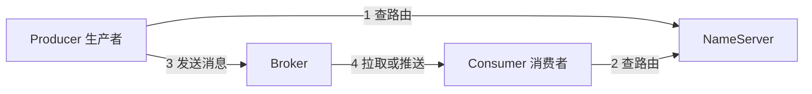
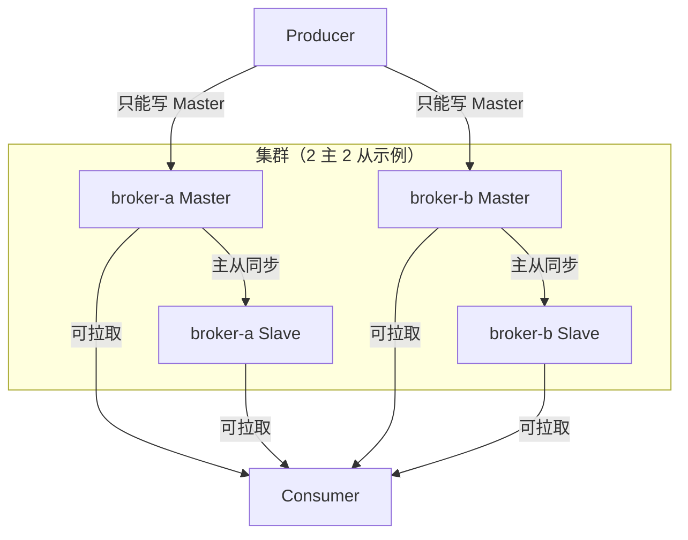

# RocketMQ 集群模式选型：单 Master、多 Master、主从双写到 Dledger

单机跑通的 RocketMQ，离生产环境还差两道坎：Broker 一旦宕机或重启，整个消息服务立刻不可用；所有消息都往同一块磁盘里写，写入量持续增长迟早把它撑满。集群要解决的正是这两件事。RocketMQ 给出的部署形态相当丰富，每一种都在可用性、可靠性和性能之间做了不同的取舍，选型因此成为一个必须结合业务想清楚的问题。

## 先给结论

- 传统部署有四种模式：单 Master、多 Master、多 Master 多 Slave（异步复制）、多 Master 多 Slave（同步双写），可靠性与性能逐级变化。
- 主从架构下读写不对称：生产者只能写 Master，消费者从 Master 或 Slave 拉取都可以，切换对应用透明。
- 异步复制毫秒级延迟，性能几乎等于多 Master，代价是主盘损坏时丢一个复制窗口内的消息；同步双写主备都写成功才返回，几乎不丢，性能低约 10%。
- 选型没有标准答案：转账、账务这类强可靠场景选同步双写，日志埋点这类吞吐优先场景选异步复制，开发测试单 Master 就够。
- 4.5 版本起官方补上了 Raft 自动选主的 Dledger 方案，发行包 `conf/dledger` 目录就是它的配置样例。

## 一、基础架构摆回桌面：消息怎么流转

**NameServer 是注册中心，Broker 才是真正干活的。** 一个 RocketMQ 环境由四类角色组成：生产者 Producer 发消息，消费者 Consumer 收消息，NameServer 收集 Broker 的状态并维护路由信息，Broker 负责消息的接收、存储与投递。

流转路径是固定的两段式：生产者先到 NameServer 查路由，拿到该主题对应的 Broker 地址，再把消息直接发给 Broker；消费者同样先查 NameServer，再从 Broker 拉取消息。NameServer 自身不参与消息收发，它挂了只影响新的路由查询，不影响已经在途的收发。这张图把后面的每一种模式都框在同一个骨架里：



## 二、单 Master：开发够用，生产别上

此前搭建的只有一套 NameServer 加一个 Broker 的环境，就是单 Master 模式。它的风险非常直白：Broker 宕机或重启，整个服务不可用，所以生产环境不会采用这种架构。

存储上还有一个隐藏问题：单个节点意味着所有消息都落在同一台机器的磁盘上，只要消息持续流入，磁盘必然在某个时刻写满，而单机磁盘没有水平扩展一说。结论是这种模式只配待在开发测试环境。

## 三、多 Master：容量上去了，可用性差一口气

把 Broker 部署成多个，天然组成集群，NameServer 也可以部署多个，这就是多 Master 模式。这种架构里没有 Slave，全都是主。横向扩展的问题解决了：消息分摊到多台机器，存储容量和吞吐都随节点数上去了。

**宕机会留下订阅空洞。** 某一台 Master 宕机期间，它上面未被消费的消息在该节点恢复之前不可订阅，消息的实时性受影响。集群整体还在服务，只是这一台上的消息暂时取不到。

**磁盘损坏就是数据丢失。** 该节点上的消息没有任何副本，盘一坏数据就没了。发行包的 `conf/2m-noslave` 样例就是这种形态：`broker-a.properties` 与 `broker-b.properties` 两份配置，`brokerId` 都是 0，没有配任何 Slave。

## 四、给每个 Master 配一个 Slave：写主读从

要补上容错，就给每个 Master 配一个 Slave，组成一对主从。架构变成下面的样子：



**生产者只能写 Master。** Slave 不接受写入，消息到达 Master 之后，通过主从同步机制复制到对应的 Slave。

**消费者两边都能拉。** Master 可读，Slave 同样可读，消费流量可以在主从之间分摊；Master 挂掉后消费自动落到 Slave 继续进行，整个过程由 RocketMQ 自动完成，消费端代码不需要任何改动。

主从同步必然引出一个关键问题：消息写到 Master 之后，是等 Slave 也写成功再给生产者返回，还是先返回再慢慢同步。两种答案对应两种模式：异步复制与同步双写。

## 五、异步复制与同步双写：10% 的性能换一个丢消息窗口

**异步复制，先返回后同步。** 消息写入 Master 即向生产者返回成功，复制在后台进行，主备之间存在短暂延迟，时间差在毫秒级，思路与 MySQL 主从复制一致。优点是性能与多 Master 模式几乎一样；Master 宕机后消费者自动从 Slave 获取消息，过程对应用透明。缺点是主节点磁盘损坏时，还没来得及复制出去的那一小段消息会丢失，当然量非常少。

**同步双写，主备都成功才返回。** 生产者的每一次发送都要等消息同时写进 Master 和 Slave，两边都落成功才向应用返回成功。主从之间消息无延迟，数据与服务都达到高可用，几乎不可能丢。代价是性能比异步复制低约 10%。

官方发行包直接把两种模式做成了两个样例目录，差别只在 `brokerRole` 一个键：

```properties
# 引自 conf/2m-2s-async/broker-a.properties（异步复制）
brokerClusterName=DefaultCluster
brokerName=broker-a
brokerId=0
deleteWhen=04
fileReservedTime=48
brokerRole=ASYNC_MASTER
flushDiskType=ASYNC_FLUSH
```

```properties
# 引自 conf/2m-2s-sync/broker-a.properties（同步双写），仅 brokerRole 一键之差
brokerRole=SYNC_MASTER
```

**选型看业务，不看偏好。** 对数据可靠性要求极高的系统，比如保存转账记录，宁可损失一些性能也要用同步双写；对性能要求极高、丢一点消息无所谓的场景，比如日志采集，选异步复制。开发测试环境，单 Master 就够。

## 六、Dledger：把选主交给 Raft

课程画图讲到同步双写为止，传统主从架构还有一个绕不开的短板，专题讲义在 RocketMQ 的缺点列表里写得很直白：不支持主从自动切换。Master 挂掉后，要么人工把 Slave 提上去，要么等它恢复，这个空档只能靠 Slave 分摊读请求来缓解。

4.5 版本引入的 Dledger 用 Raft 协议补上了这一块：一组节点（至少三个）自动选举 Leader，Leader 宕机后组内自动选出新主，写入在新主上继续，不再需要人工介入。发行包 `conf/dledger/broker-n0.conf` 里能看到它的标志性配置：

```properties
# 引自 conf/dledger/broker-n0.conf，三节点 Raft 组的节点 0
enableDLegerCommitLog=true
dLegerGroup=RaftNode00
dLegerPeers=n0-127.0.0.1:40911;n1-127.0.0.1:40912;n2-127.0.0.1:40913
dLegerSelfId=n0
```

`dLegerPeers` 列出组内全部成员，`dLegerSelfId` 声明自己是 n0，`enableDLegerCommitLog=true` 打开 Dledger 存储模式。用自动选主换来的代价是至少三个节点的资源成本，是否值得视业务对自动切换的要求而定。

## 常见误区

- **以为多 Master 集群就是高可用。** 它只解决容量与吞吐，某台宕机期间其上的消息不可订阅，实时性照样受影响；要可用性得上主从。
- **以为同步双写就绝对不会丢消息。** 它防的是单节点磁盘损坏，机房级灾难仍有风险；同时它比异步复制慢约 10%，代价要认。
- **以为消费者只能从 Master 读。** Slave 同样提供拉取能力，消费流量可以在主从之间分摊，Master 故障时消费也不中断。
- **把刷盘和主从复制混为一谈。** `flushDiskType` 管消息在本机从内存落到磁盘，`brokerRole` 管消息从主复制到从，两层各挡一类风险，组合起来才是完整的可靠性矩阵。

## 面试可能被问到的问题

1. 面试官追问：「RocketMQ 有哪几种集群部署模式，分别怎么取舍？」
   答：单 Master 只适合开发测试；多 Master 解决容量扩展，但宕机会留下订阅空洞且无副本；多 Master 多 Slave 补上副本，又分异步复制与同步双写两种。可靠性要求高选同步双写，性能优先选异步复制，按业务对丢消息的容忍度决定。

2. 面试官追问：「异步复制和同步双写的核心区别是什么？」
   答：返回时机不同。异步复制写入 Master 即返回，复制在后台进行，主备延迟毫秒级，主盘损坏时丢复制窗口内的消息；同步双写主备都写成功才返回，几乎不丢，性能低约 10%。

3. 面试官追问：「主从架构下生产者和消费者分别访问谁？」
   答：生产者只能写 Master；消费者从 Master 或 Slave 拉取都可以，Master 故障时消费自动落到 Slave，整个过程对应用透明。

4. 面试官追问：「多 Master 模式下某台宕机会发生什么？」
   答：集群整体仍在服务，其他节点的收发不受影响；但宕机节点上未被消费的消息在该节点恢复前不可订阅，实时性受影响；该节点磁盘若损坏，其上的消息就丢失了。

5. 面试官追问：「Dledger 解决了传统主从的什么问题？」
   答：传统主从不支持自动切换，Master 挂掉需要人工介入。Dledger 基于 Raft 协议在至少三个节点中自动选主，主宕机后组内自动选出新主继续写入，代价是更多的节点资源。

6. 面试官追问：「刷盘和主从复制是什么关系？」
   答：两个独立维度。刷盘（`flushDiskType`）决定消息是否落到本机磁盘，复制（`brokerRole`）决定消息是否在另一台机器有副本，两者组合构成可靠性矩阵，强可靠场景两层都要同步。

## 配套资料

- 发行包集群样例：`materials/code/10/rocketmq-all-4.5.0-bin-release/rocketmq-all-4.5.0-bin-release/conf/`（`2m-noslave`、`2m-2s-async`、`2m-2s-sync`、`dledger` 四个目录分别对应多 Master、异步复制、同步双写与 Raft 自动选主，正文引用了 `2m-2s-async/broker-a.properties`、`2m-2s-sync/broker-a.properties`、`dledger/broker-n0.conf` 的原文）
- 讲义：`materials/docs/10/RocketMQ研究v1.0.md`（组成结构章节给出 NameServer 与 Broker 的职责及交互过程，对应第一节；RocketMQ 缺点列表中的「不支持主从自动切换」对应第六节的引出）
- 本课（day10）资料包：`materials/code/03/day10-RocketMQ集群、分布式WebSocket实现以及地图找房功能实现/` 下仅有地图找房的 `textIconOverlay.js` 一个文件，与集群内容无关；四种模式的架构与取舍按课程画图讲解整理，Dledger 部分为按发行包样例与主流写法补全
