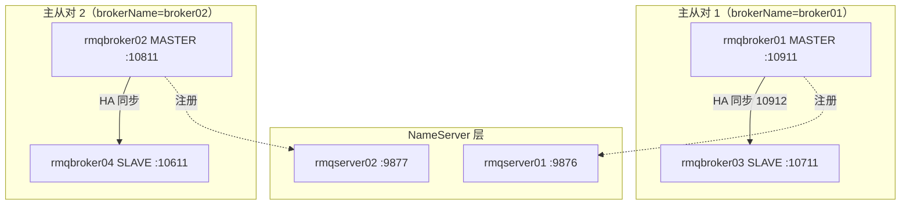
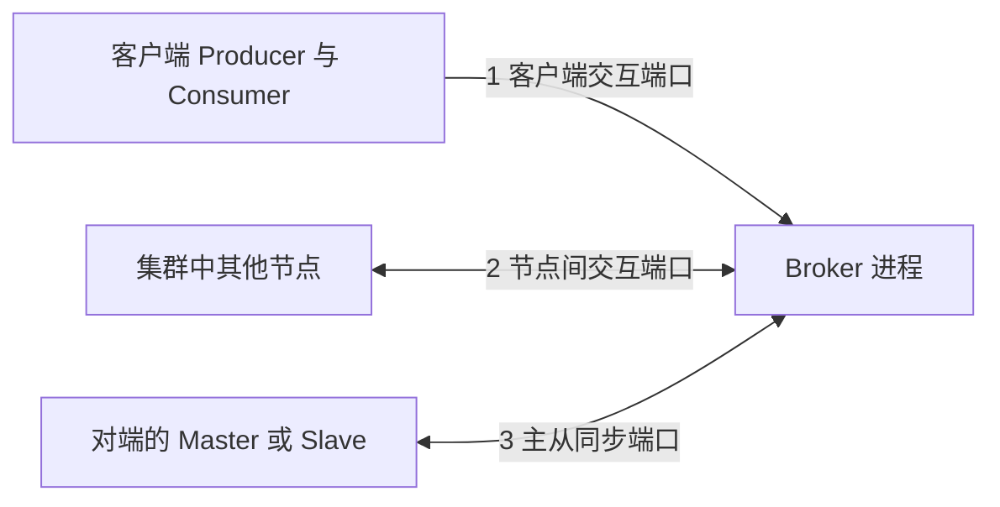

# 用 Docker 搭 2 主 2 从的 RocketMQ 集群：四个 broker.conf 逐项吃透，再收发消息验证

集群模式定为 2 主 2 从（2M2S）之后，真正动手时卡点通常不在 docker 命令，而在 `broker.conf` 里那十几个键：哪个决定集群、哪个决定主从、哪个不配就远程连不上，每一处含糊都会在启动后变成看不懂的日志。这一课先把四个配置文件逐项讲透，再按顺序把整套集群拉起来，用控制台与客户端收发两条线完成验证。

## 先给结论

- 拓扑为 2 个 NameServer（对外端口 9876 与 9877）加 4 个 Broker 容器；NameServer 走普通端口映射，Broker 用 host 网络模式。
- 一个 Broker 进程要占 3 个端口：客户端交互用 `listenPort`，主从 HA 同步用 `listenPort + 1`，VIP 通道用 `listenPort - 2`；host 网络让容器直接共享宿主机端口栈，省掉三条映射。
- `brokerId=0` 是 Master，非 0 是 Slave；主从靠相同的 `brokerName` 配对；`brokerClusterName` 相同才同属一个集群。
- 课程选择同步双写加异步刷盘：`brokerRole=SYNC_MASTER` 配 `flushDiskType=ASYNC_FLUSH`；`brokerIP1` 必须显式指定宿主机 IP，否则 Broker 注册的是容器内网地址，远程客户端连不上。
- 启动顺序先 NameServer 后 Broker；验证走两步：控制台集群页看拓扑，客户端收发消息走通。

## 一、拓扑规划与两个 NameServer

整套集群共 6 个容器，规划如下：

| 容器 | 角色 | brokerName | brokerId | 对外端口 |
|---|---|---|---|---|
| rmqserver01 | NameServer | 无 | 无 | 9876 |
| rmqserver02 | NameServer | 无 | 无 | 9877 |
| rmqbroker01 | Master | broker01 | 0 | 10911 |
| rmqbroker02 | Master | broker02 | 0 | 10811 |
| rmqbroker03 | broker01 的 Slave | broker01 | 1 | 10711 |
| rmqbroker04 | broker02 的 Slave | broker02 | 1 | 10611 |

主从配对关系画出来就是：



两个 NameServer 的创建命令：

```bash
# NameServer 1
docker create -p 9876:9876 --name rmqserver01 \
  -e "JAVA_OPT_EXT=-server -Xms128m -Xmx128m -Xmn128m" \
  -e "JAVA_OPTS=-Duser.home=/opt" \
  -v /haoke/rmq/rmqserver01/logs:/opt/logs \
  -v /haoke/rmq/rmqserver01/store:/opt/store \
  foxiswho/rocketmq:server-4.3.2

# NameServer 2，对外 9877，容器内仍是 9876
docker create -p 9877:9876 --name rmqserver02 \
  -e "JAVA_OPT_EXT=-server -Xms128m -Xmx128m -Xmn128m" \
  -e "JAVA_OPTS=-Duser.home=/opt" \
  -v /haoke/rmq/rmqserver02/logs:/opt/logs \
  -v /haoke/rmq/rmqserver02/store:/opt/store \
  foxiswho/rocketmq:server-4.3.2
```

NameServer 只有一个交互端口，所以 `rmqserver02` 用 `-p 9877:9876` 把对外端口换成 9877，容器内部没有任何变化。`JAVA_OPT_EXT` 把堆内存压到 128m，为的是测试机上多容器共存；`/opt/logs` 与 `/opt/store` 挂到宿主机，容器删除后日志与存储还在。这里用 `docker create` 先创建不启动，等 6 个容器全部备齐再统一启动，排错节奏更从容。

## 二、Broker 为什么用 host 网络：一个进程占三个端口

Broker 是集群里通信最重的角色，对外要暴露三类端口，各自服务不同的通信对象：



**第一，与客户端交互的端口。** 生产者、消费者收发消息都走它，即 `listenPort`，默认 10911。

**第二，与本集群其他节点交互的端口。** 集群内部节点之间的通信用。

**第三，主从同步的端口。** Master 向 Slave 复制数据走它。

三个端口不是随便挑的，而是围绕 `listenPort` 固定配套：加 1 得主从同步端口，减 2 得 VIP 通道端口。配置一个 `listenPort=10911`，实际占用的就是 10909、10911、10912 三个端口。逐个做 `-p` 映射要写三条，`--net host` 让容器直接使用宿主机的端口栈，一步到位：

```bash
# 第 1 个 Master，注意没有 -p，没有端口映射
docker create --net host --name rmqbroker01 \
  -e "JAVA_OPTS=-Duser.home=/opt" \
  -e "JAVA_OPT_EXT=-server -Xms128m -Xmx128m -Xmn128m" \
  -v /haoke/rmq/rmqbroker01/conf/broker.conf:/etc/rocketmq/broker.conf \
  -v /haoke/rmq/rmqbroker01/logs:/opt/logs \
  -v /haoke/rmq/rmqbroker01/store:/opt/store \
  foxiswho/rocketmq:broker-4.3.2
```

host 网络之下 `listenPort` 等端口配置直接生效在宿主机上，这也意味着四个 Broker 的端口必须在配置里手工错开，容器之间没有端口隔离这层保护。

## 三、四个 broker.conf 逐项过

broker01 的完整配置（集群名按课程讲解改用中性命名）：

```properties
namesrvAddr=172.16.55.185:9876;172.16.55.185:9877
brokerClusterName=ExampleCluster
brokerName=broker01
brokerId=0
deleteWhen=04
fileReservedTime=48
brokerRole=SYNC_MASTER
flushDiskType=ASYNC_FLUSH
brokerIP1=172.16.55.185
brokerIP2=172.16.55.185
listenPort=10911
```

逐项拆解：

**`namesrvAddr`，指向两个 NameServer，用分号分隔。** 集群里 NameServer 有两台，两个地址都要写上，分隔符是分号，逗号不认。

**`brokerClusterName`，集群名。** 多个 Master 靠这个名字认亲，配置相同的才同属一个集群，它是组建集群的前提。

**`brokerName`，主从配对的名字。** 除了给 Broker 命名，它更关键的作用是配对：broker01 的 Master 和 Slave 必须配置相同的 `brokerName`，才会被组成一对主从。

**`brokerId`，0 是主，非 0 是从。** 同一个 `brokerName` 下，`brokerId=0` 的节点是 Master，非 0（如 1）的是 Slave，角色由这个数字唯一决定。

**`deleteWhen` 与 `fileReservedTime`，一对过期清理配置。** `fileReservedTime=48` 表示消息数据在磁盘上保留 48 小时（默认 72），`deleteWhen=04` 表示每天凌晨 4 点执行过期文件清理，两个键搭配使用。

**`brokerRole`，主从复制角色。** `SYNC_MASTER` 是同步双写，主从都写成功才向生产者返回成功；换成 `ASYNC_MASTER` 就是异步复制。Slave 端固定配 `SLAVE`。

**`flushDiskType`，刷盘方式。** 课程选 `ASYNC_FLUSH` 异步刷盘，吞吐优先，可靠性由同步双写那一层兜底；两种刷盘方式的原理与取舍在存储一章展开过。

**`brokerIP1` 与 `brokerIP2`。** `brokerIP1` 是 Broker 对外服务并注册到 NameServer 的 IP，不设置的话 Broker 会把 Docker 内部生成的容器 IP 注册上去，远程客户端拿着这个内网地址根本连不进来，此前单机联调时已经踩过这个坑。`brokerIP2` 是主从之间同步数据使用的 IP，与 `brokerIP1` 配成同一个宿主机 IP 即可。

**`listenPort`，监听端口。** 四个 Broker 共享宿主机端口栈，必须两两错开。

官方发行包的样例可以直接对照，`conf/2m-2s-async` 目录下一主一从两个文件：

```properties
# 引自 materials/code/10/rocketmq-all-4.5.0-bin-release/rocketmq-all-4.5.0-bin-release/conf/2m-2s-async/broker-a.properties
brokerClusterName=DefaultCluster
brokerName=broker-a
brokerId=0
deleteWhen=04
fileReservedTime=48
brokerRole=ASYNC_MASTER
flushDiskType=ASYNC_FLUSH
```

```properties
# 引自同目录 broker-a-s.properties，从节点只改了 brokerId 与 brokerRole
brokerName=broker-a
brokerId=1
deleteWhen=04
fileReservedTime=48
brokerRole=SLAVE
flushDiskType=ASYNC_FLUSH
```

样例里没有 `namesrvAddr`、`brokerIP1` 这些键，因为官方样例假设单机默认环境起步；跨容器搭集群时这些键必须补齐。`conf/2m-2s-sync` 目录下同样的两个文件只是 `brokerRole` 换成 `SYNC_MASTER`，与上一课的两种复制模式一一对应。

四个 Broker 的差异最终收敛到四个键，挂载目录 `/haoke/rmq/rmqbroker01` 到 `rmqbroker04` 也各自独立：

| 配置文件 | brokerName | brokerId | brokerRole | listenPort |
|---|---|---|---|---|
| broker01.conf | broker01 | 0 | SYNC_MASTER | 10911 |
| broker02.conf | broker02 | 0 | SYNC_MASTER | 10811 |
| broker03.conf | broker01 | 1 | SLAVE | 10711 |
| broker04.conf | broker02 | 1 | SLAVE | 10611 |

## 四、动手执行：建目录、写配置、建容器、按序启动

把此前单机演练用的 NameServer 与 Broker 容器先 `docker stop` 停掉，释放 9876 端口。Broker 容器挂载的 `conf` 目录和 `broker.conf` 必须先行准备好：`logs` 与 `store` 目录容器会自动创建，`conf` 不会：

```bash
# 以 broker01 为例，配置先行
mkdir -p /haoke/rmq/rmqbroker01/conf
vim /haoke/rmq/rmqbroker01/conf/broker.conf   # 写入第三节的 11 行配置
```

四个 Broker 都按同样三步走：建 `conf` 目录、写 `broker.conf`、执行对应的 `docker create`。容器建完后按依赖顺序启动，Broker 启动时要向 NameServer 注册，所以 NameServer 必须先就位：

```bash
docker start rmqserver01 rmqserver02
docker start rmqbroker01 rmqbroker02 rmqbroker03 rmqbroker04
```

## 五、验证：控制台看拓扑，代码收发走通

管理控制台部署在 8082 端口，浏览器打开后切到集群页：4 个 Broker 节点全部在列，每个节点的主从角色、监听端口一目了然，点开配置页还能核对第三节的每一项配置，说明注册与组网成功。控制台源码就是资料包里的 `rocketmq-console` 工程。

功能验证复用之前的客户端代码，只把 NameServer 地址改成两个，分号分隔：

```java
DefaultMQProducer producer = new DefaultMQProducer("haoke");
producer.setNamesrvAddr("172.16.55.185:9876;172.16.55.185:9877");
producer.start();

// 向集群发送一条消息
Message message = new Message("my-test-topic", "delete", "集群验证消息".getBytes("UTF-8"));
SendResult sendResult = producer.send(message);
System.out.println("消息id：" + sendResult.getMsgId());
System.out.println(sendResult);
```

发送成功后控制台能看到消息落在 broker01 上；消费端订阅该主题、表达式用 `*`，把收到的消息打印并正常返回，说明消费链路同样畅通。在同步双写配置下，这条消息此刻同时存在于 broker01 的主从两台节点上。整套 2M2S 集群到此搭建并验证完成；扩展成 N 主 N 从时流程与配置项完全一致，只是节点数量与端口规划相应增加。

## 常见误区

- **四个 Broker 端口没错开。** host 网络之下端口直接占用宿主机，`listenPort` 与 NameServer 对外端口一旦重复，容器启动即失败或行为异常，10911、10811、10711、10611 的规划要提前定好。
- **`namesrvAddr` 用逗号分隔。** RocketMQ 只认分号，逗号会把两个地址当成一个非法地址，Broker 注册不上。
- **主从 `brokerName` 不一致。** Slave 配了别的名字就配不成一对，主从同步不建立，表现为 Slave 正常启动却收不到数据。
- **漏配 `brokerIP1`。** Broker 把容器内网 IP 注册上去，本机能通，远程客户端全部连接超时；`brokerIP2` 不配同样可能让主从同步找不到对方。
- **启动顺序颠倒。** 先起 Broker 后起 NameServer，Broker 注册不到注册中心，日志里持续刷连接失败；先起 NameServer 再起 Broker 即可避免。

## 面试可能被问到的问题

1. 面试官追问：「Broker 容器为什么用 host 网络模式？」
   答：一个 Broker 进程要占三个端口，客户端交互 10911、主从同步 10912、VIP 通道 10909，逐个做端口映射繁琐且易错；host 网络让容器直接共享宿主机端口栈，一个 `listenPort` 配置三个端口同时生效。

2. 面试官追问：「brokerId 和 brokerRole 分别决定什么？」
   答：`brokerId` 决定主从身份，0 是 Master、非 0 是 Slave；`brokerRole` 决定主节点的复制行为，`SYNC_MASTER` 同步双写、`ASYNC_MASTER` 异步复制，Slave 端固定为 `SLAVE`。两者共同确定一个节点在集群中的完整角色。

3. 面试官追问：「brokerIP1 和 brokerIP2 有什么区别？」
   答：`brokerIP1` 是对外服务并注册到 NameServer 的 IP，供客户端连接，容器环境必须显式指定宿主机地址，否则注册的是容器内网 IP 导致远程连不上；`brokerIP2` 是主从同步专用的 IP，与 `brokerIP1` 配成同一地址即可。

4. 面试官追问：「deleteWhen 和 fileReservedTime 是什么关系？」
   答：一对过期清理配置。`fileReservedTime` 定保留时长（单位小时），超时的存储文件视为过期；`deleteWhen` 定每天执行清理的时间点。例如保留 48 小时、凌晨 4 点清理，就是课程配置的 48 与 04。

5. 面试官追问：「2 主 2 从集群里，一条消息是怎么同时落到主从两台的？」
   答：生产者把消息写到 Master；配置为 `SYNC_MASTER` 时，Master 先把消息同步给同名 `brokerName` 对应的 Slave，两边都写成功才向生产者返回成功，之后主从两台都能提供消费。

6. 面试官追问：「NameServer 部署多台时，客户端怎么配置？」
   答：`namesrvAddr` 写多个地址用分号分隔，如 `ip1:9876;ip2:9877`；客户端会容错选用可用的一台完成路由查询，任一 NameServer 存活即可正常工作。

## 配套资料

- 发行包集群配置样例：`materials/code/10/rocketmq-all-4.5.0-bin-release/rocketmq-all-4.5.0-bin-release/conf/2m-2s-async/`（`broker-a.properties` 与 `broker-a-s.properties` 主从两个文件原文引用于第三节；`conf/2m-2s-sync/`、`conf/2m-noslave/`、`conf/dledger/` 为其他模式的对照样例）
- 控制台源码：`materials/code/10/rocketmq-console/rocketmq-console/`（第五节验证所用管理控制台即此工程构建部署）
- 讲义：`materials/docs/10/RocketMQ研究v1.0.md`（组成结构章节给出 NameServer 与 Broker 的职责及交互过程，对应第二节三类通信端口的背景）
- 本课（day10）自身资料包：`materials/code/03/day10-RocketMQ集群、分布式WebSocket实现以及地图找房功能实现/` 下仅有地图找房的 `textIconOverlay.js` 一个文件，与集群内容无关；Docker 命令与 `broker.conf` 按课程讲解整理（宿主机 IP 以 172.16.55.185 为例，集群名改为中性命名），客户端收发验证代码为按本课写法补全的示例
