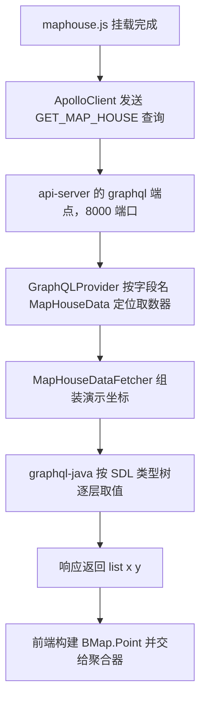

# 把地图找房的静态点位换成 GraphQL 动态加载：后台加查询，前端换取数

上一课的 `maphouse.js` 里，六个房源点写死在一个 `xy` 数组里，页面能跑，但数据是死的：后端改一条房源，地图毫无反应。这一课把这条数据链打通：后台按项目里已有的 GraphQL 模式新增一个查询，先返回同一批演示坐标保证行为一致；前端把静态数组删掉，改成组件挂载后发起查询、拿到结果再画点。改造完成后，页面上的每一个圆圈都来自一次真实的 GraphQL 请求，Network 面板里看得清清楚楚。

## 先给结论

- 改造分两端：后台在 `haoke.graphqls` 里加 `MapHouseData` 查询与两个返回类型，再写一个 `MapHouseDataFetcher` 实现类；前端把静态数组换成 Apollo 客户端的一次 `query`。
- SDL 的类型树要贴着前端的数据结构反推：前端要的是坐标数组，所以返回类型是 `list: [MapHouseXY]`，`MapHouseXY` 只有 `x`、`y` 两个 `Float` 字段。
- 取数器仍是项目固化下来的扩展模式：实现 `MyDataFetcher`，`fieldName()` 返回与 SDL 字段同名的 `MapHouseData`，打上 `@Component` 交给 Spring 容器，Provider 一行不用改。
- 前端引入 `apollo-boost` 创建客户端，查询语句用 `gql` 模板字符串定义，在 `componentDidMount` 里查询完成后再构建覆盖物，时序上不能倒。
- 聚合网格参数顺手调优：`gridSize` 从 100 调到 50，同样缩放级别下圆圈更多、更细。

## 一、后台先动：SDL 契约加一个查询

契约文件是 api-server 里的 `haoke.graphqls`，之前房源单条、房源列表、首页广告的查询都定义在这里。地图查询照样追加，先在根查询类型 `HaokeQuery` 下加一行字段：

```graphql
type HaokeQuery {
  HouseResources(id: Long): HouseResources
  HouseResourcesList(page: Int, pageSize: Int): TableResult
  IndexAdList: IndexAdResult
  MapHouseData: MapHouseDataResult
}
```

再补上两个返回类型的定义：

```graphql
type MapHouseDataResult {
  list: [MapHouseXY]
}

type MapHouseXY {
  x: Float
  y: Float
}
```

类型结构不是拍脑袋定的，要回到前端要什么。前端画点需要的最小数据集是一个坐标数组：每个元素有经度 `x` 和纬度 `y`，都是小数，对应 GraphQL 的 `Float` 标量。所以返回类型拆成两层：外层 `MapHouseDataResult` 里装一个 `list`，方括号表示集合；集合元素是 `MapHouseXY`，两个字段与前端数据结构一一对应。这与房源列表那次的 `TableResult` 加 `Pagination` 是同一个翻译过程：把 Java 对象的嵌套结构摊平成 SDL 的类型树。

## 二、写取数器：fieldName 对准字段名，数据先用演示值

项目里 GraphQL 的扩展模式早已固化：每个查询配一个 `MapHouseDataFetcher` 这样的实现类。在 api-server 的取数器包下新建类，实现 `MyDataFetcher` 接口的两个方法：

```java
package com.haoke.manage.dubbo.api.vo.map;

@Data
@AllArgsConstructor
@NoArgsConstructor
public class MapHouseDataResult {

    private List<MapHouseXY> list;
}
```

```java
@Data
@AllArgsConstructor
@NoArgsConstructor
public class MapHouseXY {

    private Float x;
    private Float y;
}
```

两个 VO 放在 `vo.map` 包下，注解交给 Lombok，字段与 SDL 严格同名同型。然后是取数器本身：

```java
@Component
public class MapHouseDataFetcher implements MyDataFetcher {

    @Override
    public String fieldName() {
        return "MapHouseData";
    }

    @Override
    public Object dataFetcher(DataFetchingEnvironment environment) {
        List<MapHouseXY> list = new ArrayList<>();
        // 演示数据：与前端原静态数据完全一致，保证改造前后页面行为不变
        list.add(new MapHouseXY(116.350444f, 39.931645f));
        list.add(new MapHouseXY(116.351684f, 39.9167f));
        list.add(new MapHouseXY(116.357253f, 39.923152f));
        list.add(new MapHouseXY(116.354954f, 39.935767f));
        list.add(new MapHouseXY(116.36233f, 39.93839f));
        list.add(new MapHouseXY(116.374249f, 39.93839f));
        return new MapHouseDataResult(list);
    }
}
```

三个要点。**第一，`fieldName()` 是注册锚点。** Provider 启动时遍历容器里所有 `MyDataFetcher` 实现类，按返回的字符串把取数器挂到 SDL 对应字段上，字符串必须与 `MapHouseData` 逐字符一致。**第二，`@Component` 不能少**，不打注解类进不了容器，遍历根本看不到它。**第三，数据先造假。** 取数器里返回的坐标与前端原静态数组一模一样，这不是偷懒，是改造纪律：先把「数据从接口来」这条链路验证通，数据源再从假数据平滑切到真数据，前端任何一行都不用为切换买单。

整条查询链路现在长这样：



关键环节在字段定位与类型取值两处：定位靠 `fieldName()` 与 SDL 对齐，取值靠返回对象与 SDL 同名，任何一处名字对不上，页面拿到的就是 null。

## 三、服务端自测：Altair 里发一次查询

重启 api-server，先用 GraphQL 客户端工具把服务端单独测通，别急着动前端。新建一个查询窗口，地址指向 `http://127.0.0.1:8000/graphql`，语句跟着 SDL 的类型树一层层写：

```graphql
query {
  MapHouseData {
    list {
      x
      y
    }
  }
}
```

执行后返回六个坐标对象，字段与预期一致，说明服务端这条链路已经独立可用。这一步的价值在于隔离：前端改造前先确认后端没问题，联调出错时不必两头猜。

## 四、前端改造：静态数组退场，查询进场

前端改动集中在 `maphouse.js`。文件头部新增依赖与两个常量：

```javascript
import React from 'react';
import { Icon } from 'semantic-ui-react';
import ApolloClient from 'apollo-boost';
import gql from 'graphql-tag';

// 创建客户端，指向 api-server 的 GraphQL 地址
const client = new ApolloClient({
  uri: 'http://127.0.0.1:8000/graphql',
});

// 地图点位的查询语句
const GET_MAP_HOUSE = gql`
  query {
    MapHouseData {
      list {
        x
        y
      }
    }
  }
`;
```

`componentDidMount` 里，地图初始化照旧，画点逻辑整体搬进查询的回调：

```javascript
componentDidMount() {
  var BMap = window.BMap;
  var BMapLib = window.BMapLib;
  var map = new BMap.Map("allmap");
  map.centerAndZoom(new BMap.Point(116.43244, 39.929986), 12);
  map.addControl(new BMap.MapTypeControl());
  map.addControl(new BMap.ScaleControl({
    anchor: window.BMAP_NAVIGATION_CONTROL_ZOOM
  }));

  // 查询完成后再用真实返回的数据画点
  client.query({ query: GET_MAP_HOUSE }).then(result => {
    var xys = result.data.MapHouseData.list;
    var markers = [];
    let pt = null;
    for (let i in xys) {
      pt = new BMap.Point(xys[i].x, xys[i].y);
      markers.push(new BMap.Marker(pt));
    }
    // 地图上覆盖物的聚合效果
    var markerClusterer = new BMapLib.MarkerClusterer(map, {
      markers: markers,
      gridSize: 100,
      styles: [
        {
          background: 'rgba(12,181,106,0.9)',
          size: new BMap.Size(92, 92),
          textSize: '16',
          textColor: '#fff',
          borderRadius: 'true'
        }
      ]
    });
    markerClusterer.setMaxZoom(50);
    markerClusterer.setGridSize(50);
  });
}
```

与上一课相比有四处变化。**第一，原来的 `var xy = [...]` 静态数组整段删除**，坐标改为 `result.data.MapHouseData.list`，路径与 SDL 契约逐层对应。**第二，画点时机变了**：查询是异步的，`then` 回调执行时才拿到数据，覆盖物构建必须整体挪进回调，写在回调外面拿到的就是 undefined。**第三，循环变量改用 `let`**，不再复用外层变量，这是顺手做的规范修正。**第四，聚合参数调优**：构造参数里 `gridSize` 是 100，紧接着又 `setGridSize(50)`，网格从大格换小格，同样缩放级别下格子里的点变少，圆圈的数量变多、半径变小，放大地图时能更早看到一圈圈的聚合效果，演示里「放大才出现圆圈」的现象也随之改善。

刷新页面点击「地图找房」，效果与改造前一致，但打开开发者工具的 Network 面板，能看到一条发往 `http://127.0.0.1:8000/graphql` 的请求，响应里装着六个坐标。数据没变，来源变了：静态到动态的第一步落地，下一步只需要把取数器里的假数据换成真查询。

## 常见误区

- **画点逻辑留在查询回调之外。** 异步查询没返回时回调外的代码已经执行完，拿 `result` 去用必然报未定义。所有依赖查询结果的 DOM 操作都要放进 `then`。
- **字段名对不上却反复查代码逻辑。** `fieldName()` 返回值、SDL 字段名、前端查询语句三处必须逐字符一致，差一个字母服务端不会报错，只会安静地返回 null。
- **SDL 类型与 Java 对象字段类型不匹配。** 坐标是带小数的数据，SDL 写成 `Int` 或 Java 用 `Integer` 接，序列化时就会丢精度或直接类型不匹配，经纬度一律用 `Float`。
- **以为 `gridSize` 越大显示越多。** 恰恰相反，网格越大格内合并的点越多，圆圈越少越大；想多看到圆圈应该调小。

## 面试可能被问到的问题

1. 面试官追问：「这个场景用 GraphQL 而不是 RESTful，图什么？」
   答：图契约与按需取数。SDL 里类型结构一目了然，前端要什么字段自己声明，一个端点承载所有查询；新增地图查询只加了契约定义与一个实现类，Provider 与既有查询零改动。对这种字段结构由前端渲染形态决定的接口，GraphQL 的表达力明显更省事。

2. 面试官追问：「新增一个 GraphQL 查询，项目里要动几处代码？」
   答：两处：SDL 里加字段与返回类型，加一个实现 `MyDataFetcher` 的取数器类并打 `@Component`。取数器靠 `fieldName()` 与 SDL 字段名自动注册，Provider、Controller、公共配置全都不用动。

3. 面试官追问：「SDL 声明的类型和 Java 对象是怎么对上的？」
   答：graphql-java 拿到取数器返回的对象后，按 SDL 声明的字段名通过 getter 逐层取值：声明了 `list` 就调 `getList()`，声明了 `x` 就调元素的 `getX()`。字段名对不上不报错，直接给 null，所以契约两侧同名同型是纪律。

4. 面试官追问：「先返回假数据再切真数据，为什么要绕这一道？」
   答：把链路问题与数据问题分开排。假数据阶段前后端行为与改造前完全一致，验证的纯粹是「请求通了、结构对了」；这一步稳定后换成真数据源，前端无感知。一次切换一个变量，出问题时定位范围小得多。

5. 面试官追问：「apollo-boost 在前端扮演什么角色？」
   答：它是 Apollo 客户端的一站式封装，配一个 `uri` 就能发 GraphQL 查询，内部处理请求组装、响应解析与缓存。工程里用它创建客户端实例，组件里 `client.query` 传入 `gql` 定义的语句，拿到 `result.data` 后再做渲染。

6. 面试官追问：「经纬度在 SDL 里为什么用 Float 而不是 Int？」
   答：经纬度是连续量，整数度只能精确到一百多公里，毫无意义。GraphQL 的 `Float` 对应 IEEE 754 双精度，与 Java 的 `Float`/`Double` 对应，才能表达小数点后六位以上、米级以下的坐标精度。

## 配套资料

- 聚合覆盖物脚本（真实文件）：`materials/code/03/day10-RocketMQ集群、分布式WebSocket实现以及地图找房功能实现/day10-RocketMQ集群、分布式WebSocket实现以及地图找房功能实现/资料/textIconOverlay.js`（前端聚合圈效果的绘制组件）
- day10 资料包其余内容为空：`haoke.graphqls` 追加段、两个 VO、取数器、前端查询代码为按本课视频画面与讲解整理，包名统一改为中性的 `com.haoke.manage`，个别画面抄录中的导入笔误已按可运行写法修正
- 取数器扩展模式的由来见同系列成稿 `0094-优化改进GraphQLProvider实现逻辑.md` 与 `0095-实现查询房源列表的GraphQL接口服务.md`，SDL 类型翻译规则在 0095 一文有完整拆解
