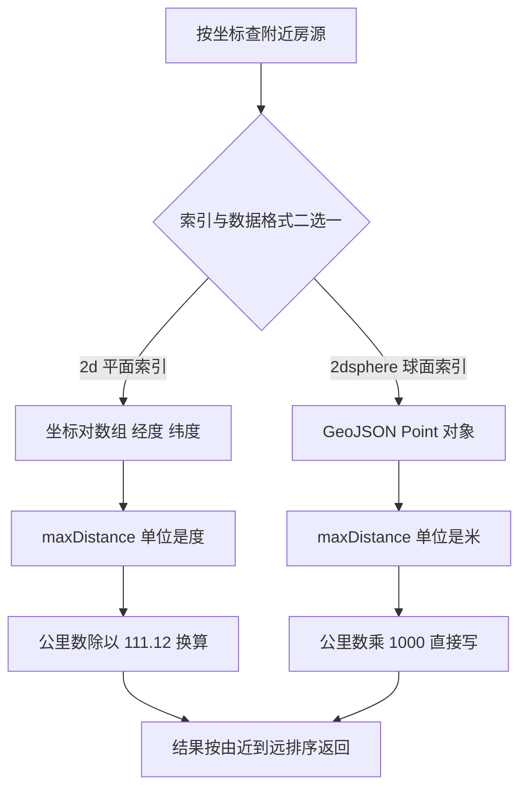

# MongoDB 的地理位置索引：2d 索引加 $near，按坐标查附近房源

地图找房的取数器里现在还是一批假坐标，换成真数据要回答两个问题：房源的经纬度存在哪、给定一个点怎么查它附近的房源。放到关系型数据库里，「附近」意味着对全表每行算经纬度的距离再排序，数据量一大就走不动。MongoDB 对这类需求给了一套原生方案：地理位置索引加地理位置查询算子，大众点评查附近美食、共享单车找附近车辆，底层都是这一类结构。这一课在 MongoDB 里把这套机制完整走一遍：建索引、造数据、按公里数查附近，顺手把 2d 与 2dsphere 两种索引的边界讲清楚。

## 先给结论

- 地理位置查询必须先建索引：给 `loc` 字段建 `2d` 索引后，`$near` 才能按距离由近到远返回文档，不建索引这类查询直接被拒绝。
- `2d` 索引是平面索引，距离单位与坐标一致，也就是度；纬度上 1 度约合 111.12 公里，所以「查 5 公里内」要写成 `$maxDistance: 5/111.12`。
- 测试数据按 `hid`、`title`、`loc: [经度, 纬度]` 组织，`hid` 配唯一索引防重复；经度在前、纬度在后，顺序不能反。
- `2dsphere` 是球面索引，配 GeoJSON 使用，距离单位是米，配合 `$geoNear` 聚合阶段还能返回精确距离，真实生产建议走这条路线。
- 地图找房的查询形态「以我为中心，5 公里内的房源」用一条 `find` 就能表达，这正是选 MongoDB 存房源坐标的理由。

## 一、「附近」为什么需要专门索引

先把问题翻译成数据语言：已知目标点坐标与半径 R，从房源集合里找出与目标点距离不超过 R 的所有文档。朴素做法是全表扫描，逐行套球面距离公式算一遍再过滤，点越多越慢。索引的价值在于把这种二维的邻近关系变成可检索的结构：MongoDB 的地理位置索引会先把二维坐标编码成一维的键，建进普通的 B 树，查询时先通过索引定位到目标点附近的那一小片区域，再对这一小片精确计算距离，绝大多数无关文档根本不进计算环节。

这类需求在生活服务里到处都是：附近的餐馆、附近的单车、附近的房源，本质都是「以一个坐标为中心的邻近查询」。课程项目正好需要「人民广场附近 5 公里内有哪些房源」，MongoDB 在这一步只要求两件事：文档里有一个坐标字段，字段上建一个地理索引，剩下的交给算子。

## 二、建索引与造数据

环境沿用容器里的 MongoDB，进容器、选库，把演示用的旧集合清掉重来：

```bash
# 进入 MongoDB 容器
docker exec -it mongodb /bin/bash
mongo
# 选择演示库
use testdb
# 清空旧数据
db.house.drop()
```

第一步给 `house` 集合的 `loc` 字段建 2d 地理索引：

```javascript
db.house.createIndex({loc: '2d'})
// 返回：numIndexesBefore: 1, numIndexesAfter: 2, ok: 1
```

集合原本只有 `_id` 一个索引，这条命令执行后索引数从 1 变 2。第二步给房源业务主键建唯一索引，保证同一套房源不会被重复插入：

```javascript
db.house.createIndex({hid: 1}, {unique: true})
// 确认：_id、loc 2d、hid 唯一，共三个索引
db.house.getIndexes()
```

接着插入测试数据。造数之前有个前置动作值得学：房源标题里有小区名，小区的经纬度哪来？用百度地图开放平台的坐标拾取服务，输入小区名就能拿到坐标。接口上的 AK 参数需要自己在百度开放平台注册账号申请，演示用的是课程提供的账号，正式开发要换成自己的。数据刻意集中在上海的中山公园与人民广场两个片区，方便后面观察查询效果：

```javascript
// 插入测试数据，loc 数组是 经度在前，纬度在后
db.house.insert({hid: 1, title: "整租 - 南丹大楼 1居室 7500", loc: [121.44822369745573, 31.196523937504594]});
db.house.insert({hid: 2, title: "陆家嘴板块，精装设计一室一厅，可拎包入住诚意租。", loc: [121.51804613891443, 31.238878702131506]});
db.house.insert({hid: 3, title: "整租 - 健安坊 1居室 4050", loc: [121.41483106993774, 31.165077330435281]});
db.house.insert({hid: 4, title: "整租 - 中凯城市之光·视野开阔，景色秀丽·拎包入住。", loc: [121.43528202056717, 31.190687949417815]});
db.house.insert({hid: 5, title: "整租 - 南京西路品质小区 三轨交汇·配套齐全·拎包入住。", loc: [121.43528282056717, 31.190687949417815]});
db.house.insert({hid: 6, title: "整租 - 简约风格·南户型·拎包入住·看房随时。", loc: [121.47521508401232, 31.2385308719981]});
```

照这个结构再补几条到十个上下，`db.house.find()` 确认数据齐了，就可以进入查询环节。

## 三、$near 查询：公里数要除以 111.12

查询「人民广场附近 5 公里内的房源」，目标点坐标是 `[121.4831024185999, 31.23515697141239]`，查询语句：

```javascript
db.house.find({
  loc: {
    $near: [121.4831024185999, 31.23515697141239],
    $maxDistance: 5 / 111.12
  }
})
```

返回三条：hid 6、hid 2 与桃源新村那套，全部落在人民广场周边。把半径改成 `2/111.12`，结果缩成两条；换个中心点查中山公园附近 2 公里，返回的标题里就带出中山公园相关的房源。距离越近结果越少，结果集默认按由近到远排序，这个次序对「附近的房源」场景正好是想要的产品语义。

这里最值得咀嚼的是 `$maxDistance: 5/111.12` 这个除法。`2d` 索引是平面索引，把经纬度当作平面上的点对待，距离单位与坐标单位一致，也就是度。地球是个球，纬度方向上转 1 度对应地表约 111.12 公里（地球周长 4 万公里除以 360 度），所以「5 公里」要换算成 `5/111.12 ≈ 0.045` 度再交给查询。不是 MongoDB 特立独行，是平面索引只认坐标单位。

整条查询链路可以概括成一张图：



两条路线的区别在数据格式与单位制，查询语义一致，选哪条取决于精度要求。

## 四、2d 与 2dsphere：平面近似与球面精确

课程演示用的是 `2d` 索引，它是早期方案，把经纬度当平面坐标处理，计算简单，够城市级应用用。但地球不是平面，跨越大范围时平面近似会累积误差，MongoDB 后来主推的是 `2dsphere` 球面索引：数据用 GeoJSON 格式表达，距离按球面几何计算，单位是米，真实生产里的地理查询建议走这条路线。同一批房源换成 2dsphere 方案（示例按主流写法补全，非本课演示内容）：

```javascript
// 2dsphere 方案：字段存 GeoJSON Point，建球面索引
db.house2.insert({
  hid: 1,
  title: "整租 - 南丹大楼 1居室 7500",
  loc: {type: "Point", coordinates: [121.44822369745573, 31.196523937504594]}
})
db.house2.createIndex({loc: '2dsphere'})

// $geoNear 聚合：直接返回距离字段，单位米，比 $near 更适合分页与排序场景
db.house2.aggregate([
  {
    $geoNear: {
      near: {type: "Point", coordinates: [121.4831024185999, 31.23515697141239]},
      distanceField: "dist",      // 计算出的距离写入该字段
      maxDistance: 5000,          // 单位米
      spherical: true,
      num: 10
    }
  }
])
```

对比一下三条差异：数据格式上，`2d` 用裸数组 `[经度, 纬度]`，`2dsphere` 用带 `type` 与 `coordinates` 的 GeoJSON 文档；单位上，`2d` 的 `$maxDistance` 是度，`2dsphere` 是米；能力上，`$near` 只能作为查询条件挂在某条 `find` 里，而 `$geoNear` 是管道阶段，能把距离写进结果、与其他聚合阶段组合，做「附近房源按距离分页」这类需求时顺手得多。地图找房的演示数据量与范围都在城市内，课程用 2d 讲透了机制，工程上迁到 2dsphere 只是换数据格式与单位。

## 常见误区

- **经纬度顺序写反。** 无论是 2d 的裸数组还是 GeoJSON 的 `coordinates`，约定都是经度在前、纬度在后。写反了查询照样能执行，只是结果完全不对，而且很难从报错里发现。
- **$maxDistance 直接写公里数。** 2d 索引下单位是度，写 5 相当于查 5 度，约 550 公里，结果多得离谱；要么除以 111.12，要么换 2dsphere 用米。
- **不建索引就上 $near。** 地理查询对字段上的地理索引有硬性要求，缺索引时 MongoDB 直接报「无法执行 geo 查询」类的错误，先 `getIndexes()` 确认索引存在。
- **AK 到处硬编码。** 调地图开放平台服务用的 AK 要自己注册申请，写在脚本里也要注意不要提交到公共仓库，密钥泄漏会被人盗刷配额。

## 面试可能被问到的问题

1. 面试官追问：「MongoDB 的 2d 索引和 2dsphere 索引有什么区别？」
   答：2d 是平面索引，把经纬度当平面坐标，距离单位是度，适合城市级的简单邻近查询；2dsphere 是球面索引，要求字段存 GeoJSON 格式，按球面几何计算，单位是米，支持跨大范围与高精度场景。生产环境的地理查询一般选 2dsphere。

2. 面试官追问：「为什么 2d 索引查 5 公里要写成 5 除以 111.12？」
   答：2d 索引是平面索引，距离单位与坐标单位一致，即度。地球纬度方向上 1 度对应地表约 111.12 公里，由地球周长约 4 万公里除以 360 度得到，所以公里数要先除以 111.12 换算成度。

3. 面试官追问：「$near 为什么能快速找到附近的点？」
   答：地理位置索引把二维坐标编码成一维键存进 B 树，查询时先按索引收窄到目标点附近的空间区域，只对候选集精确计算距离，避免了全表逐行算距离。结果集天然按距离升序返回。

4. 面试官追问：「GeoJSON 是什么，Point 怎么表示？」
   答：GeoJSON 是表达地理数据的 JSON 标准。一个点写成 `{type: "Point", coordinates: [经度, 纬度]}`，coordinates 里经度在前。除了 Point 还有 LineString、Polygon 等类型，配合 2dsphere 索引可以做路径沿线、区域包含等更丰富的空间查询。

5. 面试官追问：「$near 和 $geoNear 怎么选？」
   答：$near 是查询操作符，只能用在 find 的条件里，结果按距离排序但不能把距离值带出来；$geoNear 是聚合管道第一个阶段，能用 distanceField 把距离写进每条文档，还能与 limit、skip 及其他聚合阶段组合，做附近结果分页、按距离统计时用 $geoNear。

6. 面试官追问：「hid 这种业务主键为什么要建唯一索引？」
   答：防止同一套房源重复写入，重复插入时 MongoDB 抛重复键错误直接拒绝。业务主键的唯一性由数据库兜底，比依赖应用层先查后插可靠，并发下也不会产生重复数据。

## 配套资料

- 本课无配套源码包：day10 资料包仅含前端覆盖物脚本，MongoDB 建索引、插入与查询命令为按本课视频画面与主流写法整理，`$geoNear` 与 2dsphere 部分为按官方文档主流用法补全的扩展示例
- 聚合覆盖物脚本（真实文件，前端侧对应资料）：`materials/code/03/day10-RocketMQ集群、分布式WebSocket实现以及地图找房功能实现/day10-RocketMQ集群、分布式WebSocket实现以及地图找房功能实现/资料/textIconOverlay.js`
- Spring Boot 侧操作 MongoDB 的环境与 `MongoTemplate` 用法，见同系列成稿 `0140-spring-data-mongodb的使用之搭建环境以及保存数据.md` 与 `0141-spring-data-mongodb的使用之查询、更新、删除操作.md`，下一课把它们接到地图找房上
