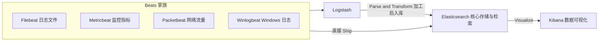

# Beats 采集、Logstash 加工、Elasticsearch 存储、Kibana 展示：Elastic Stack 全景分工

服务一多，日志就成了灾难现场：几十台机器各写各的文件，排障要一台台登上去 grep，想把访问量、错误率画成报表更是无从下手。Elastic Stack 就是为这一类问题准备的成套方案，数据有人收、有人存、有人加工、有人展示，各组件分工清楚。这一讲把整套技术栈的成员和它们之间的协作关系讲透，后面的安装与使用都建立在这张全景图上。

## 先给结论

- ELK 不是一款软件，是 Elasticsearch、Logstash、Kibana 三个软件首字母的组合；Beats 加入后官方改称 Elastic Stack。
- 数据主干只有一条：Beats 负责采集，可以直送 Elasticsearch，也可以先经 Logstash 加工再入库；Elasticsearch 负责存储与检索；Kibana 负责可视化。
- Elasticsearch 是整套栈的核心，基于 Java 与 Lucene 的开源分布式搜索引擎，分布式、零配置、自动发现、索引自动分片、副本机制、RESTful 风格都是它的标签。
- Beats 是采集家族而非单一组件，Filebeat 收日志文件、Metricbeat 收监控指标、Packetbeat 抓网络包、Winlogbeat 收 Windows 事件日志。
- Logstash 与 Beats 在「采集」上有功能重叠，因此在新架构里退到加工位，做过滤与转换（Parse & Transform）。

## 一、从 ELK 到 Elastic Stack：一次改名的来龙去脉

ELK 的名声比 Elastic Stack 大得多，但它从来不是一个产品的名字，而是三个软件名称首字母的缩写组合：E 取自 Elasticsearch，L 取自 Logstash，K 取自 Kibana。这套组合在日志分析领域流行多年，几乎成了「日志方案」的代名词。

后来组合里加入了一位新成员 Beats，负责数据采集。起名立刻成了问题：照老规矩该叫 ELKB？可如果往后还有新成员加入，难道一直往里插字母？官方的处理方式是放弃缩写，给整个技术体系起一个新名字 Elastic Stack，含义是「Elastic 公司的技术栈」，成员可以继续增加而名字不必再动。

所以两个名字的关系很明确：ELK 是老称谓，指三件套；Elastic Stack 是新称谓，包含的技术内容更多，日常交流里两者常被混用，但面试时能说清这一层来历，比背组件列表更能体现理解。

## 二、一张架构图看懂数据怎么流

整套栈的协作关系，官方用一张图就画完了，它也是后续每一讲的地图：



图上值得盯住的是那两条并存的入库路径。轻量场景里，Beats 采集到的数据直接 Ship 给 Elasticsearch，链路短、部署省；数据需要过滤、格式转换、富化时，就让 Logstash 站在中间做 Parse & Transform，加工完再交给 Elasticsearch。选哪条路取决于数据的干净程度，架构上留了两条路任选。

数据进入 Elasticsearch 之后，无论当初怎么采集、怎么加工，都经由它集中存储并提供检索，Kibana 再从 Elasticsearch 里取数渲染成图表。换句话说，采集端怎么玩都可以，最终都要先流进 Elasticsearch，这也是它被称作整套栈核心的原因。

## 三、四个成员各自干什么

**Elasticsearch：核心存储与检索引擎。** 基于 Java 开发的开源分布式搜索引擎，底层是开源全文检索库 Lucene（Elasticsearch 在它之上做了分布式与服务化封装）。官方给它的标签包括分布式、零配置、自动发现、索引自动分片、索引副本机制、RESTful 风格接口。在开源分布式搜索引擎这个领域里，它目前是份额最大的产品，最强的对手是 Apache 基金会的 Solr，而市场份额正在逐步反超。这些特点在下一讲还会逐一展开。

**Logstash：数据的收集与加工车间。** 基于 Java 开发的开源工具，官方定位是收集、分析、存储日志。它和 Beats 的功能在「采集」上有重叠，所以在 ELK 时代 L 承担采集，而如今采集的活更多交给轻量的 Beats，Logstash 退居图中中间那格，专心做解析与转换，比如按字段切分日志、过滤无用行、统一时间格式。

**Kibana：看得见的操作台。** 基于 Node.js 开发的界面工具，为 Elasticsearch 提供友好的 Web 界面，汇总、分析、搜索重要的数据，报表与仪表盘都靠它产出。对使用方来说，它是整套栈里唯一需要「打开浏览器」的部分。

**Beats：轻量采集家族。** 它是 Elastic Stack 里新加入的成员，专门做数据采集，本身是一组面向不同数据源的轻量级采集器：

| 成员 | 采集对象 | 典型场景 |
|---|---|---|
| Filebeat | 服务器日志文件 | 收集应用与中间件日志，取代了旧的 logstash-forwarder |
| Metricbeat | 外部系统监控指标 | 定期采集 Apache、HAProxy、MongoDB、MySQL、Nginx、PostgreSQL、Redis、Zookeeper 以及操作系统自身指标 |
| Packetbeat | 网络数据包 | 监控分析网络流量，支持 HTTP、DNS、MySQL、PostgreSQL、Redis、MongoDB、Memcache 等协议 |
| Winlogbeat | Windows 事件日志 | 收集 Windows 系统日志 |

家族式设计的好处是按需安装：要收日志装 Filebeat，要看数据库指标装 Metricbeat，采集器本身够轻量，几乎不占业务机器的资源。

## 四、两条路的写法感受一下

以最常见的「Filebeat 收日志送 Elasticsearch」为例，一个采集器就是一个配置文件（示例为按主流写法补全）：

```yaml
# filebeat.yml 最小可用配置
filebeat.inputs:
  - type: log
    enabled: true
    paths:
      - /haoke/logs/*.log    # 采集这个目录下所有日志文件

output.elasticsearch:
  hosts: ["172.16.55.185:9200"]   # 直送 Elasticsearch
```

数据入库后，用一条 REST 请求就能确认采集成果（示例为按主流写法补全）：

```bash
# 查看 Filebeat 建立的索引，有输出说明数据已经流进 ES
curl http://172.16.55.185:9200/_cat/indices?v
```

这两段配置对应图上的「直接 Ship」路径；如果换成 `output.logstash`，就走另一条路，由 Logstash 消费后再写 ES。架构上的两种选择，落到配置里就是换一个输出块，这也解释了为什么这套栈落地成本不高。

整套栈的学习路线也与这张图对应：先把核心 Elasticsearch 立起来（day13 与 day14），再让真实数据流进来（day15 房源搜索），最后补齐采集与可视化两端（day16 的 Beats、Kibana、Logstash），届时再用好客租房的真实数据把整条链路串一遍。

## 常见误区

- **把 ELK 当成一个软件安装。** 它是三个组件的组合，Elasticsearch、Logstash、Kibana 要分别下载、分别启动，版本还需要彼此匹配，出问题时也要按组件定位。
- **让 Logstash 扛所有采集。** Logstash 基于 JVM，资源消耗大，直接部署在业务机器上收日志会挤占业务资源；采集端的正确姿势是轻量的 Beats，Logstash 留在服务端做集中加工。
- **以为 Kibana 存数据。** Kibana 只是可视化与操作界面，所有数据都在 Elasticsearch 里；Kibana 挂了不影响数据，ES 挂了 Kibana 就是无米之炊。
- **四条链路混用采集器。** 抓网络包是 Packetbeat 的活，收文件日志用 Filebeat，选错成员要么收不到数据，要么拿到一堆无法解析的二进制。

## 面试可能被问到的问题

1. 面试官追问：「ELK 和 Elastic Stack 有什么区别？」
   答：ELK 是 Elasticsearch、Logstash、Kibana 三件套首字母的组合，是老称谓；Beats 加入后官方改称 Elastic Stack，覆盖的组件更多。改名的原因是缩写式命名无法容纳后续新成员，新名字与成员数量解耦。

2. 面试官追问：「Beats 和 Logstash 都能采集数据，为什么两个都要？」
   答：Beats 轻量，按数据源细分家族，适合部署在业务机器上做分布式采集；Logstash 基于 JVM 消耗大但加工能力强，适合在服务端集中做过滤、转换与富化。常见组合是 Beats 采集、Logstash 加工、Elasticsearch 入库，数据量小可以 Beats 直连 ES。

3. 面试官追问：「Elasticsearch 为什么是这套架构的核心？」
   答：所有采集路径最终都汇入 Elasticsearch，由它集中存储并提供检索能力，Kibana 的可视化也完全依赖它的查询接口。采集端可以换、加工层可以省，唯独存储与检索这一环不可替代，所以官方称它是 Elastic Stack 的核心。

4. 面试官追问：「Elasticsearch 和 Solr 是什么关系，底层又是什么？」
   答：两者都是开源分布式搜索引擎，是同一领域的直接竞争者，Solr 背靠 Apache 基金会，Elasticsearch 近年市场份额逐步领先。Elasticsearch 底层基于 Lucene，是在 Lucene 全文检索能力之上做了分布式、集群与服务化封装的产品。

5. 面试官追问：「Filebeat 收集的日志怎么到达 Elasticsearch？有几种路径？」
   答：两种。配置 `output.elasticsearch` 直送，链路短适合数据干净的小规模场景；配置 `output.logstash` 先送 Logstash 做解析过滤再入库，适合需要字段切分、格式统一的场景。两种路径只在采集器输出配置上切换，采集侧不用改。

6. 面试官追问：「要监控 Nginx 和 MySQL 的运行指标，选哪个组件？」
   答：Metricbeat。它按固定周期采集外部系统的监控指标，官方模块覆盖 Nginx、MySQL、Redis、MongoDB 等常见服务与操作系统自身，开启对应模块即可，不需要在目标服务上做侵入式改造。

## 配套资料

- 本课无配套源码包：`materials/code/03/day13-ElasticStack学习之Elasticsearch入门/` 与 `materials/code/03/day16-ElasticStack学习之Beats、Kibana、Logstash/` 下均只有解压清单 `_extracted.json`（记录解压文件数为 0），文中 `filebeat.yml` 与 curl 命令为按本课写法补全的示例，写法与 Beats 官方文档一致。
- Beats 家族成员与各自职责的原始出处为本课讲义画面（Filebeat、Metricbeat、Packetbeat、Winlogbeat 四件套及其采集对象清单），后续 day16 会逐个实操。
