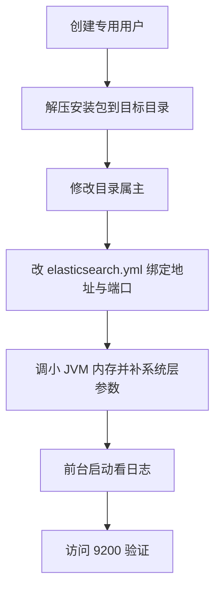
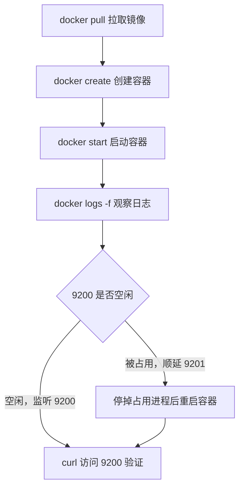
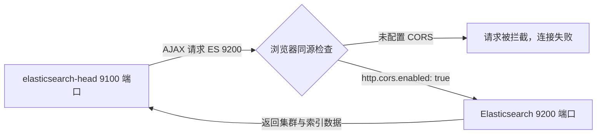
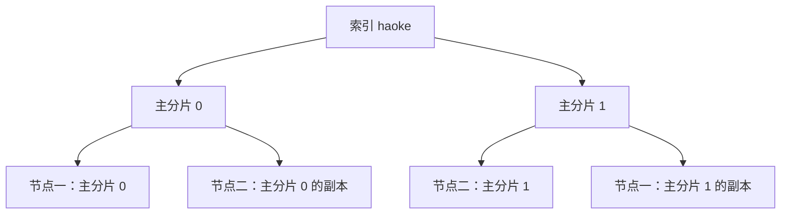
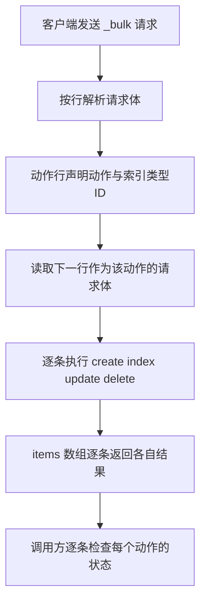
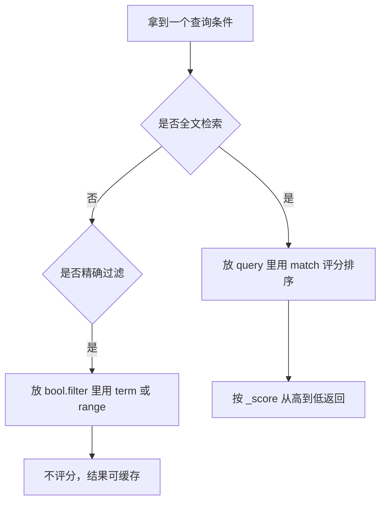
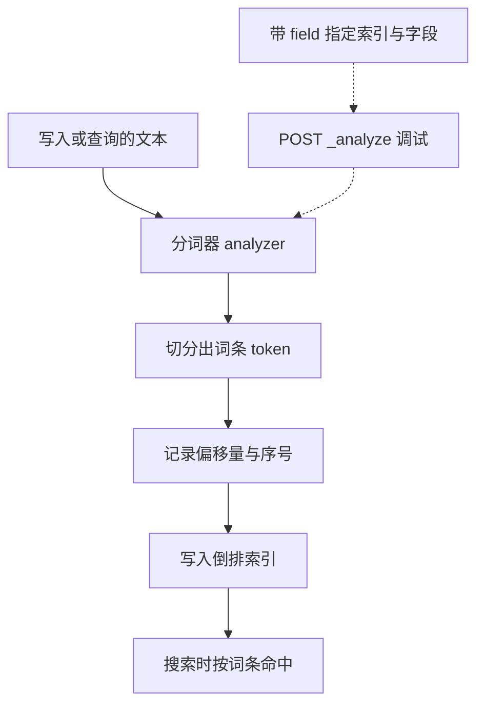
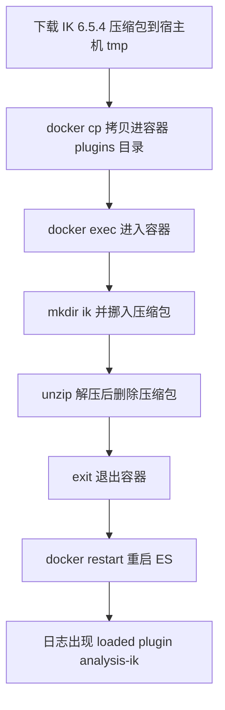
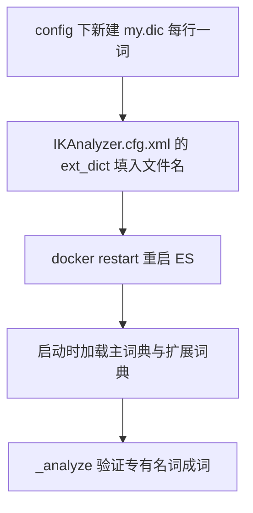

# Elasticsearch 从入门到中文分词：安装部署、核心概念、RESTful 实战与 IK 分词器全流程

## 先给结论

- 好客租房阶段的 Elasticsearch 系列全 9 课合并为一篇，路线是「它是什么与怎么装→head 图形界面→用 MySQL 思维建立概念→RESTful API 全套实操→文档核心详解→分词 API→IK 分词器安装与自定义词典」，从单机可用一路走到中文检索可用。
- 学的版本是 6.5.4：不是最新但与课程资料匹配，Elastic Stack 从 5.0 起全线统一版本号，掌握版本间差异点比追新版更重要；安装有官方压缩包与 Docker 两条路，单机必须建专用用户启动，root 会被直接拒绝。
- 端口先分清：9200 是对外 HTTP 接口，验证与客户端都走它；9300 是节点间 TCP 通信；9100 是 head 自己的端口，head 连接框里填的是 ES 的 9200 地址。
- 概念用 MySQL 类比一次到位：索引对应表而不是库，文档对应行，映射对应表结构，物理层还有分片与副本；type 正在退场，6.x 限单 type、7.x 移除，分类需求改用多索引。
- 文档操作的心智模型：更新是「删旧建新」，全量覆盖时未写的字段等于删除，局部更新用 POST `_update` 包 `doc`；删除是标记式的，磁盘空间在后台段合并时才回收。
- 查询与优化的两条主线：`text` 分词走全文检索、`keyword` 不分词走精确匹配；精确条件放 `filter`，不评分且能命中缓存，这是最省力的优化；`from/size` 深分页代价大，业务上要限制翻页深度。
- 分词是中文检索的生死线：`_analyze` 调试要带索引名，内置分词器对中文只会单字切分；解法是 IK 插件，版本必须与 ES 严格对应，`ik_max_word` 建索引保召回、`ik_smart` 做搜索减干扰。
- 自定义词典两条路：冷更新本地 `.dic` 文件加 `IKAnalyzer.cfg.xml` 配置，重启生效，文件要 UTF-8 每行一词；热更新 `remote_ext_dict` 指向 HTTP 地址，靠 `Last-Modified` 与 `ETag` 变化自动重载；扩词只影响之后写入的文档，存量数据要重新索引。
- 安装排障两条实录值得先记住：Docker 版里 ES 监听从 9200 顺延到 9201 是端口冲突自愈，先清掉占用进程而不是改配置；head 连不上绝大多数是 `http.cors.enabled` 与 `http.cors.allow-origin` 跨域配置缺失或改完没重启，Chrome 插件版因不受同源策略约束而免配置。
- 全系列演示环境是一台 ES 6.5.4 单节点，示例索引沿用课程项目口径，所有请求 URL 与响应结构都可直接在自己的单节点上复现，集群化是后续篇章的独立主题。

## 第1部分：把 Elasticsearch 跑起来：它是什么、版本怎么选、单机怎么装

学搜索引擎的第一道坎不是 API，而是把服务装起来。装的过程中问题一个接一个：Elasticsearch 和 Lucene 什么关系？版本号从 1.x 跳到 8.x，装哪个才不会掉坑？配置文件改完一启动，报错一屏也看不懂。这一篇按「认识它、选版本、装起来」三步走完入门前最关键的一段路，装完之后，后面所有 RESTful 接口的练习都在这套环境上进行。

### 一、Elasticsearch 是什么：给 Lucene 装上服务化的壳

搜索引擎领域的地基叫 Lucene，它是开源世界里全文检索做得最好的类库，但它的定位是「库」而不是「服务」：要把它用起来，得写 Java 代码、自己管索引文件、自己处理并发与恢复，直接嵌进应用系统成本很高。Elasticsearch 做的事情就是在这个地基上盖房子：封装 Lucene 的检索能力，对外提供一个开箱即用的搜索服务器。

官方给它的定义里有三个关键词值得逐个拆开。**分布式**，意味着它可以横向扩展成集群，存得下海量数据，小到一台笔记本、大到上千台机器承载 PB 级数据都能跑。**RESTful 风格**，意味着操作全部走 HTTP 接口，对客户端没有任何要求，Java、JavaScript、Python、PHP 都可以直接调，学习阶段一个 HTTP 工具就够了。**搜索与数据分析引擎**，意味着它不只做检索，聚合统计、日志解读这类分析也是它的本职。

官网列出的特性里，与日常使用关系最近的是这几条：查询能力强，结构化数据、非结构化文本、地理位置都能搜；速度快，全文检索靠倒排索引直达数据；弹性好，集群能自动检测硬件故障，配合跨集群复制与热备份保证可用性；数据结构灵活，存的是 JSON 文档，加字段不用改表。客户端生态也足够丰富，Java 侧官方提供的写法长这样（引自官网示例）：

```java
// 修正：RestHighLevelClient 没有 public 的 Builder 内部类，6.x 的标准构建方式是经 RestClient.builder 传入 HttpHost，原意不变（连接本机 9200 的 http 节点）
RestHighLevelClient client = new RestHighLevelClient(
    RestClient.builder(new HttpHost("localhost", 9200, "http")));

SearchSourceBuilder searchSourceBuilder = new SearchSourceBuilder();
searchSourceBuilder.query(QueryBuilders.matchQuery("state", "top_10_states"));
searchSourceBuilder.aggregation(AggregationBuilders.terms("top_10_states")
    .field("state")
    .size(10));
SearchRequest searchRequest = new SearchRequest();
searchRequest.source(searchSourceBuilder);
// 修正：6.5.4 的同步 search 方法签名要求传入 RequestOptions，原意不变（同步执行该查询并取回响应）
SearchResponse searchResponse = client.search(searchRequest, RequestOptions.DEFAULT);
```

同一段查询换成 curl、PHP、Python 写法几乎不变，这就是 RESTful 的好处：协议统一，语言无关。

### 二、倒排索引：快到不可思议的原因

「快到不可思议」不是营销话术，背后的机制一句话能说清：写文档时先把文本切成词，记录每个词出现在哪些文档里；查询时把查询语句也切成词，直接查这张「词到文档」的映射表。这张表就是倒排索引，它是与「文档到词」的正排相反方向的存储：

```text
文档1: 整租 两室 近地铁
文档2: 合租 主卧 近地铁
文档3: 整租 一室

倒排表:
整租   -> 文档1, 文档3
两室   -> 文档1
近地铁 -> 文档1, 文档2
```

查「整租 两室」时，引擎在倒排表里取出两个词对应的文档集合求交集，一步定位到文档 1，全程没有碰过无关数据；而关系型数据库的 `LIKE '%整租%'` 必须逐行扫描，数据量越大越慢。两条路线的分野在 day13 导览里已经画过，这里要补的是因果链：倒排索引决定了写入时必须先分词，分词质量决定搜索效果，所以中文场景才有了后面压轴的 IK 分词器一讲；倒排表也解释了为什么 ES 里一切都是「文档」，下一阶段的核心详解会围绕文档展开。

### 三、版本怎么选：为什么学 6.5.4 而不是最新的

Elasticsearch 的版本策略曾经是学习者的噩梦。5.0 之前，ELK 各组件的版本号互不相干，讲义里那张标题叫「It's complicated」的图表把混乱摆得明明白白：es 走到 1.4、1.5、1.7，kibana 却是 4.0、4.1，logstash 停在 1.5，beats 还在 1.0 Beta 1 到 Beta 3 之间徘徊。装一套日志系统，要靠一张对照表才能凑齐彼此兼容的版本。

| 阶段 | 版本状态 | 后果 |
|---|---|---|
| 5.0 之前 | 各组件版本号各自演进 | 版本兼容要查对照表，装错组合直接不通信 |
| 5.0 起 | Elastic Stack 全线统一版本号 | 一个版本号管所有组件，升级成套走 |
| 课程学习 | 选当时的最新版 6.5.4 | 环境统一，资料与报错都可在同一版本下对证 |

从 5.0 开始，所有 Elastic Stack 项目全部统一版本，这是版本问题真正的分水岭。课程录制时最新版是 6.5.4，就基于它学习。这里有一个值得想通的问题：为什么不追更新的版本？ES 迭代极快，每个版本的内容都有差异，教程、博客、报错方案大多与具体版本绑定，学习阶段用一套与资料匹配的稳定版本，遇到问题才能按图索骥；进企业后项目用什么版本就适配什么版本，注意版本间的差异即可。学的是能力，锁的是版本，这两件事分清楚，后面升级 7.x、8.x 时心里就不慌。

### 四、单机安装：从建用户到 started

整个安装过程六步，先上流程图，再逐步展开：



#### 4.1 建用户与解压

ES 出于安全考虑不允许用 root 用户运行，root 权限太大，进程一旦被攻破就是整机沦陷，所以第一步先建专用用户，再解压、改属主：

```bash
# 创建 Elasticsearch 用户，ES 不支持 root 用户运行
useradd elasticsearch

# 解压安装包到目标目录
tar -xvf elasticsearch-6.5.4.tar.gz -C /haoke/es/

# 把解压出的目录属主改成 elasticsearch，否则该用户无权读写
chown -R elasticsearch:elasticsearch es
```

`chown -R` 这步容易漏，属主还是 root 的话，切到 elasticsearch 用户启动会立刻报权限错误。

#### 4.2 三个配置文件

第一处是 `config/elasticsearch.yml`，改绑定地址与端口：

```yaml
# 绑定到本机对外 IP，默认只读本机
network.host: 172.16.55.185

# HTTP 服务端口
http.port: 9200

# 防脑裂：主候选节点数过半，单机设 1
discovery.zen.minimum_master_nodes: 1
```

`network.host` 默认指向本机回环地址，装在虚拟机里要改成虚拟机的 IP，改成什么跟着自己的机器走。第二处是 `config/jvm.options`，默认初始与最大堆内存都是 1G，测试机资源有限就调小：

```properties
# 测试环境 128m 足够跑通所有入门练习
-Xms128m
-Xmx128m
```

第三处在系统层。`network.host` 一旦不是 `localhost` 或 `127.0.0.1`，ES 会认定自己在生产环境，启动时执行严格的引导检查（bootstrap checks），其中一项就是单进程的内存映射区域数上限，需在 `/etc/sysctl.conf` 末尾追加参数并生效（示例值按主流写法补全，课程在文件末尾追加了对应参数）：

```bash
# 单进程最大内存映射区域数，ES 依赖 mmap 读取索引数据
vm.max_map_count=655360

# 保存后让参数立即生效
sysctl -p
```

如果启动时还报最大线程数不足，再到 `/etc/security/limits.conf` 里为 elasticsearch 用户提高 nproc 上限。引导检查报什么补什么，报错信息里写得很清楚。

#### 4.3 启动、验证与停止

进入 `bin` 目录执行启动脚本，第一次启动建议前台模式，日志看得见：

```bash
cd bin
./elasticsearch          # 前台启动，观察日志用
./elasticsearch -d       # 后台启动，确认无误后用
```

日志里按顺序出现三组关键字：`starting` 表示开始启动，随后是两个端口的绑定，`9300` 是节点间 TCP 通信端口，`9200` 是对外 HTTP 端口，IP 就是配置文件里写的那个；看到 `started` 即启动完成。验证方式是访问 9200 端口，浏览器或 HTTP 工具都行：

```bash
curl http://172.16.55.185:9200
```

返回的 JSON 就是 ES 的「身份证」：

```json
{
  "name" : "x30rcg",
  "cluster_name" : "elasticsearch",
  "version" : {
    "number" : "6.5.4",
    "lucene_version" : "7.5.0"
  },
  "tagline" : "You Know, for Search"
}
```

节点名、集群名、版本号都在这里，`lucene_version` 一栏正好印证了前面说的封装关系：ES 6.5.4 的内核是 Lucene 7.5.0。这段响应也是后面所有 RESTful 练习的第一个接口，同样的 GET 请求丢进 REST 客户端工具结果完全一致。

停止服务先用 `jps` 查进程号，再用不带参数的 `kill` 结束：

```bash
jps                      # 找到 Elasticsearch 进程号
kill 68072               # 平滑关闭，不要加 -9
```

ES 收到普通 kill 信号会走完整的关闭流程：停止接收新请求、把内存里的数据刷盘、通知集群。`kill -9` 直接掐断进程，跳过所有收尾，轻则启动变慢，重则数据损坏，这个习惯要从入门阶段就养好。

#### 4.4 一个安装期就会遇到的警告

磁盘剩余空间不足时，日志会持续刷 `high disk watermark [90%] exceeded` 警告，含义是磁盘使用率越过 90% 水位线，ES 会把分片从这台节点上迁走。入门阶段它不影响功能，但看到警告就该清磁盘或调低水位阈值，别把它当成报错去改配置文件瞎折腾。

## 第2部分：四条命令把 Elasticsearch 跑进容器：Docker 版安装与 9201 端口疑案

上一篇用解压方式装了 Elasticsearch：建专用用户、解压、改属主、调系统参数，一步都不能省。如果机器上本来就有 Docker，这套流程可以压缩成四条命令。命令变少的代价是排查问题的路径也变了：这一篇把 Docker 版装法走一遍，顺手解开一个第一次启动几乎人人会撞上的怪现象，日志里监听的端口明明应该是 9200，却变成了 9201。

### 一、四条命令装好一个 ES

命令来自课程讲义的 Docker 安装小节，逐条执行即可：

```bash
# 拉取镜像
docker pull elasticsearch:6.5.4

# 创建容器
docker create --name elasticsearch --net host -e "discovery.type=single-node" -e "network.host=172.16.55.185" elasticsearch:6.5.4

# 启动
docker start elasticsearch

# 查看日志
docker logs -f elasticsearch
```

镜像不大，`docker images` 里可以看到 `elasticsearch:6.5.4` 只占 774 MB。创建容器这一长串参数是理解的关键，逐个拆开：

| 参数 | 作用 |
|---|---|
| `--name elasticsearch` | 容器名，后面 start、stop、logs 都用它引用 |
| `--net host` | host 网络模式，容器共享宿主机网络栈 |
| `-e "discovery.type=single-node"` | 单节点模式启动，跳过集群发现 |
| `-e "network.host=172.16.55.185"` | ES 绑定的地址，与解压版 `elasticsearch.yml` 里那次修改等价 |
| `elasticsearch:6.5.4` | 镜像名加版本，与上一篇选定的版本保持一致 |

`docker create` 加 `docker start` 的组合与 `docker run` 等价，区别只是把「创建」和「启动」拆成两步，创建失败时能分清是镜像问题还是启动问题，排错时更清晰。

### 二、host 网络模式：为什么命令里没有 -p

常规 Docker 容器跑在桥接网络里，有自己的独立 IP，宿主机之外的机器访问不到，必须用 `-p 9200:9200` 这类映射把端口转进去。host 模式干脆跳过了这一层：容器不再有独立网络栈，进程直接监听在宿主机上，ES 监听什么端口，宿主机上就是什么端口。

上一篇讲过 ES 有两个端口：9200 是对外的 HTTP 端口，所有 RESTful 请求走它；9300 是节点间 TCP 通信端口，集群内部选主与数据同步走它。host 模式下这两个端口天然暴露，不需要任何映射。对 ES 这种自身就要占一堆端口、还经常跑在专用 Linux 机器上的服务，host 模式是最省事的选择。

单节点参数也值得多说一句。ES 启动后的默认行为是寻找其他节点组集群，学习环境里只有它自己，`discovery.type=single-node` 直接声明「集群就我一个节点」，省掉发现等待和相关引导检查，这是官方为单机场景准备的开关。

### 三、启动日志与 9201 疑案

`docker logs -f` 以跟随模式输出日志，启动过程中按顺序抓两组关键字：`starting` 表示开始启动，之后是端口绑定信息，最后看到 `started` 即启动完成。完整的路径如下：



第一次启动时日志里出现了这样的绑定信息：监听端口是 9201 而不是 9200。原因不在容器配置里，而是宿主机上按解压方式装的旧 ES 还没有停掉，9200 被它占着。ES 的 `http.port` 默认取值区间是 9200 到 9300，发现默认端口不可用时会自动往后顺延一个，于是挂到了 9201。

处理方式是把旧服务停干净，再重启容器：

```bash
# 停掉占用 9200 的旧容器（如有）
docker stop 旧容器名

# 找到解压版 ES 的进程号并平滑结束，kill 后不带 -9
jps
kill 6779

# 重新启动 Docker 版
docker start elasticsearch
```

再次观察日志，绑定端口回到 9200。此时访问一下服务，返回的 JSON 与解压版完全同构：

```json
{
  "name" : "VsaZJSG",
  "cluster_name" : "elasticsearch",
  "cluster_uuid" : "xxxxxxxxxxxxxxxxxx",
  "version" : {
    "number" : "6.5.4",
    "build_flavor" : "default",
    "build_type" : "tar",
    "lucene_version" : "7.5.0"
  },
  "tagline" : "You Know, for Search"
}
```

节点名与集群 UUID 和解压版那次不一样，这很正常，它们是启动时生成的身份信息；但版本号一致，6.5.4 对应的 Lucene 内核还是 7.5.0。两种安装方式最终得到的是同一个 ES。

### 四、容器方案的两个遗留问题

命令简单了，两件事也被暂时搁下了，它们都会在后面补课。

**第一，内存没有限制。** ES 默认堆内存 1G，容器里的进程同样按这个默认值跑，测试机内存紧张时容易把宿主机拖垮。主流做法是通过环境变量 `ES_JAVA_OPTS` 把堆压小（本课画面未加此参数，以下示例按主流写法补全）：

```bash
docker create --name elasticsearch --net host \
  -e "discovery.type=single-node" \
  -e "network.host=172.16.55.185" \
  -e "ES_JAVA_OPTS=-Xms256m -Xmx256m" \
  elasticsearch:6.5.4
```

**第二，数据在容器里裸奔。** 没有挂载数据目录意味着所有索引数据都写在容器可写层，容器一删数据全没。课程演示阶段接受这个简化，讲集群时再补数据卷挂载的配置。同理，下一篇要给 ES 加跨域配置时也得改容器内的 `elasticsearch.yml`，改配置的姿势到时一起讲。

## 第3部分：给 Elasticsearch 配个图形界面：elasticsearch-head 的装法与跨域配置

ES 装好之后，所有操作都只能靠 REST 接口：想看集群里有哪些索引、某个索引里存了什么数据，都得自己拼 URL 发请求。官方没有提供管理界面，这个空缺由一个开源前端工具 elasticsearch-head 来补。装它的过程会撞上一个必然出现的坑：页面装好了，点「连接」却连不上集群，报错与跨域有关。这篇把工具装起来，把这个坑讲透。

### 一、ES 为什么需要一个 head

ES 是一个纯服务，对外只有 RESTful API，官方刻意没做管理界面。日常开发里最常见的动作偏偏是「看」：看看索引建出来了没有、分片分布在哪个节点、写进去的数据长什么样。全靠命令行拼接口，效率很低。

elasticsearch-head（源码托管在 GitHub 的 `mobz/elasticsearch-head` 仓库）就是为这件事生的：一个专门针对 ES 的 Web 管理界面，能看节点与集群健康状态、能建索引删索引、能浏览数据、能用复合查询窗口直接发请求。它的定位要记牢：**它是一个纯前端页面应用**，运行后通过浏览器向 ES 的 9200 端口发 HTTP 请求。这个定位正是后面跨域问题的根源。

### 二、四种安装方式怎么选

官方 README 给出四种方式，各有适用场景：

| 方式 | 做法 | 是否推荐 |
|---|---|---|
| 源码安装 | `git clone` 源码，`npm install` 后 `npm run start` | 不推荐，额外要装 Node 环境 |
| Docker 安装 | 拉镜像建容器，两条命令搞定 | 推荐 |
| Chrome 插件 | 浏览器应用商店安装扩展 | 推荐，点开即用 |
| ES 插件安装 | 作为 ES 的站点插件加载 | 已废弃，不推荐 |

源码方式的完整命令如下（来自官方 README，需要先装好 Node.js）：

```bash
git clone git://github.com/mobz/elasticsearch-head.git
cd elasticsearch-head
npm install
npm run start
# 启动后访问 http://localhost:9100/
```

Docker 方式是课程演示使用的方式，命令只有三行：

```bash
# 拉取镜像
docker pull mobz/elasticsearch-head:5

# 创建容器
docker create --name elasticsearch-head -p 9100:9100 mobz/elasticsearch-head:5

# 启动容器
docker start elasticsearch-head
```

注意这里的网络方式和上一篇装 ES 不一样：head 用的是常规的 `-p 9100:9100` 端口映射，桥接网络。它是普通 Web 应用，映射一个端口就够，不需要 host 模式那种整栈共享。ES 插件方式提一句背景即可：老版本 ES 支持把这类工具作为站点插件嵌进服务，5.x 之后这条路线被废弃，网上老资料里的 `plugin -install` 命令不要再试。

### 三、装好先别高兴：连不上才是重点

容器启动后，浏览器访问 `http://172.16.55.185:9100`（IP 换成自己机器的），能看到 head 的界面。在顶部连接框填上 ES 地址 `http://172.16.55.185:9200`，点「连接」，结果是连不上。

这不是安装出了问题，而是浏览器的同源策略在拦截。head 页面从 9100 端口加载，页面里的脚本向 9200 端口发 AJAX 请求，协议、域名、端口三项里端口不同，浏览器就判定为跨源请求，默认直接拦掉。head 与 ES 是两个独立服务，端口天然不同，所以这个坑是结构性的，不装个图形界面都不知道前端世界还有这道墙。

解法是让 ES 服务端主动放行：在 `config/elasticsearch.yml` 末尾追加两行 CORS 配置，然后重启 ES：

```yaml
# 是否开启跨域支持
http.cors.enabled: true

# 允许跨域请求的来源，* 表示全部放行
http.cors.allow-origin: "*"
```

`http.cors.enabled` 打开后，ES 会在 HTTP 响应里带上跨域放行头，浏览器检查通过才把响应交给页面。重启后回到 head 界面再点连接，集群信息就出来了：节点列表、索引条目、分片在节点上的分布、每条数据的内容都能直接看。整个连接路径如下：



图里的关键分叉在同源检查那一环：CORS 配置加上之后，同一个请求从「被拦截」变成「放行」，head 与 ES 本身的代码都没有变。

还有个实操细节：如果 ES 是按上一篇的 Docker 方式跑的，改配置要 `docker exec` 进容器编辑 `elasticsearch.yml` 再 `docker restart`，比较麻烦。课程演示时改用了解压版的 ES 来配 CORS，改完重启即可；更规范的做法是把配置目录挂载成宿主机卷，直接在宿主机上改文件。

### 四、Chrome 插件：没有跨域烦恼的推荐姿势

Chrome 应用商店里有 elasticsearch-head 的扩展，安装后浏览器工具栏点一下就打开，界面与 Docker 版完全一致，连接 ES 直接就通，不需要任何跨域配置。

原因在前端的机制里：插件不是运行在某个源下的普通网页，浏览器给扩展的是扩展权限体系，不受页面同源策略约束，它发的请求不需要服务端 CORS 放行。加上插件不用在服务器上跑容器或进程，不占服务器资源，点开即用，所以课程把它列为更推荐的方式。

它的限制只有一个：应用商店的可达性。网络环境访问不了商店时，退回 Docker 方式即可，两者功能完全一样。

## 第4部分：用 MySQL 的思维学 Elasticsearch：索引、文档、分片一次理清

环境装好了，真正拦住初学者的是概念。索引听上去像「数据库」，实际对应的是表；文档是一行 JSON，却要求同名字段类型一致；type 在老资料里满天飞，新版本里又被移除了。概念错位带来的直接后果是设计索引时乱建、看报错时看不懂。这一篇把六个核心概念一次理清，每个都给一个 MySQL 世界的对应物。

### 一、索引 Index：它是表，不是库

索引是一组相关数据的逻辑存储单元，往里面放的是同一类业务数据。两个类比都成立：对着关系型数据库，它是**表**，不是数据库，这一步最容易错位；对着 MongoDB，它是集合（collection），因为两者存的都是 JSON 结构的文档，气质更接近。

还有一层定位要分清：索引的结构是为全文检索准备的，业务系统里它通常作为数据库之外的搜索层存在，房源、商品这类需要被搜索的数据同步一份进来供检索，原始数据的「正宫」仍然在数据库里。

索引是逻辑概念，物理上它可以整体放在一台机器，也可以分散到多台机器上，跨机器拼成一个大的索引库。支撑这个能力的是两个物理概念：

**第一，分片（shard）。** 每个索引由一个或多个分片组成，每个分片是一份独立、完整的索引切片，可以落在不同机器上。数据量一台机器装不下时，加机器加分片就解决，这是 ES 横向扩展的基本盘。

**第二，副本（replica）。** 每个分片可以有多个副本，副本是分片的复制品，落在别的节点上。机器挂了副本顶上，数据不丢；查询也能分流到副本，读吞吐量跟着涨。

一张图看懂索引、分片、副本与机器的关系：



图里每个主分片在另一个节点上都有一份副本，任何一个节点下线，索引仍然完整可用。分片管「装得下、扛得住」，副本管「丢不了」，两者配合就是 ES 分布式能力的地基。

### 二、文档 Document：一行 JSON

文档是存进 ES 的数据本体，一条文档就是一条 JSON，对应关系型数据库表里的一行记录。ES 的文档与 MongoDB 的文档气质类似：同一索引下的文档结构可以不同，这一条有 `rent` 字段，那一条可以没有，比关系型数据库「表结构锁死所有行」灵活得多。

灵活有一条硬边界：**同名字段的类型必须一致。** 同一个索引里，这条文档的 `age` 是整数，那条文档的 `age` 就不能是字符串；`name` 这边是文本，那边就不能是数值。类型冲突的数据写进去，检索行为会乱套。

文档由一个或多个字段组成，字段对应表里的列，但能力比列强：

```json
{
  "id" : 1001,
  "title" : "整租 两室一厅 近地铁",
  "rent" : 3600,
  "tags" : ["近地铁", "精装修", "押一付三"],
  "location" : {
    "city" : "北京",
    "district" : "朝阳区"
  }
}
```

这份示例文档（按本课写法补全）里藏着字段的三种能力。**第一，多值字段：** `tags` 是数组，一个字段装多个值，还允许重复出现在文档里；关系型数据库里做不到，一行里不可能有两个叫 `tags` 的列，要表达多值得另开一张表。**第二，复杂类型：** `location` 是嵌套对象，一个字段里还能装别的文档或数组，层次化数据直接存。**第三，类型丰富：** 文本、数值、日期这些常规类型之外，上面两种复杂类型也原生支持。

### 三、映射 Mapping：写入前定好的分析规则

建 MySQL 表时要先定结构：哪个列什么类型、多长、可不可以空。ES 里对应这件事的叫映射，它是索引的结构定义，可以类比成表结构 schema。

映射管的不只是类型，更重要的是**分析规则**：文本写进来之后怎么切分、哪些词条会被过滤掉、哪些字段要参与全文检索。这些规则决定倒排索引长什么样，直接决定搜索效果，所以正式场景里映射要在写入数据前就设计好。

它同时保留了弹性：不定义映射也能直接写数据，ES 会根据第一条文档推断字段类型，自动生成映射，这个机制叫动态映射，下一篇 RESTful 实战里就能亲手试到。下面是一个显式定义映射的示例（按主流写法补全，课程画面未展开此步）：

```json
{
  "properties" : {
    "title" : {
      "type" : "text"
    },
    "rent" : {
      "type" : "integer"
    },
    "postDate" : {
      "type" : "date"
    }
  }
}
```

`title` 声明为 `text` 类型参与分词检索，`rent` 是精确数值，`postDate` 是日期，字段的角色在设计阶段就定清楚，后面写数据时按规则走。

### 四、文档类型 Type：正在退场的老概念

类型解决的是另一个维度的问题：一个索引里能不能装多种用途的对象。关系型数据库里表结构固定，一张表只能装一类数据；ES 老版本允许一个索引下挂多个 type，比如博客应用的一个索引里，`article` 类型的文档存文章，`comment` 类型的文档存评论，各自结构不同。

多 type 有一条硬约束：**不同 type 的同名字段，类型必须全局统一。** 同一索引里，`article` 有个 `title` 是文本，`comment` 也有个 `title`，那它也必须是文本，不能一边字符串一边数值。原因是底层分片上字段定义是整个索引共享一份的，type 只是文档上打的一个标签，撑不起「每种类型一套结构」的语义。

这条约束也宣告了它的命运：6.x 起一个索引只允许一个 type，7.x 起 type 从 API 里移除，URL 中对应位置变成固定的占位 `_doc`。课程用的是 6.5.4，下一节的接口 URL 里还能看到 `user` 这样的 type，学习时知道它的历史角色即可，设计新索引时不再用它区分业务对象，要区分就多建几个索引。

六个概念与 MySQL 的对照收拢成一张表：

| Elasticsearch | MySQL | 备注 |
|---|---|---|
| Index 索引 | Table 表 | 是表不是库，也对应 MongoDB 的集合 |
| Document 文档 | Row 行记录 | 一条 JSON，同名字段类型必须一致 |
| Field 字段 | Column 列 | 支持数组多值与对象嵌套 |
| Mapping 映射 | Schema 表结构 | 额外定义分词与过滤规则 |
| Type 文档类型 | 无直接对应 | 6.x 弱化，7.x 移除 |
| Shard 分片 | 分库分表的近似物 | 分布式的物理单元，MySQL 没有原生对应 |
| Replica 副本 | 主从复制的从库近似物 | 目的是数据安全与读扩展 |

## 第5部分：Elasticsearch RESTful API 实战：从索引管理到聚合查询

ES 的全部能力都暴露在一组 RESTful 接口上：HTTP 方法表达动作，URL 表达资源，剩下的就是拼请求。这一篇把入门阶段要用的接口一次走完，覆盖八个场景：建索引删索引、文档的增改删、按 ID 与按条件的 URL 搜索、DSL 复杂查询、高亮、聚合。所有命令都按本课演示用的 6.5.4 版本整理，地址里的 IP 换成自己的 ES 服务地址即可直接复制执行。

### 一、索引管理：PUT 创建，DELETE 删除

索引类比 MySQL 的表，没有它数据无处安放。创建索引有两条路：head 界面点「新建索引」，填名称、分片数、副本数；或者直接发 API。界面方式直观但不可复现，工程上以 API 为准。

创建一个名为 `haoke` 的索引（本项目的索引名），两个分片、零副本：

```bash
PUT http://172.16.55.185:9200/haoke
{
  "settings": {
    "index": {
      "number_of_shards": "2",
      "number_of_replicas": "0"
    }
  }
}
```

用 REST 客户端发这个请求时要记得把请求头 `Content-Type` 设为 `application/json`，否则 6.x 会直接拒绝请求。返回 200，响应体核心是 `"acknowledged": true`，回到 head 里刷新，就能看到 `haoke` 出现在节点上，带着两个分片。

```json
{
  "acknowledged" : true,
  "shards_acknowledged" : true,
  "index" : "haoke"
}
```

这里创建的是**非结构化索引**：建索引时没有声明任何字段与类型，直接就能写数据。ES 底层依然是结构化存储，只是它会在写入时根据数据判断每个字段的类型并生成映射，这个判断对使用者透明，判断规则后面讲映射时展开。顺带修正一个容易记反的点：非结构化索引连创建都可以省，第一条数据写进来时 ES 会自动把索引建出来，学习阶段显式创建只是为了控制分片数和副本数。

删除索引用 DELETE 方法，URL 不需要请求体：

```bash
DELETE http://172.16.55.185:9200/haoke
```

```json
{
  "acknowledged" : true
}
```

删索引是危险动作，索引没了里面的数据全没了，head 界面里删索引还强制要求手动输入「删除」两个字做二次确认，这个设计值得欣赏。

### 二、文档增删改：一切更新都是覆盖

#### 2.1 新增：指定 ID 与自动生成 ID

新增文档的 URL 规则是「索引/类型/文档 ID」，对它发 POST 请求。插入一条用户数据，文档 ID 用 1001：

```bash
POST http://172.16.55.185:9200/haoke/user/1001
{
  "id" : "1001",
  "name" : "张三",
  "age" : 20,
  "sex" : "男"
}
```

响应状态码是 201 Created，响应体是一条完整的元数据：

```json
{
  "_index" : "haoke",
  "_type" : "user",
  "_id" : "1001",
  "_version" : 1,
  "result" : "created",
  "_shards" : {
    "total" : 2,
    "successful" : 1,
    "failed" : 0
  }
}
```

注意 URL 里的 `1001` 与请求体里的 `"id": "1001"` 不是同一个东西。URL 上的是 `_id`，文档在索引里的主键；请求体里的是业务字段，恰好值相同而已。响应里的 `_index`、`_type`、`_id`、`_version` 这组信息是元数据，原始数据在 `_source` 里。

文档 ID 也可以不指定，URL 少掉最后一段，让 ES 自动生成一个随机字符串 ID：

```bash
POST http://172.16.55.185:9200/haoke/user/
{
  "id" : "1002",
  "name" : "李四",
  "age" : 21,
  "sex" : "女"
}
```

两者的方法选择有一条规则：**指定了 ID 的写入，PUT 与 POST 都能成功；不指定 ID 意味着这是一条全新数据，只能用 POST**，换成 PUT 会得到 405 方法不允许。这个规则不用死记，RESTful 语义里新增本来就是 POST，全部统一用 POST 即可。

#### 2.2 更新：全量覆盖与局部更新

ES 里的文档不可修改，这是存储结构决定的。想改数据只有覆盖一条路，最直接的方式是把整条文档重新 PUT 一遍：

```bash
PUT http://172.16.55.185:9200/haoke/user/1001
{
  "id" : 1001,
  "name" : "张三",
  "age" : 21,
  "sex" : "女"
}
```

响应里 `result` 变成 `updated`，`_version` 从 1 涨到 2。每次覆盖版本号都递增，再改成 25、再改成 26，版本一路往上走。漏字段的后果是丢数据：覆盖请求体里没写的字段，写完就真的没有了。

只改年龄却要把姓名性别全部重抄一遍很笨，ES 提供了局部更新的接口，在 URL 末尾加 `_update`：

```bash
POST http://172.16.55.185:9200/haoke/user/1001/_update
{
  "doc" : {
    "age" : 23
  }
}
```

这里有两个必踩的坑，课程里是当着镜头踩完的。**第一，方法必须 POST**，用 PUT 会得到 405，`_update` 接口不收 PUT。**第二，请求体必须包一层 `"doc"`**，直接写 `{"age": 23}` 会得到 400，报错信息是 Validation Failed，提示缺少 `doc` 字段，意思是告诉 ES 你要更新文档的哪些内容，得通过 `"doc"` 这个键声明。

局部更新对外是「只改一个字段」，内部依然是覆盖式的四步流程：


检索、修改、删除旧文档、索引新文档，这四步 ES 替使用者做了而已，本质仍是覆盖。响应里的 `_version` 照样递增，也印证了这一点。

#### 2.3 删除：标记删除与 404

删除文档用 DELETE 方法，URL 定位到具体文档：

```bash
DELETE http://172.16.55.185:9200/haoke/user/1002
```

删除成功时 `result` 为 `deleted`，`_version` 同样递增。对同一条文档再删一次，得到的是 404 状态码，`result` 为 `not_found`，文档已经不存在了。

一个反直觉的细节：删除文档并不会立刻从磁盘上移除，只是在内部标记为已删除，ES 会在后续添加更多数据、后台合并存储段时才真正做物理清理。延迟清理换来的是删除操作的高性能，这套思路和很多存储引擎一致。

### 三、URL 搜索：从查一条到查全部

搜索是 ES 的主场，入门先掌握三种 URL 写法。

按文档 ID 查，GET 请求直接定位：

```bash
GET http://172.16.55.185:9200/haoke/user/1001
```

```json
{
  "_index" : "haoke",
  "_type" : "user",
  "_id" : "1001",
  "_version" : 2,
  "found" : true,
  "_source" : {
    "id" : 1001,
    "name" : "张三",
    "age" : 20,
    "sex" : "男"
  }
}
```

`found` 为 `true` 表示命中，`_source` 是写入时的原始数据，其余都是元数据。ID 不存在时 `found` 为 `false`，状态码 404。

查全量数据，在类型后面跟 `_search` 指令：

```bash
GET http://172.16.55.185:9200/haoke/user/_search
```

```json
{
  "took" : 26,
  "timed_out" : false,
  "_shards" : {
    "total" : 2,
    "successful" : 2,
    "skipped" : 0,
    "failed" : 0
  },
  "hits" : {
    "total" : 5,
    "max_score" : 1.0,
    "hits" : [ ]
  }
}
```

`hits.total` 是命中的总数，`hits.hits` 数组里是文档列表。这里有个默认行为要知道：**即使命中 100 条，响应里默认也只返回 10 条**，分页参数后面讲，先记住默认值是 10。

按条件查，`_search` 后面用 `q` 参数拼条件，比如查年龄等于 21 的用户：

```bash
GET http://172.16.55.185:9200/haoke/user/_search?q=age:21
```

命中结果同样装在 `hits` 里。条件简单时这种写法最快，条件一多 URL 就变得又长又乱，编码规则也容易踩坑，这就轮到 DSL 出场。

### 四、DSL 搜索：把查询条件写成 JSON

DSL（Domain Specific Language）搜索把查询条件从 URL 搬进请求体，用 JSON 表达。查年龄等于 20 的用户：

```bash
POST http://172.16.55.185:9200/haoke/user/_search
{
  "query" : {
    "match" : {
      "age" : 20
    }
  }
}
```

`query` 是查询条件的入口，`match` 是匹配类型的查询，含义是「找 `age` 等于 20 的文档」，结果与 `?q=age:20` 一致，但条件表达能力完全不在一个量级。请求方法用 POST 的原因：请求体要跟着请求走，而 GET 带请求体在很多客户端与代理工具里支持不佳，约定俗成这类查询统一 POST（ES 服务端其实两种方法都认）。

工具选择也在这里分野：Advanced REST Client 这类工具编辑 JSON 靠手敲空格排版，Postman 对 JSON 的编辑体验好得多，装成浏览器插件或桌面应用都行，后面的复杂查询都在 Postman 里演示。

复杂条件的需求来了：查年龄大于 22 岁的男性用户。条件有两个，查询结构用 `bool` 组合，`must` 放必须匹配的条件，`filter` 放过滤条件：

```bash
POST http://172.16.55.185:9200/haoke/user/_search
{
  "query" : {
    "bool" : {
      "must" : [
        {
          "match" : {
            "sex" : "男"
          }
        }
      ],
      "filter" : {
        "range" : {
          "age" : {
            "gt" : 22
          }
        }
      }
    }
  }
}
```

`range` 配 `gt` 表达大于，还可以用 `gte`、`lt`、`lte` 表达大于等于、小于、小于等于。讲义里的原例是「年龄大于 30 岁的男性」，课程演示数据里年龄在 20 到 24 之间，照搬查不出结果，于是把阈值改成 22，这一点动手复现时要注意。`must` 与 `filter` 的分工还有一层性能含义：`must` 的 `match` 要参与相关性评分，`filter` 只做过滤不评分，能用 `filter` 的条件尽量放 `filter`。

DSL 也能做全文搜索，直接 `match` 一个文本字段：

```bash
POST http://172.16.55.185:9200/haoke/user/_search
{
  "query" : {
    "match" : {
      "name" : "张三 李四"
    }
  }
}
```

查询意图看似「找名字精确等于张三 李四的人」，实际结果把张三和李四都查了出来。原因是 `match` 对关键词先做分词再检索，中文默认分析器把这段词拆成了单字，拆出的词条分别去倒排索引里命中。分词器决定了全文搜索的命中间，这是 ES 的重头戏，后面单独展开。

### 五、高亮：命中词为什么要套上 em 标签

高亮的效果人人都见过：在搜索引擎搜一个关键词，结果列表里命中词全部变红。用浏览器的开发者工具看一下搜索引擎的结果页就能看穿原理：普通文字没有任何标记，命中的关键词被 `<em>` 标签包住，样式表给 `em` 设置了红色，去掉这条样式，关键词立刻「泯然众人」。

所以高亮的本质不是渲染，而是**数据层把命中的词用标签包好返回**，前端拿到后按需着色。ES 原生支持这件事，在查询里加一个 `highlight` 块，声明要对哪些字段高亮：

```bash
POST http://172.16.55.185:9200/haoke/user/_search
{
  "query" : {
    "match" : {
      "name" : "张三 李四"
    }
  },
  "highlight" : {
    "fields" : {
      "name" : { }
    }
  }
}
```

响应里每条命中文档会多出一个 `highlight` 字段，内容是切好的片段：

```json
"highlight" : {
  "name" : [ "<em>张</em><em>三</em>" ]
}
```

命中的词被 `<em>` 包住返回，前端给 `em` 加样式就得到搜索结果页那种红色标注。这份响应还顺手证实了上一节的说法：`<em>` 包住的是「张」和「三」两个单字，关键词确实被分词了。

### 六、聚合：ES 里的 group by

聚合（aggs）做的是统计分析，类比 SQL 的 `group by`：按某个字段分组，统计每组的文档数。查每个年龄各有多少人：

```bash
POST http://172.16.55.185:9200/haoke/user/_search
{
  "aggs" : {
    "all_ages" : {
      "terms" : {
        "field" : "age"
      }
    }
  }
}
```

`aggs` 是聚合入口，`all_ages` 是这次聚合的自定义名字，`terms` 表示按字段值分组。响应里的聚合结果长这样：

```json
{
  "aggregations" : {
    "all_ages" : {
      "doc_count_error_upper_bound" : 0,
      "sum_other_doc_count" : 0,
      "buckets" : [
        { "key" : 20, "doc_count" : 2 },
        { "key" : 21, "doc_count" : 1 },
        { "key" : 22, "doc_count" : 1 },
        { "key" : 23, "doc_count" : 1 },
        { "key" : 24, "doc_count" : 1 }
      ]
    }
  }
}
```

`buckets` 是分组结果数组，每个桶的 `key` 是分组值（年龄），`doc_count` 是该组的文档数。课程演示时先查了一遍，为了让结果有层次，用局部更新把赵六的年龄改成 20，再查一遍，20 岁那一组的 `doc_count` 变成了 2，一个聚合验证了两种接口。

聚合能叠加在查询条件之上，`query` 与 `aggs` 写在同一个请求体里，先筛选再分组，对应 SQL 里 `where` 与 `group by` 的组合。到此为止，CRUD、搜索、高亮、聚合的接口骨架全部过完，后面进阶篇会把每一块往深处拆。

## 第6部分：Elasticsearch 核心详解：文档、映射与结构化查询

索引建好、文档插进去之后，返回体里那一串下划线开头的字段到底是什么？搜索为什么默认只给 10 条？同样是查「年龄等于 20」，`term` 和 `filter` 写法都能出结果，又该用哪个？这一篇把 ES 文档层的核心机制一次讲透：文档与元数据、响应控制、HEAD 探测、批量读写、分页、映射，再到 term 与 bool 结构化查询。所有命令基于课程演示的 ES 6.5.4，把地址里的 IP 换成自己的 ES 服务地址即可直接复制执行。

### 一、文档：JSON 存储与元数据

ES 里的文档就是一个 JSON 对象，前面插入的用户数据都是扁平结构，实际上它可以继续嵌套对象，比如给用户挂一段身份信息：

```bash
POST http://172.16.55.185:9200/haoke/user/1005
{
  "id" : "1005",
  "name" : "张三",
  "age" : 20,
  "sex" : "男",
  "card" : {
    "card_number" : "123456789"
  }
}
```

`card` 是一个复杂对象。写入成功后，head 工具的列表页里看不出任何区别，点开这条文档的详情才能看到嵌套结构。把整条文档读回来长这样：

```json
{
  "_index" : "haoke",
  "_type" : "user",
  "_id" : "1005",
  "_version" : 1,
  "_score" : 1,
  "_source" : {
    "id" : "1005",
    "name" : "张三",
    "age" : 20,
    "sex" : "男",
    "card" : {
      "card_number" : "123456789"
    }
  }
}
```

返回体天然分成两部分：上面那串下划线字段是元数据，`_source` 里的才是原始数据。三个最关键的元数据如下：

| 元数据 | 说明 |
|---|---|
| `_index` | 文档存储的地方，类比数据库 |
| `_type` | 文档代表的对象的类，类比表 |
| `_id` | 文档的唯一标识，类比主键 |

**第一，索引只是逻辑空间。** 数据实际被存储和索引在分片上，索引只是把一个或多个分片组合在一起的逻辑命名。分片分布在哪个节点、怎么路由，全部由 ES 负责，对使用者透明。

**第二，`_type` 是文档类型。** 同一类对象放进同一个类型，数据结构保持一致：用户数据放 `user`，商品数据放 `product`，对应关系型数据库里「一张表一种结构」。每个类型有自己的映射，告诉 ES 这类文档如何被索引。类型名可大写可小写，但不能包含下划线或逗号，惯例用小写。

**第三，`_id` 的唯一性是组合出来的。** 单看 `_id` 的值并不全局唯一，`_index` 加 `_type` 加 `_id` 三者组合才是文档在集群里的唯一标识。`_id` 可以自己指定，也可以不传让 ES 自动生成一个 32 位长度的随机字符串，用 POST 不带 ID 插数据时返回的就是这种自动 ID。

### 二、查询响应：pretty 与按需返回

直接 GET 一条文档，返回是压成一行的 JSON，人眼很难读。在 URL 后面加 `pretty` 参数，ES 会把响应格式化成带缩进的样子。这个参数只在浏览器里裸看响应时有价值，Postman 这类工具会自动美化 JSON，加不加一样。

真正有用的是按需返回。默认查询会带回文档的全部字段，很多时候只需要其中一两个，用 `_source` 参数指定字段列表：

```bash
GET http://172.16.55.185:9200/haoke/user/1005?_source=id,name
```

响应的 `_source` 里就只剩 `id` 与 `name`，要一个字段就只写一个。这与 GraphQL 的按需返回是同一个理念：要多少给多少，不做无谓的传输。

连元数据都不想要、只要原始数据时，把 URL 最后一段改成 `_source`：

```bash
GET http://172.16.55.185:9200/haoke/user/1005/_source
```

返回体里就没有 `_index`、`_version` 这些元数据了。两个需求还能叠加：只要原始数据、且只要其中部分字段，在 `_source` 路径后面再跟一个 `_source` 参数即可。

### 三、HEAD：判断文档是否存在的正确姿势

需求是判断某条文档存在与否，而不是取回内容。用 GET 当然也能做到：查到就是存在，查不到就是不存在，但 GET 会把整条数据拉回来，这次传输完全是浪费。

正确的做法是对同一个地址发 HEAD 请求：

```bash
HEAD http://172.16.55.185:9200/haoke/user/1005
```

存在时响应状态码 200，不带任何数据体；不存在时响应 404。在 Postman 里把方法从 GET 切成 HEAD 点发送，响应面板里只有状态码和响应头。判断文档是否存在因此变得非常轻量。

一个语义细节：HEAD 返回 404 只代表查询的这一刻文档不存在，不代表以后也不存在，另一个进程可能恰好在这期间创建了新文档。写「先判断再插入」这类逻辑时，不要把 404 当成永久结论。

### 四、_mget 与 _bulk：把多次网络往返压成一次

前面的操作都是单发：一次查一条、一次插一条，查 10 条数据就要 10 次网络往返。ES 的批量 API 把多个动作装进一次请求，减少网络开销。

**批量查询 `_mget`。** URL 在类型后面跟 `_mget`，请求体传一个 `ids` 数组：

```bash
POST http://172.16.55.185:9200/haoke/user/_mget
{
  "ids" : ["1001", "1003"]
}
```

响应的 `docs` 数组里两条文档一次拿回。注意部分命中的场景：把一个不存在的 ID 也塞进去，整个请求依然 200 成功，只是那条文档的 `found` 是 `false`，命中的那条照常返回。拿到结果要逐条检查 `found`，`false` 代表这条不存在，别把部分失败当成整体失败。

**批量写入 `_bulk`。** 它的请求体与常见 JSON 完全不同，是一行动作、一行数据的交替结构：

```bash
POST http://172.16.55.185:9200/haoke/user/_bulk
{"create":{"_index":"haoke","_type":"user","_id":"2001"}}
{"id":"2001","name":"name1","age":20,"sex":"男"}
{"create":{"_index":"haoke","_type":"user","_id":"2002"}}
{"id":"2002","name":"name2","age":20,"sex":"男"}
{"create":{"_index":"haoke","_type":"user","_id":"2003"}}
{"id":"2003","name":"name3","age":20,"sex":"男"}
```

每一行的语义要拆开看。动作行声明这条操作做什么：`create` 新增，还可以是 `index`、`update`、`delete`，`_index`、`_type`、`_id` 写在动作行的元数据里，ID 不指定就自动生成。数据行是上一行动作对应的请求体。`delete` 动作没有请求体，动作行的下一行直接是另一个动作。最后一行必须以换行符结尾，也就是请求体末尾要留一个空行。

课程里踩的坑值得原样复述：请求体贴进 Postman 后返回 400，排查半天发现是复制时把最后一行的换行弄丢了，补一个回车立即 200。另一个约束是动作行与数据行都不能用工具的「美化 JSON」功能格式化，一旦把一行 JSON 排成多行，整个请求体就不再合法。

批量删除刚插入的三条数据，注意 `delete` 行后面直接跟下一个动作：

```bash
POST http://172.16.55.185:9200/haoke/user/_bulk
{"delete":{"_index":"haoke","_type":"user","_id":"2001"}}
{"delete":{"_index":"haoke","_type":"user","_id":"2002"}}
{"delete":{"_index":"haoke","_type":"user","_id":"2003"}}
```

`_bulk` 一次请求在 ES 内部的处理流程：



图里最值得盯住的是最后一步：批量请求整体返回 200，不代表每条动作都成功，`items` 数组里每条动作有自己的状态码，要逐条检查。

**一次批量多少条最合适？** 批量请求会被整体加载进节点的内存，请求越大，留给其他操作的内存越少，超过某个点之后性能不升反降。这个最佳点不是固定数字，取决于硬件、文档大小与复杂度、索引和搜索的负载。官方给的方法是实测：在 1000 到 5000 个文档之间逐步加量观察耗时，耗时开始上升就往回退。物理体积比条数更要紧，1000 个 1KB 的文档和 1000 个 1MB 的文档完全是两回事，官方建议把批次物理大小控制在 5 到 15 MB，再配合实测确定条数。

### 五、from 与 size：分页和深分页的代价

`_search` 默认只返回 10 条，控制返回条数与起始位置用两个参数：`size` 是返回的结果数，默认 10；`from` 是跳过的结果数，默认 0。

```bash
GET http://172.16.55.185:9200/haoke/user/_search?from=0&size=1
GET http://172.16.55.185:9200/haoke/user/_search?from=2&size=1
```

`from` 依次加一就能逐条往下翻，这就是最朴素的分页实现。

机制简单，代价藏在分布式架构里。数据散在多个分片上，每个分片并不知道自己的局部结果在全量结果里的排位，返回前必须做全局排序：每个分片先生成自己的排序结果，再集中归并，保证整体顺序正确。请求的页码越深，这套「各分片多给、汇总后丢弃」的流程开销越大：

| 请求 | 每个分片返回 | 汇总后排序 | 最终保留 | 丢弃 |
|---|---|---|---|---|
| 第 1 页，第 1~10 条 | 10 条 | 50 条 | 10 条 | 40 条 |
| 第 1000 页，第 10001~11010 条 | 11010 条 | 55050 条 | 10 条 | 55040 条 |

以 5 个分片为例，取第 1000 页的 10 条数据，分片合计要临时产生五万五千多条中间结果，排序完丢掉九成九以上。这就是各类搜索引擎普遍把结果控制在不超过 1000 条的原因。真有深翻页需求，要用另一套游标式方案，进阶篇再展开。

### 六、映射：明确字段类型，别全靠自动判断

前面建索引从不声明字段类型，全部由 ES 自动判断，规则相当智能：

| JSON 值 | 自动推断的类型 |
|---|---|
| `true` / `false` | `boolean` |
| `123` | `long` |
| `123.45` | `double` |
| `"2014-09-15"` | `date` |
| `"foo bar"` | `string`（已废弃） |

自动判断有失手的时候，推断出的类型与实际需求不符，就要手动声明映射。另外表格最后一行已过时：从 ES 5.0 开始 `string` 类型被移除，拆成 `text` 与 `keyword` 两个类型。这两个新类型是映射的重头戏：

**第一，`text` 是要分词的类型。** 内容先被分词器切分，再生成倒排索引，适合全文检索，例如邮件内容、商品描述这类大段文字。

**第二，`keyword` 是不分词的类型。** 整串当作一个词条进倒排索引，适合结构化字段：邮箱地址、主机名、状态码这类本来就不是句子的值。

创建一个显式声明类型的索引，两个分片、类型 `person`、四个字段：

```bash
PUT http://172.16.55.185:9200/study
{
  "settings" : {
    "number_of_shards" : 2,
    "number_of_replicas" : 0
  },
  "mappings" : {
    "person" : {
      "properties" : {
        "name"  : { "type" : "text" },
        "age"   : { "type" : "integer" },
        "mail"  : { "type" : "keyword" },
        "hobby" : { "type" : "text" }
      }
    }
  }
}
```

`name` 与 `hobby` 要参与全文搜索所以用 `text`，`mail` 是邮箱地址只做精确匹配所以用 `keyword`。建完用 `GET http://172.16.55.185:9200/study/_mapping` 查看映射，返回结构与声明一致。

批量插入三条人员数据，正好复习 `_bulk` 格式，末尾别忘换行：

```bash
POST http://172.16.55.185:9200/study/person/_bulk
{"create":{"_index":"study","_type":"person","_id":"1"}}
{"name":"张三","age":20,"mail":"111@qq.com","hobby":"羽毛球、乒乓球、足球"}
{"create":{"_index":"study","_type":"person","_id":"2"}}
{"name":"李四","age":21,"mail":"222@qq.com","hobby":"羽毛球、足球、听音乐"}
{"create":{"_index":"study","_type":"person","_id":"3"}}
{"name":"王五","age":24,"mail":"555@qq.com","hobby":"看电影、听音乐、看小说"}
```

对 `hobby` 做 `match` 搜索「羽毛球」，含这个词条的文档全部命中；搜「音乐」也能命中「听音乐」，因为 `text` 字段写入时已经分词，倒排索引里已有切好的词条。默认分词器会把中文切成单字，「听音乐」进索引的是「听」「音」「乐」三个词条，中文分词怎么解决，后面单独展开。

### 七、结构化查询与过滤：term、terms、range、exists、bool

除了 `match`，ES 还有一组针对精确值的结构化查询，不依赖分词。

**`term` 精确匹配。** `term` 是 Lucene 里的最小语汇单元，term 查询用于精确匹配数字、日期、布尔值以及未分词的字符串：

```bash
POST http://172.16.55.185:9200/study/person/_search
{
  "query" : {
    "term" : {
      "age" : 20
    }
  }
}
```

**`terms` 多值匹配。** 与 `term` 类似，但值可以是数组，命中任意一个即返回，比如 `"age" : [20, 21, 22]` 一口气匹配三个年龄。

**`range` 范围查询。** 四个操作符：`gt` 大于、`gte` 大于等于、`lt` 小于、`lte` 小于等于：

```bash
{
  "query" : {
    "range" : {
      "age" : { "gte" : 20, "lt" : 30 }
    }
  }
}
```

**`exists` 字段存在判断。** 查找包含或不包含某个字段的文档，类似 SQL 里的 `is not null`：

```bash
{
  "query" : {
    "exists" : { "field" : "card" }
  }
}
```

课程里这个查询连失败两次，原因都很有代表性：第一次 URL 指到了没有 `card` 字段数据的索引，第二次把字段名拼错。查不到数据时，先核对索引名与字段拼写，再怀疑别的。

**`match` 全文匹配。** 使用频率最高的查询，查分词字段就是全文检索，遇到数字、日期、布尔值或 `keyword` 字段时退化为精确匹配，一个查询通吃两类场景。

**`bool` 组合查询。** 把以上查询拼装起来，三个子句对应三种逻辑：`must` 必须匹配，相当于 `and`；`must_not` 必须不匹配，相当于 `not`；`should` 满足即加分，相当于 `or`。查年龄大于 30 岁的男性用户，就是 `bool` 里嵌套 `range` 与 `match` 的组合。

**过滤查询 `filter`。** 同样查年龄等于 20，过滤的写法是把 `term` 放进 `bool.filter`：

```bash
POST http://172.16.55.185:9200/study/person/_search
{
  "query" : {
    "bool" : {
      "filter" : {
        "term" : {
          "age" : 20
        }
      }
    }
  }
}
```

结果和直接 `term` 一样，但响应里的 `_score` 是 0：过滤不计算相关性。这正是查询与过滤的本质区别：

| 维度 | 查询（query） | 过滤（filter） |
|---|---|---|
| 回答的问题 | 文档与条件的匹配程度如何 | 字段值是否包含特定值 |
| 相关性评分 | 计算 `_score` 并按分排序 | 不评分，`_score` 恒为 0 |
| 缓存 | 结果不可缓存 | 结果可缓存，每个文档仅约 1 字节 |
| 耗时 | 相对更耗时 | 快速匹配后载入内存，后续请求直接命中 |

**结论一句话：全文搜索、需要按相关性排序时用查询；精确匹配时用过滤，又快又能缓存。** 两者可以混用，`bool` 里 `must` 放全文条件、`filter` 放精确条件，是工程里最常见的组合：



## 第7部分：分词入门：_analyze 接口与 Elasticsearch 内置分词器

前一节搜索「张三 李四」能把两个人都查出来，根源是分词：ES 并不是拿着整串关键词去比对，而是先切成词条再去倒排索引里命中。那 ES 到底把文本切成了什么？不搞清这一点，全文搜索的命中间就只能靠猜。这一节先讲分词本身，再讲调试分词的接口，最后把内置分词器逐一过一遍，看它们为什么撑不起中文搜索。

### 一、分词与 _analyze 接口

**分词是什么？** 把一段文本拆成一系列单词的过程叫分词，ES 里也叫文本分析。拆法不唯一：「我是中国人」可以切成「我 / 是 / 中国人」，也可以切成「我是 / 中国 / 中国人」，切分位置不同，能命中的搜索就不同。英文有天生的空格当分隔符，中文没有，这个差异后面会反复出现。

**先用英文试一把。** 向 `_analyze` 发 POST，指定 standard 分词器：

```bash
POST http://172.16.55.185:9200/_analyze
{
  "analyzer": "standard",
  "text": "hello world"
}
```

响应是一个 `tokens` 数组：

```json
{
  "tokens": [
    {
      "token": "hello",
      "start_offset": 0,
      "end_offset": 5,
      "type": "ALPHANUM",
      "position": 0
    },
    {
      "token": "world",
      "start_offset": 6,
      "end_offset": 11,
      "type": "ALPHANUM",
      "position": 1
    }
  ]
}
```

`hello world` 被切成两个词条，每个词条携带四项信息：`token` 是词条本身；`start_offset` 与 `end_offset` 标出它在原文里的起止位置；`position` 是序号。起止偏移量并不只是摆设，搜索结果页里把命中词标红的高亮功能，靠的就是这组偏移量去原文里定位。

**再对指定索引发起分析。** `_analyze` 还有一种更贴近实战的用法：不全局测，而是向某个索引发请求，并带上 `field` 参数，让 ES 用「这个字段在索引里实际配置的分词器」来切词。对 `study` 索引里类型为 `text` 的 `hobby` 字段，输入「听音乐」：

```bash
POST http://172.16.55.185:9200/study/_analyze
{
  "analyzer": "standard",
  "field": "hobby",
  "text": "听音乐"
}
```

返回的词条是「听」「音」「乐」三个单字。「音乐」明明是一个词，却被拆成了两个单字，standard 分词器对英文友好（有空格就切），对中文只会逐字切分。

**这个接口什么时候用？** 两个场景。一是选型调试：想看某个分词器对某句话的切分效果，直接发 `_analyze` 就能看到词条结果，不用建索引插数据。二是线上排查：项目上线后用户反馈某些词搜出来的结果不匹配，就可以带上索引名、字段名和用户输入的关键词发起分析，复现这个字段的真实切分过程，问题出在分词环节还是别处一眼便知。整条链路可以这样看：



虚线走的就是调试路径：`_analyze` 让分词器这个黑盒变成可观察的，等价于给倒排索引拍了一张 X 光片。

### 二、内置分词器逐一对比

ES 内置了五个分词器，全部用 `_analyze` 就能逐个验证。

**standard，标准分词器。** 按单词切分，并转成小写：

```bash
POST http://172.16.55.185:9200/_analyze
{
  "analyzer": "standard",
  "text": "A man becomes learned by asking questions."
}
```

七个词条：`a`、`man`、`becomes`、`learned`、`by`、`asking`、`questions`。首字母大写的 `A` 变成了小写 `a`，句末的句点没有留下词条。英文场景下它基本够用。

**simple，按非字母切分。** 规则是遇到非字母字符就切，同样转小写：

```bash
POST http://172.16.55.185:9200/_analyze
{
  "analyzer": "simple",
  "text": "If the document doesn't already exist"
}
```

词条是 `if`、`the`、`document`、`doesn`、`t`、`already`、`exist`。关键差异在 `doesn't`：撇号不是字母，被当作分隔符，`doesn't` 拆成了 `doesn` 与 `t` 两段。换 standard 来切，`doesn't` 会作为一个词条保留。同一个句子，两个分词器给出两种结果。

**whitespace，按空格切分。** 最简单的一个，只认空格，并且不做大小写转换：

```bash
POST http://172.16.55.185:9200/_analyze
{
  "analyzer": "whitespace",
  "text": "If the document doesn't already exist"
}
```

六个词条：`If`、`the`、`document`、`doesn't`、`already`、`exist`。`If` 的大写原样保留，`doesn't` 也是完整的。什么都不多做，就是它的全部行为。

**stop，在 simple 基础上去停用词。** 停用词指语言里那些没有实际意义的虚词，英文里的 if、the、a 就属于此类。用 stop 分词器切同一句话，`if` 与 `the` 直接消失了，剩下的只有 `document`、`doesn`、`t`、`already`、`exist` 这些实词。道理很简单：这类词几乎出现在每一句话里，拿它们去倒排索引里匹配没有任何区分度，切分阶段就丢掉最划算。

**keyword，不分词。** 最特别的一个：传入什么就原样输出什么，整串文本作为一个词条返回，不做任何切分与转换。它存在的意义是「我就是不想让这个词被切」，与映射里 `keyword` 类型的思路一脉相承。

五个分词器放在一张表里对比：

| 分词器 | 切分依据 | 转小写 | 去停用词 | `doesn't` 的结果 |
|---|---|---|---|---|
| standard | 按词 | 是 | 否 | `doesn't` 一个词条 |
| simple | 非字母字符 | 是 | 否 | `doesn` + `t` |
| whitespace | 空格 | 否 | 否 | `doesn't` 一个词条 |
| stop | 非字母字符 | 是 | 是 | `doesn` + `t` |
| keyword | 不切分 | 否 | 否 | 整句一个词条 |

**中文为什么全军覆没？** 把「听音乐」交给上面任何一个分词器，得到的都是单字词条。汉字之间没有空格、没有分隔符，内置分词器只会逐字切，「音乐」这样的词全部被拆散，搜「音乐」的召回完全靠单字命中撑着，精度无从谈起。所以做国内项目，内置分词器只够当基线参考，真正的方案是安装中文分词器插件，主角就是下一节的 IK。

## 第8部分：中文分词的正确解法：安装并使用 IK 分词器

内置分词器把「我是中国人」切成一串单字，把「听音乐」拆得只剩汉字，中文搜索的精度问题到了必须解决的时候。ES 生态里最主流的答案是 IK 分词器：国人开发的开源中文分词插件，装上它，中文才真正按「词」进倒排索引。这一节讲清它的算法特点、版本选择、Docker 环境下的安装步骤，以及 `ik_max_word` 与 `ik_smart` 两种分词模式的用法。

### 一、中文分词难在哪

英语可以按空格和标点切分，汉语没有天然的词分界点，同一串汉字按不同位置切开，表达的意思可能完全不同。「我爱炒肉丝」就是现成的例子：切成「我爱 / 炒肉丝」，说的是爱吃炒肉丝这道菜；切成「我 / 爱炒 / 肉丝」，说的就变成了我爱做这道菜。切错了位置，搜索召回的文档就与用户意图南辕北辙。

难点归难点，并非无解。国内生态里有几个成熟的中文分词器：`jieba` 在 Python 世界用得非常多，清华大学的 `THULAC` 也是学院派的代表；而在 Java 与 ES 的生态里，IK 分词器是事实上的默认选择。它很早就已开源，采用「正向迭代最细粒度切分算法」，官方标称的处理能力达到 80 万字/秒，兼顾了切分质量与性能。

要分清的一个事实：IK 不是 ES 官方的组件，它是一个第三方插件。原作者早已停止维护，现在由社区维护者以 `elasticsearch-analysis-ik` 这个仓库接手发布。这也意味着装它之前必须先对版本，插件版本与 ES 版本是一一对应关系，master 分支适配 6.x 以上的最新版，6.3.0 对 6.3.0、6.2.4 对 6.2.4，课程用的 ES 是 6.5.4，直接取 release 列表里的 6.5.4 即可。

### 二、安装：两条路径，Docker 多一步

IK 的安装方式有两种，官方 README 都有说明。

**方式一，直接解压到插件目录。** 非 Docker 环境就这一条路：下载得到 zip 压缩包，解压到 ES 根目录下的 `plugins/ik` 文件夹（目录不存在就创建一个叫 `ik` 的），然后重启 ES。注意目录名随意但层级不能错，插件必须位于 `plugins` 的直接子目录里。

**方式二，elasticsearch-plugin 命令安装。** 从 v5.5.1 起支持用内置插件命令直接从 release 地址安装，参数换成自己的 ES 版本即可。这种方式对能联网的环境更省事，离线环境还是走解压。

课程演示环境是 Docker 里的 ES 6.5.4，容器里没有解压工具可用，所以完整流程是「拷进去，再进容器解压」：

```bash
# 把插件压缩包拷贝进容器的 plugins 目录
docker cp /tmp/elasticsearch-analysis-ik-6.5.4.zip elasticsearch:/usr/share/elasticsearch/plugins/

# 进入容器
docker exec -it elasticsearch /bin/bash

# 在 plugins 下建 ik 目录，把压缩包挪进去解压
cd /usr/share/elasticsearch/plugins
mkdir ik
mv elasticsearch-analysis-ik-6.5.4.zip ik/
cd ik
unzip elasticsearch-analysis-ik-6.5.4.zip
rm elasticsearch-analysis-ik-6.5.4.zip

# 退出容器并重启
exit
docker restart elasticsearch
```

直接改容器属于权宜之计，只适合测试环境：容器重建后改动就没了。正经的做法是把这一步固化成自定义镜像（commit 或写 Dockerfile），生产环境不要依赖手工操作。重启之后看启动日志验证：

```bash
[2019-01-11T12:43:36,637][INFO ][o.e.p.PluginsService] [VsaJSG] loaded plugin [analysis-ik]
```

日志里出现 `loaded plugin [analysis-ik]` 就说明插件已被加载。整个流程一图流：



关键校验点在最后一步：看日志而不是凭感觉，插件没装上时 ES 也能正常启动，不报任何错。

### 三、两种分词模式：ik_max_word 与 ik_smart

装好之后还是用 `_analyze` 验证，分词器名写 `ik_max_word`：

```bash
POST http://172.16.55.185:9200/_analyze
{
  "analyzer": "ik_max_word",
  "text": "我是中国人"
}
```

得到的词条是：`我`、`是`、`中国人`、`中国`、`国人`。「中国人」被当成一个完整的词，同时还给出了「中国」「国人」这些子粒度的词条，这就是 `max_word` 的含义：输出最细粒度的切分组合，一个句子能拆出的词全部给你。

另一个模式 `ik_smart` 做相反的事：粗粒度切分，同样的句子只给出 `我`、`是`、`中国人` 三个词条，词语之间不重叠。用官方示例对比更直观，「中华人民共和国国歌」两种模式的典型输出：

| 模式 | 词条结果 | 特点 |
|---|---|---|
| `ik_max_word` | 中华人民共和国、中华人民、中国、国人民、人民、共和国、共和、国歌 | 最细粒度，词条多，召回高 |
| `ik_smart` | 中华人民共和国、国歌 | 粗粒度，词条少，不重复 |

再验证课程里的歧义句「我爱炒肉丝」，`ik_max_word` 给出 `我`、`爱`、`炒`、`肉丝`：「肉丝」是一个完整的词条，不再是单字。中文按词进倒排索引，搜「肉丝」就能精准命中。

**建索引时把分词器挂到字段上**，这才是 IK 的真正用法。在映射里给 `text` 字段指定 `analyzer`：

```bash
PUT http://172.16.55.185:9200/haoke
{
  "settings" : {
    "number_of_shards" : 2,
    "number_of_replicas" : 0
  },
  "mappings" : {
    "user" : {
      "properties" : {
        "name"  : { "type" : "text", "analyzer" : "ik_max_word" },
        "hobby" : { "type" : "text", "analyzer" : "ik_max_word" },
        "mail"  : { "type" : "keyword" }
      }
    }
  }
}
```

之后写入 `user` 的数据，`name` 与 `hobby` 字段都会按 IK 切词。工程上常见的搭配是索引时用 `ik_max_word` 让词条尽量全、召回尽量高，搜索时用 `ik_smart` 让查询词干净不重叠，两者通过 `analyzer` 与 `search_analyzer` 两个映射参数分别指定。

装完 IK 还剩一个尾巴：像「好客租房」这类业务专有名词，IK 的主词典里没有，照样会被拆成单字。这个问题要用自定义词库解决，是下一节的内容。

## 第9部分：IK 分词器补充：自定义扩展词汇与热更新

IK 的主词典再大也是通用词典，项目里的专有名词它一概不认识：房产平台顶部的「好客租房」，主词典里没有，照样被拆成四个单字。ES 入门的最后一块拼图，就是学会给 IK 扩词。这一节讲插件的词典结构、本地扩展词典的完整操作（冷更新），以及适合线上环境的远程词典热更新思路，给 day13 的 Elasticsearch 入门段收尾。

### 一、插件 config 目录里有什么

进入容器里 IK 插件的目录 `plugins/ik/config`，列一下文件就能看清 IK 的「词库资产」：

```bash
[root@host config]# ll
total 6264
-rw-r--r-- 1 root root     625 IKAnalyzer.cfg.xml
-rw-r--r-- 1 root root 5293922 extra_main.dic
-rw-r--r-- 1 root root   63188 extra_single_word.dic
-rw-r--r-- 1 root root   3858510 main.dic
-rw-r--r-- 1 root root     156 stopword.dic
-rw-r--r-- 1 root root     125 preposition.dic
-rw-r--r-- 1 root root     164 quantifier.dic
-rw-r--r-- 1 root root     192 suffix.dic
-rw-r--r-- 1 root root     752 surname.dic
```

各自的分工：`main.dic` 约 3.9 MB，是几十万条常用词的主词典；`extra_main.dic` 等带 `extra_` 前缀的是扩展词库；`stopword.dic` 是停用词；剩下的按语义分类，`surname.dic` 姓氏、`quantifier.dic` 量词、`suffix.dic` 后缀、`preposition.dic` 介词。IK 切词时就是拿这些词典做匹配，词典里没有的字符串，最终只能退化成单字切分。

`IKAnalyzer.cfg.xml` 是这一切的入口，它声明了四个可配置项：

```xml
<?xml version="1.0" encoding="UTF-8"?>
<!DOCTYPE properties SYSTEM "http://java.sun.com/dtd/properties.dtd">
<properties>
    <comment>IK Analyzer 扩展配置</comment>
    <!--用户可以在这里配置自己的扩展字典-->
    <entry key="ext_dict"></entry>
    <!--用户可以在这里配置自己的扩展停止词字典-->
    <entry key="ext_stopwords"></entry>
    <!--用户可以在这里配置远程扩展字典-->
    <entry key="remote_ext_dict">words_location</entry>
    <!--用户可以在这里配置远程扩展停止词字典-->
    <entry key="remote_ext_stopwords">words_location</entry>
</properties>
```

`ext_dict` 与 `ext_stopwords` 挂本地词典文件，`remote_ext_dict` 与 `remote_ext_stopwords` 挂远程地址，扩展与停用两路各自独立。

### 二、冷更新：三步挂上自定义词典

目标很具体：让 IK 认识「好客租房」。操作分三步。

**第一步，建词典文件。** 在 `config` 目录下新建 `my.dic`，每行一个词：

```bash
好客租房
生活服务
抖音
蓝瘦香菇
```

用 `cat my.dic` 检查内容。顺带解释课程里出现的小插曲：用 `vi` 打开这个文件时中文显示成乱码，那是编辑器编码显示的问题，`cat` 出来内容正常就说明文件本身没坏，不必大惊小怪。

**第二步，在配置文件里挂上它。** 编辑 `IKAnalyzer.cfg.xml`，把文件名填进 `ext_dict`：

```xml
<entry key="ext_dict">my.dic</entry>
```

属性名是 `key`，值写相对 `config` 目录的文件名，多个文件用分号分隔。

**第三步，重启生效。** 词典在启动阶段加载，改完必须重启：

```bash
docker restart elasticsearch
```

重启后用老办法验证，还是 `_analyze`：

```bash
POST http://172.16.55.185:9200/_analyze
{
  "analyzer": "ik_max_word",
  "text": "我在好客租房学习"
}
```

扩展前的结果是「好」「客」「租」「房」四个单字加上「学习」；扩展后 `好客租房` 成为一个完整词条。再试一句更贴近业务的：

```bash
{
  "analyzer": "ik_max_word",
  "text": "我在好客租房上发了一套房源，看完蓝瘦香菇"
}
```

`好客租房`、`蓝瘦香菇` 都作为整词出现，`香菇` 还会作为子词一并给出，这正是 `ik_max_word` 细粒度的表现。整条冷更新链路：



路径里最容易被忽略的是第三步：配置改对了但不重启，IK 用的仍是内存里的旧词典。

### 三、热更新：remote_ext_dict 的思路

冷更新的痛点显而易见：每次加词都要登服务器改文件、重启节点，线上集群根本经不起这样折腾。IK 提供了另一条路：远程扩展词典。

做法是把 `remote_ext_dict` 指向一个 HTTP 地址，官方的建议是把词库文件放到 nginx 下，通过 URL 访问：

```xml
<entry key="remote_ext_dict">http://127.0.0.1:8080/my.dic</entry>
```

IK 启动后会周期性请求这个地址，靠 HTTP 响应里的两个头判断文件有没有变：`Last-Modified` 是文件的最后修改时间，`ETag` 是内容的指纹。文件一变更，这两个值就会变化，IK 检测到之后自动把新词库加载进来，不需要重启任何服务。运维人员只要定时往 nginx 目录丢新的词库文件，ES 集群里所有节点的 IK 就会陆续自动更新。

两种方式放在一起看：

| 维度 | 冷更新（ext_dict） | 热更新（remote_ext_dict） |
|---|---|---|
| 生效方式 | 改配置加重启 | 检测文件变更自动 reload |
| 词库位置 | 各节点本地 config 目录 | HTTP 服务（常用 nginx） |
| 多节点维护 | 每个节点都要放一份 | 一处更新全部生效 |
| 适用场景 | 词库稳定的内部系统 | 需要随时加词的线上业务 |

还有一路 `ext_stopwords` 与 `remote_ext_stopwords`，机制完全相同，只是挂的是停用词词典：把不想参与检索的字（比如「的」「了」这类虚词或敏感词）放进去，切词阶段直接丢弃。

### 四、day13 入门段收尾

到这里，day13 的 Elasticsearch 入门完整走完一圈：从 ES 与 Elastic Stack 的定位、Docker 安装与 head 工具，到索引与文档的基本概念、RESTful 接口的增删改查；再到这一大节的文档元数据、批量读写、分页、映射与结构化查询；最后靠分词 API 排查切词行为，装上 IK 让中文按词进索引，并用自定义词库把业务专名喂给分词器。项目里「房源搜索」的地基已经打好，下一篇开始进入 ES 进阶：集群、分片与路由机制会解释这一篇里「分片」「逻辑空间」这些伏笔。

## 常见误区

- **用 root 启动。** ES 会直接拒绝并抛出 cannot run elasticsearch as root，这是刻意设计的安全约束，正确做法是建专用用户并用它启动。
- **改了 `network.host` 却不做系统层配置。** 绑定非回环地址后按生产环境执行引导检查，`vm.max_map_count` 等参数不达标直接启动失败，报错信息在日志末尾，逐条对应补齐即可。
- **把 9200 和 9300 混为一谈。** 9200 是 HTTP 接口端口，浏览器、curl、各语言客户端都走它；9300 是节点间 TCP 通信端口，客户端程序在老版本里也用它连集群。验证服务是否就绪访问的是 9200。
- **`kill -9` 停服务。** 普通信号触发平滑关闭，`-9` 跳过刷盘与收尾，可能造成数据损坏，属于要戒掉的操作习惯。
- **测试配置照搬进生产。** 128m 堆内存是给测试机省资源用的，生产环境要根据数据量与查询压力规划堆大小，且 `discovery.zen.minimum_master_nodes` 在集群里必须按主候选节点数过半设置，单机写 1 不能外推。
- **看到 9201 就去乱改配置。** 端口顺延是 ES 的端口冲突自愈行为，先查 9200 被谁占用，把旧进程停干净，而不是去改 `http.port` 配置凑合。
- **给 host 模式的容器再加 `-p` 映射。** host 模式下容器没有独立网络栈，`-p` 不起作用；要用端口映射就得放弃 `--net host`，走默认桥接模式。
- **改了容器内配置不重启。** `elasticsearch.yml` 是启动时读取的，`docker exec` 进容器改完必须 `docker restart` 才生效。
- **把这条 create 命令直接搬上生产。** 没挂载数据卷、没限内存、单节点模式，三个点都是学习环境的简化，生产环境一个都不能少。
- **把 9100 当成 ES 的端口。** 9100 是 head 自己的端口，ES 的 HTTP 端口是 9200，节点通信端口是 9300。head 界面连接框里要填的是 ES 的 9200 地址，不是 9100。
- **以为 head 要装进 ES 里面。** ES 插件那条路已废弃，head 是独立前端，可以和 ES 跑在完全不同的机器上，只要网络能通。
- **生产环境无脑保留 `allow-origin: "*"`。** 学习环境全放行没问题，生产环境要限定具体来源并配合认证，否则任何人的浏览器页面都能向集群发请求。
- **把索引当数据库用。** 索引对应的是表，拿它当「库」来划分业务，会建出一堆结构混乱的索引；正确思路是一个业务检索主题一个索引。
- **以为同一索引下文档必须长一个样。** 字段可有可无是允许的，MongoDB 风格的灵活结构没问题；真正被禁止的是同名字段类型不一致。
- **用多 type 给业务对象分类。** 6.x 只允许单 type，7.x 彻底移除，按 type 分类的设计已经走不通，改用多索引。
- **指望删文档立刻释放磁盘。** 文档删除只是标记，存储层的清理在后台合并段时进行，这是存储引擎的通行做法，后面讲删除文档时还会见到它。
- **全量覆盖时漏写字段。** 覆盖式更新里请求体没写的字段等于删除，改年龄把整条文档重发一遍才安全，或者直接用 `_update` 局部更新。
- **局部更新用 PUT 或不包 `"doc"`。** `_update` 接口只收 POST，请求体必须是 `{"doc": {...}}` 结构，否则分别得到 405 与 400。
- **以为 `_search` 会返回全部命中数据。** 默认只返回 10 条，`hits.total` 是命中总数，别拿响应条数当命中数，分页要显式传参数。
- **把 `_id` 和业务主键当成一回事。** `_id` 是 ES 的文档主键，业务 ID 只是文档里的普通字段，两者可以不同值，设计时要明确哪个做 `_id`。
- **把 `_bulk` 请求体当普通 JSON 处理。** 用工具格式化、或最后一行忘了换行，分别得到解析错误与 400。动作行与数据行各占一行，请求体末尾留一个空行。
- **把 `_mget` 的整体 200 当全部成功。** 不存在的文档在 `docs` 里以 `found: false` 出现，请求本身是成功的，逐条检查 `found` 才算数。
- **拿 `term` 去查 `text` 字段。** `text` 已被分词，倒排索引里存的是词条不是原句，`term` 查「听音乐」往往查不到。精确匹配用 `keyword` 字段配 `term`，全文检索用 `match`。
- **把过滤条件全写进 `must`。** `must` 内的查询参与评分计算，精确条件放进 `filter` 既跳过评分又能命中缓存，这是最省力的 ES 查询优化。
- **允许用户无限翻页。** `from` 越大每个分片产生的中间结果越多，翻到深处性能断崖式下跌，业务上要主动限制可翻页数。
- **调试字段分词时不带索引名。** 裸调 `/_analyze` 加 `field` 参数并不能命中那个字段，分析请求要发到 `索引名/_analyze` 才会读取该字段的分词配置，两者结果可能完全不同。
- **以为所有分词器都转小写。** whitespace 不做大小写转换，`If` 和 `if` 在它眼里是两个不同的词条；下游如果按小写检索，就会出现看似玄学的搜不到。
- **把 keyword 分词器当中文分词的替代品。** keyword 是不切分，不是切得好，「听音乐」整串一个词条意味着只有输入全串才能命中，搜「音乐」什么都搜不到。
- **把 `_analyze` 的结果当搜索结果。** 它只回答「文本会被切成哪些词条」，不查询任何数据，两件事别混在一起测。
- **插件版本与 ES 版本不对应。** IK 各 release 与 ES 版本一一对应，拿 6.3.0 的插件装在 6.5.4 上，轻则加载失败重则节点起不来，先对版本再下载。
- **解压层级放错。** 插件内容必须直接位于 `plugins/ik/` 这一层（jar 包、config 目录都看得见），多套一层目录或塞进 `plugins` 根下，ES 都不会加载它，而且启动日志不报错。
- **装完不重启就测试。** 插件在节点启动时加载，热身阶段用 `_analyze` 测 `ik_max_word` 只会得到 analyzer not found，重启后再验证。
- **把 `ik_max_word` 和 `ik_smart` 当好坏之分。** 它们是粒度不同的两种模式：`max_word` 词条多适合建索引保召回，`smart` 词条干净适合做搜索词，按用途选而不是按优劣选。
- **词典文件编码不对。** IK 要求 UTF-8，从 Windows 拷过去的文件常带 BOM 或是 GBK 编码，表现为词死活不生效；先确认每行一词、无多余空行、编码为 UTF-8。
- **把 `entry` 的属性名写错。** 配置项靠 `key="ext_dict"` 识别，属性名写错不会报任何错，只是词典静默不加载，词不生效时要回头核对这行 XML。
- **以为加词立即生效。** 本地词典是启动时加载的，改完不重启等于没改；远程词典虽然免重启，也要等下一次检测周期。
- **改了词典就以为老数据也变了。** 分词发生在写入时，老文档进索引时用的还是当时的词典，扩词只影响之后写入的文档，存量数据要重新索引才能按新词检索。

## 面试可能被问到的问题

1. 面试官追问：「Elasticsearch 和 Lucene 是什么关系？」
   答：Lucene 是开源全文检索类库，能力强但偏底层，直接嵌入应用要自己处理索引管理、并发与高可用；Elasticsearch 基于 Lucene 封装成分布式搜索服务器，对外暴露 RESTful 接口，让应用不用碰检索细节就能用上全文检索。启动响应里的 `lucene_version` 也能佐证这层关系。
2. 面试官追问：「Elasticsearch 为什么搜索快？」
   答：核心是倒排索引。写入时先分词并记录词到文档的映射，查询时先分词再查映射表，命中文档集合一步得出，按相关度得分排序返回；对比关系型数据库 `LIKE` 的逐行全表扫描，查询代价与数据总量解耦。
3. 面试官追问：「9200 和 9300 端口分别干什么用？」
   答：9200 是对外 HTTP 端口，所有 RESTful 请求走它；9300 是节点间 TCP 通信端口，集群内部选主、数据同步、节点发现都走它。应用一般只与 9200 打交道。
4. 面试官追问：「为什么 Elasticsearch 不允许用 root 启动？」
   答：出于安全设计。root 权限过大，搜索服务直接暴露在网络上，进程一旦被攻破就等于交出整机权限。正确做法是创建专用用户运行，并把安装目录属主改为该用户。
5. 面试官追问：「把 `network.host` 从 localhost 改成机器 IP 会有什么影响？」
   答：ES 会从宽松的开发模式切换到生产模式，启动时执行引导检查，检查文件描述符、最大线程数、`vm.max_map_count` 等系统参数，不达标拒绝启动。这是为了防止集群带着不健康的系统配置上线，按报错逐项补齐即可。
6. 面试官追问：「Elastic Stack 的版本从什么时候开始统一的，怎么选学习版本？」
   答：5.0 之前各组件版本号各自演进，兼容关系混乱；从 5.0 起全线统一版本号，升级成套进行。学习版本选与资料匹配的稳定版即可，重点是掌握版本间的差异点，进企业后按项目版本适配。
7. 面试官追问：「`docker create` 加 `docker start` 和 `docker run` 有什么区别？」
   答：`docker run` 是创建并立即启动的合并命令，`create` 与 `start` 把两步拆开。拆开的好处是创建失败时能区分是镜像或参数问题，还是启动阶段的问题，排错更清晰，两者最终效果一致。
8. 面试官追问：「host 网络模式和默认的桥接模式差在哪里？」
   答：桥接模式下容器有独立 IP 和网络栈，外部访问要靠 `-p` 端口映射；host 模式下容器直接共享宿主机网络栈，进程监听的端口就是宿主机的端口，没有 NAT 转换的开销，代价是端口没有隔离，容器间容易冲突。
9. 面试官追问：「为什么容器启动后 ES 监听的是 9201 而不是 9200？」
   答：`http.port` 默认在 9200 到 9300 区间内取值，发现 9200 被占用就自动顺延到下一个空闲端口。9200 被占通常说明宿主机上还有一套没停干净的 ES，找到并停掉它即可恢复。
10. 面试官追问：「Docker 里跑 ES，怎么控制它占用的内存？」
   答：通过 `-e "ES_JAVA_OPTS=-Xms256m -Xmx256m"` 设置 JVM 堆大小，不设置时 ES 按默认值用 1G 堆。生产环境还要配合容器的内存上限一起规划，避免宿主机内存被搜索服务吃满。
11. 面试官追问：「容器里的 ES 数据怎么保证不丢？」
   答：把 ES 的数据目录与配置目录挂载为宿主机卷，容器即使删除重建，数据仍然落在宿主机磁盘上。演示阶段可以省略挂载，生产环境必须挂载，这也是无状态容器与有状态服务的边界。
12. 面试官追问：「elasticsearch-head 连不上 ES，排查思路是什么？」
   答：先确认 ES 服务本身活着，直接访问 9200 看返回的 JSON；再确认 head 连接框填的是 ES 地址而不是 head 自己的 9100；最后检查 ES 端 `elasticsearch.yml` 里的 `http.cors.enabled` 与 `http.cors.allow-origin`，改完必须重启。绝大多数情况是最后一步的跨域配置缺失或没重启。
13. 面试官追问：「浏览器的同源策略是怎么定义的？」
   答：协议、域名、端口三项完全相同才算同源。页面脚本向不同源的地址发 AJAX 请求会被浏览器拦截，响应拿不到。这是浏览器侧的安全机制，防止恶意页面读取其他站点的数据，服务端通过 CORS 响应头可以主动放行指定来源。
14. 面试官追问：「CORS 放行的原理是什么？」
   答：CORS 是服务端主导的跨源放行机制。服务端在响应头里声明 `Access-Control-Allow-Origin` 等字段，浏览器收到响应后核对来源，匹配才把响应交给页面。ES 的 `http.cors.enabled` 打开的就是这套响应头，`http.cors.allow-origin` 对应允许的来源列表。
15. 面试官追问：「为什么 Chrome 插件版 head 不需要跨域配置？」
   答：插件运行在浏览器的扩展权限体系里，不是某个源下的普通网页，不受页面同源策略约束，它发出的请求不走 CORS 检查，所以服务端不用配置。普通网页版的 head 是从 9100 源发出的请求，必须靠服务端 CORS 放行。
16. 面试官追问：「ES 官方有管理界面吗？生产环境一般用什么？」
   答：ES 本体不提供界面，官方生态里的配套工具是 Kibana，除了管理还承担查询、可视化与日志分析，后续课程会专门讲；轻量场景下 head、Cerebro 这类社区工具也常见，选型的核心区别是功能范围与部署成本。
17. 面试官追问：「ES 里的索引和 MySQL 的什么概念对应？」
   答：对应表，不是数据库。索引是同类业务数据的逻辑存储单元，往下一层文档对应行、字段对应列、映射对应表结构；物理层有 MySQL 没有的分片与副本，负责分布式存储与容错。
18. 面试官追问：「为什么同一索引里同名字段的类型必须一致？」
   答：因为底层分片上字段定义是整个索引共享一份映射，type 只是文档标签。同名不同型会破坏这份共享定义，导致索引与检索行为异常，所以 ES 从规则上禁止，type 概念也因此被 6.x 弱化、7.x 移除。
19. 面试官追问：「分片和副本各自解决什么问题？数量怎么权衡？」
   答：分片把索引切到多台机器，解决单机存不下、扛不住的问题，分片数决定写入的最大并行度；副本是分片的复制品，解决节点故障后的数据安全，并提供读扩展。副本越多写成本越高，一般按可用节点数与可靠性要求设 1 到 2 份。
20. 面试官追问：「不定义映射能直接写数据吗？」
   答：可以。ES 会在第一条文档写入时按字段值推断类型，自动生成动态映射。开发期方便，但推断可能不符合预期，比如把本该分词的字段推断成别的类型，正式项目建议写入前显式定义映射。
21. 面试官追问：「type 为什么会被移除？」
   答：多 type 的设计承诺是「一个索引多种结构」，但底层映射是索引级共享的，不同 type 的同名字段类型必须一致，承诺兑现不了。6.x 先限制单 type 过渡，7.x 正式移除，官方推荐用多索引替代多 type。
22. 面试官追问：「ES 能替代 MySQL 吗？」
   答：不能简单替代。ES 擅长全文检索与聚合分析，但事务、强一致与关联查询是短板，文档删除与更新也只是标记加重建的成本结构。通行架构是 MySQL 做系统记录源，ES 做搜索层，数据同步一份进来。
23. 面试官追问：「为什么说 ES 里文档不可修改？那更新是怎么实现的？」
   答：文档写入倒排索引后为了检索性能不可原地修改。全量更新是重新索引一条文档覆盖旧文档；局部更新 `_update` 内部也是四步，检索旧文档、合并修改、删除旧文档、索引新文档。每次更新 `_version` 递增，本质上都是「删旧建新」。
24. 面试官追问：「不指定文档 ID 的新增为什么不能用 PUT？」
   答：PUT 语义是对确定资源做写入，URL 里没有 ID 时资源无法定位，ES 直接返回 405。自动生成 ID 意味着创建全新资源，POST 才符合这个语义。指定 ID 时两者都能写，工程上统一用 POST 新增、PUT 覆盖，语义最清晰。
25. 面试官追问：「`match` 查询『张三 李四』为什么能把张三和李四都查出来？」
   答：`match` 是全文检索查询，会先对关键词分词，再把分出的词条分别去倒排索引匹配。中文默认分析器把它拆成单字词条，所以两人都命中。要精确匹配整串得用 `term` 查询或 `keyword` 类型字段，分词器是全文搜索效果的关键。
26. 面试官追问：「`must` 和 `filter` 都是条件，有什么区别？」
   答：`must` 内的查询参与相关性评分，`filter` 只做过滤不评分。评分要维护得分计算，`filter` 跳过这一步且结果可以缓存，能放进 `filter` 的条件就别放 `must`，这是 ES 查询优化最常用的一招。
27. 面试官追问：「ES 删除文档为什么返回成功却不见磁盘空间释放？」
   答：删除是标记式的，文档在存储段里被标记为已删除，查询时被过滤，物理清理推迟到后台段合并时进行。这与 LSM 类存储引擎的做法一致，牺牲空间回收的及时性换删除操作的高性能。
28. 面试官追问：「聚合和 SQL 的 group by 是一回事吗？」
   答：能力上对应，`terms` 聚合等价于按字段分组计数，还能叠加 `query` 对应 where、嵌套子聚合对应多级统计。差异在于 ES 聚合是为近实时的分析查询设计的，不涉及事务，数据量大时靠分片并行计算，这也是「搜索加分析引擎」定位的由来。
29. 面试官追问：「`_id` 在 ES 里是怎么保证唯一的？」
   答：单看 `_id` 的值并不唯一，`_index`、`_type`、`_id` 三者组合才是文档的唯一标识。`_id` 可以由业务指定，也可以交给 ES 自动生成 32 位随机串；自动生成必须用 POST，指定 ID 时 PUT 与 POST 都可以。
30. 面试官追问：「`text` 和 `keyword` 有什么区别？分别什么时候用？」
   答：`text` 写入时先分词再建倒排索引，用于全文检索；`keyword` 不分词，整串作为一个词条，用于精确匹配与排序聚合。邮件内容、商品描述用 `text`，邮箱地址、状态码、主机名用 `keyword`。ES 5.0 之后旧的 `string` 类型已拆成这两个。
31. 面试官追问：「查询和过滤有什么区别？为什么说过滤更快？」
   答：查询会计算每个文档与条件的相关性，给出 `_score` 并按分排序，适合全文搜索；过滤只判断字段值是否包含特定值，不评分，结果以极小的位图形式缓存，后续请求直接命中。所以精确匹配优先放 `bool.filter`。
32. 面试官追问：「`from` 加 `size` 的深分页为什么慢？」
   答：数据分布在多个分片上，取第 N 页时每个分片都要返回 from+size 条中间结果，协调节点归并排序后再丢弃大部分，分页越深临时结果越庞大。业务上应限制可翻页数，深翻页场景要换游标式方案。
33. 面试官追问：「`_bulk` 的请求体有什么格式要求？批量大小怎么定？」
   答：它是动作行与数据行交替的行式结构，不是 JSON 数组；`delete` 没有请求体；最后一行必须以换行符结尾，且不能被格式化成多行 JSON。批次大小没有固定答案，官方建议物理体积控制在 5 到 15 MB，并用 1000 到 5000 条逐级实测找出性能拐点。
34. 面试官追问：「判断一条文档存在，为什么用 HEAD 而不是 GET？」
   答：HEAD 与 GET 同一个 URL，但只返回状态码不返回数据体，200 表示存在、404 表示不存在，省掉了拉取整条文档的传输开销。返回 404 只代表当前时刻不存在，不代表以后不存在。
35. 面试官追问：「ES 里的分词发生在什么时机？」
   答：两处。索引阶段，`text` 字段写入时被分词器切分成词条写入倒排索引；搜索阶段，查询关键词同样先分词，再用切出的词条去倒排索引匹配。两阶段用的分词器可以不同，切分结果不一致会直接影响召回。
36. 面试官追问：「`_analyze` 接口的 `field` 参数有什么用？」
   答：向指定索引发起分析并带上 `field` 时，ES 会使用该字段在映射中实际配置的分词器来切分文本，等价于线上字段的真实分词行为；不带它就只是用 `analyzer` 参数指定的分词器做全局测试。排查「某字段搜不到」时用前者才有意义。
37. 面试官追问：「standard 和 simple 分词器有什么区别？」
   答：standard 按词切分并转小写，对英文会按单词边界拆分；simple 按非字母字符切分并转小写，撇号、数字、符号都会成为分隔符。典型差异是 `doesn't`：standard 保留为一个词条，simple 拆成 `doesn` 与 `t`。
38. 面试官追问：「为什么内置分词器处理不了中文？」
   答：中文没有空格等天然的词边界，内置分词器遇到连续汉字只能逐字切分，「音乐」会被拆成「音」「乐」两个单字词条，搜索精度和排序都受影响。生产做法是安装 IK 等中文分词插件，让词典驱动切词。
39. 面试官追问：「词条里的 `start_offset` 和 `end_offset` 有什么用？」
   答：它们标出词条在原文中的起止位置。搜索结果要高亮命中词时，ES 靠这组偏移量在原始文本里定位切词前后的对应关系，把命中的片段包上标签返回给前端，没有偏移量就没有准确的高亮。
40. 面试官追问：「IK 分词器是什么？为什么 ES 处理中文要用它？」
   答：IK 是国人开发的开源中文分词器，以第三方插件形式集成进 ES，采用正向迭代最细粒度切分算法。ES 内置分词器对中文只会单字切分，IK 基于主词典加规则把「中国人」这样的词完整切出，中文搜索的精度与召回都要靠它。
41. 面试官追问：「`ik_max_word` 和 `ik_smart` 有什么区别？」
   答：`ik_max_word` 输出最细粒度切分，「中国人」会同时给出中国人、中国、国人等全部子词条，适合索引阶段扩大召回；`ik_smart` 输出粗粒度、不重叠的词条，适合搜索阶段减少干扰。常见组合是索引用 max_word、搜索用 smart。
42. 面试官追问：「Docker 里安装 ES 插件和普通安装有什么不同？」
   答：多一步把插件文件送进容器，`docker cp` 把压缩包拷到容器内 plugins 目录，再进容器解压出 `plugins/ik`，然后重启容器。直接改容器只适合测试，生产环境应把插件固化进自定义镜像，避免容器重建后插件丢失。
43. 面试官追问：「怎么确认插件装好了？」
   答：看 ES 启动日志，出现 `loaded plugin [analysis-ik]` 即加载成功；再用 `_analyze` 指定 `ik_max_word` 发一句中文，能返回按词切分的词条就是完全可用。只看 ES 正常启动是不够的，插件缺失不会报错。
44. 面试官追问：「IK 是 ES 官方的分词器吗？用它要注意什么？」
   答：不是，它是社区维护的第三方插件，原作者已停止维护。使用时最要紧的是插件 release 版本与 ES 版本严格对应；另外它的词典是有限的，业务专有名词要靠自定义词库补充，且默认不支持在线加词。
45. 面试官追问：「IK 怎么让业务专有名词被正确切分？」
   答：通过扩展词典。在插件 config 下建一个 UTF-8、每行一词的 `.dic` 文件，在 `IKAnalyzer.cfg.xml` 的 `ext_dict` 里指定文件名，重启加载后这些词就进入切词词典，能作为整词被切出与命中。
46. 面试官追问：「冷更新和热更新分别指什么？」
   答：冷更新是本地扩展词典方式，修改配置文件与词库后必须重启 ES 才生效；热更新是远程扩展词典方式，`remote_ext_dict` 指向一个 HTTP 地址，IK 检测到 `Last-Modified` 或 `ETag` 变化就自动重新加载词库，无需重启。
47. 面试官追问：「远程词典的自动 reload 依赖什么机制？」
   答：IK 周期性请求远程词库地址，对比响应中 `Last-Modified` 最后修改时间与 `ETag` 内容指纹是否变化，任一变化即触发词典重新加载。所以词库文件要放在能正确返回这两个头的 HTTP 服务上，nginx 静态文件是常见选择。
48. 面试官追问：「扩展词典和停用词词典分别什么时候用？」
   答：扩展词典解决「该成词的没成词」，把业务专名、新造词加进去保证召回与精度；停用词词典解决「不该成词的成词了」，把无检索意义的虚词或敏感词挡在倒排索引之外。两者配置方式一致，用途相反。
49. 面试官追问：「给 IK 加了新词，为什么存量文档搜不到？」
   答：分词发生在文档写入时，存量文档当时按旧词典切分，倒排索引里没有新词对应的词条。扩词只影响后续写入，要让存量数据按新词可搜，需要重建索引或用 `_update` 等方式触发重新索引。

## 配套资料

- 本课无配套源码包：`materials/code/03/day13-ElasticStack学习之Elasticsearch入门/` 下仅有解压清单 `_extracted.json`（记录解压文件数为 0），安装包为 Elasticsearch 官方 6.5.4 发行包，文中安装命令、配置项与启动响应均按本课视频画面整理，`vm.max_map_count` 等系统参数的示例值按主流写法补全，与官方发行包目录结构一致。
- Java 客户端示例代码引自 Elasticsearch 官网产品页的 REST High Level Client 示例，与本课画面一致。
- 文中 `docker pull`、`docker create`、`docker start`、`docker logs` 命令与启动响应 JSON 均按本课视频画面整理；`ES_JAVA_OPTS` 内存限制为按主流写法补全的示例，课程画面未加该参数。
- Docker 安装命令按本课视频画面（课程讲义）整理；源码安装四条命令取自 `mobz/elasticsearch-head` 官方 README；`http.cors.enabled`、`http.cors.allow-origin` 两行配置为本课演示所用，注释按本课写法补全。
- 六个概念的定义与 MySQL 类比按本课视频讲义整理；JSON 文档与映射示例为本课知识点按主流写法补全的示例，课程画面未展开具体 JSON。
- 全部请求 URL、请求体与响应结构按本课 8 个视频的画面（课程讲义 PDF 演示页）整理，索引名沿用本项目的 `haoke`；讲义原例「年龄大于 30 岁」在演示中因数据改为 22 岁，正文已注明；`Content-Type` 请求头说明与 JSON 示例格式化为按主流写法补全。
- 请求地址沿用课程演示环境 `172.16.55.185:9200`（ES 6.5.4 单节点 Docker），复现时替换成自己的 ES 地址；课程中用于映射与结构化查询演示的索引原名含机构前缀，正文统一改名为 `study`，演示数据字段与响应结构以课程画面为准。
- 请求地址沿用课程演示环境 `172.16.55.185:9200`（ES 6.5.4），`hello world` 与「听音乐」两组词条结果直接取自课程演示输出；`study` 索引沿用上一篇建映射的示例索引，内置分词器对比中的英文例句为课程讲义所列句子。
- 版本对应关系、安装说明与 `中华人民共和国国歌` 示例取自 IK 插件官方仓库 `elasticsearch-analysis-ik` 的 README；`docker cp`、容器内解压与重启命令为课程实际操作记录，索引示例沿用本项目的 `haoke`。
- `IKAnalyzer.cfg.xml` 与 `config` 目录结构为课程实际文件内容；课程演示的自定义词例为机构名，正文统一替换为本项目的「好客租房」「生活服务」及网络流行词，分词验证请求沿用课程写法，地址 `172.16.55.185:9200` 换成自己的 ES 地址即可复现。
