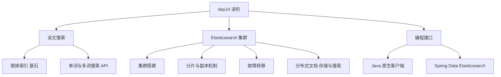

# day14 导览：倒排索引、集群与 Spring Data Elasticsearch 的进阶路线

day13 收尾时 Elasticsearch 已经能玩起来了：环境装好、API 练熟、中文分词解决。但冷静下来看，这套本事有两个缺口。一是只会「用」，搜一条关键词命中了文档，背后是按什么结构找到它的，答不上来；二是只能在单节点上玩，真放到项目里，一台机器挂了搜索就没了，数据涨了也装不下。day14 就是来补这两个缺口，再把 Java 端的代码补上，让 ES 真正落进项目。

## 先给结论

- day14 是三级跳：懂原理（倒排索引）、上规模（集群）、落代码（Java 客户端与 Spring Data Elasticsearch）。
- 倒排索引是 Lucene 与 Elasticsearch 的基石，全文搜索的所有 API 都踩在它上面，所以它排在第一讲。
- 集群部分的重点不是敲安装命令，而是搭完之后的机制：分片与副本怎么配合、节点挂了怎么故障转移、文档在分布式下怎么存怎么搜。
- 编程接口按两层讲：原生 Java 客户端看懂本质，Spring Data Elasticsearch 简化日常写法，项目里最终用的是后者。

## 一、进阶路线图



三个分支是递进关系：A 回答「搜索凭什么快」，B 回答「规模上去了怎么办」，C 回答「代码里怎么写」。前两块不懂，C 写出来的就是照抄样例；反过来，前两块通了，C 的每行代码都有解释。

## 二、原理层：从倒排索引到全文搜索

倒排索引在 day13 提过一嘴，没有展开，这次专门讲。它解决的问题一句话能说清：正排是拿文档 ID 找内容，倒排是拿词找文档。把所有文档分词，记录每个词出现在哪些文档里，搜索时就不用逐条比对，查表命中。

全文搜索做起来就是两个关键词：**相关性**决定搜出的一百条结果怎么排座次，词频、位置这些因子都来自倒排索引里记录的附加信息；**分析**决定文本怎么切成词条进倒排，分得不对，后面全歪。这两条贯穿 day14 的 API 实战：单词搜索、多词搜索，再到词与词之间逻辑关系的控制（operator）与匹配度的调节（`minimum_should_match`），每一个参数背后都是倒排索引里的机制。这些也是后面房源搜索功能的地基。

## 三、规模层：集群、分片副本与故障转移

day13 的单节点有两面天花板：机器挂了服务整体不可用，磁盘和内存撑住的数据量有限。集群是把天花板掀开的方式，但搭建本身只是起点，day14 真正花力气的是搭完之后的三件事。

**分片与副本。** 一个索引的数据切成多个分片散到各节点，容量问题变成加机器的问题；每个分片再配副本，主分片挂了副本顶上，可用性由此而来。两者在写入与查询路径上的行为差异，是理解集群的关键。

**故障转移。** 节点离线后，集群如何重新选举、副本如何提升为主分片、服务如何自愈，这套机制决定了「高可用」不是一句口号。

**分布式文档。** 一条文档写进来，凭什么落在某个分片上？一次搜索为什么能同时命中散在多台机器上的数据？存储与搜索两侧的路由机制，是集群知识里最容易似懂非懂的部分，会用图把路径走清楚。

## 四、落地层：Java 客户端与 Spring Data Elasticsearch

原理与集群都通了，最后要回到代码。原生 Java 客户端把 ES 的能力完整暴露出来，连接、构造请求、解析响应都要自己写，样板多，但每一步都对应前面学过的 RESTful 接口，用来理解本质最合适。Spring Data Elasticsearch 在它之上做了一层封装，Repository 接口加模板类把常规操作压成几行声明，项目里对外提供搜索功能时用的就是这一层。

封装到什么程度，可以先看一眼终点长什么样（示例预览，按本课写法补全）：定义一个继承 `ElasticsearchRepository` 的接口，按方法名声明查询，实现类都不用写：

```java
public interface PersonRepository extends ElasticsearchRepository<Person, Long> {

    // 方法名即查询语义：按名字精确检索
    List<Person> findByName(String name);
}
```

这层的存在感在后续课程会越来越强：抓取到的房源数据要进 ES，前台搜索框的每一次输入都要落到 Spring Data 的查询方法上。day14 学完，搜索功能从原理到代码就全部就绪了。

## 常见误区

- **把集群理解成多装几份软件。** 起三个节点不等于有了高可用，分片数、副本数配置不当，节点照样可能丢数据；机制比命令重要。
- **跳过倒排索引直接背 API。** match 查询的 `operator`、`minimum_should_match` 这些参数，离开倒排索引就只能死记硬背，面试稍一追问就露馅。
- **把 Java 客户端与 Spring Data 当二选一。** 项目里写 Spring Data，但排查慢查询、理解报错时靠的还是底层客户端与 REST 层的知识，两层都要会。
- **单节点直觉直接搬去集群。** day13 练熟的 `from+size` 深分页、批量写入，到了多分片环境开销与行为都会变化，要用分布式视角重新审一遍。

## 面试可能被问到的问题

1. 面试官追问：「倒排索引是什么？为什么说它是 Lucene 与 ES 的基石？」
   答：正排由文档找内容，倒排由词找文档：对所有文档分词，为每个词维护一个出现该词的文档列表。搜索时先分词再查表命中，避免全量扫描，相关性排序所需的词频、位置信息也记录在倒排列表里。ES 的全文检索能力全部建立在这个结构上。

2. 面试官追问：「单节点 ES 和集群最大的差别在哪？」
   答：不只是数据多一份拷贝。集群下索引被切成多个分片分布在节点上，读写要经过路由，查询要汇聚各分片结果，节点故障靠副本与选举自愈。很多单机上的直觉（比如深分页代价、写入一致性）都要在分布式语境下重新评估。

3. 面试官追问：「分片和副本分别解决什么问题？」
   答：分片解决容量与并行度，数据横向切开后可以加节点扩容，查询也在多分片上并行执行；副本解决可用性与读吞吐，主分片所在节点故障时副本提升顶上，读请求也能分摊到副本。两者数量要在写入压力、存储成本与可用性之间权衡。

4. 面试官追问：「项目里为什么不直接用 Java 客户端，要套一层 Spring Data？」
   答：Spring Data Elasticsearch 把连接管理、请求构造、结果映射这些样板收敛成 Repository 接口与模板方法，方法名即查询语义，与 Spring 生态的配置、事务、依赖注入天然整合。理解底层机制时看客户端，日常开发写 Spring Data，两层各司其职。

## 配套资料

- 本课无配套源码包：`materials/code/03/day14-ElasticStack学习之Elasticsearch进阶/` 下仅有解压清单 `_extracted.json`（记录解压文件数为 0），导览内容按课程视频的讲解与课件大纲整理，后续各讲的示例均为按本课写法补全。
