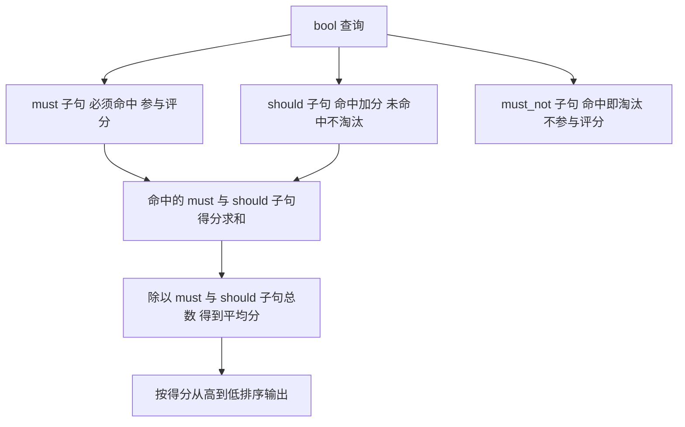

# bool 组合搜索：must 负责准入，must_not 负责踢人，should 负责加分

搜索框里的真实需求很少是单个条件：用户想要「必须带篮球、绝对不要音乐、有足球更好」，三个诉求一句话说完，
单个 match 却一个都表达不了。ES 把这类拼装活交给了 `bool` 查询：把多个子句塞进 `must`、`must_not`、`should`
三个容器，各管各的事。这一课把三个容器逐个拆开，看清它们在「召回」与「评分」两条线上的不同角色，
最后补上 `minimum_should_match` 这个控制 should 话语权的参数。

## 先给结论

- `bool` 是条件拼装容器：`must` 是硬条件，必须命中；`must_not` 是排除项，命中即出局；`should` 是加分项，命中提分、不命中不淘汰。
- 评分上只有 `must` 与 `should` 参与计算：所有命中的子句得分求和，再除以 `must` 与 `should` 子句总数取平均；`must_not` 完全不参与评分。
- `should` 默认是纯加分；一旦查询里没有 `must`，至少要命中一个 `should` 才会返回，阈值由 `minimum_should_match` 控制。
- `minimum_should_match` 接受数字或百分比，三个词设 2 表示至少命中两个，设 3 就等价于全都要。
- 加条件前先想清楚它该在召回线上还是评分线上：排除用 `must_not`，排序倾斜用 `should`，硬性要求用 `must`。

## 一、must：把硬条件装进容器

沿用上一节的 `demo` 索引与五条用户数据（张三、李四、王五、赵六、孙七，`hobby` 字段挂 `ik_max_word` 分词器）。
现在提一个组合诉求：结果必须包含篮球。写法是把 match 包进 `bool` 的 `must` 里：

```bash
POST http://172.16.55.185:9200/demo/person/_search
{
  "query": {
    "bool": {
      "must": [
        {
          "match": { "hobby": "篮球" }
        }
      ]
    }
  },
  "highlight": {
    "fields": { "hobby": {} }
  }
}
```

命中的是李四与王五两条，`hobby` 里都带着篮球。单条件下 `must` 里只放一个子句时，数组也可以简写成对象，
效果一样；但只要条件多于一个，就得用数组把子句一个个列出来。

`must` 里的每个子句都是独立的 match 查询，多个子句之间是「与」的关系：文档必须逐条满足，少一条都不行。

## 二、must_not：只负责淘汰，不负责打分

王五的爱好里有听音乐，假如需求是不想看到任何沾音乐的文档，把条件塞进 `must_not`：

```bash
POST http://172.16.55.185:9200/demo/person/_search
{
  "query": {
    "bool": {
      "must": [
        { "match": { "hobby": "篮球" } }
      ],
      "must_not": [
        { "match": { "hobby": "音乐" } }
      ]
    }
  }
}
```

结果只剩李四一条，王五被踢出局。这里有个容易忽略的关键点：`must_not` 命中与否，完全不影响任何文档的得分，
它的职责只有一条，把不相关的文档从结果集中排除。评分是 `must` 与 `should` 的事，淘汰是 `must_not` 的事，
两条线互不掺和。

## 三、should：不淘汰谁，只给谁加分

需求里还剩半句「有足球更好」。这种「有则更好、没有也行」的柔性条件放进 `should`。为了看清它对排序的影响，
先把 `must_not` 摘掉，让李四和王五同场竞技：

```bash
POST http://172.16.55.185:9200/demo/person/_search
{
  "query": {
    "bool": {
      "must": [
        { "match": { "hobby": "篮球" } }
      ],
      "should": [
        { "match": { "hobby": "足球" } }
      ]
    }
  }
}
```

只看 `must` 时两条都能命中；加上 `should` 足球之后，王五的爱好里正好有足球，得分被抬高，排到了李四前面。
李四没有足球，却照样留在结果里，这就是 `should` 与 `must` 的本质区别：前者影响排序，后者决定生死。
课件里的例子用的是游泳，道理完全一样，换成任何加分词都成立。

把三种容器放进一张图，评分与召回的分工一目了然：



图里最值得盯的是「求和再除以总数」这一步：bool 查询为每个文档计算相关度得分时，把所有匹配的 `must` 与
`should` 子句分数求和，再除以这两类子句的总数取平均。意味着没命中的 `should` 子句也会进分母，
`should` 攒太多、命中的太少，平均分反而会被拉低。

## 四、should 什么时候从加分变成门槛

默认情况下，`should` 里的内容不是必须匹配的，纯加分。但有一条隐藏规则：如果整个 `bool` 查询里没有 `must`，
`should` 就必须至少命中一个，否则返回空。用三个爱好词做演示：

```bash
POST http://172.16.55.185:9200/demo/person/_search
{
  "query": {
    "bool": {
      "should": [
        { "match": { "hobby": "游泳" } },
        { "match": { "hobby": "篮球" } },
        { "match": { "hobby": "音乐" } }
      ]
    }
  }
}
```

除张三外全部命中，四条文档各占三个词中的一个或几个。这个行为像 `or`，但 `or` 往往太松：用户搜索时
命中一个词的结果经常跑偏。`minimum_should_match` 就是松紧旋钮，规定至少命中几个：

```bash
POST http://172.16.55.185:9200/demo/person/_search
{
  "query": {
    "bool": {
      "should": [
        { "match": { "hobby": "游泳" } },
        { "match": { "hobby": "篮球" } },
        { "match": { "hobby": "音乐" } }
      ],
      "minimum_should_match": 2
    }
  }
}
```

阈值抬到 2 之后，只占一个词的孙七出局，剩下三条：王五游泳、篮球、音乐三个全占，得分最高排第一；
李四占游泳与篮球，赵六占游泳与音乐，各占两个，得分次之。设成 3 就是三个词必须全部命中，
设成 `75%` 这类百分比则按比例折算，数字与百分比都合法。

这个参数在上一节的 match 查询里也出现过：match 把搜索串切成多个词条时，词条之间同样靠它控制最低命中数。
放在 `bool` 层级，控制对象从「词条」换成了「should 子句」，思想是同一个：给 `or` 与 `and` 之间加一档可调的中间态。

## 常见误区

- **以为 `must_not` 会影响得分排序。** 它只做排除，命中 `must_not` 的文档直接从结果集消失，留下的文档得分
  与有没有这条 `must_not` 无关。想压低某类结果的排名，用 `should` 反向加分或下一节的权重，而不是 `must_not`。
- **只写 `should` 却以为它是可选的。** `bool` 里没有 `must` 时，`should` 至少要命中一个（或 `minimum_should_match`
  规定的个数），一条都不占的文档不会返回。要表达「纯加分且不设门槛」，配上 `must` 或 `filter` 一起用。
- **`minimum_should_match` 位置放错。** 它既能写在 match 内部控制词条命中数，也能写在 `bool` 层控制子句命中数，
  两者是不同的控制点；写在 `bool` 里时与 `must` 平级，塞进某个 `should` 子句内部控制的是整个 bool。
- **以为 `should` 子句越多召回越宽。** 没有 `must` 时设了 `minimum_should_match`，子句越多门槛越难过；
  就算全部可选，取平均的评分机制也会让大量未命中的子句稀释得分。

## 面试可能被问到的问题

1. 面试官追问：「bool 查询里 must、should、must_not 各自的语义是什么？」
   答：`must` 是与关系，子句必须全部命中；`should` 是或关系加加分项，命中提分、未命中不淘汰；
   `must_not` 是排除项，命中即出局。前两者参与相关性评分，`must_not` 不参与评分，只影响召回。

2. 面试官追问：「只有 should 没有 must 时，行为有什么变化？」
   答：此时 `should` 至少要命中一个文档才会返回，默认值相当于 1，可用 `minimum_should_match` 调高，
   支持数字与百分比两种写法。有 `must` 或 `filter` 存在时，`should` 退回纯加分角色。

3. 面试官追问：「bool 查询的得分是怎么算的？」
   答：对每个文档，先算出每个命中的 `must` 与 `should` 子句各自的相关性得分，求和后除以这两类子句的总数
   得到平均分，按平均分排序。`must_not` 不进入这套计算，它只负责把文档挡在结果集之外。

4. 面试官追问：「filter 和 must 有什么区别，什么场景用 filter？」
   答：`filter` 与 `must` 一样要求命中，但 filter 上下文不算相关性得分，且结果可以被缓存。
   状态、分类这类只关心「是与否」、不关心「多相关」的条件放 filter，能省掉打分开销并复用缓存。

5. 面试官追问：「minimum_should_match 传 2 和传 75% 有什么区别？」
   答：2 是绝对数量，要求至少命中两个子句或词条；75% 是相对比例，按子句总数四舍五入折算。
   词条数不固定时百分比更稳，固定搜索表单里用绝对数更直观。

## 配套资料

- 本课无配套源码包：`materials/code/03/day14-ElasticStack学习之Elasticsearch进阶/` 下仅有解压清单
  `_extracted.json`（记录解压文件数为 0）。文中索引、映射与五条用户数据沿用上一课的 `demo` 演示索引，
  bool 组合查询请求体按本课课件写法补全，可在任意 Elasticsearch 实例上原样执行。
