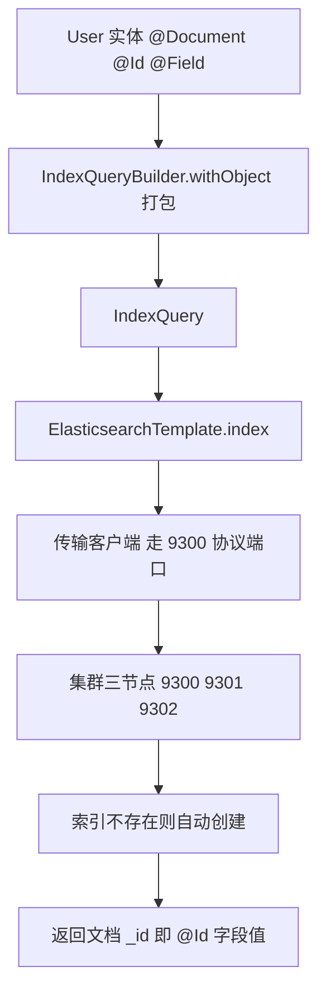

# 把 Elasticsearch 交给 Spring 管：Spring Data Elasticsearch 起步、实体注解与第一次新增

低级、高级两套 REST 客户端都练过了，为什么官方还要再提供一层 Spring Data Elasticsearch？因为项目开发要的从来不是
「能调通」，而是少写代码：实体加几个注解就该自动变成索引结构，存一条数据不该还要手动构造 Request。这一篇从零搭一个
Spring Boot 整合工程，跑通第一条新增，顺手记录一个官方参数不生效的坑和解法，这个坑在该版本组合下必现，绕不过去。

## 先给结论

- 整合只靠一个 `spring-boot-starter-data-elasticsearch` 起步依赖，版本由 Spring Boot parent 统一仲裁，自己别写版本号。
- 配置走 `spring.data.elasticsearch.` 前缀，节点端口是 9300 不是 9200：这套整合走的是 Java 传输协议，9200 是 REST
  接口专用端口。
- 实体类用 `@Document` 声明索引名、类型、分片与副本，`@Id` 标的字段直接等价于文档 `_id`，`@Field(store = true)`
  控制字段的存储行为。
- 新增一个动作：`IndexQueryBuilder` 把实体包成 `IndexQuery`，`ElasticsearchTemplate.index()` 返回文档 ID，索引不存在
  会自动创建。
- 版本坑：`@Document` 的 `shards` 参数在该版本组合下不生效，建出来的索引永远是默认 5 个分片，解法是手动建索引再把
  `createIndex` 设为 `false`。

## 一、Spring Data Elasticsearch 要解决什么

原生 API 再方便，落到项目里仍有两类重复劳动：一是对象与文档的转换，每个实体都要手动 `source(map)`、手动解析回来；
二是连接管理，客户端的创建、关闭要自己接进应用生命周期。Spring 的强项恰恰是模板与封装，所以 Spring Data 项目对
Elasticsearch 做了官方支持，目的只有一个，简化操作。整合方式自然还是 Spring Boot：起步依赖加配置文件，模板对象注入
进来就能用。前面学的 REST 客户端知识并没有白费，模板底层发的还是那些请求，理解了底层，上层封装出问题时才知道去哪查。

## 二、工程搭建：一个 starter 与三个配置项

pom 的骨架与普通 Spring Boot 工程一致，父工程钉住 2.1.0.RELEASE，依赖里最关键的是整合 starter：

```xml
<parent>
    <groupId>org.springframework.boot</groupId>
    <artifactId>spring-boot-starter-parent</artifactId>
    <version>2.1.0.RELEASE</version>
</parent>

<dependencies>
    <!-- Spring Boot 整合 Elasticsearch 的起步依赖 -->
    <dependency>
        <groupId>org.springframework.boot</groupId>
        <artifactId>spring-boot-starter-data-elasticsearch</artifactId>
    </dependency>
    <dependency>
        <groupId>org.springframework.boot</groupId>
        <artifactId>spring-boot-starter-test</artifactId>
    </dependency>
    <!-- 简化实体 getter/setter 的编写 -->
    <dependency>
        <groupId>org.projectlombok</groupId>
        <artifactId>lombok</artifactId>
        <version>1.18.4</version>
    </dependency>
</dependencies>
```

版本适配有两句话要说。第一，starter 自己带的 Elasticsearch 相关版本由 parent 的依赖管理仲裁，pom 里不要再手写
版本号，否则和仲裁版本打架。第二，本课集群是 6.5.4，Spring Boot 2.1.0 默认管理的客户端是 6.4.x 系列，同一主版本
下可以正常通信；工程上更稳的做法是利用 parent 预留的 `<elasticsearch.version>` 属性把客户端版本覆盖成与服务端
一致的 6.5.4，这是通用做法，按需采用。

配置文件只有三行（集群名沿用本课环境改名后的 `es-haoke-cluster`）：

```properties
spring.application.name=es-demo
spring.data.elasticsearch.cluster-name=es-haoke-cluster
spring.data.elasticsearch.cluster-nodes=172.16.55.185:9300,172.16.55.185:9301,172.16.55.185:9302
```

**第一，端口必须是 9300。** 这是整合里最容易栽的坑：低级、高级 REST 客户端走 9200 的 HTTP 接口，而 Spring Boot
这套整合走的是 Java API 的传输协议，那个协议监听在 9300。三个节点的 9300、9301、9302 依次列出，写成 9200 就是
连不上的死循环。**第二，cluster-name 要与集群真实名字一致。** 节点靠集群名认亲，名字对不上，客户端照样被拒之门外。
启动类没有特殊之处，`@SpringBootApplication` 加 `main` 方法，照常放在 `com.example.es` 根包下即可。

## 三、实体：@Document 把类映射成索引结构

测试需要一个操作对象，还是用熟悉的 User。一个类加上注解，它的索引结构就声明完了：

```java
@Data
@AllArgsConstructor
@NoArgsConstructor
@Document(indexName = "demo", type = "user", shards = 6, replicas = 1)
public class User {

    @Id
    private Long id;

    @Field(store = true)
    private String name;

    @Field
    private Integer age;

    @Field(store = true)
    private String hobby;
}
```

逐个注解拆开看。**`@Document` 是整张身份证。** `indexName` 是索引名，不存在时会自动创建；`type` 是类型名；
`shards` 与 `replicas` 期望的分片数 6、副本数 1。**`@Id` 是文档主键。** 标了这个注解的字段值直接等价于文档 `_id`，
后面新增的例子里能清楚看到这一点。**`@Field` 管字段行为。** `store = true` 表示这个字段的原始值单独存储在 Lucene
的存储区里，不依赖 `_source` 也能取回，这是从 Lucene 一路带过来的基础概念；不加 store 时字段默认会建索引
（`index` 参数默认 true），是否单独存储则按需决定，`name` 与 `hobby` 打开存储，`age` 保持默认。三个 Lombok 注解
负责生成 getter、setter 与构造器，与 ES 无关。

## 四、新增数据：模板的一个 index 方法

测试类注入模板对象，Spring 最擅长的模板套路来了：

```java
@RunWith(SpringRunner.class)
@SpringBootTest
public class TestSpringBootES {

    @Autowired
    private ElasticsearchTemplate elasticsearchTemplate;

    @Test
    public void testSave() {
        User user = new User();
        user.setId(1001L);
        user.setName("张三");
        user.setAge(20);
        user.setHobby("足球、篮球、听音乐");

        // 实体包成 IndexQuery，交给模板写入
        IndexQuery indexQuery = new IndexQueryBuilder()
                .withObject(user).build();
        String id = this.elasticsearchTemplate.index(indexQuery);
        System.out.println(id);
    }
}
```

`@RunWith(SpringRunner.class)` 让测试跑在 Spring 容器里，`@SpringBootTest` 拉起完整上下文，模板才能注入。新增
只有两步：`IndexQueryBuilder().withObject(user).build()` 把实体包成 `IndexQuery`，然后 `index(indexQuery)` 写入，
返回值就是文档 ID，控制台打出 `1001`。回到 head 里刷新，`demo` 索引已经自动创建出来了，文档的 `_id` 正是 1001，
与 `@Id` 注解的字段值一致。对比高级客户端的写法：`IndexRequest`、`RequestOptions`、响应解析全都不见了，实体直接
进、ID 直接出。顺带说一句，`index()` 天然是 save-or-update 语义，同一个 `_id` 再写一次就是覆盖，这一点和原生
API 一脉相承；Spring Data 家族还有 Repository 这条更省事的路线（`save` 方法同名同义），项目落地时会用到，下一
篇收尾时再对比。



图里的关键路径是 D 到 E：模板在中间做了对象到文档的转换，再交给底层的传输客户端发出 9300 协议请求，上层看到的
只有实体与 ID。

## 五、分片数不生效：一个必现的坑与绕法

数据存进去之后，head 里检查索引结构会发现不对劲：注解上写的 `shards = 6`，建出来的索引却是 5 个分片。换一个
索引名（比如改成 `demo1`）重跑一遍，结果还是 5。排查下来参数就是没生效，这个问题没有找到根因，暂时定性为这个
版本组合下 Spring Boot 与 Elasticsearch 整合的 bug。坑既然绕不过去，就用绕法：索引自己建，不让框架代劳。

做法分两步。第一步，在 head 里手动新建索引，取名 `demo2`，分片数填 6、副本数填 1，创建完可以看到 0 到 5 共
六个分片分布在三个节点上。第二步，注解上关掉自动创建，只保留索引名与类型：

```java
@Document(indexName = "demo2", type = "user", createIndex = false)
public class User {
    // 字段与前面完全一致
}
```

再跑一次新增，数据顺利写进 `demo2`，索引的分片数没有发生任何变化。经验固化成一条：**保存数据之前先手动建好
索引，再把 `createIndex` 设为 `false` 直接使用。** 分片数在索引创建后就不可修改，让框架用默认值建错的索引，
只能删了重建，这个顺序从一开始就要定对。

## 常见误区

- **配置节点写 9200。** `spring.data.elasticsearch.cluster-nodes` 收的是传输协议端口 9300 系，9200 是 REST 接口
  端口，两套客户端体系各走各的门，混了就连不上。
- **给 starter 手写版本号。** Spring Boot parent 已经仲裁好整合相关版本，自己引一套版本轻则冗余重则冲突；要改
  版本走 parent 预留的属性覆盖。
- **实体忘了 `@Id`。** 没有主键字段的实体写入后 `_id` 随机生成，后续按 ID 更新、删除都对不上号；`@Id` 是实体与
  文档对齐的锚点。
- **依赖自动建索引并相信注解参数。** 该版本组合下 `shards` 不生效，分片数不对的索引只能删除重建；手动建索引加
  `createIndex = false` 才稳。

## 面试可能被问到的问题

1. 面试官追问：「Spring Data Elasticsearch 相比直接用 REST 客户端解决了什么？」
   答：它把对象与文档的映射交给注解声明，把连接管理交给 Spring 容器，把常见操作收敛成模板方法与 Repository 接口。
   开发者面向实体写代码，序列化、请求构造、响应解析都不再出现，代价是少了一部分原生 API 的灵活性，需要时模板也
   能透传原生对象。

2. 面试官追问：「整合配置里为什么写 9300 而不是 9200？」
   答：这套整合走 Java API 的传输协议，监听在 9300；9200 是 RESTful HTTP 接口端口，低级与高级 REST 客户端走它。
   两套协议在服务端是两个不同的端口，配置哪套客户端就填哪个端口。

3. 面试官追问：「@Id 注解的作用是什么？」
   答：标记实体中作为文档主键的字段，其值直接成为文档 `_id`。写入时用它，按 ID 查询、更新、删除也认它，保证了
   实体对象与 ES 文档的一一对应。

4. 面试官追问：「@Field 的 store 属性什么含义？」
   答：对应 Lucene 的存储概念。设为 true 表示字段原始值额外存进存储区，可以在不加载整个 `_source` 的情况下单独
   取回该字段；默认 false 时只建索引不单独存储。是否开启要看业务是否需要按字段原值取回，开了会增加存储开销。

5. 面试官追问：「遇到 @Document 的 shards 参数不生效怎么办？」
   答：这个版本组合下确实存在，索引被建成默认 5 个分片。处理办法是放弃自动创建：在管理工具或初始化脚本里手动
   建索引并明确指定分片与副本，实体注解保留索引名并把 createIndex 设为 false。分片数建索引后不可改，所以创建
   时机必须自己把控。

6. 面试官追问：「同一个 _id 重复执行新增会发生什么？」
   答：index 操作是 save-or-update 语义，同 _id 写入会覆盖旧文档，版本号递增。利用这一点可以做全量更新，但要
   清楚覆盖意味着未传字段会丢，局部修改应该用 update 语义。

## 配套资料

- 本课无配套源码包：`materials/code/03/day14-ElasticStack学习之Elasticsearch进阶/` 下仅有解压清单
  `_extracted.json`（解压文件数为 0）。pom、配置、实体与新增示例均按本课演示写法补全为可运行代码，原课程包名
  已改写为中性的 `com.example.es`，索引名改用中性的 `demo` 系列；集群名沿用本课环境改名后的 `es-haoke-cluster`。
