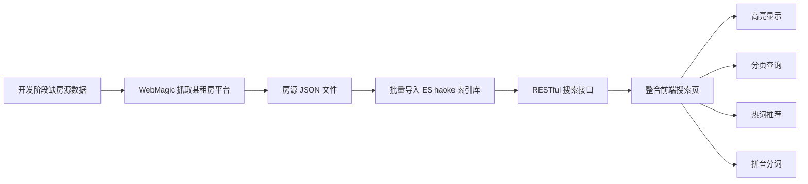

# 搜索功能开工先解决一件事：day15 用爬虫造数据，再把搜索从接口做到拼音纠错

day13、day14 把 Elasticsearch 的安装、概念和 Java 客户端练熟了，回头要给好客租房接上真正的房源搜索，却撞上一个尴尬的问题：开发库里只有手写的几条测试数据，搜索接口写出来返回的是空列表，分词准不准、相关度行不行，根本没有东西可验证。day15 这一整天就是冲着这个问题来的，先抓数据，再一路把搜索功能从后台接口做到前端页面，最后加上高亮、分页、热词推荐和拼音分词四层体验增强。

## 先给结论

- 开发阶段缺真实数据，用 WebMagic 写一个爬虫从某租房平台抓房源，抓取只服务于开发测试，不作为项目业务功能。
- 抓到的数据先落成 JSON 文件，再批量导入 Elasticsearch 的 `haoke` 索引库，搜索功能从此有原料。
- 搜索主线三步走：开发 RESTful 搜索接口、整合前端页面、功能层面加高亮与分页。
- 两个体验向的收尾：热词推荐解决「搜不到时给用户一个建议」，拼音分词解决「汉字输成了拼音也能匹配」。

## 一、没有数据的搜索功能就是个空壳

搜索功能的代码本身不难，难在调它需要数据。用几条手写数据去调分词，永远验证不出真实效果：真实房源的标题写法五花八门，价格有区间、户型有分布、楼层朝向各不相同，只有这种数据喂进去，才能看出中文分词切得对不对、排序靠不靠谱。

造数据的两条路摆在面前。手写 insert 语句，编 2000 条不现实，编出来的数据格式还高度雷同，分词器一眼就「看穿」了它的假。写爬虫去抓真实站点的公开房源列表，数据天然带真实分布，标题的措辞、价格的梯度、户型的组合都和线上环境一致。两条路里爬虫是唯一划算的那条，这也是为什么 day15 把「房源数据抓取」排在「实现房源搜索」前面。

这里要划清一条边界：抓数据是开发阶段的造数手段，不是平台要上线的能力。项目本身不靠抓别人的房源来运营，爬虫代码也不进入项目的业务模块。把它当成开发者的一项工具技能来学，定位就摆正了。

## 二、抓取一环：目标站点与产出

框架选的是 WebMagic，一个简单灵活的 Java 爬虫框架，两天之内就能把数据抓回来。目标站点随便挑一个有房源数据的平台即可，课程选的是某租房平台的上海租房频道，58 同城这类站点同样可以做目标，选择本身没有讲究。

站点结构上值得先记住三件事，抓取逻辑全靠它们撑起来：

| 结构 | 特点 | 对爬虫的意义 |
|---|---|---|
| 租房列表页 | 一页约 30 条房源，每条带详情链接 | 作为爬虫入口 |
| 房源详情页 | 标题、租金、户型、楼层等完整信息 | 真正抽数据的地方 |
| 分页 URL | 按 `pg2`、`pg3` 递增，最多到 100 页 | 翻页抓全量 |

抓取的最终产物是一份 JSON 文件，课程资料里就带着这份成果：2010 条真实房源记录，每条含标题、租金、户型、租赁方式、楼层、图片名与来源链接。随手取第一条看看成色：

```json
{
  "title": "整租 · 凯欣*园诚意出租的房品质小区采光好 楼层佳 交通便利",
  "rent": "11000",
  "houseType": "1室2厅1卫",
  "rentMethod": "整租",
  "floor": "高楼层/36层",
  "image": "SH2136842962700091392.jpg"
}
```

标题是自然的口语化文案，租金、户型、楼层都是真实组合，拿这种数据去调分词和排序才有说服力。day15 的中段会把这份文件批量灌进 Elasticsearch 的 `haoke` 索引库，从这一刻起搜索功能才算真正开张。

## 三、搜索主线：接口、前端、两层优化

数据进了索引库，搜索功能的开发按依赖顺序铺开。先写后台的 RESTful 搜索接口，把「关键词进、房源列表出」这条链路打通；接口稳了再整合前端页面，让搜索框真正可用；基本功能跑通之后才轮到功能层面的优化，高亮让命中关键词在结果里标色，分页让结果可翻页浏览。顺序不能颠倒，前端整合依赖接口的返回结构，高亮分页又依赖已跑通的查询，一层压着一层。

## 四、热词推荐与拼音分词：两处体验收尾

基本搜索之外还有两个容易被忽略的体验问题。一个是用户输入的词太冷门、结果寥寥时，系统应该主动给一组热门搜索词做推荐，这就是热词功能，它需要把用户的搜索行为积累下来再做统计推荐。另一个是用户把汉字直接敲成了拼音，比如想搜「两室」却输入了 `liangshi`，按原样检索什么也搜不到；给 Elasticsearch 装上拼音分词器插件，让索引同时支持拼音检索，这类输入也能命中数据。这两个能力是 day15 压轴的内容，也是很多搜索产品「好用」的隐藏原因。

把 day15 一整天串起来看：



图里左半段是「造原料」，右半段是「做产品」，中间的 `haoke` 索引库是分界线。数据一旦入库，后面的每一步都可以独立开发和验证，这条线也是后续所有搜索相关需求的固定套路。

## 常见误区

- **把爬虫抓数据当成项目业务模块。** 抓取只存在于开发阶段，用于构造测试数据，不进需求列表、不上生产，代码也应与业务代码分开存放。
- **认为抓来的数据可以随意使用。** 目标站点公开了数据不代表可以无限抓取、任意商用，尊重站点限制（比如本课目标站的 100 页上限）、控制抓取频率、仅作学习测试，是底线。
- **先写搜索接口再回头补数据。** 索引结构、分词器配置都要按真实数据定，拿假数据定完 mapping 再灌真数据，大概率返工。正确顺序是数据先行。
- **把高亮、分页当独立功能从零设计。** 它们是对既有查询的增强，接口返回结构要为高亮片段留位置，分页参数要透传到底层查询，一开始就按这个形态设计接口，后面改动的成本才小。

## 面试可能被问到的问题

1. 面试官追问：「你们项目搜索功能的数据从哪来的？」
   答：开发阶段用 WebMagic 写爬虫从公开房源平台抓取真实数据，落成 JSON 后批量导入 Elasticsearch。抓取仅用于开发测试构造真实分布的数据，不是项目业务功能，生产数据由业务系统产生。

2. 面试官追问：「搜索功能开发的整体链路是什么样的？」
   答：数据采集入库、开发搜索接口、整合前端、再叠加高亮分页等优化。依赖关系决定了顺序：接口依赖索引库有数据，前端依赖接口契约，高亮分页依赖已跑通的查询，热词与拼音分词属于体验增强。

3. 面试官追问：「为什么要先灌数据再开发接口，而不是同步进行？」
   答：索引 mapping 和分词器配置必须依据真实数据形态来定，查询的相关性效果也只有真实数据才能验证出来。先有数据可以一次把结构定对，避免接口开发完因数据形态变化而返工。

4. 面试官追问：「用户搜不到结果时你们怎么处理？」
   答：两层兜底。一是热词推荐，统计高频搜索词，在结果稀少时推给用户引导换词；二是拼音分词，把汉字与拼音建立索引关联，用户误输拼音时仍能命中数据，两者都是围绕召回率做的体验优化。

## 配套资料

- 抓取成果数据：`materials/code/03/day15-房源数据抓取以及实现房源搜索/day15-房源数据抓取以及实现房源搜索/资料/抓取的房源数据/data.json`（JSON Lines 格式，2010 条房源记录，含 title、rent、houseType、rentMethod、floor、image、url 字段）
- 拼音分词前置文档：`materials/code/03/day15-房源数据抓取以及实现房源搜索/day15-房源数据抓取以及实现房源搜索/资料/集群添加拼音分词器.md`、同目录 `集群添加IK分词器.md`
- day15 资料包未提供 WebMagic 抓取源码工程，涉及爬虫的代码为按本课写法补全的示例
