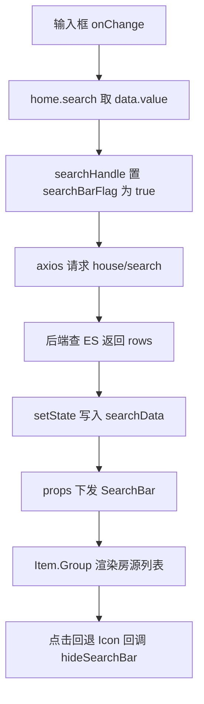

# 首页搜索框接上搜索接口：React 整合搜索功能的交互改造与列表渲染

接口在 Postman 里能返回 JSON，功能还不算完成。真正的入口是首页顶部那个搜索框：用户输入关键字，下方浮出匹配的房源列表，看完点回退收起。这一篇把 `/house/search` 接到 React 首页上，路上会撞到一个焦点驱动的经典矛盾：浮层靠失焦关闭，而点击结果必然先失焦，结果列表永远点不中。

## 先给结论

- 原实现用 onFocus 显示、onBlur 关闭结果浮层，与「点击结果」这个动作天然冲突：点击必先失焦，浮层先隐藏，结果永远点不中。
- 改造方向是拔掉焦点开关：输入框 onChange 时发起搜索并显示浮层，关闭只交给浮层上的回退按钮。
- 数据流严格单向：`search()` 用 axios 拿到结果写入 state，`searchData` 经 props 下发给 SearchBar 渲染列表。
- 两个样式细节：结果区容器加 `overflow-y: auto` 才有滚动条；标题超长用 `overflow: hidden` 加 `white-space: nowrap` 截成一行。
- 新建的 `search.css` 必须在组件里 import，不引用等于没写。

## 一、原始实现：焦点驱动的浮层为什么点不到

首页的搜索框来自 semantic-ui-react 的 Input 组件，点击它会出现一个覆盖在页面上的浮层，用来放搜索结果。浮层的显隐原本挂在两个焦点事件上：

```javascript
searchHandle = () => {
  this.setState({ searchBarFlag: true });  // 获得焦点：显示浮层
};

hideSearchBar = () => {
  this.setState({ searchBarFlag: false }); // 失去焦点：隐藏浮层
};
```

输入框上绑定 `onFocus={this.searchHandle}` 与 `onBlur={this.hideSearchBar}`，点进输入框浮层出现，移开就消失。演示没有破绽，真实使用立刻穿帮：想点浮层里的某条结果，光标一离开输入框，onBlur 先触发，浮层先于点击消失。问题不在事件写法，而在「失焦即关闭」这条规则本身。

## 二、改造：onChange 驱动搜索

思路是把「搜索」与「显隐」都改由内容变化驱动：输入框内容变化时发起请求，同时显示浮层；浮层什么时候关，不再由焦点决定。

home.js 中定义 search 方法并绑定到 Input 的 onChange：

```javascript
search = (event, data) => {
  let value = data.value; // semantic-ui 的 Input 把输入内容放在 data.value
  this.searchHandle();    // 显示结果浮层
  axios.get('http://127.0.0.1:18080/house/search?keyword=' + value + '&page=1')
    .then((response) => {
      this.setState({ searchData: response.data.rows }); // 列表数据写进 state
    });
};
```

三个细节值得留意。**第一，semantic-ui 的回调签名。** Input 的 onChange 回调是 `(event, data)`，输入内容在 `data.value` 里，不是 `event.target.value`。**第二，this 指向。** search 与 searchHandle 都用箭头函数定义成类的属性，this 始终指向组件实例；如果写成普通方法再当引用传递，this 会丢。**第三，axios 的响应层级。** then 拿到的是响应对象，业务数据在 `response.data` 里，接口返回的 `{totalPages, rows}` 还要再往下一层。

state 里给 searchData 一个空数组初值，浮层显隐标记保持 false：

```javascript
this.state = {
  searchBarFlag: false,
  searchData: [] // 初值必须是数组，否则首次 render 时 map 会报错
};
```

渲染时按条件挂载 SearchBar，数据经 props 下发：

```jsx
{this.state.searchBarFlag
  ? <SearchBar searchData={this.state.searchData} hideSearchBar={this.hideSearchBar}/>
  : null}
```

整条链路如下图：



关键路径是 F 到 G：组件树里数据只从上往下走，home 持有数据，SearchBar 只负责展示，关闭时再通过 props 里的回调把意图传回去。

## 三、SearchBar：把数组渲染成列表

searchbar.js 用 semantic-ui-react 的 Item 系列组件排列表，一个 Item 对应一条房源：

```jsx
import React from 'react';
import { Icon, Item } from 'semantic-ui-react';
import './search.css';

class SearchBar extends React.Component {

  hideSearchBar = () => {
    this.props.hideSearchBar(); // 调用 home 传进来的关闭回调
  };

  render() {
    return (
      <div className="search-bar">
        <Icon onClick={this.hideSearchBar} name='angle left' size='large'/>
        <div className="search-bar-content">
          <Item.Group divided unstackable>
            {this.props.searchData.map(item => {
              return (
                <Item key={item.id}>
                  <Item.Image src={'http://haoke-images.oss-cn-qingdao.aliyuncs.com/' + item.image}/>
                  <Item.Content>
                    <div className='house-title'>{item.title}</div>
                    <Item.Meta>
                      <span className='cinema'>{item.orientation}({item.houseType})</span>
                    </Item.Meta>
                    <Item.Description>{item.rent}</Item.Description>
                  </Item.Content>
                </Item>
              );
            })}
          </Item.Group>
        </div>
      </div>
    );
  }
}
```

结构上分四块：图片、标题、朝向与户型、租金。图片地址由 OSS 前缀拼接抓取时落库的文件名得到。列表渲染必须给每个 Item 指定 `key`，diff 时靠它识别哪些行可以复用。

## 四、两个样式问题与一个 import

跑起来会发现两个观感问题。结果多了列表不能滚动，整个页面被撑长；标题长的房源会把行折成两三行，参差不齐。分别加两段样式解决。

home.css 里给结果容器补滚动：

```css
.search-bar-content {
    overflow-y: auto; /* 内容超出容器高度时出现纵向滚动条 */
}
```

新建 search.css 处理标题截断：

```css
.house-title {
    overflow: hidden;    /* 超出部分隐藏 */
    white-space: nowrap; /* 强制单行，不许折行 */
}
```

search.css 建好后还要在 searchbar.js 顶部 `import './search.css'` 引入。这里踩过一个实打实的坑：样式写完刷新页面毫无变化，排查半天发现 import 没加，webpack 的世界里没有被引用的样式文件就是不存在。

## 五、关闭浮层：开关交给回退按钮

onBlur 被移除后，浮层失去了关闭途径。解法是在浮层左上角放一个回退图标（上面的 `<Icon name='angle left'/>`），点击它调用 `this.props.hideSearchBar()`，即 home 传下来的那个方法，把 `searchBarFlag` 置回 false。关闭动作从「焦点离开」变成「用户明确表态」，浮层开关全程由人控制。

## 常见误区

- **浮层开关继续挂在 onBlur 上。** 点击结果前必然失焦，浮层先消失。正解是关闭动作交给浮层内的按钮，显隐与焦点解耦。
- **searchData 初值不是数组。** 初值给 null 或不给，首次 render 时 `this.props.searchData.map` 直接抛错，页面白屏。初值写 `[]`。
- **样式文件忘了 import。** css 写得再对，没有被组件引入就不会进打包产物，表现为「样式怎么改都没反应」。
- **把 axios 的响应对象当业务数据用。** 列表在 `response.data.rows`，写成 `response.rows` 拿到 undefined，列表空白且不报错，全靠 console 排查。

## 面试可能被问到的问题

1. 面试官追问：「React 父子组件之间怎么通信？」
   答：父传子用 props，子传父用回调：父组件把函数作为 props 传下去，子组件在事件里调用并携带数据。本例的 hideSearchBar 是标准的子传父回调，searchData 则是标准的 props 下发。

2. 面试官追问：「类组件里的事件方法为什么要用箭头函数定义？」
   答：普通方法作为引用传递后 this 丢失，调用报错。箭头函数没有自己的 this，定义时就绑定组件实例，适合直接当事件回调；等价做法是在 constructor 里 bind。

3. 面试官追问：「setState 之后能立刻拿到新值吗？」
   答：不能保证。setState 会做批量化合并，同一周期内的多次修改合并成一次重渲染，直接读 this.state 大概率是旧值。需要基于最新状态计算时用函数式 setState，或在其回调里读取。

4. 面试官追问：「列表渲染的 key 有什么作用？」
   答：key 是虚拟 DOM diff 时识别元素的身份证，同一 key 复用已有节点只更新内容。用数组下标当 key，在插入、删除时会造成错位复用，应优先用业务唯一标识如 id。

5. 面试官追问：「受控组件和非受控组件的区别？」
   答：受控组件的值由 React state 驱动，每次输入都触发 onChange 更新 state；非受控组件的值存在 DOM 里，需要时用 ref 去取。实时搜索这类联动场景用受控组件更合适。

6. 面试官追问：「点击外部关闭浮层一般怎么实现？」
   答：常见做法是监听 document 的 click 并判断点击目标是否在浮层内，浮层内事件做 stopPropagation。本例的浮层承担结果展示，改成显式的回退按钮关闭，交互意图更明确。

## 配套资料

- 搜索结果的真实数据源：`materials/code/03/day15-房源数据抓取以及实现房源搜索/day15-房源数据抓取以及实现房源搜索/资料/抓取的房源数据/data.json`（2010 条房源，导入 `haoke` 索引后由接口返回）
- day15 资料包未含前端工程与 api-server 源码：文中 home.js、searchbar.js 与样式代码为按本课写法补全的示例，接口契约与上一节的 `/house/search` 保持一致
