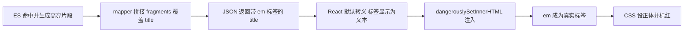

# 让高亮在页面上亮起来：React 用 dangerouslySetInnerHTML 渲染 ES 高亮标签

后端 mapper 改造完，接口返回的 `title` 已经带上了 `<em>` 标签，用 Postman 看一目了然。切回浏览器却看不到任何高亮：React 把标签当成普通文本原样输出了。这一节只解决一个问题，怎么让返回值里的 HTML 作为标签渲染出来，以及这条捷径背后的安全底线。

## 先给结论

- React 出于防 XSS 的考虑，默认把 JSX 表达式里的 HTML 全部转义成文本，`{item.title}` 渲染出来的是字面的标签字符，不是高亮字样。
- 要让后端拼好的高亮标签生效，用 `dangerouslySetInnerHTML={{ __html: item.title }}` 把字符串作为 HTML 注入，Vue 里对应 `v-html`。
- `<em>` 自带斜体样式，看起来像 bug，需要在 CSS 里对 `.house-title em` 设置 `font-style: normal` 并标红，高亮效果才算完成。
- dangerouslySetInnerHTML 等于关掉转义防护，注入内容必须可信：本课的高亮串由自家后端拼装、标签固定，风险可控；但凡内容可能来自用户或第三方，注入前必须消毒。

## 一、现象：高亮数据到了，标签却显示不出来

接口返回的 JSON 里，`title` 已经是 `整租 · <em>地铁</em>口精装两房` 这样的内容。前端沿用普通渲染：

```jsx
{/* 普通写法：React 把 HTML 转义成纯文本 */}
<div className='house-title'>{item.title}</div>
```

页面上直接显示 `整租 · <em>地铁</em>口精装两房`，标签原样暴露。这不是数据没到，而是 React 的设计：JSX 花括号表达式里的字符串一律按文本处理，HTML 特殊字符全部转义。这道防线挡住了「接口返回的内容里藏一段脚本」的注入攻击，代价是需要渲染 HTML 时得多走一步。

## 二、dangerouslySetInnerHTML：显式地注入 HTML

React 给的口子在名字里就写着危险。把 title 改成 HTML 注入：

```jsx
{/* 把 title 作为 HTML 渲染，em 成为真实标签 */}
<div className='house-title'
     dangerouslySetInnerHTML={{ __html: item.title }}></div>
```

注意语法细节：值是一个对象，键名是双下划线包裹的 `__html`，写成普通字符串会直接报错。刷新后搜索「地铁」，关键词变成了带标签的斜体字，说明 `<em>` 已经真实渲染。Vue 的对应写法是 `v-html="item.title"`，行为一致：元素的 innerHTML 被赋值为这段字符串。

## 三、CSS 收尾：em 的默认斜体改回正常字重

`<em>` 是语义化标签，浏览器默认样式是斜体，观感更像「字坏了」而不是高亮。在 search.css 里补两条：

```css
.house-title em {
    font-style: normal; /* em 默认斜体，改回正常 */
    color: red;         /* 关键词标红 */
}
```

搜索「地铁」「地铁1」验证，所有命中的关键词统一标红，列表其余内容不受影响。高亮链路到此完整：查询指定高亮字段，mapper 拼装标签回填实体，接口返回带标签的 JSON，前端注入渲染，CSS 定妆。



关键分叉在 D 与 E：同一个字段值，走普通插值就是文本，走 HTML 注入才是标签，选择权完全在前端手里。

## 四、XSS：这条捷径的安全底线

dangerouslySetInnerHTML 的本质是把 `element.innerHTML` 直接赋值，浏览器会解析执行其中的标签与脚本，安全与否完全取决于注入内容从哪来。本课的 title 有两层来源：抓取的房源数据来自第三方页面，高亮标签由自家后端拼接。关键词虽然来自用户输入，但 ES 高亮只会在命中文本两侧包 pre_tags 与 post_tags，标签本身固定。即便如此，第三方数据混入 `` 这类载荷的可能性仍然存在，稳妥做法是后端对高亮结果做白名单过滤，只保留 em 标签，或前端用 DOMPurify 这类库消毒后再注入。凡是「接口返回什么就渲染什么」的写法，都要先回答一句：内容可不可信。

## 常见误区

- **以为高亮没生效，其实是转义。** 页面上看到 `<em>` 字样说明数据已到，只是走了文本渲染，改用 dangerouslySetInnerHTML 即可。
- **`__html` 写法不对。** 值必须是 `{{ __html: xxx }}` 对象，少一层花括号或把键写成 html 都会报错。
- **不处理 em 默认样式。** 斜体被当成乱码 bug 排查半天，加 `font-style: normal` 才是高亮的正常观感。
- **对不可信内容直接注入。** 用户生成的评论、第三方抓取的数据里可能带脚本载荷，直接 v-html 或 dangerouslySetInnerHTML 就是存储型 XSS，必须先消毒。

## 面试可能被问到的问题

1. 面试官追问：「React 为什么要默认转义 HTML？」
   答：JSX 的设计前提是不可信内容默认安全，表达式渲染一律按文本处理，从源头挡住 XSS。需要渲染 HTML 时必须用 dangerouslySetInnerHTML 显式声明，把风险决策留给开发者，名字里的 dangerously 就是提醒。

2. 面试官追问：「dangerouslySetInnerHTML 的原理是什么，有什么风险？」
   答：它把传入对象的 __html 值赋给元素的 innerHTML，浏览器解析执行其中标签。风险在于内容若含脚本或事件属性载荷就会被执行，形成存储型 XSS。缓解手段是服务端白名单过滤、前端 DOMPurify 消毒，并尽量少用。

3. 面试官追问：「Vue 里对应的写法是什么，两者有何区别？」
   答：v-html 指令作用相同，把表达式值赋给 innerHTML。区别在形式：React 用 props 形式的 API 并在名字上标记危险，Vue 用模板指令。两者风险模型一致，注入不可信内容都会出问题。

4. 面试官追问：「高亮的标签可以自定义吗？」
   答：可以。ES 高亮默认 pre_tags、post_tags 为 em 标签对，构建 HighlightBuilder.Field 时可指定为任意标签，比如带 class 的 span 标签对，前端按 class 直接着色，省掉样式覆盖这一步。

5. 面试官追问：「高亮内容会覆盖原字段值吗？」
   答：本课实现里 mapper 用高亮串覆盖了实体 title，返回给前端的就是带标签版本，原始文本不再单独返回。如果业务两版都要，可以在实体上另加字段分别存放，或前端按标签剥离。

## 配套资料

- 搜索数据源：`materials/code/03/day15-房源数据抓取以及实现房源搜索/day15-房源数据抓取以及实现房源搜索/资料/抓取的房源数据/data.json`（`title` 的原始内容来自抓取结果，接口返回时被高亮标签包裹）
- day15 资料包未含前端工程源码：searchbar.js 的渲染片段与 search.css 为按本课写法补全的示例；dangerouslySetInnerHTML 为 React 官方 API，Vue 的 v-html 为对照补充
