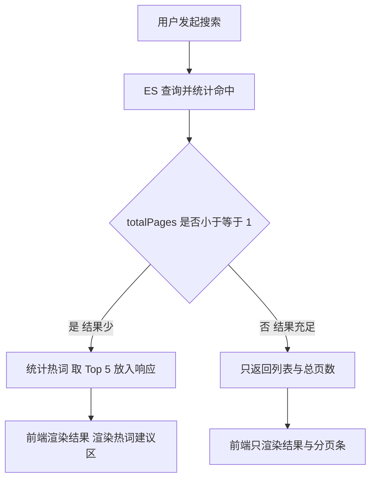

# 搜索只回来一条结果时别让用户干瞪眼：热词搜索的功能定义与触发时机

在搜索框里输入「桃园」，命中的房源只有一条，结果浮层下面大片留白，分页条也因为只有一页而不出现。用户此刻的反应通常不是欣赏这一条数据，而是怀疑自己搜错了地方。搜索体验里最怕的就是这种死胡同，热词搜索要解决的正是它：结果太少的时候，给用户递几个「换了更好搜」的词。

## 先给结论

- 热词不是人工配置的推荐词，而是从用户的搜索行为里统计出来的：按搜索的关键字与其命中的结果数量排序，数量越多的越靠前。
- 出现时机卡得很死：无搜索结果，或结果只有一页时才展示，两种情况本质上都是「结果少」。
- 数量上限是 5 个，多了就不是建议而是刷屏。
- 交互形态是搜索框下方的建议区，点击某个热词等于替用户完成一次输入：词回填到输入框，同时自动发起搜索。
- 后端响应要多带一个字段：搜索结果之外附上热词集合，前端只负责渲染与回传点击。

## 一、热词是什么：从搜索行为里统计出来的榜单

需求原文值得逐句读一遍：

> 需求：当无搜索结果或搜索结果只有一页时，显示搜索热词，最多显示 5 个热词。
> 热词：按使用用户搜索的关键字以及搜索到的结果数量进行排序，数量越多的越排到前面，从而得到热词。

拆开看有两个统计维度。**维度一是关键字本身**，每个在搜索框里出现过的词都是一条候选；**维度二是数量**，讲义口径下这个数量指的是该关键字搜索命中的结果条数，命中的越多越靠前。两个维度拼起来，榜单的含义是「这些词能搜出大量内容」，把它推给刚经历了一场空搜索的用户，等于告诉他换这几个词试试，大概率能出结果。

这类思路在通用搜索引擎里随处可见。在百度搜 `java`，结果页底部会出现一排热点词条，旁边标着有多少万人搜过。百度热点的口径是搜索人数：某个词被 45 万人搜过，它就成为热点。两种口径的共同点是把「用户的行为」聚合成排序依据，而不是靠运营人工拍脑袋上词；差别只在统计的对象，一个数「有多少人搜了它」，一个数「它搜出来多少东西」。落到房源搜索这个场景，讲义选了后者，理由很直接：热词的使用场景就是「结果太少」，此时用户最需要的不是别人在搜什么，而是哪个词能搜得多。

工程上也常见按搜索次数排行的口径，两种口径的数据来源是同一份搜索记录，差别只在聚合时取哪个值，实现层面的取舍放到实现分析里对比。

## 二、什么时候出现：结果少才递热词

触发条件写在需求第一句里：无结果，或结果只有一页。这两个条件在现有代码里其实已经有现成的判断依据，接口返回的 `totalPages` 小于等于 1 就覆盖了全部两种情况：0 页对应无结果，1 页对应结果不满两页。

把判断画成流程，搜索请求的响应分成两条路：



关键分叉就是中间那个判断：结果充足的搜索不掺任何热词，页面该给分页条给分页条，该给列表给列表；结果少的搜索才多带一份建议。这个判断必须放在后端，因为总页数只有后端算得出来，前端拿到 `totalPages` 再自行决定要不要展示热词区也可以，但热词数据本身已经在响应里了，判断放在哪一端只是渲染策略问题。

顺带一提，分页条在这一刻天然消失。分页器那节的渲染条件是 `totalPage > 1` 才显示，单页结果本来就不出分页条，热词建议区正好补上它腾出来的空间，两个功能在布局上无缝衔接。

## 三、交互形态：点击热词等于替用户输入

需求给出的效果示例是：用户搜「桃园」只回来一条，结果下方出现一行建议，提示「搜索的结果较少，建议搜索下面这几个内容」，后面跟着「房」「小区」「新村」这样的热词。点其中任何一项，两件事同时发生：这个词填进搜索框，页面立刻用这个词重新发起搜索。

前端要做的接线不复杂，在现有的搜索组件里加一块建议区：

```jsx
{this.props.hotWords && this.props.hotWords.length > 0 ? (
    <div>
        <span>搜索的结果较少，建议搜索：</span>
        {this.props.hotWords.map((word, idx) => (
            // 每个热词一个 Label，点击交给统一的搜索入口
            <Label as='a' key={idx} onClick={this.handleHotSearch}>{word}</Label>
        ))}
    </div>
) : null}
```

`hotWords` 从 home 的 state 经 props 传下来，后端响应里有值、且结果确实少的时候才渲染。点击回调复用现有的搜索链路，把热词当作普通的输入值传回去：

```javascript
handleHotSearch = (e, data) => {
    // data.children 是 Label 里的文本，即热词本身
    this.props.searchPage(null, { value: data.children });
};
```

home 里的 `search` 本来就接受 `data.value` 作为关键字，热词点击与手动输入在它眼里是同一个入口，不需要任何特殊分支。这段示例为按本课写法补全，具体落地在具体实现那一节完成。

响应的数据形状也随之定型，在原有的 `totalPages` 与 `rows` 之外多一个 `hotWords`：

```json
{
  "totalPages": 1,
  "rows": [{ "title": "桃园 1 居室", "rent": "1500" }],
  "hotWords": ["小区", "新村", "近地铁", "整租", "一室"]
}
```

热词的统计口径、存储选型与记录时机，是后面两节要回答的问题；这一节把需求钉死，功能边界清楚了，实现才有得谈。

## 常见误区

- **把热词当成运营位。** 词表由后台人工维护，搜索行为毫无参与。热词的生命力在「统计」，词是用户搜出来的，人工只该做审核过滤。
- **结果多也挂热词。** 搜「小区」几百条结果还在下面推热词，等于否认用户刚做的选择。触发条件收紧到 `totalPages <= 1`。
- **点击热词只回填不搜索，或者只搜索输入框却是空的。** 前者让用户多点一次，后者让用户困惑输入框里的字从哪来。回填与搜索必须同一次点击完成。
- **热词数量不设上限。** 一口气推二十个词，建议区比结果区还长。需求定的上限是 5 个，接口取 Top 5，前端不再自行截断。

## 面试可能被问到的问题

1. 面试官追问：「热词和搜索建议、自动补全是一回事吗？」
   答：不是。自动补全发生在输入过程中，依据的是索引里的词与输入前缀的匹配，解决「打得快」；热词发生在搜索完成之后，依据的是用户行为统计，解决「搜不出来怎么办」。一个在打字时介入，一个在出结果时介入，数据来源与实现路径都不同。

2. 面试官追问：「为什么热词按搜索到的结果数量排序，而不是按搜索次数？」
   答：这是需求口径的选择。按结果数排序的榜单含义是「换这些词能搜出更多内容」，与热词只在结果少时出现的场景严丝合缝；按搜索次数排序的榜单含义是「大家在搜什么」，更适合做首页热搜之类的展示位。数据来源相同，聚合口径不同，选哪种取决于产品把热词放在什么场景用。

3. 面试官追问：「要不要展示热词的判断放前端还是后端？」
   答：数据侧必须在后端，`totalPages` 只有后端算得出，热词统计与查询也都在服务端；渲染判断可以放前端，拿到 `totalPages` 与 `hotWords` 后自行决定是否出建议区。通常后端只在结果少时才去查热词，没必要每次搜索都多查一趟。

4. 面试官追问：「空结果的关键字要不要纳入热词统计？」
   答：要记录，看口径。按结果数排序的口径下，0 结果的词分数垫底，永远进不了 Top 5，记录它不伤功能；按搜索次数的口径下，高频零结果的词是搜索体验的重要信号，说明索引里缺内容或分词没跟上，单独有价值。

5. 面试官追问：「热词榜希望新词及时上榜，直接用统计好的历史榜单有什么问题？」
   答：历史榜单是离线聚合的结果，时效性差，突发搜索趋势反映不上去。要做实时榜单就得让每次搜索都实时更新计数，读的时候现取 Top N，这正好指向 Redis 有序集合这类在线结构，也是实现分析那一节方案选型的核心议题。

## 配套资料

- 搜索的实体数据：`materials/code/03/day15-房源数据抓取以及实现房源搜索/day15-房源数据抓取以及实现房源搜索/资料/抓取的房源数据/data.json`（2010 条房源，「桃园」这类低频关键字与「小区」这类高频关键字都出自它）
- day15 资料包未含前端工程与 api-server 源码：文中建议区渲染、点击回调与响应 JSON 示例为按本课写法补全，接口契约沿用 `/house/search` 系列
