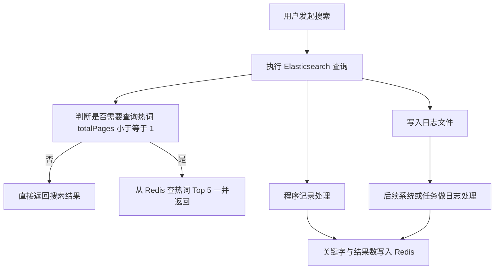

# 热词数据从哪来：同步写 Redis 与日志异步管道的两条实现路线

功能需求已经钉死：结果少于等于一页时，返回按数量排序的 Top 5 热词。轮到实现分析，真正要回答的是三个问题：每次搜索发生时记什么、这条记录走什么路径落到存储里、读取时怎么取。前两个问题各有一个分叉，分叉的选择决定了这套统计是轻是重。

## 先给结论

- 每次搜索都要记录两样原始数据：搜索关键字、该关键字命中的结果数，热词榜单完全由它们聚合出来。
- 存储归宿统一是 Redis 的有序集合（ZSet）：成员放关键字，分数放数量，按分数倒序取前 N 名就是热词榜。
- 写入有两条路。方案一同步：查询完成后由程序直接写 Redis，实现最短，但记录动作挂在搜索主链路上。方案二异步：程序只往日志文件里写一行记录，后续由独立的系统或任务读日志、解析、再写 Redis，主链路几乎零负担。
- 读取侧有前置判断：结果较多时没必要查热词，`totalPages <= 1` 才去 Redis 里取 Top 5，随搜索结果一并返回。
- 本课落地同步方案，加上异步方案的记日志半程；日志的采集与解析由后续日志体系课程补齐，两条路线的记录代码都要写。

## 一、流程全景：一个判断加两条写入路

把讲义的流程图完整还原出来，热词功能在搜索链路上的位置一目了然：



图上有两处容易看漏的地方。写入路的主干从 B 分出两条：程序记录处理与写日志，它们对应同步与异步两个方案，殊途同归于 Redis；读取路的判断在 C，决定的是「要不要把热词放进这次响应」，与写入路互不阻塞，每次搜索无论结果多少都会走一次写入。

## 二、方案一：同步写，查询完顺手记一笔

同步方案里，Controller 拿到搜索结果后先算出结果数，再连关键字一起写进 Redis 的有序集合，伪码骨架是：

```java
// 查询完成后，同步记录本次搜索（示意骨架，具体实现见下一节）
SearchResult search = this.searchService.search(keyword, page);
long count = /* 由总页数与当前页条数换算出结果总数 */;
// ZSet：成员是关键字，分数是结果数
this.redisTemplate.opsForZSet().add("haoke_hot_words", keyword, count);
```

这条路的优点是短平快：一次 Redis 往返，数据立刻可见，前端马上就能搜到刚产生的热词，逻辑全在一个方法里，出问题一翻代码就是全貌。

代价在于它站在主链路上。搜索接口的耗时里凭空多了一次 Redis 网络往返，平时几十毫秒感知不到，可一旦 Redis 抖动，搜索接口跟着超时：一个辅助功能的故障，升级成了核心功能的故障。真要走同步方案，写入处必须包一层 try-catch 降级，记录失败只打告警，绝不能让异常往上传。

## 三、方案二：异步写，主链路只记一行日志

异步方案把「记录」和「聚合」拆开。搜索接口只做一件轻到可以忽略的事：往日志文件里写一行结构化记录。

```java
// 主链路只负责打日志，聚合交给后续处理
LOGGER.info("搜索关键字为 {}, 结果数量为 {}", keyword, count);
```

日志落盘之后，谁来消费？讲义图里画的是一个独立的日志处理环节：由另外的系统或任务读日志、解析出关键字与结果数、再写进 Redis。写到日志与写 Redis 之间隔着一层缓冲，主链路在任何情况下都不会因为热词统计而变慢。

两条路线摆在一起对比：

| 对比项 | 同步写 Redis | 异步写日志 |
|---|---|---|
| 实现成本 | 一段代码，链路内完成 | 打日志极简，但要额外养一个消费端 |
| 对搜索接口的影响 | 多一次 Redis 往返，需降级保护 | 仅一次日志输出，可忽略 |
| 实时性 | 立即可查 | 取决于消费端的处理周期 |
| 故障隔离 | Redis 故障波及搜索接口 | 日志是落盘缓冲，消费端挂了可追补 |

异步方案的消费端用什么实现，讲义明确说了本节不展开，后续的日志采集与处理课程会专门做；本节把记日志这一半先写出来，管道另一半留待那里接上。

## 四、方案空间之外：为什么不选数据库和 ES 聚合

除了课程给的同步与异步两路，热词统计在工程上还有两种常见走法，摆出来更能看清 Redis 有序集合为什么是首选。以下对比为按主流方案补充的延伸讨论。

**走法一是数据库计数表。** 一张表两列：关键字、计数，每次搜索 `UPDATE` 加一。问题是搜索是高频写，同一个热词的同一行会被并发改写，行锁竞争激烈；要拿榜单还得 `ORDER BY count DESC`，数据量一大就是慢查询，通常还得再建一张定时聚合的汇总表兜底。

**走法二是 ES terms 聚合。** 把每次搜索作为一个文档写进 ES，热词榜就是对关键字字段做 terms 聚合取 Top N。聚合能力是现成的，还能按时间窗口切分；但搜索行为本身也是高频写，等于用 ES 承接第二份写流量，聚合再有缓存，也扛不住把排行榜查询变成常态高频操作。

**Redis 有序集合两头都占便宜。** 写入 `ZINCRBY` 是对单个成员的分数累加，复杂度对数级，没有行锁式的竞争；读取 `ZREVRANGE` 直接按分数倒序取前 N，本来就是排好序的结构。读写都高频的场景，正是它的主场。本课同步方案用 `add` 直接设分数（分数即结果数，覆盖写符合口径）；如果产品口径换成按搜索次数排行，把 `add` 换成 `incrementScore` 累加即可，存储结构一行不用动。

## 五、读取侧：何时查、怎么取

读取侧的逻辑在流程图的判断框里：结果较多时用户不需要建议，直接返回；`totalPages <= 1` 时才向 Redis 查热词。取法是有序集合的倒序区间：

```bash
# 取热词榜前 5：按分数从高到低，下标 0 到 4（命令示例，结构演示用）
ZREVRANGE haoke_hot_words 0 4 WITHSCORES
```

查出来的热词集合塞进搜索响应一起返回，前端拿到后按上一节约定的形态渲染建议区。至此实现分析完毕：记录两样数据、两条写入路、一个读取判断，下一节动手把同步方案与日志半程写进代码。

## 常见误区

- **读时统计。** 用户请求热词时现场去翻搜索记录做聚合，请求越热统计越慢。统计必须在写时完成，读取只做一次区间查询。
- **同步方案不设降级。** 写 Redis 不包 try-catch，Redis 一抖搜索接口跟着 5xx。记录类操作失败只告警，不阻断主流程。
- **日志随便打。** 日志行格式随意，后续解析要靠正则猜。记录格式必须结构化、带统一前缀标识，给消费端留出稳定可解析的契约。
- **只有有结果才记录。** 0 结果的搜索同样是有价值的数据：按结果数口径它分数垫底进不了榜单，按搜索次数口径它是「索引缺内容」的信号，记录动作不该有条件分支。

## 面试可能被问到的问题

1. 面试官追问：「热词统计为什么选 Redis 有序集合而不是 MySQL 计数表？」
   答：搜索是高频写，MySQL 单行 `UPDATE` 有行锁竞争，榜单查询还要 `ORDER BY` 扫描；ZSet 的 `ZINCRBY` 是单成员分数累加，`ZREVRANGE` 直接按分数倒序取 Top N，读写都常数量级，天然匹配「高频记、随手取」的访问模式。

2. 面试官追问：「同步记录热词对搜索接口有什么风险，怎么兜底？」
   答：风险是把一次 Redis 网络往返加进了搜索主链路，Redis 抖动会放大成搜索接口超时。兜底是写入处捕获异常降级，失败只记告警日志；更彻底的做法就是切异步方案，主链路只写日志。

3. 面试官追问：「异步方案里，日志写成功了但消费端挂了怎么办？」
   答：日志文件是落盘缓冲，数据没有丢，消费端恢复后从上次读到的位置继续追即可。要做到这一点，日志行需要带时间戳等定位信息，消费端记录读取位点，两边配合保证至少一次处理；重复消费则靠 ZSet 的分数语义天然幂等或计数上容错。

4. 面试官追问：「热词榜单要按时间窗口分开，比如只看最近一小时，结构怎么调整？」
   答：给 ZSet 的成员名或 key 加上窗口维度，例如按小时滚动的 key，每小时一个榜单，读取时取当前窗口的 key；过期窗口用 TTL 自动清理。窗口粒度越细，key 数量越多，按业务时效要求权衡。

5. 面试官追问：「`ZADD` 与 `ZINCRBY` 在这个场景里怎么选？」
   答：看分数语义。分数表示「该词当前命中的结果数」，覆盖写用 `ZADD`，新查询的结果刷新旧值；分数表示「累计被搜次数」，累加用 `ZINCRBY`。结构完全相同，一行写入命令之差，产品口径切换时改的是记录侧一行代码。

## 配套资料

- 搜索的实体数据：`materials/code/03/day15-房源数据抓取以及实现房源搜索/day15-房源数据抓取以及实现房源搜索/资料/抓取的房源数据/data.json`（2010 条房源，热词统计的对象数据）
- day15 资料包未含 api-server 工程源码：文中记录与读取的 Java 骨架、日志行与 Redis 命令示例为按本课写法补全，方案对比一节的数据库与 ES 聚合走法为按主流方案补充
