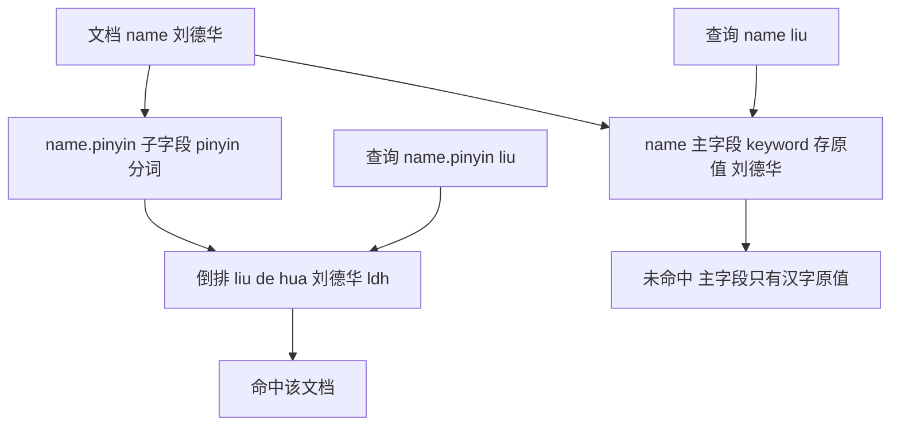

# 只会拼不会写也能搜到：pinyin 分词插件从安装到子字段搜索

用户记得某个名字的发音，却写不出汉字，在搜索框里敲的是 `liu` 或者首字母 `ldh`；找房的人对小区名只闻其声、不知其字。IK 分词器把汉字切成了词，但切出来的词和拼音是两个世界，中文的倒排索引里根本没有 `liu` 这个词条。要把「音」接进搜索，靠的是 Elasticsearch 的 pinyin 分词插件。

## 先给结论

- 插件是 `elasticsearch-analysis-pinyin`，版本必须与 Elasticsearch 版本严格一致，解压到每个节点的 plugins 目录；docker 部署的场景是把插件目录挂载进容器并重建，集群三个节点一个都不能少。
- 它提供 `type` 为 `pinyin` 的自定义 tokenizer，可配参数决定产出哪些形式：全拼、首字母串、原汉字保留等。
- 用 `_analyze` 测「刘德华」，产出 `liu`、`de`、`hua`、`刘德华`、`ldh` 五类词条，全拼、原文、首字母一次备齐。
- 搜索要靠 multi-fields 子字段：字段本体按原值索引，子字段挂 pinyin 分词器，查询必须打到 `name.pinyin` 这条路径，打到主字段上拼音是查不到的。
- 项目索引 `haoke` 的 `title` 字段同样加拼音子字段（真实资料）：中文检索走 IK，拼音检索走 pinyin，一个字段两种索引方式并存。

## 一、拼音分词解决什么问题

中文搜索的常规链路是：文本过 IK 切成词，倒排索引里存的是 `刘`、`德华` 这类词条，用户输入也走同一套分词后去匹配。这条链路对 `liu` 完全无感，因为索引里没有拼音词条。

pinyin 插件在分词这一环多做一步：把汉字转成拼音形式再进倒排。于是同一个字段在倒排索引里同时拥有汉字与拼音两套词条，用户敲拼音、敲首字母、敲汉字，都能落到同一条数据上。它不替代 IK，而是与之并存，各管一种输入习惯。

## 二、安装：每个节点都要有，一个都不能漏

插件以 zip 包发布，版本号要和 ES 完全对齐，这里的环境是 6.5.4。解压到宿主机的插件目录，docker 部署的集群通过挂载把目录送进每个节点：

```bash
# 插件解压到宿主机目录，每个节点一份
cd /haoke/es-cluster/pinyin
unzip elasticsearch-analysis-pinyin-6.5.4.zip

# docker 部署：停掉旧容器，重建时把 ik 与 pinyin 一起挂进 plugins
docker stop es-node01 es-node02 es-node03
docker rm es-node01 es-node02 es-node03
docker create --name es-node01 --net host \
  -v /haoke/es-cluster/node01/elasticsearch.yml:/usr/share/elasticsearch/config/elasticsearch.yml \
  -v /haoke/es-cluster/node01/jvm.options:/usr/share/elasticsearch/config/jvm.options \
  -v /haoke/es-cluster/ik:/usr/share/elasticsearch/plugins/ik \
  -v /haoke/es-cluster/pinyin:/usr/share/elasticsearch/plugins/pinyin \
  -v /haoke/es-cluster/node01/data:/usr/share/elasticsearch/data \
  elasticsearch:6.5.4
# node02 与 node03 同理，只替换各自的配置与数据目录
```

这段流程与课程资料里集群添加 IK 分词器的做法同构，只是多挂一个 pinyin 目录。装完启动，日志里能看到插件加载的痕迹，集群绿了才算就绪。

## 三、建索引并测分词：五类词条一次看清

先用一个演示索引把插件的产出摸清楚（索引名按规范从官方示例改名，其余配置保持原样）：

```json
PUT /pinyin_test/
{
  "settings": {
    "index": {
      "analysis": {
        "analyzer": {
          "pinyin_analyzer": {
            "tokenizer": "my_pinyin"
          }
        },
        "tokenizer": {
          "my_pinyin": {
            "type": "pinyin",
            "keep_separate_first_letter": false,
            "keep_full_pinyin": true,
            "keep_original": true,
            "limit_first_letter_length": 16,
            "lowercase": true,
            "remove_duplicated_term": true
          }
        }
      }
    }
  }
}
```

配置的结构是两层：`tokenizer` 区定义一个名叫 `my_pinyin` 的分词器，类型是插件注册的 `pinyin`，参数在这里调；`analyzer` 区把 `pinyin_analyzer` 这个名字指到它，之后引用的都是 `pinyin_analyzer`。

拿「刘德华」过一遍分词器：

```json
POST /pinyin_test/_analyze
{
  "text": ["刘德华"],
  "analyzer": "pinyin_analyzer"
}
```

返回的词条是 `liu`、`de`、`hua`、`刘德华`、`ldh`，五种形式各有来源，参数对照如下：

| 参数 | 作用 | 本课取值 |
|---|---|---|
| `keep_full_pinyin` | 逐字全拼，产出 liu、de、hua | true |
| `keep_first_letter` | 整串首字母，产出 ldh（默认开启） | 默认 true |
| `keep_separate_first_letter` | 首字母拆成单字 token（l、d、h） | false |
| `keep_original` | 保留原汉字 刘德华 | true |
| `limit_first_letter_length` | 首字母串的最大长度 | 16 |
| `lowercase` | 拼音统一小写 | true |
| `remove_duplicated_term` | 重复词条去重 | true |

课程对参数的态度是保持默认够用，值得留意的是 `keep_separate_first_letter` 保持 false：单字母 token 量极大且歧义重，开了它索引体积与查询噪音双双失控。

## 四、multi-fields：一个字段，两套倒排

分词器有了，怎么让它作用于业务字段？答案是 multi-fields 子字段：一个字段在 mapping 里声明出若干子字段，写入时主字段与子字段各按各的分析方式建立倒排。给演示索引加映射：

```json
POST /pinyin_test/folks/_mapping
{
  "folks": {
    "properties": {
      "name": {
        "type": "keyword",
        "fields": {
          "pinyin": {
            "type": "text",
            "analyzer": "pinyin_analyzer"
          }
        }
      }
    }
  }
}
```

`name` 本体是 `keyword`，不分词、存原值，承担精确查询；`name.pinyin` 是它的子字段，text 类型、挂 `pinyin_analyzer`，承担拼音匹配。插入一条数据后：



图上两条查询路径的差别，就是这个功能最容易绊倒的地方。插一条 `{"name": "刘德华"}` 实测：`match` 查 `name` 传「刘德华」，keyword 精确匹配，命中；查 `name` 传 `liu`，主字段倒排里只有汉字原值，查不到；同样的 `liu` 打到 `name.pinyin`，立刻命中，首字母 `ldh` 同样命中。ES 设计子字段正是为了让一个字段支持多种检索方式，想按拼音搜就挂 pinyin 的子字段，互不干扰。

## 五、回到房源索引：title 字段的两种分词并存

演示索引跑通后，把它套到项目的 `haoke` 索引上。课程资料给出的 mapping 里，`title` 字段是这样的：

```json
"title": {
    "type": "text",
    "analyzer": "ik_max_word",
    "fields": {
        "pinyin": {
            "type": "text",
            "analyzer": "pinyin_analyzer"
        }
    }
}
```

主字段 `title` 沿用 `ik_max_word`，承接中文关键词搜索；子字段 `title.pinyin` 走 pinyin 分析器，承接拼音与首字母搜索。用户搜「小区」走 `title`，搜 `xiaoqu` 或 `xq` 走 `title.pinyin`，两条路查的是同一批房源文档。其余 keyword 字段保持 `index: false` 不做索引，mapping 整体结构未动。拼音搜索就此成为搜索入口的又一个选项，与热词、分页、高亮互不相扰。

## 常见误区

- **插件版本与 ES 版本不匹配。** 插件按 ES 大版本编译，6.5.4 的插件装到别的版本上，节点直接启动失败。下载时版本号跟着 ES 走，不带任何侥幸。
- **只装了部分节点。** 集群三个节点只挂了两个，含分词查询的请求一旦路由到缺插件的节点，报未知 tokenizer，且现象时好时坏，因为路由是轮着走的。插件必须全节点覆盖。
- **给已有索引补装插件就指望生效。** analyzer 是索引创建时定死的，已有索引不会自动长出拼音词条。先装插件、再按新 mapping 重建索引，数据重导一遍。
- **拼音查询打到主字段上。** `match` 查 `name` 传 `liu` 永远查不到，必须显式写子字段路径 `name.pinyin`。查询端要清楚每个词该走哪条路。
- **打开单字母首字母开关。** `keep_separate_first_letter` 产出海量单字母 token，索引膨胀、噪音剧增，默认 false 别动。

## 面试可能被问到的问题

1. 面试官追问：「IK 分词器和 pinyin 插件是什么关系，能同时用吗？」
   答：两者是并存的分词能力，不互相替代。IK 负责把中文切成词，pinyin 负责把汉字转成拼音词条。同一个字段可以通过 multi-fields 挂多个子字段，主字段走 IK、子字段走 pinyin，分别服务中文输入与拼音输入两类用户习惯。

2. 面试官追问：「multi-fields 子字段和 copy_to 的区别是什么？」
   答：multi-fields 是一个字段的多种索引形态，子字段的值来自主字段本身，查询走「主字段.子字段」路径；copy_to 是把多个字段的值复制聚合成一个新字段，用来做跨字段的综合检索。一种输入方式对应一个字段时用前者，多字段合并搜索时用后者。

3. 面试官追问：「装完 pinyin 插件后，已有索引的拼音搜索不生效，什么原因？」
   答：analyzer 与 mapping 在索引创建时确定，已存在的倒排里没有拼音词条，装插件只是让分词器可用，不会追溯改写存量倒排。正确顺序是装插件、按含子字段的 mapping 重建索引、重导数据，拼音搜索才生效。

4. 面试官追问：「pinyin 插件的产出有哪些形态，分别由什么控制？」
   答：逐字全拼由 `keep_full_pinyin` 控制，整串首字母由 `keep_first_letter` 控制并受 `limit_first_letter_length` 约束长度，原汉字保留由 `keep_original` 控制，大小写由 `lowercase` 统一。按业务需要的输入形态挑开关，开得越多索引越大。

5. 面试官追问：「拼音搜索的首字母歧义怎么处理？」
   答：首字母串信息量低，`ldh` 可能对应无数组合，命中噪音天然偏多。缓解手段是搜索入口上把首字母查询与全拼查询分级，首字母命中只做提示或候选；配置上限制 `limit_first_letter_length`、关闭单字母 token，把噪音压在可控范围。

6. 面试官追问：「docker 部署的 ES 集群，插件升级的正确姿势是什么？」
   答：替换宿主机插件目录内容，逐个节点 stop、rm 后按原挂载参数重建容器，等节点重新加入集群再处理下一个，保持集群整体可用。升级期间版本短暂的节点间不一致要避免写入依赖新分词器的索引。

## 配套资料

- 集群安装拼音分词器与项目索引 mapping（真实资料）：`materials/code/03/day15-房源数据抓取以及实现房源搜索/day15-房源数据抓取以及实现房源搜索/资料/集群添加拼音分词器.md`（含 `haoke` 索引完整 settings 与 `title` 拼音子字段 mapping）
- 集群安装 IK 分词器（真实资料，docker 重建流程同构）：`materials/code/03/day15-房源数据抓取以及实现房源搜索/day15-房源数据抓取以及实现房源搜索/资料/集群添加IK分词器.md`
- 演示索引一节的建索引、`_analyze` 与搜索请求为按插件官方示例整理，索引名按规范改名，mapping 按多字段规范精简
