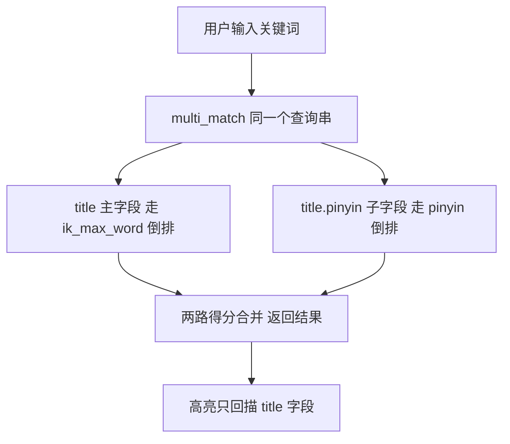

# 让 ditie 搜到地铁：拼音子字段接进房源搜索的全过程

pinyin 插件装好了，`_analyze` 也验证过五类词条，看上去只差临门一脚。真把搜索入口打开，敲一个 `ditie`，一条房源都出不来：线上用的还是那个只有 IK 倒排的旧 `haoke` 索引，搜索服务也还只会打 `title` 一个字段。插件能力要落到业务搜索上，还差「重建索引」与「改造查询」两步。

这一课把这两步一次走完：删掉旧索引，用带拼音配置的 mapping 重建 `haoke`，把查询从单字段 `match` 换成 `multi_match`，重导数据、重启服务后，汉字、拼音、混合输入都能命中。

## 先给结论

- analyzer 在索引创建时定死，给已有索引装插件不会追溯生效，必须删掉 `haoke` 重建，数据重导一遍。
- settings 里定义 `my_pinyin` tokenizer 与 `pinyin_analyzer`，mappings 里给 `title` 挂一个 `pinyin` 子字段，原字段结构不动，写入数据的代码一行不改。
- 查询端从 `matchQuery("title", keyword)` 换成 `multiMatchQuery(keyword, "title", "title.pinyin")`，一个入口同时覆盖中文与拼音。
- 高亮字段配在 `title` 上就够；拼音命中不会高亮出中文标题，这是分词机制使然，不是 bug。
- Java 侧改完必须重启服务。实测时就因为没重启，拼音怎么搜都搜不到，白查了半天代码。

## 一、旧索引为什么不改不行

`haoke` 索引创建时，`title` 只挂了 `ik_max_word`，倒排里全是中文词条。插件装进集群只是让 `pinyin` 这种 tokenizer 变得可用，它不会改写存量倒排，mapping 也无法就地给字段追加分析器，路径只有一条：删了重建。

```bash
DELETE /haoke/
# 索引连同数据一起删除，随后重新导入即可
```

数据没了并不心疼，抓取脚本随时可以重跑，资料包里两千多条房源 JSON 就是为重导准备的。

## 二、重建索引：带拼音配置的完整请求

课程资料里给出了完整的建索引请求，原样落地即可（请求发往集群节点）：

```json
PUT /haoke/
{
    "settings": {
        "index": {
            "number_of_shards": 6,
            "number_of_replicas": 1,
            "analysis": {
                "analyzer": {
                    "pinyin_analyzer": {
                        "tokenizer": "my_pinyin"
                    }
                },
                "tokenizer": {
                    "my_pinyin": {
                        "type": "pinyin",
                        "keep_separate_first_letter": false,
                        "keep_full_pinyin": true,
                        "keep_original": true,
                        "limit_first_letter_length": 16,
                        "lowercase": true,
                        "remove_duplicated_term": true
                    }
                }
            }
        }
    },
    "mappings": {
        "house": {
            "dynamic": false,
            "properties": {
                "title": {
                    "type": "text",
                    "analyzer": "ik_max_word",
                    "fields": {
                        "pinyin": {
                            "type": "text",
                            "analyzer": "pinyin_analyzer"
                        }
                    }
                },
                "image":       { "type": "keyword", "index": false },
                "orientation": { "type": "keyword", "index": false },
                "houseType":   { "type": "keyword", "index": false },
                "rentMethod":  { "type": "keyword", "index": false },
                "time":        { "type": "keyword", "index": false },
                "rent":        { "type": "keyword", "index": false },
                "floor":       { "type": "keyword", "index": false }
            }
        }
    }
}
```

与旧配置相比，变化只有两处。**settings 的 analysis 区块**定义了拼音分析器：`tokenizer` 区声明名叫 `my_pinyin` 的分词器、类型是插件注册的 `pinyin`，`analyzer` 区把 `pinyin_analyzer` 这个名字指向它。**mappings 的 title 字段**多了 `fields` 声明，子字段名叫 `pinyin`，text 类型、挂 `pinyin_analyzer`。主字段 `title` 依旧走 `ik_max_word`，其余 keyword 字段原样保留。

写入侧完全无感：文档还是按老结构发，ES 在写入时自动把 `title` 的值同时索引到 `title.pinyin` 上，原结构零改动，多出一套倒排。

## 三、先证明两个方向各自能查

索引建好，插入一条真实抓取的数据：

```json
POST /haoke/house/
{
    "title": "近地铁，南北两房+小区中间位置+中间楼层+看房方便",
    "rent": "4500",
    "houseType": "2室0厅1卫",
    "rentMethod": "整租"
}
```

三个请求对比着发，现象把机制照得一清二楚：

- `match` 查 `title` 传「地铁」：命中，高亮正常，中文词条在 IK 倒排里。
- `match` 查 `title` 传 `ditie`：零结果，IK 倒排里没有拼音词条。
- `match` 查 `title.pinyin` 传 `ditie`：命中，但高亮里看不到中文被标记。

第三种情况的解释：`title.pinyin` 的倒排词条是 `di`、`tie` 这类拼音 token，而 ES 的高亮是把命中的词条在原始文本上回描，拼音 token 在中文原文里找不到对应位置，自然描不出 `<em>` 标签。想要高亮，查询就得同时打到主字段上，这正是 multi_match 要解决的事。

## 四、查询端换成 multi_match：一个关键词两条倒排

单个 `match` 只能指定一个字段，要 `title` 与 `title.pinyin` 同时参与，用 `multi_match`。先看请求体的写法：

```json
POST /haoke/house/_search
{
    "query": {
        "multi_match": {
            "query": "ditie",
            "fields": ["title", "title.pinyin"]
        }
    },
    "highlight": {
        "fields": {
            "title": {}
        }
    }
}
```

用户输中文时 `title` 分支命中、有高亮；输拼音时 `title.pinyin` 分支命中、无高亮；输「地tie」这类混合串时两个分支各按各的分词去碰。高亮配置只写 `title`，拼音命中没有标签，两种表现都是预期内的。

Java 侧对应改造搜索服务，从单字段 `match` 换成 `multiMatchQuery`（以下为按本课写法补全的示例，原工程源码未随资料包提供）：

```java
public SearchResult search(String keyword, Integer page) {
    // 原来：单字段 match，只有中文词条参与匹配
    // QueryBuilders.matchQuery("title", keyword)

    // 现在：一个关键字同时在 title 与 title.pinyin 两条倒排上匹配
    QueryBuilder queryBuilder = QueryBuilders
            .multiMatchQuery(keyword, "title", "title.pinyin");

    SearchQuery searchQuery = new NativeSearchQueryBuilder()
            .withQuery(queryBuilder)
            // 高亮只配在 title 上，中文命中时返回 em 标记
            .withHighlightFields(new HighlightBuilder.Field("title"))
            .withPageable(PageRequest.of(page - 1, ROWS))
            .build();
    // 后续执行查询、封装 SearchResult 的逻辑与之前一致
}
```

`multiMatchQuery` 的参数顺序要注意：第一个参数是查询串，后面才是字段名列表。整条查询的走向如下：



图上两条分支就是这次改造的全部秘密：一个入口、两套倒排，用户不需要知道自己敲的是汉字还是拼音。

## 五、重导数据、重启服务、前端实测

查询逻辑变了，索引里还得有数据。把之前写的导入代码重新执行一遍，它读取资料包的房源 JSON 逐条写入 `haoke`，mapping 结构没变，导入过程零修改。这里有个现场教训：导入完成后搜「fang」查不到数据，排查半天代码没问题，原因是**搜索服务没有重启**，跑着的还是旧逻辑。重启之后，一轮实测全部通过：

- 搜「东方」，中文命中，标题高亮；
- 搜「fang」，命中标题带「东方」的房源；
- 搜「xiaoqu」「huayuan」，命中带「小区」「花园」字样的房源；
- 首字母串同样可用，拼音插件默认保留整串首字母，`hkzf` 这类输入也能落到对应文档。

到这里，搜索入口对输入习惯的包容度就齐了：会打字的搜中文，会拼的搜全拼，懒得拼全的搜首字母，都通向同一批数据。

## 常见误区

- **不删旧索引直接发新 mapping。** `PUT /haoke/` 对已存在的索引会报 `resource_already_exists_exception`；指望往已有 mapping 追加子字段就生效，倒排里没有拼音词条，怎么查都是空。正确顺序是删索引、重建、重导数据。
- **把高亮字段配成 `title.pinyin`。** 拼音 token 回描不到中文原文，配了也出不来高亮。高亮字段配 `title`，接受拼音命中无高亮这个表现。
- **改完 Java 代码不重启服务。** 内存里跑的还是旧逻辑，现象是「改了等于没改」，先确认进程重启过再排查别的。
- **以为 `dynamic: false` 会自动收录新字段。** 该设置下文档里未被 mapping 声明的字段直接不索引，子字段名拼错一个字母不报错，但查询永远落空。

## 面试可能被问到的问题

1. 面试官追问：「给已有索引新增拼音搜索能力，标准流程是什么？」
   答：ES 的 analyzer 与 mapping 在索引创建时确定，无法就地给字段换分析器。标准流程是集群全节点装好 pinyin 插件、按新 mapping 创建新索引、用 `_reindex` 或重新导入灌数据、再用别名切换流量。数据量小时删索引重导也行，生产上更倾向别名灰度。

2. 面试官追问：「multi_match 和用 bool 把两个 match 拼起来有什么区别？」
   答：`multi_match` 是一个查询串在多个字段上各自执行后按策略合并得分，默认 `best_fields` 取最高分字段的分值；bool 里放两个 `match` 是两个独立条件的交集，字段必须都命中才返回。搜索要的是「任意字段命中即可」，所以用 `multi_match`。

3. 面试官追问：「拼音能命中为什么高亮不出来？」
   答：高亮的实现是把命中的词条在原始文本上定位并包上标记，`title.pinyin` 的词条是 `di`、`tie` 这类拼音，在中文原文中不存在对应位置，无法回描。高亮字段配在主字段 `title` 上，中文命中正常高亮，拼音命中没有高亮属于预期行为。

4. 面试官追问：「fields 子字段会不会改变写入结构，需要改插入代码吗？」
   答：不需要。multi-fields 的值来自主字段本身，写入端仍然只发原文档，ES 建倒排时自动按子字段的分析器多索引一份。它改变的是索引结构而非文档结构，前提是索引按新 mapping 重建。

5. 面试官追问：「`keep_first_letter` 和 `keep_separate_first_letter` 有什么区别？」
   答：前者保留整串首字母，「好客租房」产出 `hkzf` 一个词条，适合首字母缩写搜索；后者把每个字的首字母拆成独立单字 token，词条量巨大且歧义严重，一般保持 false。本课配置沿用了前者默认开启的效果。

## 配套资料

- 拼音分词器与 `haoke` 索引完整 mapping（真实资料，第二节建索引请求的出处）：`materials/code/03/day15-房源数据抓取以及实现房源搜索/day15-房源数据抓取以及实现房源搜索/资料/集群添加拼音分词器.md`
- 重导数据用的房源 JSON（真实资料，两千余条，含文中试验数据）：`materials/code/03/day15-房源数据抓取以及实现房源搜索/day15-房源数据抓取以及实现房源搜索/资料/抓取的房源数据/data.json`
- 搜索服务的 Java 改造代码为按本课写法补全的示例，课程资料包未含该服务源码工程
