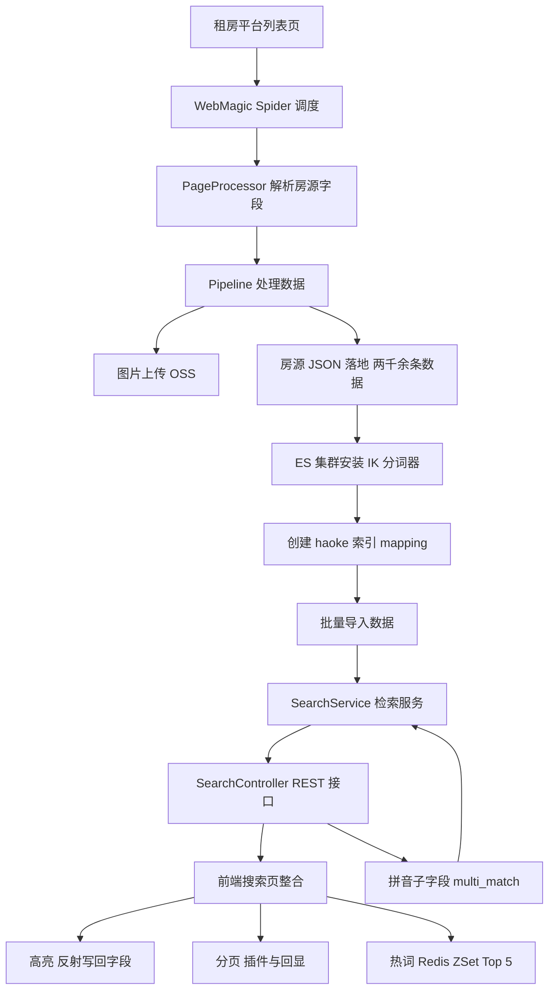

# day15 收官：从爬虫抓取到拼音搜索的一条完整链路

day15 的信息密度在整门课程里排得上号：一天之内跨了采集、入库、检索、呈现、增强五层，WebMagic 爬虫、OSS 图片、IK 分词器、批量导入、搜索接口、前端页面、高亮、分页、热词、拼音分词，十来个话题一个接一个。单点当时都讲透了，但学完最容易犯的毛病是「每一环都懂，串起来不会」。这一篇把全章按数据流向重新串一遍，标出每环的位置、关键实现和当时踩过的坑，当作整章的骨架图来用。

## 先给结论

- 全章主线是一条数据流水线：抓取房源与图片、图片进 OSS、数据进 Elasticsearch、接口对外供搜索、前端呈现结果，四个体验增强全部挂在检索环节上。
- 抓取用 WebMagic：`PageProcessor` 负责解析页面字段，`Pipeline` 负责落库与传图，落地两千余条房源 JSON。
- 入库的前置条件是集群装 IK 分词器并重建 `haoke` 索引，批量导入每凑满一批提交一次，而不是一条一个请求。
- 检索侧四个增强各有要点：高亮靠反射写回字段实现通用化，分页难在回显与参数传递，热词用 Redis ZSet 记分取 Top 5，拼音靠子字段加 `multi_match` 双路匹配。
- 高亮的反射写回与热词的固定格式日志是两个能带走的通用技巧，后者的日志行正是 day16 日志采集体系的伏笔。

## 一、全章链路总览

整章做的事画成一张图，箭头方向就是数据流向：



关键路径是从 F 到 I 的入库段：数据格式、分词器、mapping 三者必须先对齐，导入才有意义；后面 J 到 L 的检索段全部建立在这套索引结构上。前半段产出数据，后半段消费数据，中间的分界线就是 `haoke` 索引。

## 二、抓取与入库：网页变索引

**第一环是 WebMagic 抓取。** 框架的分工很清晰：`PageProcessor` 实现页面解析，从列表页抽取标题、户型、租赁方式、租金、楼层这些字段，再顺藤摸瓜把详情页地址塞回待抓队列；`Pipeline` 拿到解析结果做后续处理。抓下来的字段和资料包里 `data.json` 的结构一一对应，`title`、`houseType`、`rentMethod`、`rent`、`floor` 都在里面。

**第二环是图片上传 OSS。** 解析出的图片地址不能直接用，房源图片要转存到对象存储，Pipeline 里完成上传后把新地址写进数据。这样搜索结果里展示的图片不依赖被抓的站点，链接稳定、加载也快。

**第三环是装 IK 分词器、建索引。** 集群原本没有 IK，docker 部署的场景下把 IK 的 zip 解压到插件目录、重建容器挂载进去。随后创建 `haoke` 索引：6 个分片、1 个副本，`title` 挂 `ik_max_word` 承接中文切词，其余 keyword 字段 `index: false` 不参与检索。

**第四环是批量导入。** 两千多条数据如果一条发一个请求，网络往返的开销就能把导入拖垮，课程实现是攒批提交（下段代码精简自课程实现）：

```java
String createStr = "{ \"index\": { \"_index\": \"haoke\", \"_type\": \"house\" } }";
StringBuilder sb = new StringBuilder();
int count = 0;
for (String line : lines) {
    // 每条数据前面跟一行 action 元信息，组成 bulk 的标准格式
    sb.append(createStr).append("\n").append(line).append("\n");
    if (++count >= 100) {
        request.setEntity(sb.toString());
        Response response = this.restClient.performRequest(request);
        System.out.println("请求完成：" + response.getStatusLine());
        count = 0;
        sb = new StringBuilder();
    }
}
```

Bulk API 的格式是「一行元信息、一行文档」交替，凑满 100 条就发一次请求。批量大小是个权衡：太小退化为逐条提交，太大单请求体积失控，百条量级是这类导入的常用起点。

## 三、搜索接口与前端整合

数据进了索引，接着把检索能力开成 REST 接口。控制层结构如下（包名已改为中性的 `com.example`）：

```java
package com.example.haoke.dubbo.api.controller;

import com.example.haoke.dubbo.api.service.SearchService;
import org.springframework.beans.factory.annotation.Autowired;
import org.springframework.web.bind.annotation.CrossOrigin;
import org.springframework.web.bind.annotation.RequestMapping;
import org.springframework.web.bind.annotation.RestController;

@RequestMapping("house/search")
@RestController
@CrossOrigin // 前后端分离，跨域必须放开
public class SearchController {

    @Autowired
    private SearchService searchService;

    @Autowired
    private RedisTemplate redisTemplate; // 热词功能预留
}
```

`@CrossOrigin` 在前后端分离的项目里是必配项，页面域名和接口域名不同源，不放行浏览器直接拦掉请求。`RedisTemplate` 在这一步就注入进来，是给后面的热词功能预留的位置。

前端这边的工作量容易被低估：原工程没有搜索页，列表页组件、关键字输入、结果渲染、与后端的参数对接都要自己写。这一段教师的建议很实在，跟着敲一遍，对前端组件间数据流转的理解会扎实很多。

## 四、四个体验增强：接口能用到接口好用

**高亮走反射，换来了通用性。** 命中的词条要从 `HighlightField` 写回结果对象，如果对着 `title` 字段硬编码，以后每加一个高亮字段就要改一段代码。课程实现用反射遍历搜索结果的字段 Map，按字段名找到对象属性直接写值，高亮处理与具体字段解耦，对象加字段不用动处理逻辑。

**分页插件简单，麻烦在细节。** 服务端只是把 `Pageable` 传给查询，真正花时间的是回显与传参：页码从 home 组件传给搜索组件，结果回来再回调刷新，数据在组件间绕一圈，任何一环的 state 没接上，页面就不翻页。

**热词用 Redis ZSet 做榜单。** 每次搜索把关键字与结果数写进有序集合，结果少的时候取 `reverseRange` 前 5 个作为建议词返回。这里埋过一个负数陷阱：结果数由总页数换算而来，零结果时总页数是 0，`(0 - 1) * 每页条数` 直接算出负分，要用 `Math.max` 把页数下限卡在 1。

**拼音是收尾的增强。** 两件要记牢的事：建索引时在 settings 里定义拼音分析器，mapping 里用 `fields` 给 `title` 挂子字段；查询时从单字段 `match` 换成 `multi_match`，`title` 与 `title.pinyin` 两路同时匹配，中文拼音混合输入都能命中。高亮只配在 `title` 上，拼音命中不出高亮是机制使然。

## 五、全章沉淀的三个通用技巧

**反射写回是跨场景复用的。** 任何「搜索结果的 Map 转对象」的场景都适用，字段写不进去时检查属性名与 `getField` 的访问标志即可。

**固定格式的日志是给机器看的。** 热词功能里除了同步写 Redis，还打了一行 `LOGGER.info("搜索关键字为 {}, 结果数量为 {}", keyword, total)`，格式定死、关键字在前数量在后，这就是为异步方案准备的素材：day16 要学的 Beats 会把这样的日志采集起来，交给后续管道解析聚合。当时看似多余的一行日志，现在正好接上下一章。

**动手重跑比看懂重要。** 全章每个环节都留了可重跑的产物：抓取脚本、`data.json`、两份分词器配置文档，删掉索引从头来一遍，链路就真的属于自己了。

## 常见误区

- **只看演示不动手写。** 这一章教师反复强调实现要自己敲，尤其是前端搜索页与高亮的反射处理，看懂和写出来之间隔着大量细节，错过练习窗口后面章节会连续受影响。
- **高亮处理对字段硬编码。** 对着 `title` 写死一段取高亮的代码，短期能跑，加字段就崩。用反射按字段名写回，一次实现处处可用。
- **分页只改服务端。** 服务端分页参数传对了，页面不动照样「分页失效」，症状出在回显与组件间传参上，排查范围要覆盖前端。
- **拼音建完索引不重导数据。** 新 mapping 只对新写入的文档生效，重建索引后必须把数据重新导入，否则拼音倒排里是空的，怎么搜都没有结果。

## 面试可能被问到的问题

1. 面试官追问：「从抓取到搜索，你的数据链路是怎么设计的？」
   答：WebMagic 抓取房源字段并解析图片，图片转存对象存储，结构化数据落地成 JSON；Elasticsearch 集群先装 IK 分词器，按规划好的 mapping 建索引，用 Bulk API 攒批导入；检索能力封装成 REST 接口供前端调用，高亮、分页、热词、拼音作为检索环节的增强逐层叠加。

2. 面试官追问：「批量导入为什么要分批，批大小怎么定？」
   答：Bulk 请求把多份文档合并成一次网络往返，摊薄了连接与解析开销；单批过大则请求体积膨胀、内存压力大、失败重试代价高。常用起点是几百条或几 MB 一批，按文档大小和集群反馈调，观察导入吞吐与错误率取平衡点。

3. 面试官追问：「高亮字段的处理为什么用反射，有别的方案吗？」
   答：反射按字段名把 `HighlightField` 的片段写回结果对象，处理逻辑与具体字段解耦，对象新增字段零改动。替代方案是 MapStruct 这类映射工具或在 VO 里预置高亮字段，各有取舍：反射灵活但有性能与类型安全成本，显式映射直观但要随字段维护。

4. 面试官追问：「热词为什么选 Redis 的 ZSet，而不是每次从 Elasticsearch 聚合？」
   答：ZSet 成员唯一、自带分数、按分数有序，一次 `reverseRange` 就是 Top N，读写都是常数级开销，还把统计压力从 ES 挪了出去。直接对搜索日志做 terms 聚合也能出榜单，但每次查询都要扫日志，实时性与成本都差；两者也可以结合，ES 聚合做离线榜，ZSet 做实时榜。

5. 面试官追问：「拼音搜索上线，对已有索引和老数据怎么处理？」
   答：分析器在索引创建时定死，装插件只解决能力可用，存量倒排里没有拼音词条。要新建含拼音子字段的索引，把数据重导或 `_reindex` 过去，再用别名把查询切到新索引；查询端同时改成 `multi_match` 覆盖主字段与子字段，高亮字段保留主字段。

## 配套资料

- 集群安装 IK 分词器文档（真实资料）：`materials/code/03/day15-房源数据抓取以及实现房源搜索/day15-房源数据抓取以及实现房源搜索/资料/集群添加IK分词器.md`
- 集群安装拼音分词器与 `haoke` 索引 mapping 文档（真实资料）：`materials/code/03/day15-房源数据抓取以及实现房源搜索/day15-房源数据抓取以及实现房源搜索/资料/集群添加拼音分词器.md`
- 抓取落地的房源 JSON，两千余条，供重导与测试（真实资料）：`materials/code/03/day15-房源数据抓取以及实现房源搜索/day15-房源数据抓取以及实现房源搜索/资料/抓取的房源数据/data.json`
- 批量导入代码为按课程实现精简的示例，SearchController 包名已改写为 `com.example`，课程资料包未含服务端源码工程
