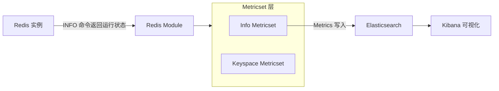
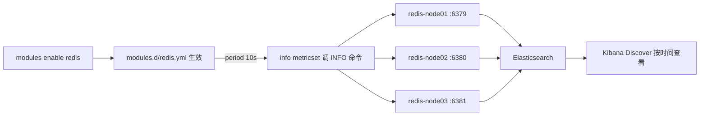

# Metricbeat 入门学习之指标采集：Module 结构、部署与 Redis Module

## 先给结论

- 日志回答「发生了什么」，指标回答「现在状态如何」：CPU 占用、内存水位、Redis 连接数这类数值型的运行状态不适合混在日志里采，Beats 家族里专门干这件事的是 Metricbeat。
- 指标与日志是两类数据：日志按事件追加、文本为主、格式不定；指标按周期定时采集、数值为主、结构固定。
- Metricbeat 由两层组成：module 是采集对象（system、redis、mysql 等），metricset 是该对象下的一组具体指标（cpu、memory、network 等）。
- 采数方式是调用对象自身的接口，比如 Redis 模块靠 INFO 命令拿到运行状态，整理成指标后写入 Elasticsearch。
- 部署与 Filebeat 完全同构：解压到统一目录、metricbeat.yml 改一处输出指向 ES 集群、启动命令加 -e 让日志打到控制台。
- system 模块默认开启：modules.d 下其他模块配置全带 disabled 后缀，解压完不改一行模块配置就能采系统指标，采集节奏由 period: 10s 决定。
- 启用中间件模块三步走：modules list 查货架，modules enable redis 启用，改 hosts 填节点地址后启动，Redis 指标照 10 秒一轮写进 ES。
- 看数据去 Kibana 的 Discover 按时间排序，文档里 module 与 metricset 两个标签定位来源，字段就是对象接口整理出来的运行状态。

## 第1部分：Metricbeat入门学习之简介

日志回答「发生了什么」，指标回答「现在状态如何」。CPU 占用、内存水位、Redis 的连接数，这些数值型的运行状态不适合混在日志里采：日志行有正常、debug、error 混杂，没规律可循，而监控要的是每个固定时间点的确定数值。Beats 家族里专门负责这件事的是 Metricbeat，官方给它的定位是轻量型指标采集器，从操作系统和各类服务收集指标，存入 Elasticsearch 做实时分析，最终由 Kibana 展现。

### 一、指标和日志，是两种数据

把两者摆在一张表里，边界立刻清楚：

| 维度 | 日志 | 指标 |
|---|---|---|
| 产生方式 | 事件发生时追加一行 | 按周期定时采集一次 |
| 数据形态 | 文本行，格式不定 | 数值 + 维度标签 |
| 内容规律 | 正常、debug、error 混杂 | 结构固定，可横向对比 |
| 典型用途 | 排查具体某次故障 | 看趋势、做告警、容量规划 |

指标采集是「定期做的固定动作」：比如每 5 分钟采一轮，每轮拿到一串确定字段的数值。这些数据存进 Elasticsearch 之后，天然适合做时间维度的聚合分析，几小时的曲线、几天的同比环比都拉得出来。展现层交给 Kibana，本课先把数据采到 ES，可视化在后面的课程展开。

### 二、两层结构：module 管对象，metricset 管指标

Metricbeat 的组成只有两个概念，但两层职责必须分清：

**module 是采集对象，回答「找谁要数据」。** 要采的是 MySQL、Redis、Nginx 还是操作系统本身，就启用对应的 module，每个对象一个模块。

**metricset 是指标的集合，回答「要哪一类数据」。** 同一个对象身上可以拿多组指标：操作系统的 CPU 是一组、内存是一组、网络又是一组；Redis 的 INFO 概览是一组、键空间统计又是一组。

打个比方：module 是「去哪个部门办事」，metricset 是「在这个部门领哪几张表」。一个 module 内含若干 metricset，启用模块时按需勾选。

### 三、以 Redis 为例看完整数据流

Redis 有个 `INFO` 命令，连接上执行就能拿到实例的运行情况：内存占用、CPU 消耗、客户端连接数等。Metricbeat 的 Redis 模块正是借这个命令取数：



关键路径在图中从右往左看：INFO 返回的是 Redis 自己定义的一种文本结构，Redis Module 先把这些信息整理成 metricset 需要的数据结构，再把相关指标发送给 Elasticsearch，ES 存好之后即可对外展现。注意这条链路里根本没有日志文件什么事，Metricbeat 拿数据的途径是服务自身的管理接口，这与 Filebeat 盯文件的方式是本质区别。

### 四、配置长什么样（示例）

Metricbeat 的配置骨架与 Filebeat 一脉相承，下面是按主流官方写法补全的可运行示例（课程本节只讲组成与流程，未给配置，此为按本课系列环境整理）：

```yaml
# metricbeat.yml（示例）
metricbeat.config.modules:
  path: ${path.config}/modules.d/*.yml   # 与 Filebeat 相同的模块加载机制

setup.template.settings:
  index.number_of_shards: 1              # 指标索引单分片足够

output.elasticsearch:
  hosts: ["192.168.1.7:9200", "192.168.1.7:9201", "192.168.1.7:9202"]
```

指标数据量远小于日志，单分片通常够用，这与 Filebeat 配 3 分片的取舍不同。系统指标模块默认启用，`system.yml` 里按 module 声明周期与 metricset（示例）：

```yaml
- module: system
  period: 10s                            # 每 10 秒采一轮
  metricsets:
    - cpu
    - memory
    - network
```

Redis 模块同理，声明对象地址与要采的 metricset（示例）：

```yaml
- module: redis
  metricsets: ["info", "keyspace"]
  period: 10s
  hosts: ["192.168.1.7:6379"]
```

想直观看看 INFO 命令给的是什么，连上 Redis 执行一次：

```bash
redis-cli -h 192.168.1.7 info memory
# used_memory_human:2.31M 之类的字段，正是 Info Metricset 的数据来源
```

启动方式与 Filebeat 相同：`./metricbeat -e -c metricbeat.yml`，事件就会按 period 节奏源源不断写入索引。

### 五、和 Filebeat 怎么分工

两者同属 Beats 家族，输出端配置完全一致，经常成对部署在业务机器上：Filebeat 盯着日志文件采文本行，Metricbeat 周期性地向系统与服务要指标。一条经验法则：数据以「行」为单位、要回溯原文的，走 Filebeat；数据以「数值」为单位、要画曲线做告警的，走 Metricbeat。排查一次线上故障时，两条线的数据在同一套 ES 里互为佐证。

## 第2部分：Metricbeat入门学习之部署与收集系统指标

想知道一台 Linux 主机此刻的 CPU 忙不忙、内存还剩多少、网卡流量流向哪里，用 `top` 敲一下只是看个瞬时快照；要让这些数值按固定节奏持续入库、事后能拉出曲线做趋势分析，需要的是一个常驻的指标采集器。上一课认识了 Metricbeat 的 Module 与 Metricset 两层结构，这一课把它真正跑起来：解压、改一处输出、启动，系统的指标数据就会自己写进 Elasticsearch。

### 一、部署三步：解压、认目录、改输出

安装包与 Filebeat 同源，随 day13 的资料包提供，上传到统一管理 Beats 家族的目录后解开：

```bash
cd /haoke/beats
tar -xvf metricbeat-6.5.4-linux-x86_64.tar.gz
rm metricbeat-6.5.4-linux-x86_64.tar.gz     # 解压完删掉压缩包，目录直接可用
cd metricbeat-6.5.4-linux-x86_64
ls
```

目录结构与 Filebeat 基本一致，值得关注的就两样：可执行脚本 `metricbeat`，以及核心配置 `metricbeat.yml`。配置文件自带注释说明，最常用选项在 `metricbeat.yml`，想找冷门配置项再去翻 `metricbeat.reference.yml`。

打开 `metricbeat.yml`，从上往下过一遍，需要心里有数的段落如下：

```yaml
# metricbeat.yml（节选，注释已精简）
metricbeat.config.modules:
  path: ${path.config}/modules.d/*.yml    # 从哪个目录加载模块配置
  reload.enabled: false                    # 是否动态重载模块配置
  #reload.period: 10s

# Elasticsearch template setting
setup.template.settings:
  index.number_of_shards: 1                # 指标索引的分片数，默认 1，数据量大可调到 3
  index.codec: best_compression

#setup.kibana:
  #host: "localhost:5601"                  # 后面要一键加载官方 dashboard 时才需要配

output.elasticsearch:
  hosts: ["192.168.1.7:9200", "192.168.1.7:9201", "192.168.1.7:9202"]
```

**输出是唯一必须动的段落。** 把 Filebeat 那份 `output.elasticsearch` 原样拷过来就行，三个节点一起填，Beat 会自己做连接轮转。分片数默认是 1，指标数据体积远小于日志，想留余量可以设成 3；`setup.kibana` 这段暂时不动，等后面要在 Kibana 里一键导入 Metricbeat 自带看板时再回来配它。

### 二、modules.d：system 模块默认就开着

`metricbeat.config.modules.path` 把模块配置指向 `modules.d` 目录，进去看一眼：

```bash
cd modules.d
ll
# activemq.yml.disabled  apache.yml.disabled  mysql.yml.disabled  redis.yml.disabled ...
# 一长串 .disabled 里，唯独 system.yml 没有后缀
```

Beats 家族统一的开关机制在这里再次出现：每个模块一份配置文件，未启用的带 `.disabled` 后缀，主配置的加载规则是 `modules.d/*.yml`，后缀不在匹配范围内就等于关闭。Filebeat 一课启用 Redis 模块时用的正是这套机制。这里唯独 `system.yml` 裸着，意味着解压完成、一行不改，系统指标采集就已经就位：

```yaml
# system.yml（节选）
- module: system
  period: 10s                # 每 10 秒采集一轮
  metricsets:
    - cpu
    - load
    - memory
    - network
    - process
    - filesystem
    # ...
  enabled: true
```

module 声明采集对象是操作系统本身，period 控制节奏，metricsets 列出要哪几组指标，上一课讲的「module 管对象、metricset 管指标」落到配置上就是这个样子。

### 三、启动与验证

```bash
cd /haoke/beats/metricbeat-6.5.4-linux-x86_64
./metricbeat -e
```

两个启动细节值得说清。**其一，`-e` 是调试开关。** 不加它，Metricbeat 会把运行日志写进当前目录的 `logs` 文件；加上 `-e`，日志直接在控制台滚动，起没起、连没连上一眼可见，学习与排查阶段一律带着它。**其二，不需要 `-c` 指定配置。** 进程默认读取同目录的 `metricbeat.yml`，这与前面 Filebeat 惯用的「另写一份配置、启动时 `-c` 指定」路数不同，默认文件改动不大时直接用它更省事。

控制台依次出现这几行，说明数据已经在路上：

```bash
INFO cfgfile/reload.go:205 Loading of config files completed.
INFO pipeline/output.go:95 Connecting to backoff(elasticsearch)
INFO elasticsearch/client.go:713 Connected to Elasticsearch version 6.5.4
INFO template/load.go:129 Template already exists and will not be overwritten
```

打开 Kibana 的监控页面或直接查 ES 索引，按时间倒序浏览，`metricset.module` 为 `system` 的指标文档会持续涌入。点开一条看字段：`metricset.name` 标明这条文档属于哪组指标，network 组里有 `in` 与 `out` 两个字段，分别对应流入与流出流量；memory 组是内存占用；filesystem 组是文件系统水位。字段名与 `system.yml` 里勾选的 metricsets 一一对应，结构固定、数值为主，正是适合聚合画曲线的形态。

整条数据链路没有一处人工干预：


关键路径从左往右看：主配置只回答「去哪加载模块、往哪发数据」，采集行为全部由 `modules.d/system.yml` 定义。输出与采集解耦，换输出目标不动模块，增减指标不动主配置，这是 Beats 整个家族共享的设计。

### 四、按需精简：system 模块的进阶写法

默认 metricsets 全开，练习环境无所谓，生产上应按监控目标裁剪。讲义给的参考写法是把不同指标拆成多个采集段，各用各的节奏：

```yaml
# system.yml 按需裁剪（源自讲义的示例段落）
- module: system
  period: 15m
  metricsets:
    - uptime
- module: system
  period: 5m
  metricsets:
    - raid
  raid.mount_point: /
```

低频指标（开机时长、阵列状态）拉长到分钟级，核心指标保持 10 秒级，采集压力与监控粒度就此分开。模块还支持 processors 在采集端做事件过滤，比如用 `drop_event` 配正则，把 `/sys/fs/cgroup` 一类虚拟挂载点的文件系统事件直接丢弃，避免噪音入库。

## 第3部分：Metricbeat入门学习之Redis Module

system 模块是随包默认开好的，真正能体现 Metricbeat 价值的是它对各类中间件的指标采集：Redis 的内存水位、连接数、键空间，MySQL 的查询吞吐，Nginx 的请求速率。这些指标不必手写脚本去抓，Metricbeat 为每个常见服务内置了 Module，启用、填地址、启动，三步完事。这一课以 Redis 为例走一遍完整流程，课程环境里那套三节点的 Redis 集群正好拿来当采集对象。

### 一、先看货架上有什么：modules list

不启用的模块不占运行开销，但启用前得知道有哪些可选：

```bash
./metricbeat modules list
```

输出按状态分成两段（节选）：

```bash
Enabled:
system

Disabled:
apache
ceph
docker
golang
haproxy
kafka
kibana
kubernetes
mongodb
mysql
nginx
php_fpm
postgresql
rabbitmq
redis
...
```

system 是唯一默认启用的模块，上一课跑的就是它。其他模块全在 disabled 区待命，反过来也可以用 `modules disable system` 把它关掉，只留自己需要的。列表里眼熟的这些中间件，课程项目里大多用得上：MongoDB 在微聊功能里用过，MySQL 是主库，Nginx 在后面部署环节会出现，Docker 本身就是当前环境的运行底座，Kafka、RabbitMQ 在消息队列章节也学过。

### 二、启用 Redis 模块并改配置

```bash
./metricbeat modules enable redis
./metricbeat modules list
# Enabled:
# redis
# system
ls modules.d
# redis.yml  system.yml  其余仍为 yml.disabled
```

enable 的真实动作依旧朴素：`redis.yml.disabled` 改名为 `redis.yml`，主配置按 glob 加载 `modules.d/*.yml` 时它就生效了。接下来编辑模块自己的配置文件：

```bash
vim modules.d/redis.yml
```

```yaml
# modules.d/redis.yml（节选，注释已精简）
- module: redis
  metricsets:
    - info
    # - keyspace              # 键空间统计，需要时放开
  period: 10s

  # Redis hosts
  hosts: ["192.168.1.7:6379", "192.168.1.7:6380", "192.168.1.7:6381"]
  # Network type to be used for redis connection. Default: tcp
  #network: tcp
  # Max number of concurrent connections. Default: 10
  #maxconn: 10
  # Redis AUTH password. Empty by default.
  #password: foobared
```

**hosts 是唯一必改项。** 三个节点写进同一个数组，模块会逐个采集，讲义里的示例同样是三个地址，与课程环境一一对应。其余项保持默认即可：`network` 默认 tcp，`maxconn` 默认 10 个并发连接，`password` 在实例没开 `requirepass` 时留空，开了就必须填。metricset 里 `info` 负责实例概况，`keyspace` 负责各数据库的键数量统计，按需放开。

### 三、启动与验证

回到 Metricbeat 根目录启动：

```bash
./metricbeat -e
```

日志照旧先报模块配置加载完成，再报 Connected to Elasticsearch。等一轮采集周期后去 Kibana 的 Discover 页面刷新，时间范围选最近 15 分钟并按时间戳倒序，`module` 字段为 `redis` 的文档就出现了。点开一条 info 文档，字段相当密集（节选）：

```json
{
  "metricset": { "module": "redis", "name": "info" },
  "redis": {
    "info": {
      "version": "5.0.2",
      "redis_version": "5.0.2",
      "uptime": 86400,
      "memory": { "used": { "value": 2421824, "human": "2.31M" } },
      "clients": { "connected": 5 },
      "stats": { "total_commands_processed": 105372 }
    }
  }
}
```

版本号、已运行时长、内存占用、连接的客户端数、累计处理命令数，全是 `INFO` 命令返回内容的结构化整理，上一课原理部分讲的「调用对象自身接口取数」在这里得到验证。三个节点的指标混在同一批文档里，靠地址字段区分，后续做可视化时按节点分组即可。

整条链路一张图：



关键路径在 info metricset 分出的三条线：一个模块配置同时盯住三个实例，谁也不用多写一份配置，这正是 Module 机制相对手写采集脚本的核心优势。

### 四、举一反三：其他模块怎么查

Redis 走通的这条路对所有模块通用：`modules enable <名称>`，改 `modules.d/<名称>.yml` 里的地址与参数，重启生效。具体每个模块有哪些 metricset、参数怎么填，查官方文档的 Metricbeat 模块页即可，写法彼此相似。可以动手试两个：当前环境整套服务都跑在 Docker 里，启用 docker 模块就能把容器的 CPU、内存、网络指标一并收上来，正好补全宿主机视角看不到的容器层监控；项目里用到的 MongoDB、MySQL、Nginx 也都值得各开一遍，成本就是几分钟配置。

## 常见误区

- **拿 Metricbeat 去读日志文件。** 它的取数方式是调用对象接口（如 INFO 命令），没有 harvester 盯文件的机制；文件日志交给 Filebeat，各干各的。
- **period 越小越好。** 采集间隔缩到秒级以下会放大服务端与 ES 的双份负载，指标粒度按监控需求定，常规运维 10 秒到 1 分钟足够。
- **把指标索引当全文检索用。** 指标以数值字段为主，价值在聚合与可视化；想按关键字搜日志原文，还是去查 Filebeat 的索引。
- **以为一个 module 只能出一组指标。** metricset 才是指标的最小单位，一个模块下同时启用 info、keyspace 等多组是常态。
- **控制台一片安静就以为没启动。** 忘了带 `-e`，运行日志全写进了当前目录的 `logs` 文件，进程其实活得好好的。排查问题先加 `-e` 重启。
- **改了 `modules.d` 里的配置等它自动生效。** `reload.enabled` 默认是 `false`，模块配置的改动要重启 Metricbeat 进程才会加载。
- **hosts 只填一个 ES 节点。** 单点一挂采集就断流，集群环境把多个节点都写进 `hosts` 数组，客户端会自动轮转。
- **想关系统指标就去删 `system.yml`。** 正确动作是 `./metricbeat modules disable system`，或把文件改回 `.disabled` 后缀；直接删文件会让主配置按 glob 找不到问题倒不明显，但状态管理就乱了。
- **enable 完直接等数据，忘了改 hosts。** 模块默认指向 `127.0.0.1:6379`，采集器与 Redis 不同机时永远连不上，Discover 里自然一条 redis 文档都没有。
- **实例开了密码却没配 `password`。** 日志里刷 NOAUTH 或连接被拒的错误，指标一条不进；反之没开密码却填了密码同样失败，两端要对齐。
- **把 Discover 里「暂时看不到数据」当成采集失败。** period 是 10 秒一轮，Discover 默认时间范围可能不覆盖最新数据，先确认时间范围与排序，再回控制台看有没有报错。
- **在 `metricbeat.yml` 主配置里手写 redis 段。** 模块参数只认 `modules.d/redis.yml`，写在主配置里不生效，两个文件的职责边界与 Filebeat 一致。

## 面试可能被问到的问题

1. 面试官追问：「Metricbeat 和 Filebeat 的区别是什么？」
   答：Filebeat 是日志采集器，逐行读取日志文件发往下游；Metricbeat 是指标采集器，按周期调用系统与服务的接口采数值型指标。两者同属 Beats 家族，输出配置一致，通常成对部署分别覆盖日志与监控两条线。
2. 面试官追问：「module 和 metricset 是什么关系？」
   答：module 是采集对象，比如 system、redis、mysql，决定找谁拿数据；metricset 是对象下的一组具体指标，比如 cpu、memory、info，决定拿什么数据。一个 module 包含多个 metricset，按需启用。
3. 面试官追问：「Metricbeat 是怎么拿到 Redis 的运行指标的？」
   答：通过 Redis 的 INFO 命令。INFO 返回内存、CPU、连接数等运行状态，Redis Module 把它整理成 Info Metricset 的数据结构后写入 Elasticsearch；键空间统计则由 Keyspace Metricset 负责。
4. 面试官追问：「指标数据存进 Elasticsearch 之后用来做什么？」
   答：指标结构固定、按时间戳落盘，适合做时间维度的聚合分析，Kibana 里画趋势图、配阈值告警、做容量规划都基于它；与日志数据互补，构成可观测的两条数据线。
5. 面试官追问：「为什么说指标采集是周期性、日志采集是事件性的？」
   答：日志由应用在事件发生时追加，采集器被动感知文件增长即可；指标是固定的数值快照，必须按 period 主动定时去采，比如每 10 秒一轮，间隔决定了监控的时间分辨率。
6. 面试官追问：「Metricbeat 的部署流程和 Filebeat 有什么异同？」
   答：几乎同构：解压即用、目录里一个可执行文件加一份 YAML 主配置、模块配置统一放 `modules.d`、输出段都配 `output.elasticsearch`。差别只在采集对象：Filebeat 盯日志文件，Metricbeat 按周期调系统与服务的接口拿指标。
7. 面试官追问：「system 模块为什么不用手动启用？」
   答：官方发行包里 `modules.d/system.yml` 本来就没有 `.disabled` 后缀，主配置按 `modules.d/*.yml` 加载时它天然生效。其他模块想启用用 `./metricbeat modules enable <名称>`，本质就是去掉后缀改名。
8. 面试官追问：「启动参数 `-e` 是干什么的？」
   答：让 Metricbeat 把自身运行日志输出到控制台而不是写进当前目录的 logs 文件。调试阶段用它最快看到模块加载、ES 连接、模板写入这些关键日志；生产脚本里可以不带，靠日志文件留痕。
9. 面试官追问：「采到的系统指标数据长什么样，后面怎么用？」
   答：每条文档带时间戳与 `metricset.module`、`metricset.name` 标识，数值字段结构固定，比如 network 指标分流入 in 与流出 out。存进 ES 后适合按时间维度聚合，在 Kibana 里画 CPU、内存、网络的趋势图，也可接告警。
10. 面试官追问：「指标索引的分片数为什么默认配成 1？」
   答：指标数据量通常远小于日志，单分片足够承载，分片过多反而增加集群元数据与查询开销。数据规模上来后可以通过 `setup.template.settings` 的 `index.number_of_shards` 调大，模板在索引创建前生效。
11. 面试官追问：「Metricbeat 的 Redis Module 是怎么拿到指标的？」
   答：info metricset 按周期连上每个 `hosts` 节点执行 INFO 命令，把返回的文本整理成结构化文档写入 ES，字段涵盖版本、内存、客户端连接数、命令统计等；keyspace metricset 则负责各库键数量统计。全程不需要在 Redis 侧装任何东西。
12. 面试官追问：「`modules enable` 命令背后做了什么？」
   答：把 `modules.d` 目录下该模块的 `yml.disabled` 文件改名为 `yml`。主配置的 `metricbeat.config.modules.path` 指向 `modules.d/*.yml`，改名后即被加载；disable 是反向改名，模块开关就是文件后缀。
13. 面试官追问：「一个 Redis Module 能同时监控多个实例吗？」
   答：能。hosts 数组里写多个地址即可，模块按周期对每个实例分别采集，文档里带各自的连接地址字段用于区分。集群、主从、多端口混部署都是同一份配置覆盖。
14. 面试官追问：「info 和 keyspace 两个 metricset 有什么区别？」
   答：info 是实例级运行概况，对应 INFO 命令的内存、连接、持久化、统计信息；keyspace 是库级键数量与带过期键的统计，用来看数据规模变化。两者独立启用，按监控目标勾选。
15. 面试官追问：「Metricbeat 采 Redis 指标和自己在应用里埋点相比，怎么选？」
   答：实例级运行状态（内存、连接、命中率）交给 Metricbeat 这类采集器，标准化、零侵入、与 ES 可视化生态打通；业务级指标（某接口的处理量）才需要应用内埋点。两层互补，运维监控不占业务代码。
16. 面试官追问：「采集间隔 period 设 10 秒合适吗？」
   答：对 Redis 这类读内存的轻量操作，10 秒开销可以忽略；但间隔越小入库量越大，ES 索引与存储压力同步上升。常规监控 10 秒到 1 分钟之间按告警灵敏度定，没必要为「好看」把间隔压到秒级以下。

## 配套资料

- 课程资料包 `materials/code/03/day16-ElasticStack学习之Beats、Kibana、Logstash/` 解包后未含源码文件，文中 module 与 metricset 的组成说明、Redis INFO 数据流为按本课课件讲解整理；`metricbeat.yml` 与模块配置为按主流官方写法补全的示例并已注明
- ES 集群环境背景可对照：`materials/code/03/day15-房源数据抓取以及实现房源搜索/day15-房源数据抓取以及实现房源搜索/资料/集群添加IK分词器.md`
- 课程资料包 `materials/code/03/day16-ElasticStack学习之Beats、Kibana、Logstash/` 解包后未含安装包与源码文件，文中 `metricbeat.yml`、`system.yml` 配置与全部命令为按本课课件和操作步骤整理的可运行示例，安装包可从 Elastic 官网 Beats 下载页按版本获取
- 课程资料包 `materials/code/03/day16-ElasticStack学习之Beats、Kibana、Logstash/` 解包后未含源码文件，文中 `modules.d/redis.yml` 配置、命令序列为按本课课件演示整理，info 文档的字段结构为按 Metricbeat 官方文档语义补全的示例并已注明
- Redis 安装与部署背景可对照：`materials/docs/10/Redis安装指南.md`
