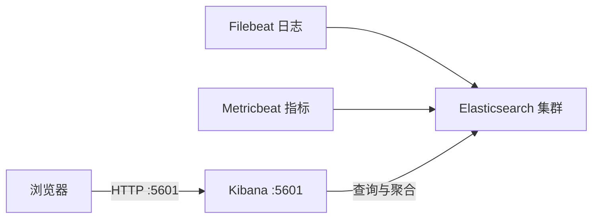
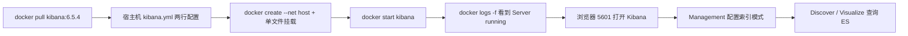
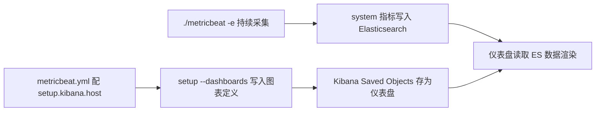

# Kibana 入门学习全记录：两种部署、Discover 数据探索与仪表盘导入

## 先给结论

- Kibana 是 Elastic Stack 里专门与 Elasticsearch 协作的数据分析与可视化平台；版本必须与 ES 严格一致，课程环境统一 6.5.4，混版本必有兼容性问题。
- 安装包部署只改两处：`server.host` 改本机 IP（默认 localhost 只能本机访问），`elasticsearch.url` 指向 ES 地址；启动命令 `./bin/kibana`，依赖的 Node 环境随包自带。
- Docker 部署一条命令可重建：拉同名版本镜像，宿主机写好 `kibana.yml` 单文件挂载进 config 目录，`--net host` 共享网络直接监听 5601，不需要 `-p` 端口映射。
- 启动判据两条：日志报出 5601 端口、浏览器看到欢迎界面；插件状态从 uninitialized 到 yellow 再到 green 即就绪。
- Discover 的入场券是索引模式：没有 Index Pattern 页面永远空白；创建时必须选时间字段（通常 `@timestamp`），直方图分桶与顶部时间过滤都靠它。
- 页面没数据先查时间范围：默认只看最近 15 分钟，数据是半小时前写入的就什么都看不到，把窗口调大立刻出来；Available Fields 点「+」可把标识字段加成表格列。
- 官方仪表盘不必手画：`./metricbeat setup --dashboards` 一条命令经 Kibana API 写入，前提 `setup.kibana.host` 指向真实地址且 Kibana 处于运行状态。
- setup 只装图表定义不产生数据：导入完把 Beat 用 `-e` 跑起来持续写数，盘面才会动；Filebeat 同一套动作，仪表盘按模块划分，启用对应 module 在采数据的盘才有内容。

## 第1部分：认识 Kibana：两行配置，给 Elasticsearch 装一个可视化窗口

Filebeat、Metricbeat 一路跑下来，数据不是打在控制台就是躺在 Elasticsearch 的索引里，想看个趋势得手写聚合查询，这样的展现方式谈不上友好。真正想要的形态是柱形图、饼图、地图这类一眼看结论的图形界面。Elastic Stack 里负责这件事的成员叫 Kibana，官方给它的口号是「您使用 Elastic Stack 的窗口」。这一课把它装起来，为前面采到的日志与指标数据备好展示台。

### 一、为什么需要一个「窗口」

看日志的目的是发现问题，发现问题才能解决问题。而问题藏在几千行文本里的时候，肉眼逐行扫的效率极低；换成一张图，红色的异常段、绿色的正常段、占比最高的错误类型，一眼分明。官方那句宣传语说得很到位：一张图片胜过千万行日志。这不是审美偏好，是信息压缩：聚合之后的数据把「逐行看」变成了「按维度看」。

Kibana 的能力面比想象中宽，官网演示里能看到柱形图变成饼图、再变成地图的动画，除了常规图表与表格，还能把数据落到地图上按地理维度分析，配合 Machine Learning 做异常探索，用 Canvas 自由定制展示画面。本课系列用到的是它的基础盘：Discover 检索原始文档、Visualize 做图表、Dashboard 拼看板，先把这些跑通，进阶功能按需再学。

### 二、它在架构里的位置

Kibana 本身不存数据，所有图表都是实时向 Elasticsearch 发查询请求渲染出来的：



图的右半边是本课要补的一环：Kibana 作为纯前端形态的查询台挂在 ES 旁边，浏览器只跟 Kibana 通信，数据始终留在 ES 里。这也解释了为什么它的安装如此轻：没有数据库、没有存储目录，一个 Web 服务加一份配置。

### 三、安装包方式部署

上传 `kibana-6.5.4-linux-x86_64.tar.gz` 到统一管理 Beats 的目录，解开即得：

```bash
cd /haoke/beats
tar -xvf kibana-6.5.4-linux-x86_64.tar.gz
cd kibana-6.5.4-linux-x86_64
```

目录里能看到 `bin`、`config`、`node_modules` 等，`node_modules` 里是打包时自带的 Node.js 依赖，Kibana 本质是一个 Node 前端服务，运行环境官方已经备齐。接下来改配置文件 `config/kibana.yml`，要动的只有两处：

```yaml
# config/kibana.yml（节选）
server.host: "192.168.1.7"                          # 默认 localhost，改成本机 IP 才能远程访问
elasticsearch.url: "http://192.168.1.7:9200"        # Kibana 背后连的 ES 地址
```

**`server.host` 不改是最常见的翻车点。** 默认值 `localhost` 让服务只绑本机回环地址，虚拟机里装的 Kibana，宿主机浏览器怎么敲地址都打不开，报错还容易误判成防火墙问题。`server.port` 默认就是 5601，没有冲突不必改。`elasticsearch.url` 填集群任一节点的地址均可，Kibana 会自动发现整个集群。

启动并验证：

```bash
./bin/kibana
# 日志出现 Server running at http://0.0.0.0:5601 即就绪
```

Kibana 启动比 ES 慢不少，插件的加载要等一会儿，日志从 `uninitialized` 到 `yellow` 再到 `green` 是正常过程。浏览器访问 `http://192.168.1.7:5601`，欢迎页会询问是否导入示例数据（航班、电商一类演示数据集），学习环境可以先跳过，让界面保持干净，需要演示时随时能再导。看到带左侧导航的主界面，安装就算完成了，具体功能模块留到后面的课程逐一展开。

## 第2部分：一条命令拉起 Kibana：Docker 部署与配置挂载实践

安装包方式装 Kibana，要传包、解压、改配置、进 bin 目录执行，步骤不多但样样要手工做一遍。课程环境里 ES 集群、Redis 集群早就容器化了，再往这台机器上散落一个解压版服务显然不合群，用 Docker 部署 Kibana 才是同一套环境该有的做法。这一课把上一课的两行配置搬进容器，体会一次「拉镜像、挂配置、起容器」的容器化部署节奏。

### 一、镜像与宿主机配置文件

镜像在容器化课程里多半已经拉过，没有的话补一条：

```bash
docker pull kibana:6.5.4
```

容器的思路是「配置留在宿主机，容器只负责运行」。先在宿主机放一份配置文件，内容就是安装包方式改的那两行：

```yaml
# /haoke/beats/kibana.yml
server.host: "192.168.1.7"
elasticsearch.url: "http://192.168.1.7:9200"
```

`server.host` 决定 Kibana 对谁开放，`elasticsearch.url` 指向 ES 集群。之后无论容器删了多少次、重建多少遍，配置始终躺在宿主机上，改参数只需要编辑这一个文件再重启容器，不用 `docker exec` 钻进容器里找配置。

### 二、创建并启动容器

如果之前留有旧容器，先清掉再建，避免名字冲突：

```bash
docker rm -f kibana
docker create --name kibana \
  --net host \
  -v /haoke/beats/kibana.yml:/usr/share/kibana/config/kibana.yml \
  kibana:6.5.4
docker start kibana
```

三个参数各管一件事，值得逐个说透。

**`--net host` 是网络模式的选择。** 容器不再拥有独立网络栈，而是直接共享宿主机的网卡与端口，Kibana 起来后监听的就是宿主机自己的 5601。好处有两层：省去 `-p 5601:5601` 的映射声明，也天然规避了容器访问宿主机服务的地址难题，配置里写宿主机 IP 即可直达 ES。

**`-v` 做的是单文件挂载。** 冒号左边是宿主机文件，右边是容器内路径，右侧 `/usr/share/kibana/config/kibana.yml` 是镜像里 Kibana 固定的配置读取位置，一个字都不能改；左侧路径以实际放置的配置文件为准。挂载的含义是宿主机文件覆盖容器内同名文件，配置从此由外面管。

**`create` 与 `start` 分开执行。** `docker create` 只创建容器不启动，便于创建前反复核对参数，确认无误再 `start`；日常也可以合成一条 `docker run -d`，效果相同，课程演示分两步是为了让每一步的产物都看得见。

启动之后盯日志：

```bash
docker logs -f kibana
# Optimization of bundles complete...
# ...monitoring plugin 状态 uninitialized → yellow → green
# log   [05:33:12.123] [info][listening] Server running at http://0.0.0.0:5601
```

`-f` 与 Linux 的 `tail -f` 同义，持续跟踪新输出。看到 `Server running` 加 5601 端口即就绪，刷新浏览器访问 `http://192.168.1.7:5601`，出现与安装包方式一样的欢迎界面。顺手看一眼容器全景，`docker ps` 里 kibana、es-node01 到 es-node03、redis-node01 到 redis-node03 一排排整齐，整套监控栈在容器层面各就各位。

数据侧的路没有变化，容器只是换了个壳：



关键路径在 create 这一步分出两条线：网络线经 `--net host` 把 5601 暴露在宿主机上，配置线经 `-v` 把两行参数送进容器的 `config` 目录，两条线打通后，Kibana 在容器里的行为与上一课裸装时完全一致。

### 三、装好之后从哪里开始用

进主界面第一件事不是画图，是声明数据源：左侧导航进入 Management，在 Index Patterns 里新建索引模式，把前面 Filebeat 与 Metricbeat 写入的索引名匹配进去，之后 Discover 里检索、Visualize 里建图都以这个模式为入口。入口配置好，前面几课辛苦采进来的日志与指标才算真正有了展示台。

## 第3部分：数据不用再翻 JSON：Kibana Discover 的索引模式、时间过滤与字段表

指标数据已经源源不断写进 Elasticsearch，可拿 `curl` 翻页看文档终究不是个办法：想确认「最近一小时哪台主机的 CPU 高」，就得一遍遍改查询串、人眼扫返回结果。Kibana 左侧菜单里的 Discover（数据探索）就是为这个场景准备的：打开页面就是一张按时间铺开的表，选个时间范围、勾几列字段，答案直接摆在眼前。这一课把 Discover 用起来之前的那道门槛「索引模式」讲清楚，再把页面上三样高频的东西，时间选择器、直方图、字段表，逐个过一遍。

### 一、先认全 Kibana 的功能菜单

登录进 Kibana，左侧菜单比 Discover 一个页面大得多，按课件里的中文标注把名字先对上号：

| 菜单项 | 中文标注 | 一句话定位 |
|---|---|---|
| Discover | 数据探索 | 像表格一样浏览索引里的原始文档 |
| Visualize | 可视化 | 基于数据创建图表 |
| Dashboard | 仪表盘 | 把一组图表拼成一个页面 |
| Timelion | 时序控件 | 时间序列数据的专用表达式图表 |
| Canvas | 画布 | 自由排版的大屏展示 |
| Machine Learning | 机器学习 | 异常检测等高级分析 |
| Dev Tools | 开发者工具 | 直接书写并执行查询语句 |
| Management | 管理 | 索引模式、Saved Objects、集群监控等入口 |

刚装好的实例里，Visualize、Dashboard 这些页面因为还没建索引模式，点进去全是空提示，属正常现象，不影响先把菜单认一遍。Dev Tools 值得顺手试一下：左边写查询，点执行按钮，右边直接回 JSON：

```json
GET _search
{
  "query": { "match_all": {} }
}
```

返回里能看到 Kibana 自己的存量数据，比如 `_index` 为 `kibana_1` 的空间配置文档，说明查询链路是通的。这个控制台在后面调 DSL、验数据时都会反复用到。

### 二、创建索引模式：Discover 的入场券

Discover 只显示「索引模式」圈定的范围。课程环境里 Metricbeat 已经在往 Elasticsearch 写数据，索引名按日期滚动，形如 `metricbeat-6.5.4-2019.01.15`，所以模式填 `metricbeat-*` 正好全兜住。创建走两条路里的任意一条：

- Management → Index Patterns → Create index pattern；
- 直接进 Discover，页面中央的空状态提示里就有创建引导。

以 Management 这条路为例：在 pattern 输入框填 `metricbeat-*`，输入框下方实时列出匹配到的索引，课程环境匹配出三个（当天按日期切出来的几个索引都在）；点 Next step 进入第二步，Time Filter field name 下拉里选 `@timestamp`，点 Create index pattern 完成。


这张图的关键一步是选时间字段：它是 Discover 的「坐标轴」，直方图按它分桶，时间选择器按它收窄范围。这个字段必须是日期类型，而且 6.x 版本创建后不可再改，选错了只能删掉模式重建。

### 三、Discover 页面三件套：时间选择器、直方图、字段表

模式建好，回到 Discover，左上角索引模式下拉里选中 `metricbeat-*`，页面从上到下分三块：右上角的时间选择器、中部按时间分桶的直方图、下半部分的文档表。

**时间选择器是最先要摆平的东西。** 课程操作里刚打开时文档表是空的，看着像采集断了，把窗口从「最近 15 分钟」调到「最近 4 小时」，直方图立刻冒出一排柱子。原因很朴素：Metricbeat 是持续采集，页面默认窗口只覆盖最近 15 分钟，数据要是 20 分钟前写入的，窗口里当然什么都没有。排障的第一动作是调时间范围，而不是重启采集器。

**想多看几列，从右侧字段列表里加。** 左侧 Available Fields 列出该模式下所有字段，鼠标悬停能预览取值最多的前几条。点 `beat.name` 旁的「+」，表格多出一列采集器名称；再加 `host.name` 看数据来自哪台主机；再加 `metricset.name` 看属于哪组指标。三列加上后，每条文档是谁采的、来自哪台机器、属于哪组指标，一行看全。加错的列点列头上的「-」移除即可。

**顶部搜索栏是行内过滤器。** 想只看某一台主机、某一组指标的数据，在搜索栏写字段条件回车即可，课程所用 6.5.x 支持 KQL 语法，也可以切换成 Lucene 语法，例如：

```bash
beat.name: metricbeat-node01 and metricset.name: cpu
```

条件生效后，直方图和文档表同步收窄到满足条件的数据。它和 Dev Tools 里的 query 做的是同一件事，只是换成了适合人手的行内写法，探索阶段效率高得多。

### 四、和 Head 插件摆在一起看

课程前面用 Elasticsearch Head 查过集群索引分布，三节点、分片在哪一目了然，那是「集群视角」。但 Head 看文档只能翻原始 JSON，一次几十条，没有时间维度，数据量一大就没法用了。Discover 补的正是「数据视角」：时间轴上哪段是采集空窗、哪台机器的指标在爬高，直接可读。两个页面分工明确：查集群健康去 Head，看业务与指标数据去 Discover。

## 第4部分：仪表盘不必手画：一条 setup 命令导入 Metricbeat 与 Filebeat 官方大盘

数据进了 Elasticsearch 只是第一步，真正要给人看的是仪表盘：打开一个页面，CPU、内存、网络流量的走势全在图上。自己进 Visualize 一张张画图再拼进 Dashboard，几十张图得画到什么时候。好在每种 Beat 的发行包里都打包了官方做好的仪表盘资源，一条 setup 命令就能整体灌进 Kibana。这一课先拿 Metricbeat 走完整流程，再用 Filebeat 验证这套机制是通用的，两课合起来看，规律一目了然。

### 一、Metricbeat：先改 setup.kibana，再跑 setup 命令

打开 Metricbeat 安装目录下的 `metricbeat.yml`，搜索 `setup.kibana`，把注释打开并填上 Kibana 的真实地址。课程环境 Kibana 装在 `192.168.1.7` 的 Docker 里，配置改完是这样：

```yaml
# metricbeat.yml（节选，注释已精简）
# Starting with Beats version 6.0.0, the dashboards are loaded via the Kibana API.
# This requires a Kibana endpoint configuration.
setup.kibana:
  host: "192.168.1.7:5601"
```

协议与端口都可以省略，默认按 `http` 和 `5601` 处理；只有 Kibana 带了额外路径时才必须写全 `http://host:5601/path`。旁边还有个相关的开关值得看一眼：

```yaml
#setup.dashboards.enabled: false
```

默认 false 意思是「不在 Beat 启动时自动装载仪表盘」，改 true 后每次启动都会尝试装载，实验环境没必要开，手动 setup 一次就够。

接着在 Metricbeat 根目录执行导入命令：

```bash
./metricbeat setup --dashboards
# Loading dashboards (Kibana must be running and reachable)
# Loaded dashboards
```

命令行输出本身就写明了规则：Kibana must be running and reachable，装载过程是 Beat 调 Kibana 的 API 把打包好的索引模式、可视化对象、仪表盘布局逐个写入，Kibana 不在线这步必然失败。看到 `Loaded dashboards` 就说明全部资源已经进了 Kibana 的 Saved Objects。

### 二、System 仪表盘：先跑采集，再看盘

打开 Kibana 的 Dashboard 页面，搜索 `system`，能看到 Metricbeat 带来的系统大盘，点开 Host overview。此刻大概率提示无数据，这不是导入失败：setup 只装了「图表的定义」，图上要显示的数据仍要 Metricbeat 自己去采。把采集跑起来：

```bash
./metricbeat -e
```

等两个采集周期，回 Kibana 把时间范围调到最近 15 分钟，数据就上来了。整条链路一张图：



图里两条线在最后的「渲染」汇合：定义来自 Kibana，数据来自 Elasticsearch，缺哪条线页面都是空的。这也解释了为什么导入完成和看到数据是两个动作。

大盘上值得停留的内容不少。主机概览里有按 CPU 使用率的直方图，鼠标悬停能看到某一时刻的具体百分比；内存与磁盘的走势紧随其后。网络流量图用两种颜色区分方向，蓝色是入流量，紫色是出流量，一眼能看出机器是在收数据还是在发数据。进程部分有两张 Top 榜，按 CPU 排序和按内存排序，排查「谁在吃资源」时直接看这两张图。嫌手动刷新麻烦的话，右上角可以把刷新间隔设成 5 秒，页面会自动跟着走。CPU 曲线前面一段是空的、后面才有，正是因为采集是从 `-e` 启动那一刻才开始的，图表不会补历史。

### 三、Redis 仪表盘：模块大盘的通用玩法

搜索框换 `redis`，[Metricbeat Redis] 系列大盘同样有内容，前面 Metricbeat 课程里启用过 Redis 模块，三节点 `6379、6380、6381` 的指标一直在采。大盘里能看到当前连接到 Redis 的客户端数量、实例运行时长、内存与 CPU 占用，还有服务版本等信息；每个节点的指标按连接地址分行展示，哪台实例状态异常一翻便知。

回头看 Dashboard 列表还能刷出长长一串：Docker、Apache、Golang、HAProxy、MySQL 等。这些大盘的定义在 setup 时已经全部装进去了，但没有启用对应 module 采集的，打开就是空架子。规律很简单：`modules enable` 启用一类采集，盘上才有那类数据，二者一一对应。

### 四、Filebeat：换一个 Beat，同一套动作

Filebeat 仪表盘的用法和 Metricbeat 几乎逐字相同，正好拿前面配置过的 Redis 日志采集来验证。先把手头不再需要的采集进程停掉，进入 Filebeat 目录，找到此前写的 `haoke-redis.yml`，它已经把 Redis 日志写进 Elasticsearch，现在只差 `setup.kibana` 一段：

```yaml
# haoke-redis.yml（节选）
filebeat.inputs:
  - type: log
    enabled: true
    paths:
      - /haoke/log/*.log
setup.template.settings:
  index.number_of_shards: 3
filebeat.config.modules:
  path: ${path.config}/modules.d/*.yml
  reload.enabled: false
output.elasticsearch:
  hosts: ["192.168.1.7:9200", "192.168.1.7:9201", "192.168.1.7:9202"]
setup.kibana:
  host: "192.168.1.7:5601"
```

注意 YAML 的缩进格式，`setup.kibana` 是顶级键，`host` 缩进两格。然后执行 setup，因为输出配置都在自定义文件里，必须用 `-c` 指定它：

```bash
./filebeat -c haoke-redis.yml setup
```

这个命令除了装载仪表盘，还会顺带把索引模板写进 Elasticsearch，控制台滚动完输出即完成。接着把 Filebeat 跑起来持续写日志：

```bash
./filebeat -e -c haoke-redis.yml
```

回 Kibana 的 Dashboard 搜索 `redis`，列表里会同时出现 Metricbeat 的 Redis 大盘和 Filebeat 的 Redis 日志大盘，注意标题前缀，别点混了。打开 Filebeat 这个，顶部的统计图一开始可能还是空的，底部的日志面板已经能刷出刚采上来的 Redis 日志行；把时间范围调大、再等采集跑一阵，上面的图也会陆续有数据。到这里 Filebeat 的仪表盘链路就验证完了，课程里只以 Redis 为例，其余日志类型同一套做法。

## 常见误区

- **版本随手下个最新的。** Kibana 与 Elasticsearch 必须同版本号，6.5.4 的 ES 配 7.x 的 Kibana 直接拒绝连接，模板与索引结构的差异会让页面大面积报错，装之前先对齐版本。

- **`server.host` 保持默认还纳闷打不开页面。** `localhost` 只监听本机，远程浏览器访问必然失败，改成本机 IP 是远程访问的前提。

- **ES 还没起就急着开 Kibana。** Kibana 启动时连不上 ES 会按 `elasticsearch.startupTimeout` 不断重试，页面一直提示 Kibana server is not ready yet，先确认 ES 健康，再看 Kibana 日志。

- **以为 Kibana 要在每台 ES 节点上都装一份。** 它是无状态的展示层，一个集群部署一个实例即可，多装只是白白多占内存；对展示层本身有高可用诉求时，用前置负载均衡挂多个 Kibana 实例，而不是挨台安装。

- **`--net host` 和 `-p` 一起用。** host 模式下端口映射参数会被直接忽略，写了 `-p 5601:5601` 不报错但不生效，容器照样监听宿主机端口；两种模式二选一，选了 host 就别写映射。

- **挂载路径写成目录。** `-v /haoke/beats/kibana:/usr/share/kibana/config/kibana.yml` 把目录挂在文件位置上，Kibana 读不到有效配置，启动即失败；单文件挂载两侧都必须精确到文件名。

- **ES 地址写成 `localhost`。** bridge 网络模式下容器里的 localhost 是容器自己，永远连不上宿主机的 ES，报 No Living connections；本课因为用了 host 网络，写宿主机 IP 自然可达，换 bridge 时更要注意。

- **日志还没 green 就判死刑。** Kibana 启动要优化 bundle、逐个装载插件，从 `uninitialized` 走到 `green` 需要几十秒，期间页面的 Kibana server is not ready yet 是正常现象，盯到 `Server running` 再下结论。

- **没建索引模式就进 Discover，以为数据没进来。** Discover 空白只说明没有可选的数据范围，去 Management 建好模式再回来，数据就在那里。

- **时间字段随手选。** 必须选 `@timestamp` 这类日期字段，选成普通字段时间轴就是死的；6.x 建完不可修改，只能删除重建。

- **把「最近 15 分钟没数据」当成采集故障。** 先把窗口拉大到几小时验证，再回采集器控制台看日志，顺序别反，很多「故障」只是窗口太窄。

- **索引模式和实际索引名对不上。** 模式是通配规则，`metricbeat-*` 写成 `metricbeat*` 之外的拼写错误、或索引带了别的命名前缀，都会导致匹配不到，创建时看一眼下方实时列出的索引列表就能确认。

- **setup 执行到一半报错，检查方向却跑向 Elasticsearch。** 装载走的是 Kibana API，Kibana 没启动、地址端口不通都会卡在 Loading，先确认 Kibana 在线再谈别的。

- **`setup.kibana.host` 留在默认的 `localhost:5601`。** Beat 与 Kibana 不同机时永远连不上，跨机部署必须写成 Kibana 所在机器的 IP。

- **以为 setup 会导入数据。** 它只写图表定义，盘上有没有数取决于 Beat 是否在采集、时间范围是否覆盖，导入完成直接看盘看到空白属于预期内。

- **setup 时忘了 `-c` 指定自定义配置文件。** 不带 `-c` 会读默认的 `filebeat.yml`，里面的输出和 Kibana 地址可能完全不是你要的那套，装出来的模板与仪表盘自然对不上数据。

## 面试可能被问到的问题

1. 面试官追问：「Kibana 是什么，和 Elasticsearch 是什么关系？」
   答：开源的数据分析与可视化平台，Elastic Stack 成员之一，专为配合 ES 设计。它自身不存数据，接收浏览器请求后把查询与聚合转发给 ES，把结果渲染成图表、表格、地图，是整套日志与指标体系的展示窗口。

2. 面试官追问：「Kibana 的版本为什么必须和 Elasticsearch 严格一致？」
   答：Kibana 依赖 ES 的索引结构与集群 API，不同大版本之间这两者有破坏性变化，混版本会导致连接失败或功能异常。官方要求两者版本号一致，部署时用同一套发行版本即可规避。

3. 面试官追问：「Kibana 安装后远程访问不了，怎么排查？」
   答：按顺序看三点：`server.host` 是否还是默认 `localhost`；`server.port` 5601 是否被占用或被防火墙拦截；ES 是否健康、`elasticsearch.url` 是否填对。第一项是新手案例里出现频率最高的原因。

4. 面试官追问：「为什么 Kibana 的安装包里会带 node_modules？」
   答：Kibana 本身是构建在 Node.js 上的 Web 服务，发行包直接把运行所需的 Node 依赖打进去，做到解压即用，不要求服务器预装 Node 环境，也保证了版本与 Kibana 代码匹配。

5. 面试官追问：「Beats 采的数据到 Kibana 展现，中间经过了什么？」
   答：Beats 把数据写入 ES 索引，Kibana 通过索引模式（index pattern）声明要查哪些索引，Discover 的检索与 Visualize 的聚合都以该模式为入口，查询实时打到 ES 的分片上，Kibana 不缓存、不落盘数据。

6. 面试官追问：「`--net host` 和 `-p` 端口映射有什么区别？」
   答：`-p` 是 bridge 模式下的端口映射，容器有独立网络栈，流量经 docker-proxy 转发；`--net host` 让容器直接共享宿主机网络命名空间，监听的就是宿主机端口，少了 NAT 一层，性能更好也更省配置，代价是端口没有隔离，冲突需自行规划。

7. 面试官追问：「为什么配置要挂载进容器，而不是 exec 进去改？」
   答：容器按不可变思路使用，`docker exec` 改的是容器可写层，容器一删配置就没了；挂载宿主机文件让配置的生命周期独立于容器，重建容器、升级镜像都带着同一份配置，改动也只需要在宿主机编辑。

8. 面试官追问：「`docker create` 和 `docker run` 有什么区别？」
   答：`docker run` 等于 `create` 加 `start`，一步到位；`create` 只创建容器不启动，适合先核对参数、再显式 `start` 的场景。两者创建出的容器地位相同，都可以 `docker start`、`docker logs` 管理。

9. 面试官追问：「容器里的 Kibana 连不上 Elasticsearch，一般查什么？」
   答：按链路查：`elasticsearch.url` 是否指向容器视角可达的 ES 地址，bridge 模式下写 localhost 必然失败；宿主机防火墙是否放行 9200；ES 是否健康。容器日志里 No Living connections 基本都出在这条链路上。

10. 面试官追问：「生产环境里 Kibana 用容器部署要注意什么？」
   答：配置全部走挂载或环境变量注入，镜像版本与 ES 严格对齐；host 网络在多服务混部时容易端口打架，生产更常用 bridge 加端口映射或独立网络；再配资源限制防止 Node 进程吃满内存，重要场景前置负载均衡挂多个实例。

11. 面试官追问：「Kibana 的 Index Pattern 是干什么的，不建行不行？」
   答：它是 Kibana 与 Elasticsearch 索引之间的映射声明，用通配符圈定哪些索引进入可视化范围，同时指定时间字段。不建的话 Discover、Visualize、Dashboard 都没有数据源可用，Kibana 基本只剩 Dev Tools 和集群管理能干活。

12. 面试官追问：「Index Pattern 里的时间字段起什么作用？」
   答：Discover 的直方图按这个字段做 date histogram 聚合，顶部时间选择器按它过滤查询范围。字段必须是 date 类型，选错或缺失时页面没有时间轴，只能全量翻文档，体验一落千丈。

13. 面试官追问：「Discover 打开后没有任何数据，你的排查顺序是什么？」
   答：先看右上角时间范围，默认最近 15 分钟，拉大到数小时或自定义区间；再确认左上角选中的索引模式正确；然后用 Dev Tools 直查对应索引，确认数据确实写进去了；最后回头看采集器日志。时间范围误判最常见，先排除它成本最低。

14. 面试官追问：「Dev Tools 里的查询和程序访问 Elasticsearch 有什么区别？」
   答：Dev Tools 是 Kibana 内置的调试控制台，带自动补全，适合人工排查和验证 DSL；程序访问走 9200 端口的 REST API，才是业务集成方式。两者语法一致，控制台里验证过的 DSL 可以直接搬进代码。

15. 面试官追问：「Discover 搜索栏的 KQL 和 Lucene 语法怎么选？」
   答：KQL 写法贴近自然语言，如 `beat.name: node01 and metricset.name: cpu`，日常过滤够用且不易写错；切到 Lucene 语法可以用正则、模糊匹配等更底层的能力。简单条件用 KQL，复杂检索再切 Lucene。

16. 面试官追问：「`beat setup --dashboards` 到底做了什么？」
   答：发行包里打包了官方的索引模式、可视化对象与仪表盘布局资源，setup 命令以当前配置文件里的 `setup.kibana` 地址为目标，通过 Kibana API 把这些资源逐个写入 Kibana 的 Saved Objects。它是一次性动作，重复执行会覆盖同名对象。

17. 面试官追问：「为什么装载仪表盘要求 Kibana 必须在线？」
   答：6.0 版本起仪表盘改为经 Kibana API 装载，而不是直接写 Elasticsearch。Kibana 负责管理 Saved Objects 与界面展示，Beat 只是把资源推给它，所以 Kibana 不可达时命令会一直停在 Loading 阶段直到失败。

18. 面试官追问：「setup 和 `beat -e` 启动采集是什么关系，顺序有要求吗？」
   答：相互独立。setup 写定义，`-e` 采数据，先后皆可。但注意 setup 会顺带写入索引模板，生产上一般先 setup 再启动采集，保证数据按正确的 mapping 落库，仪表盘字段引用也不会落空。

19. 面试官追问：「仪表盘打开了却没有数据，怎么排查？」
   答：按链路查四点，Beat 是否在运行、module 是否启用、Elasticsearch 里有没有新文档、Kibana 顶部时间范围是否覆盖数据写入的时段。前三点在 Discover 里直查索引即可验证，最后一点最容易被忽略。

20. 面试官追问：「Metricbeat 和 Filebeat 的仪表盘机制有区别吗？」
   答：没有本质区别，同一套 setup 子命令、同一个 `setup.kibana` 配置段、同一种 Kibana API 装载方式。差别只在内容：Metricbeat 的大盘围绕指标 metricset，Filebeat 的大盘围绕日志与 module 的解析结果，大盘里还有专门的日志面板。

21. 面试官追问：「生产环境要不要每次升级都重新 setup？」
   答：版本升级后官方仪表盘资源可能有增改，重新执行一次 setup 即可同步，重复执行会覆盖同名对象，自定义过的图表要先备份成独立的 Saved Object。日常扩容节点、重启采集都不需要重跑 setup。

## 配套资料

- 课程资料包 `materials/code/03/day16-ElasticStack学习之Beats、Kibana、Logstash/` 解包后未含安装包与源码文件，文中 `kibana.yml` 配置、启动命令为按本课课件与操作步骤整理的可运行示例，安装包可从 Elastic 官网按与 ES 一致的版本下载

- ES 集群环境背景可对照：`materials/code/03/day15-房源数据抓取以及实现房源搜索/day15-房源数据抓取以及实现房源搜索/资料/集群添加IK分词器.md`

- 课程资料包 `materials/code/03/day16-ElasticStack学习之Beats、Kibana、Logstash/` 解包后未含源码文件，文中 `kibana.yml`、`docker create` 命令为按本课课件与操作步骤整理的可运行示例（挂载路径已按单文件挂载写法补全并注明），镜像版本与课程环境一致

- 容器化搭建 ES 与 Redis 集群的背景可对照：`materials/code/03/day15-房源数据抓取以及实现房源搜索/day15-房源数据抓取以及实现房源搜索/资料/集群添加IK分词器.md`

- 课程资料包 `materials/code/03/day16-ElasticStack学习之Beats、Kibana、Logstash/` 解包后未含源码文件，界面操作步骤、索引名与字段名依据本课课件及课堂演示整理；KQL 过滤示例为按本课环境补全的示例并已注明

- 采集侧的数据来源可对照 `materials/code/03/day16-ElasticStack学习之Beats、Kibana、Logstash/` 同章节 Metricbeat 相关课件内容（本课视频画面已覆盖）

- 课程资料包 `materials/code/03/day16-ElasticStack学习之Beats、Kibana、Logstash/` 解包后未含源码文件，文中 `metricbeat.yml` 节选、`haoke-redis.yml`、命令与终端输出为按本课课件与课堂演示整理

- Redis 环境背景（三节点 `6379、6380、6381` 的由来）可对照：`materials/docs/10/Redis安装指南.md`
