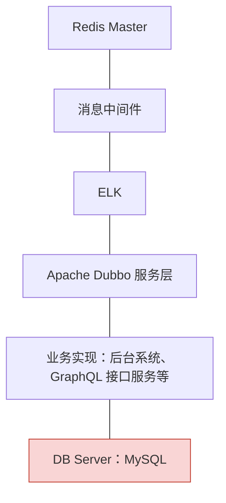
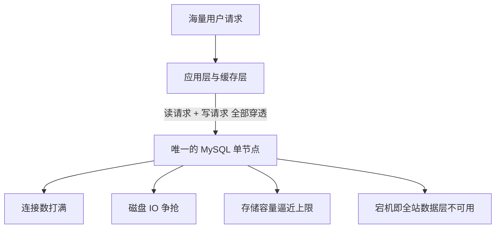

# 好客租房的架构图上，最先扛不住的一层为什么是数据库

系统已经做了不少改造：缓存、消息、搜索、日志栈都配齐了，可真正的压力测试还没来。上线之后用户一多，最先
报警的往往不是应用层，而是整张架构图最底下那台孤零零的 MySQL。这一课把好客租房项目的系统架构重新摊开，
看清 DB Server 这一层的单节点到底会栽在哪几个坑里，以及为什么下一课必须谈 MySQL 集群。

## 先给结论

- 整个系统按功能与技术做了分层，最底层是 DB Server，上面依次是 Dubbo 服务层、业务实现层，外围配着
  ELK、RocketMQ 等支撑组件。
- 这一层目前只有一个 MySQL 节点，是典型的单节点服务，整个架构里它最脆弱。
- 单节点数据库的问题集中在三点：单点故障、大并发下的读写性能瓶颈、海量数据的存储天花板。
- 前面课程里 Redis、RocketMQ、Elasticsearch 都已经集群化，唯独数据库还单着，这是架构短板。
- 解法只有一条路：给 MySQL 做集群。具体选哪种集群方案（主从复制、PXC、中间件、HAProxy），从下一篇开始展开。

## 一、把架构图重新摊开看一遍

这张分层图在讲项目功能的时候就出现过，现在换个角度读它，重点不在每个框里写了什么，而在层与层之间的依赖
方向。



从下往上看，最底层是 DB Server，也就是 MySQL；往上是 Apache Dubbo 服务层；再往上是具体业务实现，
包括后台系统、GraphQL 接口服务等。图的左侧与后方挂着 ELK 日志栈和 RocketMQ 消息队列这类支撑组件。
所有业务的读写请求，最终都会穿透到最底下那个 MySQL 框里。

关键的一步是给最底层那格上了红色标记：其他组件在前面的课程里陆续做了集群或主备，Redis 有主从，
RocketMQ 是 2m2s 集群，Elasticsearch 是三节点集群，而 DB Server 这个框里只装了一个 MySQL 实例。
流量越往上越收敛，到这一层却是单点，结构性的风险就摆在这里。

## 二、单节点数据库的三道坎

**第一道坎是单点故障。** 只有一个 MySQL 节点，意味着它宕机就等于数据层整体宕机。应用层的机器可以
随便扩，扩到一百台，数据库一挂，全部请求都在连接池里超时。对好客租房这类生活服务平台来说，房源数据、
用户数据都压在这一个实例上，可用性等于这一台机器的可用性。

**第二道坎是大并发下的读写瓶颈。** 系统上线后用户一多，面临的是大并发访问。读请求和写请求全部涌向
同一个实例，连接数、CPU、磁盘 IO、Buffer Pool 互相争抢。读操作占了绝大多数，却让每一次写都被排队
的读拖慢，这是单实例天然的困境，机器配置再高也有上限。

**第三道坎是海量数据的存储天花板。** 业务持续运行，房源、用户、订单相关的数据量会一路增长。单实例的
存储容量有限，数据量上去之后，索引变深、查询变慢、备份窗口变长，等问题暴露再补救就来不及了。

单节点 MySQL 的问题，用一张图把压力路径画出来：



这张图在讲单节点的压力路径：全部请求只能走一条道，走到尽头就是一个 MySQL 实例，三种资源问题并发出现，
外加宕机风险。图里最关键的是那条唯一的穿透箭头，它没有第二条路可走。

这两类问题在单实例上是可以直接观测到的。以下为按主流写法补全的观测示例，在单节点 MySQL 上执行，
用来直观感受连接与查询负载的堆积：

```bash
# 查看当前连接数，大并发时逼近 max_connections 上限
mysql -uroot -p -e "SHOW STATUS LIKE 'Threads_connected';"
# 查看累计处理过的读、写请求数，读请求占比通常远高于写
mysql -uroot -p -e "SHOW GLOBAL STATUS LIKE 'Innodb_rows_read';"
mysql -uroot -p -e "SHOW GLOBAL STATUS LIKE 'Innodb_rows_inserted';"
```

```sql
-- 单实例容量与读写压力的直观参考：表数据量与索引体积
SELECT table_name,
       table_rows,
       ROUND(data_length / 1024 / 1024) AS data_mb,
       ROUND(index_length / 1024 / 1024) AS index_mb
FROM information_schema.tables
WHERE table_schema = 'haoke'
ORDER BY data_length DESC;
```

前一段命令观察的是并发：`Threads_connected` 反映当前打开的连接数，压测时它逼近
`max_connections`，说明连接层已经打满。后一段查询观察的是数据量：`data_length` 与
`index_length` 随业务增长持续膨胀，索引体积超过内存缓冲池后，查询开始频繁读盘，这就是存储天花板的
具体表现。

## 三、问题确认，方案预告

把现象归拢成一句话：系统架构里 DB Server 一层只是单节点服务，面对大并发与海量数据存储，这个架构存在
很严重的问题，所以接下来要实现 MySQL 的集群，来应对大并发、海量数据存储等问题。

做集群之前还有一道选择题要做。MySQL 集群不是一种技术，而是一族方案：读写分离的主从复制架构、走中间件
的代理架构、上负载均衡的高可用架构、追求强一致性的 PXC 集群，以及把前面几种混搭的混合架构。每一种解决
的问题不同，代价也不同，后面的课程会逐一拆开讲，最后落到本项目该选哪种形态。

## 常见误区

- **以为加了缓存和消息队列，数据库就不会有压力。** 缓存挡得住热点读，挡不住未命中的读与全部写；消息
  队列削峰只对异步场景有效，强实时的读写依旧直达数据库。单节点的问题是结构性的，不是加组件能绕开的。
- **把「单点」理解成性能不够快。** 单节点的核心风险是可用性，机器再强，宕机就是全站数据层不可用；
  性能瓶颈只是它的第二个问题。
- **认为数据量还小，可以以后再改。** 集群方案涉及复制、中间件、路由改造，越晚做迁移成本越高，
  应该在架构设计阶段就预留出集群演进路径。

## 面试可能被问到的问题

1. 面试官追问：「你们的数据库为什么需要集群，单机 MySQL 不够用吗？」
   答：单机有三个硬伤：宕机即单点故障，全站数据层不可用；读写挤在同一个实例上，大并发时连接数与 IO
   互相争抢；单实例容量有限，海量数据下索引变深、查询与备份都变慢。集群能同时解决可用性、性能与容量
   三个层面的问题。

2. 面试官追问：「系统的其他组件都集群化了，为什么单单数据库容易成为瓶颈？」
   答：所有业务请求最终都要落到数据层，流量越往下越收敛；缓存与消息挡住的只是一部分流量，强一致的
   读写必须到达数据库。如果这一层是单节点，它就是整条链路里最脆弱的一环。

3. 面试官追问：「读多写少的应用，单库的主要矛盾是什么？」
   答：读请求占比高，和写请求竞争同一个实例的连接、CPU 与磁盘 IO，读写互相拖慢。这类场景天然适合
   读写分离架构，把读压力分摊到多个从库上，主库专心承担写。

4. 面试官追问：「给数据库做集群，有哪些可选方案？」
   答：常见有四类：主从复制加读写分离，解决读写压力分担；中间件代理架构（如 MyCat），在代理层完成
   读写路由与分库分表；负载均衡架构，用 HAProxy 这类代理保证中间件层的高可用；PXC 集群，通过强同步
   保证任何节点间数据一致。实际生产常按业务一致性需求混合使用。

## 配套资料

- 本课无配套源码包：`materials/code/03/day17-MySQL集群解决方案(主从复制、PXC集群、MyCat、HAProxy)/`
  下仅有解压清单 `_extracted.json`（记录解压文件数为 0）。本课为架构分析课，无代码与配置产物；
  架构分层与问题结论均按本课课件与讲解整理，文中标注示例的命令仅用于演示观察单节点负载，为按本课写法
  补全的示例。
