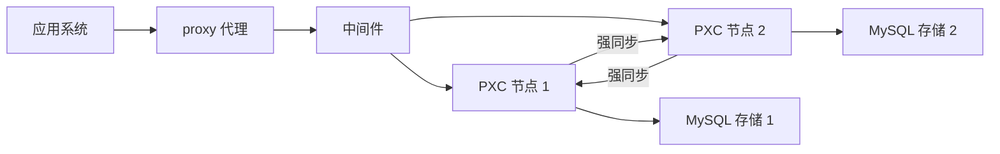
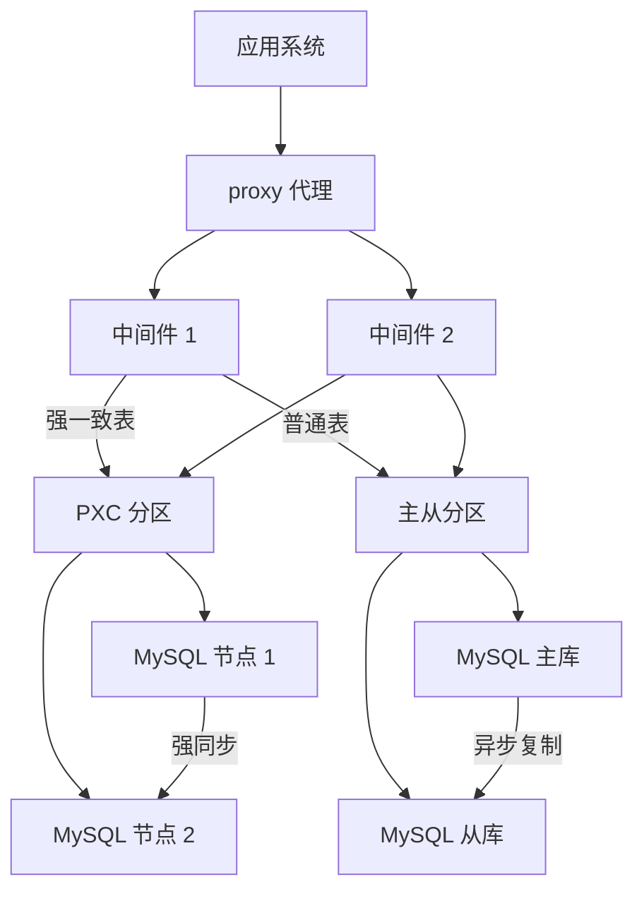

# 交易数据一条都不能丢：PXC 强同步集群与主从混搭的混合架构

主从读写分离解决了读压力，却留下一个让人不安的尾巴：主从同步是异步的，写主库成功不代表从库已经有了
这条数据，极端情况下同步中断，数据就真丢了。查询类业务无所谓，交易类业务一条都不能丢。这一课讲的就是
补齐这块短板的 PXC 集群，以及生产上更常见的落法：让强一致的 PXC 与弱一致的主从混搭成混合架构。

## 先给结论

- PXC 集群提供读写强一致性：数据在任何一个节点写入的同时同步到其余节点，任意节点读到的数据完全一致。
- PXC 的底层是 Galera 复制技术，形态是多主集群：任何一个节点都能写，写入会强同步到所有节点。
- 强一致的代价是性能：事务写入后不立即提交，先同步到其余节点，同步完成才提交，性能低于主从架构。
- PXC 不是一种新数据库，最终数据仍存储在 MySQL 里，它只是给 MySQL 集群补上强同步能力的方案。
- PXC 与主从不是互相取代，而是按需混搭：强一致数据进 PXC 分区，普通数据走主从分区，这就是混合架构。

## 一、PXC 要解决的就是那个同步窗口

回顾读写分离架构的两个问题：应用连接多节点导致开发复杂，这个用中间件解决了；主从之间同步异步完成，
导致弱一致性，写主库成功后立刻去从库读，可能读不到，甚至可能丢数据，这个问题一直悬着。

什么业务在意这件事？交易数据。写入的金额、订单一旦因为同步窗口丢失，账就对不上了。这类场景需要的是
强一致性：数据不能丢，写入之后从任何节点读都要能读到。

PXC 集群提供的能力正是读写强一致性：数据在集群中任何一个节点写入的同时，同步到其他所有节点，节点
之间没有延迟。在任意一个节点读取，都能读到最新写入的数据，这就是强一致性与弱一致性的分水岭。

## 二、PXC 在架构里的位置

把 PXC 放进前面搭好的骨架里看全貌。应用系统先把请求发给 proxy 代理做负载均衡，代理分发到中间件，
中间件做读写判断，把请求落到 PXC 集群的节点上。



这张图与主从负载均衡架构的差异就在最底下那一段：主从架构里主库到从库是一根单向的异步同步线，PXC
这里是两根方向相反的强同步线。无论数据写进哪个节点，都会同步到另一个节点，所以任意节点写入、任意
节点读取，结果完全一致。

图里还有一个容易误解的点：PXC 节点下面连着的仍然是 MySQL。PXC 不是一个新数据库，它基于 Galera
复制技术，把多个 MySQL 实例组织成强同步的多主集群，最终的数据存储依旧由 MySQL 完成。选型时它
解决的是强一致性这一个问题，而不是替你换一套存储引擎。

三个节点的 PXC 集群用 Docker 也能快速拉起来，以下为按主流写法补全的示例，课程后续搭建环节会展开：

```bash
# 创建容器互通的网络
docker network create --subnet=172.20.0.0/16 pxc-net

# 第一个节点，独立成簇
docker run -d --name pxc-node1 --network pxc-net \
  -e CLUSTER_NAME=pxc-cluster \
  -e XTRABACKUP_PASSWORD=pxcpass \
  -p 3306:3306 \
  percona/percona-xtradb-cluster:5.7.23

# 第二个节点，通过 CLUSTER_JOIN 加入集群，自动完成数据同步
docker run -d --name pxc-node2 --network pxc-net \
  -e CLUSTER_NAME=pxc-cluster \
  -e XTRABACKUP_PASSWORD=pxcpass \
  -e CLUSTER_JOIN=pxc-node1 \
  -p 3307:3306 \
  percona/percona-xtradb-cluster:5.7.23
```

强同步的效果可以直接验证，以下为按主流写法补全的示例：

```sql
-- 在节点 1 上写入
INSERT INTO t_order (order_no, amount) VALUES ('H20240101', 199.00);

-- 立刻到节点 2 上查询，无需等待，直接命中刚写入的数据
SELECT * FROM t_order WHERE order_no = 'H20240101';
```

## 三、强一致的代价：事务要等所有节点点头

PXC 的性能比主从架构低，原因藏在事务提交流程里。一个写请求到达某个 PXC 节点，这个节点的事务并不能
立刻提交，而是先把本次变更同步到集群中的其他 PXC 节点；其他节点确认收到并应用之后，发起写入的节点
才真正提交事务，此时数据才算保存成功。

同步本身要花时间，多个节点之间的确认往返也有性能损耗，写放大就这样产生了。主从架构写完主库就返回，
PXC 要等一圈节点点头才返回，这就是两者性能差距的来源。

换来的是数据可靠性：只要集群还有节点活着，写入成功的数据就同时存在于所有节点，不存在异步复制那种
「主库认为同步过了、从库其实没收到」的丢失窗口。牺牲一点写性能，换回交易数据一条不丢，对资金敏感的
业务是划算的买卖。

## 四、混合架构：强一致与弱一致各管一段

全面上 PXC 并不明智。有些数据本来就没有强一致性需求，比如房源浏览日志、收藏记录，丢了可以补，
延迟一会儿无所谓，为它们付出强同步的性能代价不值得。生产上更常见的做法是把 PXC 集群与主从复制
集群组合起来，按数据的业务属性分区，这就是混合架构。



图中四个 MySQL 节点被划成两个分区：上面两个节点组成 PXC 分区，存储强一致性要求高的数据，节点间
强同步；下面两个节点组成主从分区，存储一致性要求不那么高的数据，主库到从库异步复制。中间件是分区的
调度者，按业务表做路由选择，交易相关的表落到 PXC 分区，普通业务表落到主从分区。

中间件承担了所有路由判断，压力集中，所以中间件要做集群；多个中间件节点又要靠 proxy 负载均衡把请求
摊匀，让每个节点承接的请求量相对均衡。前面几课搭起来的代理加中间件骨架，在这里原样复用，只是底层
从单一主从换成了强弱两个分区。

做系统架构时，不必在主从复制与 PXC 之间二选一，更常落地的恰恰是这种按需求混搭的混合式架构：需求
不同，分区策略不同，它才是兼顾一致性与性能的相对完美解。后面会基于好客租房项目的数据库表结构逐表
分析，把这套混合架构真正搭建出来。

## 常见误区

- **把 PXC 当成主从的替代品。** PXC 用写性能换强一致，对不在意丢数据的业务是浪费。两者是按业务
  分工的关系，交易数据用 PXC，普通数据用主从，混合架构才是常态。
- **以为 PXC 是一套新数据库。** PXC 基于 Galera 复制技术组织多个 MySQL 实例，最终存储仍是 MySQL，
  它解决的是强同步问题，不是换存储引擎。
- **以为多主就能无代价随便写。** 多主意味着每次写都要向所有节点同步并等待确认，写入越多，确认开销
  越大；把所有表都塞进 PXC 分区，整体吞吐反而被拖垮。
- **以为混合架构一定要两套独立集群各自维护。** 分区之上由中间件按表统一路由，proxy 负责负载均衡，
  对应用仍然只有一个入口，运维复杂度集中在中间层，而不是扩散到应用代码里。

## 面试可能被问到的问题

1. 面试官追问：「PXC 集群和主从复制的本质区别是什么？」
   答：主从复制是异步的、单向的，写主库成功即返回，从库何时同步到不确定，属于弱一致性；PXC 基于
   Galera 实现多主强同步，任何一个节点写入都会同步到全部节点，事务要等同步完成才提交，任意节点读
   到的都是最新数据，属于强一致性。

2. 面试官追问：「PXC 为什么能保证数据不丢？」
   答：事务提交的时序被重排了：变更先同步到集群所有节点并确认，之后才提交事务、才向应用返回成功。
   同步失败则提交失败，不存在主库已成功而从库缺失的窗口，所以已确认的数据在所有节点上都有一份。

3. 面试官追问：「PXC 的性能为什么比主从低，还要不要用？」
   答：低在同步确认的开销，写请求要等所有节点应用完变更才能提交，写放大明显。要不要用取决于业务：
   交易、订单这类丢一条就出事故的数据，用性能换可靠性是值得的；日志、收藏这类可容忍延迟的数据，
   用主从更经济，所以生产上常常两者混搭。

4. 面试官追问：「PXC 是一个数据库吗？」
   答：不是。它是让多个 MySQL 实例组成强同步多主集群的方案，底层复制能力来自 Galera，数据的最终
   存储仍然由各个 MySQL 节点完成。对应用暴露的依然是 MySQL 协议，可以把它理解为一层强一致性保障。

5. 面试官追问：「混合架构里数据怎么划到不同分区？」
   答：中间件按业务表做路由：对强一致性要求高的表，比如交易与订单，路由到 PXC 分区强同步存储；
   普通业务表路由到主从分区异步复制。中间件做集群保证自身可用，前面再加 proxy 负载均衡，应用只
   感知一个统一入口。

## 配套资料

- 本课无配套源码包：`materials/code/03/day17-MySQL集群解决方案(主从复制、PXC集群、MyCat、HAProxy)/`
  下仅有解压清单 `_extracted.json`（记录解压文件数为 0）。PXC 强同步原理、写入提交流程与混合架构分区
  方案均按本课课件与讲解整理；文中的 Docker 与 SQL 片段为按本课写法补全的示例，便于对照验证。
