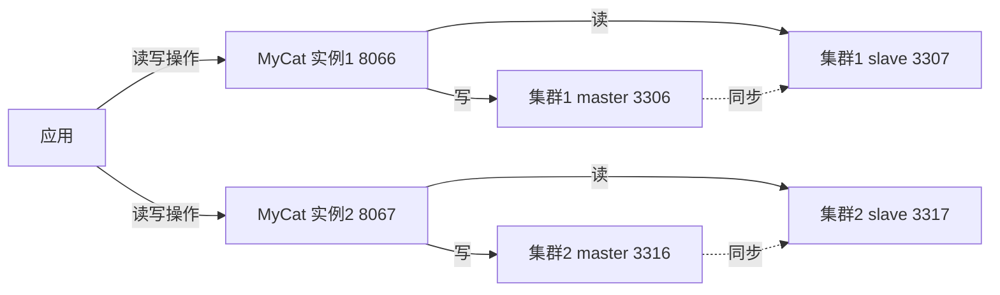

# 中间件也要甩掉单点：两实例 MyCat 集群

MySQL 集群之上加了 MyCat，应用访问是简单了，可压力也全部汇聚到了这一个中间件节点上。高并发场景里最先扛不住的往往就是它：MyCat 扛不住，后面的 MySQL 集群再强也接不到流量；MyCat 一旦宕机，整个数据库入口直接失联。解法与对待 MySQL 如出一辙：给 MyCat 也做集群，让两个实例共同承担转发压力。这一课在一台机器上部署出两个 MyCat 实例，并看清集群之后新出现的问题。

## 先给结论

- MyCat 本身不存数据、无状态，天然适合横向扩展：复制一个实例、对接同一批 MySQL 集群即可。
- 同机双实例必须改三处端口：`wrapper.conf` 的 wrapper 管理端口 1984，`server.xml` 的服务端口 8066 与管理端口 9066；两台机器各跑一个实例则不必改。
- 第二个实例由第一个的目录整体复制而来，`schema.xml`、`rule.xml` 与用户配置保持完全一致，两边看到的数据库视图才相同。
- 双实例解决了性能与单点，却把「连哪个」抛回给应用，统一入口要靠负载均衡组件，这就是 HAProxy 登场的理由。

## 一、单 MyCat 的瓶颈在哪

MyCat 的工作是把 SQL 解析、按规则路由、把结果合并返回，这些都是 CPU 与网络开销。请求量小的时候一台绰绰有余，并发一上来，这个唯一入口的连接数、内存、处理线程都会先于 MySQL 触顶。更麻烦的是它成了关键路径上的单点：它一停，应用全部断连。

把中间件变成两个，压力平摊，一个挂了另一个还在，问题就从架构上消解了：



两个实例对接的是同一批 MySQL 集群，配置完全相同，任何一个都能独立完成路由与转发。MyCat 自己不落数据，所以不存在「两个实例之间怎么同步」的问题，这是它与 MySQL 集群最本质的区别。

## 二、复制出第二个实例

第二个实例不需要重装，把现有目录整体复制一份即可，配置、脚本、依赖一次到位：

```bash
cd /haoke/mycat
cp mycat01 mycat02 -R
ll
# mycat01/ mycat02/ 两个目录，结构完全相同：bin conf lib logs
```

`mycat02` 的 `schema.xml`、`rule.xml` 以及 `server.xml` 里的用户定义原样保留，保证它对接同样的 MySQL 集群、提供同样的逻辑库与账号。接下来要改的只有端口。

## 三、同机双实例的端口改造

两个实例跑在同一台机器上，端口撞车是第一个要解决的问题，一共有三处：

**第一处是 wrapper 管理端口。** MyCat 用 Java Service Wrapper 管理进程启停，`conf/wrapper.conf` 里这个端口默认是 1984，第二个实例启动时 wrapper 会因端口被占而起不来：

```properties
# mycat02/conf/wrapper.conf
wrapper.port=1985 #默认 1984，同机第二个实例改成 1985
```

**第二、三处在 `server.xml` 里。** 服务端口 8066 与管理端口 9066 都写进 `system` 配置段：

```xml
<system>
    <property name="serverPort">8067</property>
    <property name="managerPort">9067</property>
</system>
```

也就是说第二个实例对外是 8067 服务端口、9067 管理端口。这三处改动只在同机部署时必需；如果两个 MyCat 分布在两台机器上，端口互不相干，一份配置直接复用即可。

## 四、启动与验证

先停掉正在运行的实例，再逐个拉起，避免老进程的端口干扰判断：

```bash
jps                      # 查看进程号
kill -9 MycatStartup对应的进程号

cd /haoke/mycat/mycat02/bin
./startup_nowrap.sh      # 直接拉起 JVM，日志写入 logs/console.log
tail -f ../logs/mycat.log   # 看到 MyCAT Server startup successfully 即成功
```

客户端新建连接指向第二个实例：主机 192.168.1.18、端口 8067，用户名与密码仍是 `server.xml` 里定义的那一组。连上之后打开逻辑库，`tb_ad` 的数据完整在列。这不是巧合：两个实例对接的是同一批 MySQL 集群，数据只有一份，任何一个实例查出来都一样。此时把连接切回 8066，结果完全相同，两个实例等价。

## 五、等价的两个入口，新问题来了

集群是成了，但回头看一眼应用的处境：它要维护 8066 与 8067 两个连接地址，自己做流量分配；哪个实例挂了，还得自己感知并切换到另一个。中间件的复杂度解决了，应用的复杂度却反弹了。

这层问题就该交给专职的负载均衡组件：在应用与 MyCat 集群之间再立一个统一入口，应用只认它一个地址，由它把请求转发到健康的实例上。这个角色就是下一课的 HAProxy。到这里整条链路的分层已经清晰：MySQL 负责存储与复制，MyCat 负责分片路由与读写分离，HAProxy 负责接入与分发，每往上一层，下层就被挡住一层。

## 常见误区

- **以为两个 MyCat 之间要同步数据。** MyCat 无状态、不存数据，实例之间没有任何同步关系，只要对接同一批 MySQL，视图天然一致。需要「同步」的是配置文件，改动要两边同步生效。
- **只改 `server.xml` 的两个端口，漏掉 `wrapper.conf`。** 1984 端口被第一个实例占着，第二个实例的 wrapper 起不来，表现为启动脚本执行后进程消失，去 `logs/console.log` 里能看到端口占用信息。
- **以为复制目录就等于部署完成。** 复制只是第一步，端口改造与连接验证缺一不可，尤其要确认第二个实例连的 MySQL 与第一个一致。
- **以为多实例性能无上限叠加。** MyCat 层的并发提升了，但所有请求最终仍要落到 MySQL 集群，数据库侧的容量与复制能力才是整条链路的最终上限。

## 面试可能被问到的问题

1. 面试官追问：「MyCat 为什么要做集群？」
   答：单一 MyCat 是全链路的关键单点，高并发下它先于数据库触顶，宕机则整个数据库入口失联。多实例部署把转发压力摊开，也消除了单点故障；又因为 MyCat 不存数据、无状态，横向扩展的成本非常低。
2. 面试官追问：「MyCat 是有状态的组件吗？」
   答：不是。它只做 SQL 路由、转发与结果合并，不持久化业务数据，实例之间也不需要互相感知。集群化的要点是保证所有实例的配置一致、对接同一批后端数据库，任何实例都能独立提供服务。
3. 面试官追问：「同一台机器部署两个 MyCat 要注意什么？」
   答：端口要错开三处：wrapper 管理端口 1984 改 1985，服务端口 8066 改 8067，管理端口 9066 改 9067。异机部署则不用改端口，但配置文件的同步维护要多花心思。
4. 面试官追问：「双 MyCat 之后应用该怎么接入？」
   答：不应让应用维护两个地址，那只是把复杂度推回应用层。标准做法是在 MyCat 集群前面加负载均衡组件，如 HAProxy，应用只连统一入口，由它完成分发与故障剔除。
5. 面试官追问：「MyCat 的 8066 与 9066 端口分别是什么？」
   答：8066 是服务端口，执行业务 SQL；9066 是管理端口，提供 `show @@heartbeart`、`show @@connection` 这类运行态管理命令，运维排查通常先连 9066 看后端心跳与连接状况。

## 配套资料

- 本课无配套源码包：`materials/code/03/day17-MySQL集群解决方案(主从复制、PXC集群、MyCat、HAProxy)/`
  目录下仅有解压清单 `_extracted.json`（记录解压文件数为 0），无源码可挂。
- 双实例的部署流程、三处端口改造与连接验证整理自本课讲解与画面；`wrapper.conf`、
  `server.xml` 的端口片段与启动命令为按本课写法补全的示例，库名与账号沿用上一课的
  中性命名。
