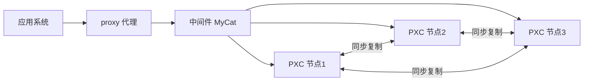
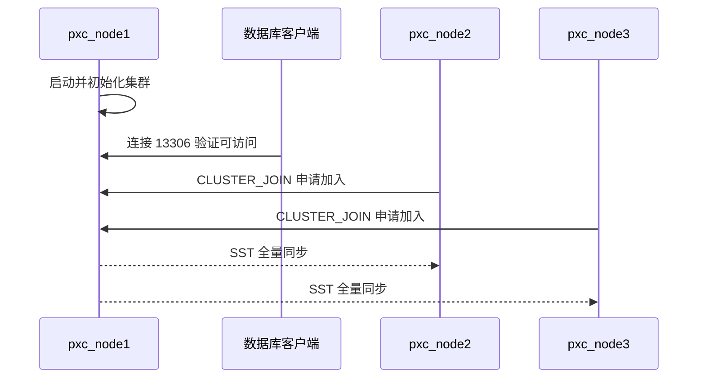

# 三节点 PXC 集群落地：建卷、组网、按顺序启动与双写验证

原理清楚了，这一课把 PXC 真正部署出来：三台容器组成一个集群，先起第一个节点完成初始化，再把另外两个拉进来，最后在任意节点写数据验证强一致。部署最容易翻车的地方不在命令本身，而在参数配对与启动顺序上：集群名写不齐、CLUSTER_JOIN 给错对象、三个节点一起 start，任何一处都会让集群起不来。

## 先给结论

- 节点规划：容器 `pxc_node1`、`pxc_node2`、`pxc_node3`，宿主机端口 13306、13307、13308，数据卷 v1、v2、v3。
- 镜像 `percona/percona-xtradb-cluster:5.7`，用 `docker tag` 重命名为 `pxc`，后续命令简短。
- 用独立网段 `172.30.0.0/24` 创建网络 `pxc-network`，三个节点固定 IP，互找得到。
- 三个节点的 `CLUSTER_NAME` 必须同名；第二、第三个节点多一个 `CLUSTER_JOIN=pxc_node1`，指明加入谁创建的集群。
- 启动必须按序：先启动 node1，等客户端能连上 13306 再启动其余节点，因为 node1 的启动过程完成了集群初始化。
- 集群是否成立查 `wsrep_cluster_size`，值为 3 即三节点在线；任一节点建库建表写数据，其余节点立即可见。

## 一、加入 PXC 后的整体架构

应用系统的读写请求先进代理（HAProxy），代理转给中间件（MyCat），中间件把操作落到 PXC，最终存储在 MySQL。这里有一个与主从时代完全不同的细节：PXC 的任何一个节点都能读也能写，中间件不需要再配读写分离，也不存在「必须写主节点」的限制。



上层入口收敛在代理，底层三个节点对等互备；中间那层读写分离配置因为多主而直接消失，架构反而变简单了。

## 二、准备数据卷、镜像与网络

动手前先把上一课验证用的 HAProxy、MyCat 容器停掉，避免端口与资源互相干扰；此前创建过的卷和网络不必删除重建，直接复用。

```bash
# 创建三个数据卷，三个节点各用一个
docker volume create v1
docker volume create v2
docker volume create v3

# 拉取 PXC 镜像
docker pull percona/percona-xtradb-cluster:5.7

# 重命名镜像，后续命令直接写 pxc
docker tag percona/percona-xtradb-cluster:5.7 pxc

# 创建 PXC 集群专用网段
docker network create --subnet=172.30.0.0/24 pxc-network
```

数据卷与挂载宿主机目录效果类似，但由 Docker 统一管理，实际数据落在 `/var/lib/docker/volumes` 下的同名目录里，比手工维护挂载目录省心。三个节点坚持用数据卷还有一个实际考量：容器被删除重建时，卷里的数据仍在，新节点挂上同一个卷就能带着旧数据回来，这在调试集群参数、反复重建节点的场景里非常受用。

## 三、创建三个节点

```bash
# 第一节点：只声明集群名，不带 CLUSTER_JOIN
docker create -p 13306:3306 -v v1:/var/lib/mysql \
  -e MYSQL_ROOT_PASSWORD=root -e CLUSTER_NAME=pxc \
  --name=pxc_node1 --net=pxc-network --ip=172.30.0.2 pxc

# 第二节点：增加 CLUSTER_JOIN，加入 pxc_node1 创建的集群
docker create -p 13307:3306 -v v2:/var/lib/mysql \
  -e MYSQL_ROOT_PASSWORD=root -e CLUSTER_NAME=pxc \
  -e CLUSTER_JOIN=pxc_node1 \
  --name=pxc_node2 --net=pxc-network --ip=172.30.0.3 pxc

# 第三节点：同理，端口 13308、数据卷 v3、IP 172.30.0.4
docker create -p 13308:3306 -v v3:/var/lib/mysql \
  -e MYSQL_ROOT_PASSWORD=root -e CLUSTER_NAME=pxc \
  -e CLUSTER_JOIN=pxc_node1 \
  --name=pxc_node3 --net=pxc-network --ip=172.30.0.4 pxc
```

参数逐个拆开看：`-p` 把容器内 3306 映射到宿主机 13306、13307、13308；`-v v1:/var/lib/mysql` 把数据卷挂到 MySQL 数据目录；`MYSQL_ROOT_PASSWORD` 设置 root 密码；`CLUSTER_NAME` 统一叫 `pxc`，名字相同才算同一个集群；`--net` 与 `--ip` 把节点固定在刚建的网段里。node1 不配 `CLUSTER_JOIN`，它不是加入谁，而是集群的创建者。

## 四、启动顺序：先初始化，再加入

```bash
# 只启动第一个节点，跟踪日志确认初始化完成
docker start pxc_node1 && docker logs -f pxc_node1
```

启动 node1 不只是把这一个容器跑起来，它同时完成了整个 PXC 集群的初始化。初始化没完成之前，其他节点就算启动了也加入不进来。所以流程是：启动 node1，等日志显示集群就绪，用客户端连一次 13306 确认可访问，再启动 node2 与 node3。日志里能看到新节点以 JOINER 身份加入、SST（State Snapshot Transfer，全量数据快照传输）完成、进入同步状态，这就是新节点从集群拉全量数据补齐的过程。



## 五、验证集群与双写

```sql
-- 在任意节点执行，查看集群规模
SHOW STATUS LIKE 'wsrep_cluster_size';
-- 结果 Value 为 3，表示三个节点都在集群里
```

接着做功能验证。在 node1 上创建 `haoke` 库、字符集 utf8，马上到 node2 与 node3 上刷新，库已经在；再建表、插入一条数据，三个节点的连接同时都能查到，同步并行完成，体感上没有延迟：

```sql
-- 示例：验证脚本骨架
CREATE DATABASE haoke DEFAULT CHARACTER SET utf8;
CREATE TABLE haoke.t_house (id BIGINT PRIMARY KEY, title VARCHAR(64));
INSERT INTO haoke.t_house VALUES (1, '示范房源');
-- 分别连 13306、13307、13308 查询，三条连接结果一致
SELECT * FROM haoke.t_house;
```

从建库到插数全程不用关心「连的是哪个节点」，这正是第一节说的多主特性在起作用。

## 常见误区

- **三个节点同时 `docker start`。** node1 尚未完成集群初始化，其余节点的加入请求全部失败，集群起不来。先起 node1 并确认可连接，再起其余节点。
- **给 node1 也配 `CLUSTER_JOIN`。** 第一个节点是集群创建者，配了它就等于要加入一个不存在的集群，直接报错。该参数只给第二及以后的节点。
- **`CLUSTER_NAME` 各写各的。** 名字不同的节点互不认账，各自独立运行，`wsrep_cluster_size` 永远是 1。三个节点必须同名。
- **沿用读写分离配置。** PXC 任一节点可读写，把主从时代那套读写分离规则原样搬过来属于无用功，中间件直连集群即可。

## 面试可能被问到的问题

1. 面试官追问：「为什么第一个节点能被客户端连上之后，才能启动其他节点？」
   答：第一个节点的启动过程同时完成 PXC 集群初始化，集群结构就绪前其他节点无法加入。以第一个节点可被客户端连接作为初始化完成的判据，之后 node2 与 node3 通过 CLUSTER_JOIN 加入。
2. 面试官追问：「CLUSTER_NAME 和 CLUSTER_JOIN 分别管什么？」
   答：CLUSTER_NAME 声明节点属于哪个集群，所有节点必须同名才能互认；CLUSTER_JOIN 声明加入哪个已有节点所在的集群，第二个及之后的节点都要配，第一个节点不配。
3. 面试官追问：「新节点加入时数据怎么补齐？」
   答：通过 SST 全量快照传输从已有节点拉取完整数据；节点短暂离线后回归、差距在一定范围内时走 IST 增量传输，只补缺失的事务。
4. 面试官追问：「怎么确认 PXC 集群健康？」
   答：查 `SHOW STATUS LIKE 'wsrep_cluster_size'`，值等于规划节点数说明全员在线；再看 `wsrep_cluster_status` 为 primary、`wsrep_ready` 为 ON，说明集群可正常提供服务。
5. 面试官追问：「为什么单独建网段并固定 IP？」
   答：节点之间要长驻通信做同步复制，固定 IP 让每个节点地址稳定可寻；独立网段把集群流量与业务网络隔离，避免地址冲突，也便于排查。

## 配套资料

- 本课无配套源码包：`materials/code/03/day17-MySQL集群解决方案(主从复制、PXC集群、MyCat、HAProxy)/`
  目录下仅有解压清单 `_extracted.json`（记录解压文件数为 0）。
- 节点规划、建卷、拉镜像、建网络、创建三个容器与启动顺序整理自本课讲解与画面；
  建库建表验证脚本为按本课写法补全的示例。
