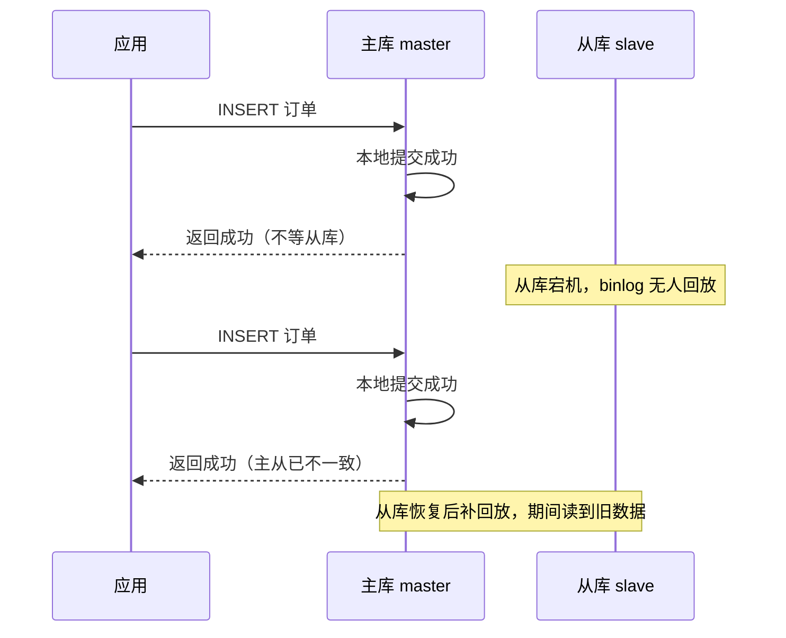

# PXC 和主从复制怎么选：同步与异步、双写与单写的三条分界线

主从复制搭好了，PXC 集群也跑通了，很多人到这里反而犯迷糊：两套方案都是「多节点存数据」，都能扛读压力，真要上一个项目时该用哪个？如果把 PXC 当性能更好的主从来用，或者把主从当强一致集群来用，都会在生产上栽跟头。

这两套方案的区别集中在三条线上：谁能写、怎么同步、拿什么换什么。把这三条线理清楚，选型就是一道送分题。

## 先给结论

- 读写能力不同：PXC 的所有节点都可读可写；主从复制是单向的，只有主库能写，从节点不能写入。
- 同步机制不同：PXC 是同步复制，能保证强一致性；主从是异步复制，从节点停了同步，主库照样写入并正常返回，主从数据从此不一致。
- 性能不同：PXC 用性能换一致性，写性能明显低于主从；主从因为异步，性能优于 PXC。
- 用途不同：PXC 存订单、用户这类不能丢的数据；主从存购物车、用户行为日志这类丢一点无所谓的数据。
- 没有谁取代谁：按业务场景选，重要数据走 PXC，一般数据走主从，两套方案经常在同一个系统里并存。

## 一、读写能力：全节点双写与单向复制

**第一，PXC 集群里每个节点都是完整的可写节点。** 往任何一个节点插入数据，集群会把这个写操作同步到其余节点，所以不管连的是哪个节点，读和写都没问题。对应用来说，集群像一个整体，不用关心「这条 SQL 该发给谁」。

**第二，主从复制是单向的，方向永远是从主库到从库。** 写操作只能落在 master 上，再由 binlog 传给 slave 回放；反方向走不通，无法从 slave 节点向 master 节点做同步。所以从库只承担读，写入被限制在主库上，这也决定了主从架构天生要配一套读写分离的路由规则。

```sql
-- 示例：主从架构下验证「从库不能写」（按本课写法补全）
-- 在 slave（3307）上执行写操作
INSERT INTO haoke.t_ad (id, title) VALUES (1, '测试广告');
-- ERROR 1290 (HY000): The MySQL server is running with the
-- --super-read-only option so it cannot execute this statement

-- 同一条写操作发给 master（3306）则正常执行，并经 binlog 复制到 slave
```

## 二、同步机制：强一致与异步复制

**PXC 的同步是同步进行的。** 一个事务要在集群所有节点上都执行成功，才算提交成功；只要有一个节点写失败，整个事务在所有节点上都失败。这是它能保证数据强一致性的根本原因，集群里任何时刻任何节点看到的数据都是同一份。

**主从的同步是异步进行的。** 主库提交事务不需要等从库确认，binlog 往外一扔就接着干自己的活。这带来一个典型风险：从节点停止同步（网络断了、从库宕机）之后，主节点依然可以向主库写入数据，并且对应用正确返回成功。等从库恢复再追日志，中间这段差距就造成了主库和从库的数据不一致。



图里两次写入主库都成功了，但从库第二次根本没收到数据，主从差距就是在「异步」这两个字里悄悄产生的。同样的场景换成 PXC，从节点不在线时写入会直接失败或等待，绝不会出现「主库成功了、其他节点不知道」的状态。

## 三、性能与用途：拿什么换什么

**PXC 是拿性能换一致性。** 每一次写都要全集群确认，节点越多、写放大越明显，所以它的写性能明显低于主从。**主从在性能上优于 PXC**，写操作本地落盘就返回，复制在后台慢慢追，吞吐量高得多。

性能差异直接划定了两者的使用边界：

| 维度 | PXC 集群 | Replication 主从 |
|---|---|---|
| 写入节点 | 全部节点可读可写 | 只有 master 可写 |
| 复制方式 | 同步复制 | 异步复制 |
| 一致性 | 强一致，任一节点写全员可见 | 最终一致，存在主从延迟窗口 |
| 写性能 | 较低，全集群确认 | 较高，本地提交即返回 |
| 典型数据 | 订单、用户信息等不可丢失的数据 | 购物车、用户行为日志等可容忍丢失的数据 |

判断标准就一句话：**这条数据丢了会不会出事故。** 订单少一条要赔钱，用户信息错一版要出纠纷，这类数据放 PXC；购物车少一件商品、行为日志丢一段，业务上无感，这类数据放主从，把省下来的写性能用在刀刃上。

在 PXC 里验证强一致只需一条链路：

```sql
-- 示例：PXC 双写验证（按本课写法补全）
-- 连节点 1（13306）写入
INSERT INTO haoke.t_house (id, title) VALUES (1, '朝南两居室');
-- 立刻连节点 2（13307）查询，无需任何等待
SELECT id, title FROM haoke.t_house WHERE id = 1;
-- 结果立即返回：1, 朝南两居室（强一致，同步完成）
```

## 常见误区

- **把 PXC 当高性能方案。** PXC 的卖点是强一致而不是快，写吞吐反而低于主从。想要写性能而选 PXC，会把最贵的资源用在最不敏感的数据上。
- **把主从当强一致用。** 异步复制意味着存在延迟窗口，从库读到的可能是旧数据。把下单结果立刻放到从库去查，典型症状就是「刚写进去却查不到」。
- **以为从库停了主库会拒绝写入。** 恰恰相反，主从架构下从库停止同步，主库照常写入并返回成功，一致性就这样被破坏。要发现这种情况得靠监控 Seconds_Behind_Master 与主从校验，而不是靠数据库报错。
- **认为两套方案二选一。** 实际项目里经常并存：核心表走 PXC，日志类表走主从，按数据的容忍度分配，而不是整个系统一刀切。

## 面试可能被问到的问题

1. 面试官追问：「PXC 和主从复制最本质的区别是什么？」
   答：同步机制。PXC 是同步复制，事务要在所有节点都成功才算提交，保证强一致性；主从是异步复制，主库提交不等从库，只能保证最终一致。读写能力与性能差异都是这一点的延伸。

2. 面试官追问：「为什么主从架构下从库不能写入？」
   答：主从复制是单向的，binlog 只从 master 流向 slave，slave 上的写入无法回传给 master，也无法在多个从库之间协调。放开从库写入会造成双向冲突和数据错乱，所以从库只承担读。

3. 面试官追问：「从库宕机一段时间，恢复后数据怎么办，主从还能一致吗？」
   答：从库恢复后会从上次记录的 binlog 位点继续回放，把宕机期间积压的事务补上，最终追平主库。但在追平之前读从库会读到旧数据，这段窗口内主从是不一致的。

4. 面试官追问：「哪些数据适合放 PXC，哪些适合放主从？」
   答：不能容忍丢失的数据放 PXC，比如订单、用户信息，强一致保证任何节点写入全局可见；能容忍一定丢失的数据放主从，比如购物车、用户行为日志，用更高的写性能承载这类流量。

5. 面试官追问：「PXC 性能不如主从，为什么还要用它？」
   答：因为有些业务的一致性比性能重要。资金、订单类数据一旦出现节点间不一致，资损和纠纷的代价远高于写性能的损耗。PXC 用全集群确认换来了「任何时刻任何节点数据一致」的保证，这笔交换对这些业务是划算的。

## 配套资料

- 本课无配套源码包：`materials/code/03/day17-MySQL集群解决方案(主从复制、PXC集群、MyCat、HAProxy)/`
  目录下仅有解压清单 `_extracted.json`（记录解压文件数为 0）。
- 三条区别的结论与对照表整理自本课讲解与画面；文中的主从只读验证与 PXC 双写验证均为按本课写法补全的示例。
