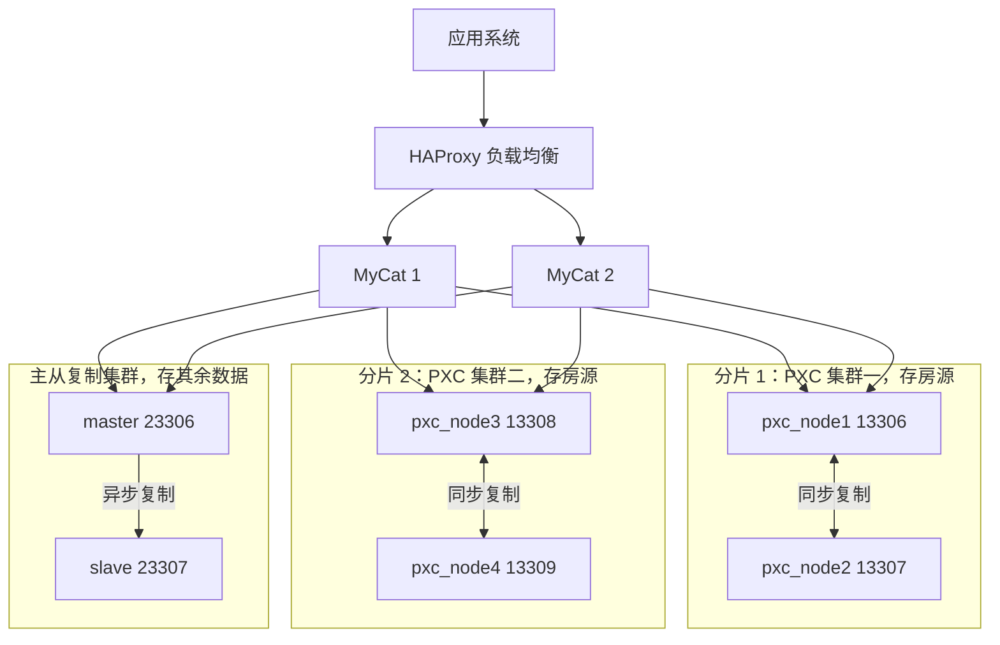

# 一套混合数据库架构长什么样：HAProxy、双 MyCat、双 PXC 分片与主从集群

学完主从复制、MyCat、HAProxy、PXC，最容易留下的疑问是：这四样东西到底怎么组合进一个真实项目？生产环境几乎不会只用其中一种，单一方案总有短板，主从扛不住核心数据的一致性要求，PXC 扛不住全量数据的写压力。

以租房项目为例，这一课把这四层拼成一个完整拓扑：核心的房源数据进 PXC 强一致集群并做水平分片，广告等一般数据进主从集群，MyCat 负责把请求路由到正确的位置，HAProxy 给两个 MyCat 做负载均衡。先看懂这张图，后面两课再把它一节一节部署出来。

## 先给结论

- 整个架构共 6 个 MySQL 实例：4 个组成两套 PXC 集群（每套 2 节点），2 个组成 1 套主从复制集群。
- 两套 PXC 集群之间没有同步关系，它们是两个分片，逻辑上组成一个大的分片整体。
- 业务层面规定：房源数据保存在 PXC 分片中，其余数据（如广告）保存在主从架构中，路由判断落在 MyCat 的配置里。
- 两个 MyCat 组成中间件集群，对等部署，请求由 HAProxy 轮询分发。
- 请求路径：应用系统 → HAProxy → MyCat → PXC 分片或主从集群。

## 一、整体拓扑：从后往前看一遍

看这种多层架构，从数据端往应用端倒着走反而更清楚，因为每一层的存在理由都由它后面那一层决定。



**最里面是两套 PXC 集群。** 每套集群内部两个节点做强同步，任何一个节点写入，两个节点同时生效，这是上一课说的同步复制在起作用。关键在于两套集群之间：它们互不同步，各自存着房源数据的一部分，是两个真正的分片；对 MyCat 来说，这两套集群合起来才是一个完整的存储整体。

**旁边是 1 套主从复制集群。** 一主一从、异步复制，存放不要求强一致的数据。它和两套 PXC 分片之间也没有任何同步关系，数据归属完全由路由规则决定，各存各的。

**往前提是两个 MyCat。** 中间件本身是个 Java 进程，单点部署的话它一挂整个数据库层就瘫了，所以部署两个实例组成 MyCat 集群，把进入的请求随机或轮询地发给后面的集群节点。

**最前面是 HAProxy。** 它对两个 MyCat 做负载均衡，应用系统只认识 HAProxy 一个入口，不需要知道后面有几个 MyCat、哪个活着。

## 二、实例清单与端口规划

把图里的每个实例落到端口上，部署时照着这张表逐个创建：

| 层 | 实例 | 端口 | 说明 |
|---|---|---|---|
| 负载均衡 | HAProxy | 4001 管理页、4002 代理入口 | 轮询分发到两个 MyCat |
| 中间件 | mycat01、mycat02 | 8066/9066、8067/9067 | 分片与读写分离路由 |
| 强一致分片 1 | pxc_node1、pxc_node2 | 13306、13307 | PXC 集群一，同步复制 |
| 强一致分片 2 | pxc_node3、pxc_node4 | 13308、13309 | PXC 集群二，同步复制 |
| 弱一致集群 | master、slave | 23306、23307 | 主从复制，异步 |

6 个 MySQL 实例各挂一个 Docker 数据卷，全部跑在同一台宿主机或同一批主机上，靠端口和网段区分身份。

## 三、数据怎么分：房源进 PXC，其余进主从

**划分依据是数据丢不丢得起。** 房源是项目的核心资产，价格、状态错一条就是客诉，所以进 PXC 拿强一致；广告数据晚几秒、丢一条影响有限，放进主从，用异步复制的高性能承载这类流量。

这条业务规定最终要翻译成 MyCat 的路由配置，也就是 `schema.xml` 里每张表挂在哪个数据节点上。按本节架构补一份示例（本课无源码包，按本章节 MyCat 各课的写法补全）：

```xml
<mycat:schema xmlns:mycat="http://io.mycat/">
  <schema name="haoke" checkSQLschema="false" sqlMaxLimit="100">
    <!-- 房源表：按 id 取模，分到两套 PXC 集群 -->
    <table name="tb_house_resources" dataNode="dn1,dn2" rule="mod-long"/>
    <!-- 广告等其余表：固定进主从集群，不分片 -->
    <table name="tb_ad" dataNode="dn3"/>
  </schema>
  <dataNode name="dn1" dataHost="pxc1" database="haoke"/>
  <dataNode name="dn2" dataHost="pxc2" database="haoke"/>
  <dataNode name="dn3" dataHost="repl" database="haoke"/>

  <!-- PXC 集群一：两个节点均可写，互为备写 -->
  <dataHost name="pxc1" maxCon="1000" minCon="10" balance="0" writeType="1" dbType="mysql" switchType="1">
    <heartbeat>select user()</heartbeat>
    <writeHost host="W1" url="192.168.1.18:13306" user="root" password="root"/>
    <writeHost host="W2" url="192.168.1.18:13307" user="root" password="root"/>
  </dataHost>

  <!-- 主从集群：写走 master，读按 balance 策略分给 slave -->
  <dataHost name="repl" maxCon="1000" minCon="10" balance="3" writeType="1" dbType="mysql" switchType="1" slaveThreshold="100">
    <heartbeat>select user()</heartbeat>
    <writeHost host="W1" url="192.168.1.18:23306" user="root" password="root">
      <readHost host="R1" url="192.168.1.18:23307" user="root" password="root"/>
    </writeHost>
  </dataHost>
</mycat:schema>
```

注意两个 `dataHost` 的差别：PXC 那组不需要配 `readHost`，因为它的每个节点都能写，两个 `writeHost` 互为备份；主从那组是标准的读写分离写法，写落在 master，读分给 slave。同一份配置在两个 MyCat 实例上保持一致，应用连哪一个都一样。

HAProxy 这一层的配置在负载均衡一课已经配好，这里只看它和 MyCat 的衔接：

```bash
listen proxy-mysql
bind 0.0.0.0:4002
mode tcp
balance roundrobin
# 代理两个 MyCat 实例
server mycat_1 192.168.1.18:8066 check port 8066 maxconn 2000
server mycat_2 192.168.1.18:8067 check port 8067 maxconn 2000
```

`mode tcp` 让 HAProxy 工作在四层，直接转发 MySQL 协议；`check` 健康检查发现某个 MyCat 挂掉就把它摘出轮询，应用无感知。

## 四、每一层各解决什么问题

**HAProxy 解决「入口单点」。** 两个 MyCat 互为备份，但应用总得连一个固定地址，HAProxy 用一个端口收口所有连接，故障时自动切换，还附带一个 4001 的状态页可以看流量分布。

**MyCat 解决「分片路由与读写分离」。** 哪张表去哪个分片、主从之间读写怎么分，全部收在中间件这一层，应用像连一个普通 MySQL 一样连 MyCat，业务代码里看不到任何集群细节。

**PXC 解决「核心数据强一致」。** 房源数据分布在两个分片上扩了写容量，每个分片内部同步复制保证不丢。

**主从解决「一般数据的高性价比存储」。** 广告、行为类数据量大但不金贵，异步复制的性能优势正好用在这里。

四层各司其职，任何一层都不是为了技术时髦，而是对应一种具体的数据诉求。

## 常见误区

- **以为两套 PXC 集群之间会互相同步。** 它们是两个分片，各存一半房源，互不复制。数据落在哪个分片由 MyCat 的分片规则决定，集群之间没有同步通道。
- **以为一个 MyCat 就够了。** MyCat 是整个架构里承上启下的单点，只部署一个的话它挂了全库失联。两个 MyCat 加 HAProxy 健康检查，才能把中间件这一层的故障挡掉。
- **把所有表都塞进 PXC。** PXC 的写要全集群确认，把广告、日志这类可丢数据也放进去，等于用最贵的写路径跑最不重要的流量，分片价值被白白稀释。
- **给 PXC 集群照搬主从的读写分离配置。** PXC 任意节点可写，MyCat 里配两个 `writeHost` 即可；`readHost` 与 `balance` 那套读写分离参数是给主从集群用的，套错对象会让读流量路由错位。

## 面试可能被问到的问题

1. 面试官追问：「为什么数据库层要做成混合架构，而不是只用一种方案？」
   答：因为不同数据的一致性要求和性能要求不同。核心数据如订单、房源不能丢，适合 PXC 强一致；一般数据如广告、日志能容忍丢失，适合主从的高性能异步复制。混合架构让每种数据走最匹配的存储路径。

2. 面试官追问：「两套 PXC 集群之间是什么关系，会互相备份吗？」
   答：不会备份。它们是两个独立分片，各自内部强同步，彼此之间没有同步关系，合起来构成逻辑上的完整数据集。数据的分布由 MyCat 的分片规则决定，比如按 id 取模。

3. 面试官追问：「应用怎么连这套架构，感知得到后面有几个数据库吗？」
   答：感知不到。应用只连 HAProxy 的一个代理端口，HAProxy 转发给 MyCat，MyCat 再按配置路由到 PXC 分片或主从集群。分片、读写分离这些细节全部收在中间件层，对应用就是一个普通 MySQL。

4. 面试官追问：「两个 MyCat 挂了一个怎么办？」
   答：HAProxy 对两个 MyCat 配置了健康检查，检测到故障就把该后端摘出轮询，请求全部落到存活实例上，两个实例的配置一致，所以业务无感知。HAProxy 本身也可配主备避免自己的单点。

5. 面试官追问：「房源数据放 PXC、广告放主从，这个规则在哪里落地？」
   答：落在 MyCat 的 `schema.xml` 配置里。每张表声明自己的 `dataNode`，`dataNode` 再指向不同 `dataHost`，房源表的节点指向两套 PXC 集群，广告表的节点指向主从集群，路由在 SQL 解析阶段完成。

## 配套资料

- 本课无配套源码包：`materials/code/03/day17-MySQL集群解决方案(主从复制、PXC集群、MyCat、HAProxy)/`
  目录下仅有解压清单 `_extracted.json`（记录解压文件数为 0）。
- 架构分层、实例规划与数据划分规则整理自本课讲解与画面；`haproxy.cfg` 片段整理自本章节 HAProxy 部署一课的屏幕配置；`schema.xml` 为按本章节 MyCat 各课写法补全的示例。
