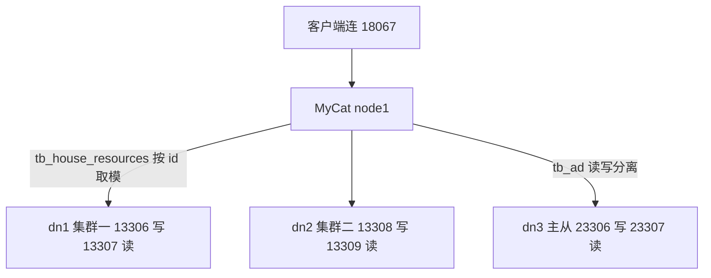

# 部署 MyCat 集群：双节点接通 PXC 双分片与主从集群

六个 MySQL 实例已经全部就位：4 个组成两套 PXC 分片，2 个组成一套主从。中间件层怎么接？让 MyCat 也以两个节点上场：node1 与 node2 各持一份相同配置，把房源的两个分片和广告的主从集群统一纳管起来，再用真实数据验证分片与读写分离。

## 先给结论

- 两个节点都由旧实例目录整体复制而来：node1 部署在 `/data/mycat/node1`，node2 复制 node1 得到。
- 同机双实例要错开三处端口：wrapper 端口 node1 用 1985、node2 用 1986；服务端口 18067 与 18068；管理端口 19067 与 19068。
- schema.xml 定义三个 dataHost：集群一 13306 与 13307、集群二 13308 与 13309 都用 balance 2，主从 23306 与 23307 用 balance 3，对应数据节点 dn1、dn2、dn3。
- 房源表 tb_house_resources 走 dn1,dn2 按 id 取模分片，rule.xml 的 count 配 2；广告表 tb_ad 只挂 dn3。
- 验证看两件事：不同 id 的房源落在不同 PXC 分片，tb_ad 在主从两边都能查到。

## 一、复制旧实例，搭出 node1 骨架

之前的 MyCat 单实例部署在 `/haoke/mycat/mycat01`，配置、脚本、依赖都是现成的，综合环境把它挪到 /data 下重新组织：

```bash
# 在 /data 下建 mycat 目录
cd /data
mkdir mycat
cd mycat

# 把旧实例整体复制过来，重命名为 node1
cp /haoke/mycat/mycat01 ./mycat01 -R
mv mycat01 node1
```

复制而非重装：配置、脚本、依赖一次到位，后面只改端口与适配新架构的部分；node2 也由复制得来。

## 二、server.xml：账号、逻辑库与端口

server.xml 清空重写只留需要的部分，账号沿用整套课程的约定（示例账号 haoke，按自己的 user 配置填写）：

```xml
<?xml version="1.0" encoding="UTF-8"?>
<!DOCTYPE mycat:server SYSTEM "server.dtd">
<mycat:server xmlns:mycat="http://io.mycat/">
    <system>
        <property name="useHandshakeV10">1</property>
        <property name="useSqlStat">0</property>
        <property name="useGlobalTableCheck">0</property>
        <property name="processorBufferPoolType">8</property>
        <property name="handleDistributedTransactions">0</property>
        <property name="useZKSwitch">false</property>
        <!-- 综合环境的服务端口与管理端口 -->
        <property name="serverPort">18067</property>
        <property name="managerPort">19067</property>
    </system>
    <!-- 客户端连接 MyCat 使用的账号与逻辑库 -->
    <user name="haoke" defaultAccount="true">
        <property name="password">haoke123</property>
        <property name="schemas">haoke</property>
    </user>
</mycat:server>
```

端口规划是这一步的重点：服务端口 18067、管理端口 19067，整组落在 1 开头的段，与之前练习用的 8066、9066 彻底分开；node2 顺延一位是 18068 与 19068。还有一处端口藏在 wrapper.conf 里：

```properties
# node1/conf/wrapper.conf
wrapper.port=1985 #默认 1984，同机多实例必须错开
```

MyCat 用 Java Service Wrapper 管理进程启停，同机撞车时第二个实例根本起不来，是 MyCat 集群那一课踩过的坑。

## 三、schema.xml：三个集群、三个数据节点

这份配置是接入混合架构的核心。逻辑库 haoke 下挂两张表，背后是三个 dataHost：

```xml
<?xml version="1.0"?>
<!DOCTYPE mycat:schema SYSTEM "schema.dtd">
<mycat:schema xmlns:mycat="http://io.mycat/">
    <schema name="haoke" checkSQLschema="false" sqlMaxLimit="100">
        <!-- 房源数据：跨两个 PXC 集群分片，按 id 取模 -->
        <table name="tb_house_resources" dataNode="dn1,dn2" rule="mod-long"/>
        <!-- 广告等一般数据：落在主从复制集群 -->
        <table name="tb_ad" dataNode="dn3"/>
    </schema>

    <dataNode name="dn1" dataHost="cluster1" database="haoke"/>
    <dataNode name="dn2" dataHost="cluster2" database="haoke"/>
    <dataNode name="dn3" dataHost="cluster3" database="haoke"/>

    <!-- 集群一：PXC 分片 1，读请求在写节点与读节点间随机分 -->
    <dataHost name="cluster1" maxCon="1000" minCon="10" balance="2"
              writeType="0" dbType="mysql" dbDriver="native" switchType="1" slaveThreshold="100">
        <heartbeat>select user()</heartbeat>
        <writeHost host="w1" url="192.168.1.18:13306" user="root" password="root">
            <readHost host="r1" url="192.168.1.18:13307" user="root" password="root"/>
        </writeHost>
    </dataHost>

    <!-- 集群二：PXC 分片 2，策略与集群一相同 -->
    <dataHost name="cluster2" maxCon="1000" minCon="10" balance="2"
              writeType="0" dbType="mysql" dbDriver="native" switchType="1" slaveThreshold="100">
        <heartbeat>select user()</heartbeat>
        <writeHost host="w1" url="192.168.1.18:13308" user="root" password="root">
            <readHost host="r1" url="192.168.1.18:13309" user="root" password="root"/>
        </writeHost>
    </dataHost>

    <!-- 集群三：主从复制，严格区分读写 -->
    <dataHost name="cluster3" maxCon="1000" minCon="10" balance="3"
              writeType="0" dbType="mysql" dbDriver="native" switchType="1" slaveThreshold="100">
        <heartbeat>select user()</heartbeat>
        <writeHost host="w1" url="192.168.1.18:23306" user="root" password="root">
            <readHost host="r1" url="192.168.1.18:23307" user="root" password="root"/>
        </writeHost>
    </dataHost>
</mycat:schema>
```

两个 balance 的取值有讲究：PXC 每个节点都能参与读写，读请求随机分给写节点与读节点都不亏，两套 PXC 集群用 balance 2；主从集群的 slave 只承担读，读写一刀切开，用 balance 3。

分片规则在 rule.xml 里把 count 改成 2：

```xml
<tableRule name="mod-long">
    <rule>
        <columns>id</columns>
        <algorithm>mod-long</algorithm>
    </rule>
</tableRule>

<function name="mod-long" class="io.mycat.route.function.PartitionByMod">
    <!-- 分片数量：两套 PXC 集群 -->
    <property name="count">2</property>
</function>
```

id 对 2 取模，两种余数对应两个数据节点，两套 PXC 集群各存一半房源。

## 四、启动 node1，用真实数据对账

先清场再启动：之前实验留下的两个 MyCat 进程还在跑，占着 1984 与 1985 的 wrapper 端口，node1 的 1985 会撞车：

```bash
# 查看并结束两个旧 MyCat 进程
jps
kill -9 旧实例的进程号

# 前台试跑，确认配置能正常拉起
cd /data/mycat/node1/bin
./mycat console
# 看到启动成功后 Ctrl+C，转后台运行
./mycat start
```

客户端连 192.168.1.18 的 18067 端口，账号 haoke，逻辑库里就是房源与广告两张表。插数据验证路由：把之前那条房源原样再插一遍，再新增一条 id 为 2 的房源：

```sql
-- 房源第 2 条：id 为偶数，按取模应落在集群一
INSERT INTO tb_house_resources (id, title, estate_id, building_num, building_unit,
  building_floor_num, rent, rent_method, payment_method, house_type, covered_area,
  use_area, floor, orientation, decoration, facilities, pic, contact, mobile,
  created, updated)
VALUES (2, '城南三室一厅', 1, '2', '2', '2', 2000, '整租', '月付', '普通住宅',
  '100.00', '100.00', '2', '南北', '精装修', '有',
  'http://img.haoke.com/house/2.jpg', '18888888888', '18888888888',
  '2018-11-16 11:34:02', '2018-11-16 11:34:02');
```

打开真实的 MySQL 连接对账：13308（集群二）里有 id 为 1 的房源而 13306 没有，新插入的 id 为 2 在 13306（集群一）能查到而 13308 没有，一条数据只落一个分片，取模路由货真价实。tb_ad 通过 18067 插入一条，23306 主库立即可见，23307 从库刷新后同样出现，读写分离与主从复制都正常。整条路由关系如下：



图里关键的是房源表的分叉：一条 INSERT 进来，MyCat 解析出 id 取模后只发给两套 PXC 集群中的一套，另一半由后续插入补齐；tb_ad 整个走 dn3，不参与分片。

## 五、node2：复制 node1，改三处端口

node2 的部署就是一次复制加三处改动：

```bash
# 复制 node1 为 node2
cd /data/mycat
cp node1 node2 -R

# 改 wrapper 管理端口：1985 改 1986
vim node2/conf/wrapper.conf
```

server.xml 里服务端口 18067 改 18068、管理端口 19067 改 19068。schema.xml 与 rule.xml 一字不动，两个节点必须提供完全相同的逻辑库视图，否则同一个查询从不同节点进去会看到不同的世界。启动方式与 node1 相同：

```bash
cd /data/mycat/node2/bin
./mycat console
./mycat start
jps
# 此时能看到两个 MyCat 进程
```

客户端复制 node1 的连接，端口改成 18068，连上后两张表与数据完整在列。不是 node2 存了数据，而是它对接的 MySQL 集群与 node1 一致，数据只有一份，两个节点等价。至此 MyCat 集群就绪，应用又面临「连哪个」的老问题，答案就是下一课的 HAProxy。

## 常见误区

- **node2 复制完直接启动。** wrapper 端口 1985 与 node1 撞车，进程起不来或反复退出，jps 里没有新进程。三处端口都要改。
- **PXC 集群沿用 balance 3。** balance 3 让读请求全部避开写节点，但 PXC 每个节点都能承担读写，写节点的读能力被白白浪费。PXC 用 2，主从用 3。
- **把 tb_ad 挂到 PXC 分片上。** 广告这类数据量小的数据放主从就够，房源数据才需要跨 PXC 分片，表与数据节点的对应关系要在 schema.xml 里写清楚。
- **连接成功就当部署完成。** 连上 18067 只说明 MyCat 活着，分片是否生效要用不同 id 的数据到两个分片对账，主从是否生效要到 23307 看数据有没有同步过来。

## 面试可能被问到的问题

1. 面试官追问：「两个 MyCat 节点的配置为什么要完全一致？」
   答：MyCat 无状态、不存数据，集群化的意义是每个节点都能独立完成同样的路由。schema.xml、rule.xml 与账号配置不一致，同一个查询从不同节点进去会命中不同的数据节点或规则，出现随机的错数据。

2. 面试官追问：「PXC 集群为什么用 balance 2 而不是 3？」
   答：balance 2 让读请求在写节点与读节点间随机分配，balance 3 让读全部走 readHost。PXC 节点地位对等、都能写，写节点参与读不影响一致性；主从里从库只读，才需要 balance 3 严格隔离。

3. 面试官追问：「mod-long 分片的好处与局限是什么？」
   答：好处是实现简单、数据分布均匀，查询带 id 时能直接定位分片。局限是扩容要改 count 并迁移历史数据，且不带分片键的查询会广播到所有分片再聚合，跨分片查询代价较高。

4. 面试官追问：「MyCat 怎么知道一条 SQL 该发给哪个节点？」
   答：连接进来先看逻辑库与表，有分片规则的表按规则列计算路由，这里是 id 对分片数取模；没有规则的表按 dataNode 直接路由。读写走向由 dataHost 的 balance 与 SQL 类型共同决定。

5. 面试官追问：「综合架构里 tb_ad 为什么不分片？」
   答：分片是为了解决单表数据量与并发写入的瓶颈，广告表量级远够不着；放主从集群读写分离即可，还省去跨分片聚合的复杂度。分片策略按数据量与增长预期来定，不是所有表都值得分。

## 配套资料

- 本课无配套源码包：`materials/code/03/day17-MySQL集群解决方案(主从复制、PXC集群、MyCat、HAProxy)/`
  目录下仅有解压清单 `_extracted.json`（记录解压文件数为 0）。
- 目录组织、三处端口（wrapper 1985 与 1986、服务 18067 与 18068、管理 19067 与 19068）与
  schema.xml 三集群结构、balance 取值整理自本课讲解与画面；`server.xml`、`rule.xml` 全文与
  schema.xml 中集群二、集群三节点为按本课写法补全；账号已做中性化处理；插入 SQL 整理自画面
  原文、列有删减，图片地址替换为示例。
