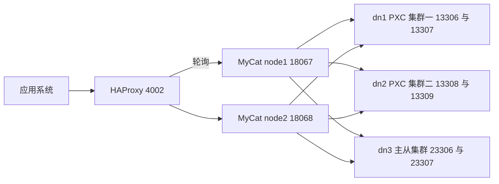
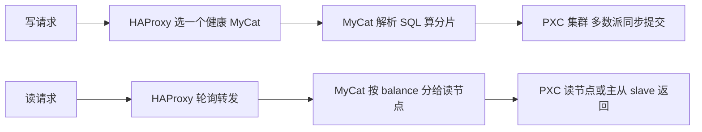

# MySQL 集群全家桶复盘：从单节点困境到四层混合架构

数据库单节点扛不住大并发与海量存储，这是 day17 的起点。一圈方案讲下来，从主从复制到 PXC，从 MyCat 到 HAProxy，最终落成一个四层混合架构。这一课没有新组件，把全章串成一张图、一张端口表和一组选型判断，复习时照着走一遍就够了。

## 先给结论

- 方案演进是一条「解决旧问题、长出新问题」的链：主从复制解决读多写少，带来应用复杂与弱一致；中间件解决应用复杂，带来中间件瓶颈与单点；负载均衡解决中间件入口；PXC 解决弱一致，代价是写入性能。
- 最终落地的是混合架构：HAProxy 统一入口，MyCat 双节点做分片与读写分离，房源数据存两套 PXC 分片，广告等一般数据存主从集群。
- balance 选型口诀：PXC 集群用 2，读请求在写节点与读节点间随机分；主从集群用 3，读写一刀切。
- 强一致场景的数据放 PXC，可容忍延迟的数据放主从，按业务对一致性的要求分流，而不是一套方案打天下。

## 一、方案演进：每层解决什么，又留下什么

**读写分离架构（主从复制）。** 应用对数据库的访问普遍读多写少，思路是一个主库负责写、若干从库负责读，主从之间靠 binlog 同步。它解决了读压力，却留下两个问题：应用要自己连多个节点、判断读写，开发变复杂；主从同步是异步完成的，属于弱一致，对数据安全性要求高的场景不合适。

**中间件架构。** 应用复杂度的解法是加一层中间件：应用只连 MyCat 一个地址，读写判断、分片路由、结果合并全部收口在中间件里。MyCat 自己却成了新的瓶颈与单点，于是有了 MyCat 集群：两个实例对接同一批 MySQL，无状态、横向扩展，配置保持一致。

**负载均衡架构。** MyCat 做了集群，应用又要面对「连哪个节点」的问题，这一层交给 HAProxy：四层转发加健康检查，应用只认一个入口，故障节点自动摘除。

**PXC 集群架构。** 主从的弱一致问题靠 PXC 解决：事务要在多数节点同步提交成功才算写成功，强一致性换来的是性能损耗。它不替代主从，而是与主从分工，于是有了最终的混合形态：

这张图是全章的最终答案：上层解决「请求怎么进来」，中层解决「请求怎么路由」，底层解决「数据怎么存才可靠」。每往上一层，下层就被屏蔽一层，应用永远只面对一个连接串；两个 MyCat 节点对着同一批数据节点，任何一个都能独立完成路由。

## 二、数据路由：谁存什么，怎么分

混合架构里两种数据两条路，由 schema.xml 的表与数据节点对应关系决定：

| 表 | 数据节点 | 落点 | 规则 |
|---|---|---|---|
| tb_house_resources | dn1,dn2 | 两套 PXC 集群 | mod-long 按 id 取模，count 2 |
| tb_ad | dn3 | 主从集群 | 不分片，balance 3 读写分离 |

房源数据量大、增长快，用分片换容量与写入能力；广告这类数据量小、更新少，走主从读写分离就够。判断一张表要不要分片，看数据量与增长预期，也看它对跨分片查询的敏感度，分片不是越多越好。

## 三、端口与部署清单：复习用的全景表

整套环境跑在一台虚拟机上，端口规划是排障时最先要对的账：

| 层 | 组件 | 端口 | 说明 |
|---|---|---|---|
| 接入层 | HAProxy | 4001 | 管理界面 /dbs |
| 接入层 | HAProxy | 4002 | 数据库代理，roundrobin |
| 中间件层 | MyCat node1 | 18067 服务、19067 管理 | wrapper 1985 |
| 中间件层 | MyCat node2 | 18068 服务、19068 管理 | wrapper 1986 |
| 数据层 | PXC 集群一 | 13306 写、13307 读 | 分片 1，dn1 |
| 数据层 | PXC 集群二 | 13308 写、13309 读 | 分片 2，dn2 |
| 数据层 | 主从集群 | 23306 主、23307 从 | dn3 |

动手搭建的顺序同样值得记：主从复制、MyCat、HAProxy、PXC、综合应用，由简到繁逐层搭，每一层验证通过再往上叠。综合应用阶段把四种组件拼在一起：两套 PXC 分片加一套主从，MyCat 配三个 dataHost 接入，HAProxy 收口成统一入口，再用不同 id 的房源数据验证分片、用广告表验证主从。回顾每个组件在链路里的角色：

写路径的关键是 PXC 的多数派提交，数据一致性在这一步被锁死；读路径的关键是 balance 策略，读压力被摊到不承担写入的节点上。两条路径合起来，就是这套架构的全部运行逻辑。

## 四、选型判断：什么数据放哪一层

**第一，看一致性要求。** 交易、支付这类丢不起的数据放 PXC，多数派提交保证强一致；广告、日志、统计这类可容忍短暂延迟的数据放主从，性能更好、成本更低。

**第二，看数据量与增长。** 单表几十万级没必要分片，读写分离即可；千万级以上、写入持续增长才考虑分片，分片键选查询最常用的列，本方案里就是 id。

**第三，看应用侧改造成本。** 小规模项目没有中间件也能活，应用内做读写分流即可；规模上来之后，中间件与负载均衡把复杂度收口的价值才显现。方案跟着规模走，不要一上来就堆四层。

## 常见误区

- **以为 PXC 可以完全替代主从。** PXC 强一致的代价是写入性能与节点规模，全量数据都上 PXC 成本高。混合架构的本质是按数据特性分配存储方案。
- **以为中间件是标配。** MyCat 解决的是应用侧多数据源的复杂度，小项目用应用内分流更简单；引入中间件的同时也引入了新的运维对象与故障点。
- **balance 取值背混。** 1 是备主与读库参与、2 是读写节点随机、3 是只走 readHost；PXC 用 2，主从用 3，判断依据是后端节点能不能承担读写。
- **只记组件不记端口。** 四层架构排障的第一步就是确认链路上每一跳的端口通不通，端口全景表要能默画出来。

## 面试可能被问到的问题

1. 面试官追问：「为什么要用混合架构，而不是全上 PXC？」
   答：PXC 用性能换强一致，适合交易类核心数据；大量一般数据对一致性要求没那么苛刻，用主从复制性能更好、成本更低。混合架构按数据特性分配方案，在一致性与性能之间取平衡。

2. 面试官追问：「主从复制和 PXC 的一致性差异在哪里？」
   答：主从是异步复制，主库提交即返回，从库随后追平，存在延迟窗口，属于弱一致；PXC 基于 Galera 协议，事务要在多数节点验证并同步提交成功才返回，强一致但写入延迟更高。

3. 面试官追问：「MyCat 集群和 HAProxy 能不能只留一个？」
   答：两者解决不同问题。MyCat 集群解决中间件的吞吐与单点，但没有统一入口，应用要自己挑节点；HAProxy 提供统一入口与故障摘除，但没有 MyCat 它无路可转。要高可用的中间件层，两者是配对出现的。

4. 面试官追问：「分片键为什么选 id，取模分片有什么坑？」
   答：id 是最常用的查询条件，带分片键的查询能直接定位分片。取模分片数据分布均匀、实现简单，坑在扩容：改分片数要迁移历史数据，期间要处理路由一致；不带分片键的查询会广播所有分片再聚合。

5. 面试官追问：「一个写请求在这套架构里的完整路径是什么？」
   答：应用连 HAProxy 的 4002，HAProxy 按 roundrobin 把连接转给某个 MyCat 节点，MyCat 解析 SQL 判断出是写操作，按表的分片规则对 id 取模，把语句发给对应 PXC 集群的写节点，PXC 多数节点同步提交成功后逐层返回。

6. 面试官追问：「这套环境要上生产还差什么？」
   答：至少三件事：HAProxy 用 Keepalived 加虚拟 IP 做双机热备；MyCat 与 MySQL 分机器部署，避免资源争抢与单机故障；补齐监控告警与备份恢复，主从延迟、PXC 集群状态、慢查询都要有水位。

## 配套资料

- 本课无配套源码包：`materials/code/03/day17-MySQL集群解决方案(主从复制、PXC集群、MyCat、HAProxy)/`
  目录下仅有解压清单 `_extracted.json`（记录解压文件数为 0）。
- 章节脉络、最终架构图与搭建顺序整理自本课总结的讲解与画面；端口全景表与路由规则汇总自
  day17 主从复制、MyCat、HAProxy、PXC 与综合应用各课的配置。
