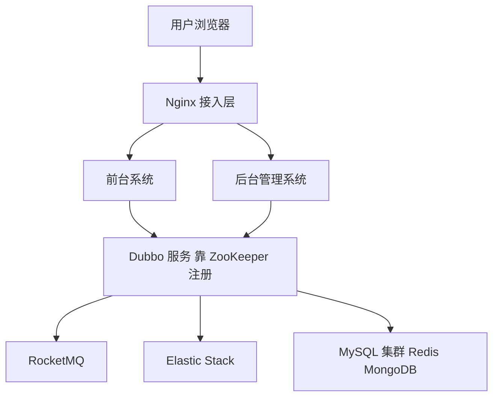

# 项目发布导览：上线前的架构、计划与流程怎么走

功能开发完不等于项目结束。整套租房系统横跨前后台多个服务，底下还压着 MySQL 集群、Redis、RocketMQ、Elastic Stack 一众中间件，要让整套系统真正跑起来，得把每个服务安放到机器上并串成一条链路。day18 干的就是这件事：把项目发布到生产环境，再做功能测试。

有一点要先说破：课程里的「上线」是自己构造的生产环境，用来完整走一遍企业发布的流程，并不是企业里真正对外的生产发布。流程、动作、坑是真实的一套，环境本身是教学环境，这个前提决定了后面所有部署决策的尺度。

## 先给结论

- day18 的主线五步：部署架构、部署计划、实施部署、打包项目、功能测试，环环相扣，顺序不能乱。
- 先讲架构再定计划：看懂服务之间的依赖与调用关系，才能决定谁部署在哪、用什么方式部署。
- 部署计划要落到机器与服务：MySQL、Redis、RocketMQ 这些基础服务各用什么方式部署，应用服务怎么打包运行。
- 打包与部署是两件事：先把代码打成可运行的产物，再放到机器上跑起来，上线后从用户视角做功能回归。

## 一、部署架构：认清要部署的是什么

整套系统的调用关系可以简化成四层。用户从浏览器访问域名，请求先到接入层的 Nginx，由它把请求分给前台系统与后台管理系统；应用服务之间通过 Dubbo 互相调用，靠 ZooKeeper 做服务注册与发现；业务运行离不开 RocketMQ 的消息、Elastic Stack 的搜索与日志；数据最终落在 MySQL 集群、Redis 与 MongoDB 上：



这张图在 day17 的基础上又叠加了应用与接入层：MySQL 集群那四层是数据侧的地基，Nginx 与各应用服务是跑在它上面的业务体。部署要自下而上推进，地基没打牢就上业务服务，只会收获一连串连接失败的日志。看架构图的另一个用处是划清依赖边界：Dubbo 服务依赖 ZooKeeper，搜索依赖 Elasticsearch，消息依赖 RocketMQ，这些依赖关系直接决定后面的部署顺序。

## 二、部署计划：先写清楚，再动手

架构看清之后，动手之前还有一步计划。一台机器跑不下所有服务，每个服务的部署方式也不同：MySQL 集群用 Docker 容器加数据卷，Redis 可能要集群模式，RocketMQ 要 NameServer 加 Broker，应用服务要决定裸跑 jar 还是进容器。计划就是把这些问题逐个落定：

| 规划项 | 要回答的问题 | 示例结论（具体以后续课实际部署为准） |
|---|---|---|
| 机器划分 | 哪台机器跑哪些服务 | 按资源占用分组，数据库类独占资源 |
| 基础服务 | 每个中间件的部署方式与端口 | Docker 容器，沿用 day17 的端口规划 |
| 应用服务 | 打包方式与运行方式 | 可执行 jar 或 Docker 镜像 |
| 网络连通 | 服务之间怎么互相找到对方 | Docker 自定义网络或宿主机端口映射 |

计划的价值在于提前暴露依赖：应用服务依赖注册中心与消息队列，这些中间件就必须先部署；数据层要接得上 day17 的 MySQL 集群成果，端口与数据卷规划就得延续。计划写清楚，后面实施时每一步都有据可查，出了问题也容易定位是哪个环节漏了。

## 三、实施部署与打包：代码变成服务

实施部署按计划自下而上推进：先把 MySQL 集群、Redis、RocketMQ 这类基础服务在容器里跑起来，再部署注册中心与搜索，最后上应用服务。容器化的基础动作在前面章节都用过，比如给一组服务建一个共享网络，让它们按容器名互通（示例命令）：

```bash
# 创建自定义网络，同一网络内的容器可用容器名互访
docker network create --subnet=172.18.0.0/24 haoke-network

# 基础服务加入该网络
docker run -d --net=haoke-network --name=zookeeper zookeeper:3.4
```

应用侧的产出物是 Spring Boot 的可执行 jar，打包与运行各一条命令（示例）：

```bash
mvn clean package -DskipTests
java -jar app-service.jar --server.port=8080
```

打包前有一件容易忽略的事：配置要按生产环境准备。数据库地址指向 HAProxy 的 4002，Redis 与 RocketMQ 指向对应容器，而不是带着开发环境的地址上线。这些连接地址正是 day17 收口成的那一个入口，部署时把它抄进配置，链路就自然接上了。

## 四、功能测试：上线的验收关

部署完成不算完，从用户视角把核心链路回归一遍才算上线：房源能浏览、搜索能出结果、消息能收发、后台管理能登录。测出来的问题可能是配置错漏、端口不通、版本不对，也可能是部署顺序导致的依赖缺失。功能测试通过，这一轮发布才算真正完成，day18 的主线到此闭合。

## 常见误区

- **以为上线就是打个 jar 丢上去。** jar 只是最后一环，机器规划、中间件部署、网络连通、配置准备缺一样，服务都起不来。
- **生产环境带着开发配置跑。** 数据库还指向本机 3306、注册中心指向 localhost，这类配置错漏是上线故障的高发区，打包前先过一遍配置。
- **部署顺序随意。** 应用服务依赖注册中心、消息队列与数据库，基础服务没就绪就起应用，只会反复报连接失败。
- **部署完不做功能回归。** 进程活着不代表业务通了，从用户视角跑一遍核心功能才算验收。

## 面试可能被问到的问题

1. 面试官追问：「说说你了解的项目上线流程。」
   答：先明确部署架构与机器规划，制定部署计划；再自下而上部署基础服务与应用服务；应用代码打包成可运行产物后发布；上线后做功能回归验证。每一步都有可核对的产出，出问题能定位到具体环节。

2. 面试官追问：「Spring Boot 项目怎么打包部署？」
   答：用 spring-boot-maven-plugin 打成可执行 fat jar，依赖全部打进包内，java -jar 直接运行；进阶做法是构建 Docker 镜像进容器部署，配合自定义网络让服务互相发现。配置通过外部参数或 profile 区分环境。

3. 面试官追问：「为什么接入层要用 Nginx？」
   答：统一对外入口，做反向代理与负载均衡，把请求分给多个应用实例；还能承载静态资源、证书与跨域配置。应用服务只暴露在内网，安全面与扩展性都更好。

4. 面试官追问：「多个服务部署时，网络怎么规划？」
   答：容器化部署用自定义 Docker 网络把相关服务放进同一网段，按容器名互通；跨宿主机用端口映射或 overlay 网络。要点是把服务发现方式固定下来，配置里不写死一堆 IP。

## 配套资料

- 本课无配套源码包：`materials/code/03/day18-项目发布以及各种服务集群搭建/` 目录下仅有解压清单
  `_extracted.json`（记录解压文件数为 1，内容为房源抓取测试数据
  `day18-项目发布以及各种服务集群搭建 - 副本/资料/data.json`）。
- 课程主线、部署架构分层与五步流程整理自本课讲解与画面；网络创建与打包运行命令为按本课写法补全的示例，
  具体机器与服务规划以 day18 后续课的实际部署为准。
