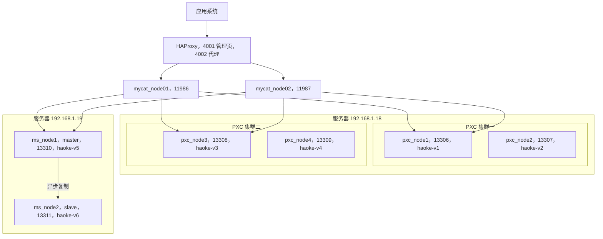
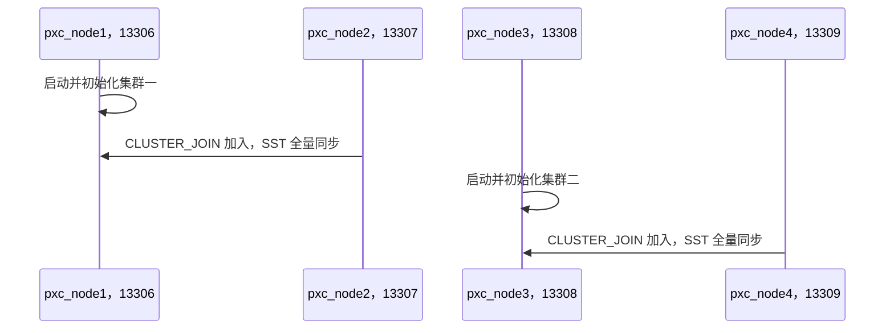
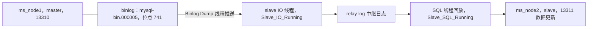
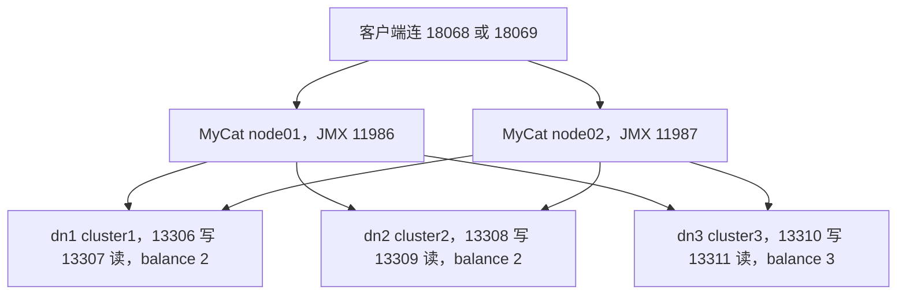
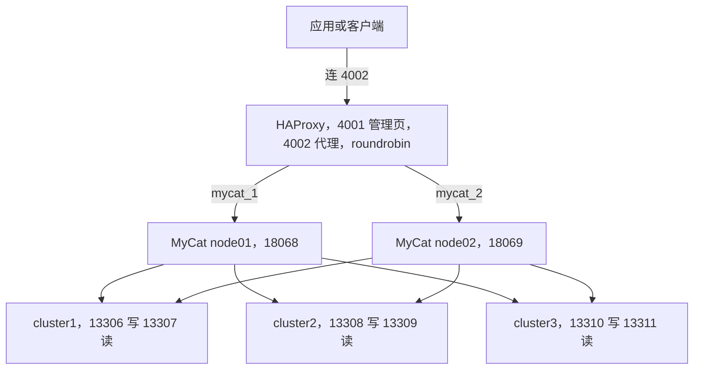

# MySQL 集群部署之全景实操：PXC、主从、MyCat 与 HAProxy 一次搭完

## 先给结论

- 规划先行：6 个 MySQL 实例分三组摊在两台机器上，两套 PXC（各 2 节点）放 192.168.1.18，一套主从放 192.168.1.19；端口规则统一「3306 前压 1 顺延」，13306 到 13311 一眼能对回默认端口。
- 每个实例独占一个 Docker 数据卷，haoke-v1 到 v6 与实例一一对应；MyCat 两节点占 11986、11987，HAProxy 占 4001、4002，应用侧最终只认 4002 一个入口。
- PXC 部署节奏：自定义网络指定子网 172.30.0.0/24，每套集群先起第一个节点并等它可连接，再带 `CLUSTER_JOIN` 起第二个节点；集群内同步可见、跨集群互不可见才算部署完成。
- 主从复制在 1.19 上搭：master 开 `log-bin` 定 server-id，同步账号只授 `REPLICATION SLAVE`，`CHANGE MASTER TO` 的位点抄 `SHOW MASTER STATUS` 的实时输出，验收看两个 Running 同时为 Yes。
- MyCat 是 Java 中间件，同机双节点三处端口错开；schema.xml 把房源表按 id 取模挂到两套 PXC，广告与楼盘走主从，PXC 用 balance 2、主从用 balance 3。
- HAProxy 用 host 网络模式做四层转发，proxy-mysql 段两个 server 轮询指向两个 MyCat 的 18068 与 18069，连库必须走 4002 的 mode tcp 段，4001 只是管理页，改配置必须重启容器。
- 分工总结：HAProxy 管连接分流与探活，MyCat 管分片路由与读写分离，PXC 与主从按数据一致性要求分组承接，出问题按层排查。

## 第1部分：MySQL集群部署之规划

部署计划定了「先数据库」，实施前还得把数据层摊开到纸面上：两套 PXC 加一套主从共 6 个 MySQL 实例，加上 MyCat 与 HAProxy，谁是第几个节点、落在哪台机器、占哪个端口、挂哪个数据卷，一个问题没提前定，动手时就会顾此失彼。

规划表就是这一步的产出。它看起来只是一张表格，实际上是后面每一课的施工清单：建卷、组网、起容器、配中间件，全按表逐行执行。

### 一、架构回顾：四层结构摊到两台机器
数据层的整体结构在综合应用那几课已经搭过一遍：应用连代理，代理连中间件，中间件连集群。这次机器富余，结构不变，落位变了：



**两套 PXC 集群是强一致分片。** 每套内部两个节点同步复制，专门存房源这类一致性要求高的数据；两套之间互不同步，各存一部分，合起来才是完整存储，分到哪套由 MyCat 的分片规则决定。**主从集群承载其余数据。** 广告等不要求强一致的数据走 master 写、slave 读的异步复制链路。与综合应用那几课把全部实例压在一台机器上不同，这次主从集群搬到 192.168.1.19，端口相应顺延。**MyCat 与 HAProxy 是数据侧的收口。** 两个 MyCat 对等部署做分片路由，HAProxy 在前面做负载均衡，三者与主从同在 19 机器上，数据库侧对应用只暴露一个地址。

### 二、端口规则：一条规则推算全部端口
端口规划只立了一条规矩：MySQL 默认端口 3306 前面压个 1，然后往下顺延。于是 6 个实例依次占 13306、13307、13308、13309、13310、13311，看到端口就知道顺序，看到顺序就能推端口，排查时不用翻笔记。

非 MySQL 的角色同样有预留：MyCat 两个节点登记 11986、11987（节点自身的服务端口与管理端口沿用 MyCat 集群一课三段错开的写法，各节点顺延错开）；HAProxy 沿用综合应用一课的 4001 管理页、4002 代理入口。整张规划表如下：

| 服务 | 宿主机端口 | 服务器 | 容器名 | 数据卷 |
|---|---|---|---|---|
| MySQL-node01（PXC 集群一） | 13306 | 192.168.1.18 | pxc_node1 | haoke-v1 |
| MySQL-node02（PXC 集群一） | 13307 | 192.168.1.18 | pxc_node2 | haoke-v2 |
| MySQL-node03（PXC 集群二） | 13308 | 192.168.1.18 | pxc_node3 | haoke-v3 |
| MySQL-node04（PXC 集群二） | 13309 | 192.168.1.18 | pxc_node4 | haoke-v4 |
| MySQL-node05（主从 master） | 13310 | 192.168.1.19 | ms_node1 | haoke-v5 |
| MySQL-node06（主从 slave） | 13311 | 192.168.1.19 | ms_node2 | haoke-v6 |
| MyCat-node01 | 11986 | 192.168.1.19 | mycat_node01 | — |
| MyCat-node02 | 11987 | 192.168.1.19 | mycat_node02 | — |
| HAProxy | 4001、4002 | 192.168.1.19 | haproxy | — |

这张表有三列是硬约束：**端口**不能撞（同一台机器上每个宿主机端口只能映射一次）、**容器名**不能重（Docker 里同名即冲突）、**数据卷**与实例一一对应（挂错卷等于把别人的数据盘拔下来插到自己机器上）。服务器列决定了命令在哪台机器上执行，也是硬约束。

### 三、数据卷：六个实例六块盘
每个 MySQL 实例配一个独立数据卷，由 Docker 统一管理，实际数据落在宿主机 `/var/lib/docker/volumes` 下的同名目录里。按规划先建卷，PXC 四个卷在 1.18 上建，主从两个卷在 1.19 上建：

```bash
# 数据卷按规划逐台创建（实际存储路径：/var/lib/docker/volumes）

# 在 192.168.1.18 上：PXC 集群一、二共四个节点的卷
docker volume create haoke-v1
docker volume create haoke-v2
docker volume create haoke-v3
docker volume create haoke-v4

# 在 192.168.1.19 上：主从 master、slave 的卷
docker volume create haoke-v5
docker volume create haoke-v6
```

卷建好后用 `docker volume ls` 逐台核对数量，18 上四个、19 上两个。这里的六条命令属于规划预演，实际执行随下一课部署 PXC 集群一并完成；卷名一旦定下就不要中途改，容器创建时 `-v` 引用的就是这些名字。

数据侧通了之后，应用侧只改一处配置，数据源指向 HAProxy 的代理入口：

```properties
# 示例：应用数据源最终只认 HAProxy 的 4002（按本课规划补全）
jdbc.url=jdbc:mysql://192.168.1.19:4002/haoke?useUnicode=true&characterEncoding=utf8
jdbc.username=root
jdbc.password=root
```

分片规则、读写分离、主从切换，全部藏在 4002 后面，应用代码里看不到任何集群细节。这正是规划表里把 MyCat 与 HAProxy 放在数据库侧同机的原因：数据层的问题在数据层内部消化。

### 四、按表施工：规划的价值在执行时兑现
规划表定下后，实施顺序也自然浮出来：先在 1.18 建 PXC 集群（卷、镜像、网络、容器、按序启动），再在 1.19 部署主从复制，随后起 MyCat 双节点、HAProxy 收口。每一课的产出都能在表上找到对应行，装完一项核对一行：端口通不通、容器名对不对、卷挂没挂上，全有据可查。出了问题也能顺着表反查：连接 13308 失败，先看 pxc_node3 在不在 1.18 上跑着，再看端口映射，最后看卷，三层排查路径一目了然。
## 第2部分：MySQL集群部署之部署pxc集群

规划表在手，数据层实施从 PXC 开始。PXC 对参数配对与启动顺序最敏感：集群名对不上、加入对象指错人、四个容器一把梭全拉起来，任何一处都能让整套集群起不来，而且报错信息往往很晚才冒出来。

这一课把规划表上的前四行变成四个跑着的容器：先建数据卷，再备镜像与网络，然后创建两套各两节点的 PXC 集群，按序启动，最后用客户端逐节点验证同步。主从集群与 MyCat、HAProxy 留给后面的课程。

### 一、建数据卷：六块盘分两台机器
容器删了可以重建，数据卷删了数据就没了，所以第一件事是建卷。按规划，1.18 上建 PXC 四个节点的卷，1.19 上建主从两个节点的卷，主从的卷虽属后面课程，也随本课一并建好备用：

```bash
# 数据卷（实际存储路径：/var/lib/docker/volumes）
# 在 192.168.1.18 上执行：PXC 四个节点的卷
docker volume create haoke-v1
docker volume create haoke-v2
docker volume create haoke-v3
docker volume create haoke-v4
docker volume ls

# 在 192.168.1.19 上执行：主从两个节点的卷
docker volume create haoke-v5
docker volume create haoke-v6
docker volume ls
```

建完逐台用 `docker volume ls` 核对：18 上四个、19 上两个。卷在哪个机器上建，将来挂它的容器就必须在哪台机器上跑，这一步跨不了机器，建错地方只能删了重建。

### 二、备镜像与建网络：两台机器分开对待
镜像用官方的 `percona/percona-xtradb-cluster:5.7`，拉下来后重命名为 `pxc`，后面创建容器的命令直接写短名。1.18 上此前实验已有该镜像，确认即可；1.19 上没有，现场拉取后同样打 tag：

```bash
# 拉取镜像并重命名（1.18 已有则确认，1.19 需拉取）
docker pull percona/percona-xtradb-cluster:5.7
docker tag percona/percona-xtradb-cluster:5.7 pxc
```

网络只在 1.18 上准备。创建前先用 `docker network ls` 查一眼，此前实验建过 `pxc-network` 就直接复用；没有才执行创建，且必须显式指定子网：

```bash
# 创建 PXC 专用网络，指定子网防止与默认地址池冲突
docker network create --subnet=172.30.0.0/24 pxc-network
```

指定子网有两个理由。**固定 IP 依赖自定义网络**，PXC 节点之间要长驻通信做同步复制，地址必须稳定可寻；**默认地址池会撞车**，Docker 预设的网段池里 172.17、172.18 等段常被先建的网络占走，随机分配一旦报 `Pool overlaps with other one on this address space`，还得回头腾挪，不如开局就圈一段偏僻的 `172.30.0.0/24`。1.19 上部署的是主从节点，不走 PXC 这套组网，网络不必建。

### 三、创建四个容器，按两条线分别启动
容器用 `docker create` 先创建、后启动，把「建」与「启」分开，正好配合「建完四个、按序启动」的节奏。命令按规划表逐行来，每台集群的第二个节点多一个 `CLUSTER_JOIN`（命令按本课写法补全，画面讲义只完整给出了建卷与建网络部分）：

```bash
# 集群一第一个节点：只声明集群名，不带 CLUSTER_JOIN
docker create -p 13306:3306 -v haoke-v1:/var/lib/mysql \
  -e MYSQL_ROOT_PASSWORD=root -e CLUSTER_NAME=pxc \
  --name=pxc_node1 --net=pxc-network --ip=172.30.0.2 pxc

# 集群一第二个节点：CLUSTER_JOIN 指向 pxc_node1
docker create -p 13307:3306 -v haoke-v2:/var/lib/mysql \
  -e MYSQL_ROOT_PASSWORD=root -e CLUSTER_NAME=pxc \
  -e CLUSTER_JOIN=pxc_node1 \
  --name=pxc_node2 --net=pxc-network --ip=172.30.0.3 pxc

# 集群二第一个节点：自成一体，作为新集群的种子
docker create -p 13308:3306 -v haoke-v3:/var/lib/mysql \
  -e MYSQL_ROOT_PASSWORD=root -e CLUSTER_NAME=pxc \
  --name=pxc_node3 --net=pxc-network --ip=172.30.0.4 pxc

# 集群二第二个节点：CLUSTER_JOIN 指向 pxc_node3
docker create -p 13309:3306 -v haoke-v4:/var/lib/mysql \
  -e MYSQL_ROOT_PASSWORD=root -e CLUSTER_NAME=pxc \
  -e CLUSTER_JOIN=pxc_node3 \
  --name=pxc_node4 --net=pxc-network --ip=172.30.0.5 pxc
```

参数与节点一一对应：`-p` 把容器内 3306 映射到规划表上的 13306 到 13309；`-v` 各挂各的卷；`CLUSTER_NAME=pxc` 是集群身份；`CLUSTER_JOIN` 只出现在每套集群的第二个节点上，声明「我加入谁」。两套集群这里沿用了同一个集群名，身份区分完全压在 `CLUSTER_JOIN` 的指向上，指错一个就会串集群；更稳的写法是给第二套集群取独立的名字，综合应用一课的示例用的就是 `pxc1`、`pxc2` 异名隔离。

启动按两条线走，每条线内部严格「先第一后第二」：

```bash
# 集群一线：先起 pxc_node1，跟踪日志等它完全就绪
docker start pxc_node1 && docker logs -f pxc_node1
# 客户端能连上 13306 后，再起 pxc_node2
docker start pxc_node2 && docker logs -f pxc_node2

# 集群二线：同样先起 pxc_node3 再起 pxc_node4
docker start pxc_node3 && docker logs -f pxc_node3
docker start pxc_node4 && docker logs -f pxc_node4
```



每套集群的第一个节点启动时完成的是集群初始化，不只是自己跑起来。初始化没完成，第二个节点的加入请求就无从握手，所以判据是第一个节点能被客户端连上，而不是进程刚拉起来。日志里第二个节点以 JOINER 身份加入、经 SST（State Snapshot Transfer，全量快照传输）拉齐数据、进入 SYNCED 状态，这条线通了，该集群就算立住了。两条启动线互不依赖，可以先跑完集群一再跑集群二。

### 四、验证：集群内同步可见，跨集群互不可见
用数据库客户端建四个连接，主机都是 192.168.1.18，端口分别 13306、13307、13308、13309，账号密码 root，四个全部连接成功，容器层就绪。

集群内验证：连 13306 建一个 `test` 库（字符集 utf8），马上到 13307 刷新，库已经在；接着建一张测试表并插入一条数据，两个连接同时可见，删除后两边同步消失，强同步货真价实。跨集群对照：连 13308 看 `test` 库，不存在，这正是两套集群互不同步的证据：

```sql
-- 连 13306 执行：建库建表，验证与 13307 的同步
CREATE DATABASE test DEFAULT CHARACTER SET utf8;
CREATE TABLE test.tb_test (
  id BIGINT PRIMARY KEY AUTO_INCREMENT,
  name VARCHAR(100)
);
INSERT INTO test.tb_test (name) VALUES ('张三');
-- 到 13307 刷新：库、表、数据全部可见；删除后两边同步消失
-- 到 13308 查看：test 库不存在，两套集群互不同步
```

集群二用同样的方法走一遍：在 13308 建 `test` 库与测试表，插入一条「李四」，到 13309 刷新立即可见。顺手查一下集群规模更稳妥：

```sql
-- 分别连 13306 与 13308 执行，两套集群各应为 2
SHOW STATUS LIKE 'wsrep_cluster_size';
```

四个连接、两条集群线全部验证通过，规划表的前四行落地，PXC 部分到此完成。
## 第3部分：MySQL集群部署之部署MS集群(主从复制)

规划表上的前四行（两套 PXC 分片）已经落地，第 5、6 行轮到主从集群。它和 PXC 的组队方式完全不同：PXC 靠集群名与加入参数把节点「织」进一个同步组，主从的两个实例彼此并不认识，要靠 binlog 和位点手工串成上下级，多一步配置就多一类失败原因。

这一课把 master 与 slave 两个实例在 192.168.1.19 上跑起来，接通复制，再用建库插数验证同步。做完之后，6 个 MySQL 实例全部就位，MyCat 的数据节点配置随时可以把它们纳管起来。

### 一、master：开 binlog、定 server-id、起容器
先在 1.19 上给 master 准备配置目录，配置与数据分开存放，以后重建容器数据卷不动：

```bash
# 创建 master 的配置目录并编辑配置文件
mkdir /data/mysql/haoke/master01/conf -p
cd /data/mysql/haoke/master01/conf
vim my.cnf
```

```bash
# /data/mysql/haoke/master01/conf/my.cnf
[mysqld]
log-bin=mysql-bin #开启二进制日志，主从复制的载体
server-id=1 #服务id，不可重复
sql_mode=STRICT_TRANS_TABLES,NO_ZERO_IN_DATE,NO_ZERO_DATE,ERROR_FOR_DIVISION_BY_ZERO,NO_AUTO_CREATE_USER,NO_ENGINE_SUBSTITUTION
```

`log-bin` 是主从复制的载体，主库所有写操作都记进 binlog，从库靠回放它追平数据；`server-id` 是复制拓扑里每个节点的身份证，主从各不相同才能正确寻址。接着创建并启动容器：

```bash
# 创建 master 容器：数据卷 haoke-v5，端口 13310
docker create --name ms_node1 -v haoke-v5:/var/lib/mysql \
  -v /data/mysql/haoke/master01/conf:/etc/my.cnf.d \
  -p 13310:3306 -e MYSQL_ROOT_PASSWORD=root percona:5.7.23

docker start ms_node1 && docker logs -f ms_node1
```

配置目录挂到容器的 `/etc/my.cnf.d`，MySQL 启动时自动加载。日志走到能接受连接，再用数据库客户端新建两个连接：主机都是 192.168.1.19，端口分别 13310、13311，账号密码 root，先连上 13310 这一个。

### 二、建同步账号，记下位点
同步账号只为复制而生，权限最小化：

```sql
-- 在 master（13310）上执行
CREATE USER 'haoke'@'%' IDENTIFIED BY 'haoke';
GRANT REPLICATION SLAVE ON *.* TO 'haoke'@'%';
FLUSH PRIVILEGES;

-- 记录 binlog 文件名与当前位点，从库接入要用
SHOW MASTER STATUS;
-- 本例输出：mysql-bin.000005 | 741
```

`SHOW MASTER STATUS` 输出的文件名与 Position 是从库回放的起点，后面 `CHANGE MASTER TO` 要原样抄进来，抄错一个字符同步就会缺数据或直接报错。

### 三、slave：同款模板改 server-id，接入主库
slave 的目录、配置、容器命令与 master 完全同款，只改三处：目录换成 `slave01`，`server-id` 换成 2，端口与数据卷换成 13311 与 haoke-v6（命令按 master 同款写法补全）：

```bash
# 创建 slave 容器：数据卷 haoke-v6，端口 13311
docker create --name ms_node2 -v haoke-v6:/var/lib/mysql \
  -v /data/mysql/haoke/slave01/conf:/etc/my.cnf.d \
  -p 13311:3306 -e MYSQL_ROOT_PASSWORD=root percona:5.7.23

docker start ms_node2 && docker logs -f ms_node2
```

课堂上演示了一个典型失误：slave 容器名没按规划表写，建出来才发现名字不对，只能 `docker rm` 删掉重新创建。容器名、端口、数据卷三样在规划表上都有登记，建完核对一遍，不符就删掉重建，别带着错位往下走。

容器起来后在 slave 上接入主库并开启同步：

```sql
-- 在 slave（13311）上执行，文件名与位点抄 SHOW MASTER STATUS 的输出
CHANGE MASTER TO
MASTER_HOST='192.168.1.19',
MASTER_PORT=13310,
MASTER_USER='haoke',
MASTER_PASSWORD='haoke',
MASTER_LOG_FILE='mysql-bin.000005',
MASTER_LOG_POS=741;

START SLAVE;

SHOW SLAVE STATUS\G
-- 关键两项：
-- Slave_IO_Running: Yes
-- Slave_SQL_Running: Yes
```

两个线程都为 Yes 才算配置成功，这一对状态是主从排障的第一入口：



图里对应着两个 Yes 的来历：`Slave_IO_Running` 把守「从库能不能收到主库的 binlog」，`Slave_SQL_Running` 把守「收到的日志能不能落地回放」，任何一个是 No，复制链路就断了一环。

### 四、验证同步，再清理现场
在 master 上建一个测试库做实测：

```sql
-- master（13310）上执行
CREATE DATABASE test DEFAULT CHARACTER SET utf8;
CREATE TABLE test.tb_test (
  id BIGINT PRIMARY KEY AUTO_INCREMENT,
  name VARCHAR(100)
);
INSERT INTO test.tb_test (name) VALUES ('王五');
-- 切到 slave（13311）刷新：库、表、数据全部可见
```

从库立即可见，主从链路就算真正打通。验证完把 `test` 库删掉，两边同步消失，环境恢复干净：这个库只用于验证，留着会随 binlog 被复制到下游，没有意义。到这里规划表的第 5、6 行落地，数据层六实例全部就绪。
## 第4部分：MySQL集群部署之部署MyCat集群

MySQL 层的 6 个实例已经全部就绪，但应用不可能自己去挑分片：房源数据存两套 PXC，广告与楼盘走主从，谁写哪儿、读哪儿，总得有人替应用算。这个角色就是 MyCat。这一课在 192.168.1.19 上装出两个 MyCat 节点，写完三大配置文件，启动并用真实数据验证分片与读写分离。

### 一、装出 node01：解压、备份、重写配置
MyCat 依赖 Java 环境，装它之前先用 `java -version` 确认机器上有 JDK（1.19 这台机器此前已具备）。在 1.19 上建安装目录，上传 Mycat-server-1.6.1 安装包并解压，把解压出的目录重命名为 node01：

```bash
mkdir /haoke/mycat -p
# 上传安装包到该目录后解压
tar -xvf Mycat-server-1.6.1-release-*.tar.gz
mv mycat node01
```

conf 目录下原来有一套默认配置，先备份再重写，出问题随时能回退：

```bash
cd /haoke/mycat/node01/conf
cp server.xml server.xml.bak
cp schema.xml schema.xml.bak
```

### 二、server.xml 与 wrapper.conf：账号、端口
server.xml 只保留两件事：给客户端用的账号，和同机多实例必须错开的端口：

```xml
<?xml version="1.0" encoding="UTF-8"?>
<!DOCTYPE mycat:server SYSTEM "server.dtd">
<mycat:server xmlns:mycat="http://io.mycat/">
    <system>
        <!-- node01 的服务端口与管理端口，node02 顺延为 18069 与 19069 -->
        <property name="serverPort">18068</property>
        <property name="managerPort">19068</property>
    </system>
    <!-- 客户端连 MyCat 用的账号与逻辑库 -->
    <user name="haoke" defaultAccount="true">
        <property name="password">haoke123</property>
        <property name="schemas">haoke</property>
    </user>
</mycat:server>
```

还有一处端口藏在 wrapper.conf 里：

```properties
# node01/conf/wrapper.conf：JMX 端口默认 1984，node01 改 11986，node02 改 11987
wrapper.java.additional.7=-Dcom.sun.management.jmxremote.port=11986
```

三处端口一起改是同机双实例的硬要求，漏一处，第二个实例不是起不来就是管理端口互相打架。

### 三、schema.xml 与 rule.xml：一库三表三集群
这份配置是整个接入方案的核心。逻辑库 haoke 下挂三张表，背后是三个 dataHost：

```xml
<?xml version="1.0"?>
<!DOCTYPE mycat:schema SYSTEM "schema.dtd">
<mycat:schema xmlns:mycat="http://io.mycat/">
    <schema name="haoke" checkSQLschema="false" sqlMaxLimit="100">
        <!-- 房源数据：跨两套 PXC 集群分片，按 id 取模 -->
        <table name="tb_house_resources" dataNode="dn1,dn2" rule="mod-long"/>
        <!-- 广告与楼盘：落在主从集群 -->
        <table name="tb_ad" dataNode="dn3"/>
        <table name="tb_estate" dataNode="dn3"/>
    </schema>

    <dataNode name="dn1" dataHost="cluster1" database="haoke"/>
    <dataNode name="dn2" dataHost="cluster2" database="haoke"/>
    <dataNode name="dn3" dataHost="cluster3" database="haoke"/>

    <!-- cluster1：PXC 分片 1，读请求在两节点间随机分 -->
    <dataHost name="cluster1" maxCon="1000" minCon="10" balance="2"
              writeType="0" dbType="mysql" dbDriver="native"
              switchType="1" slaveThreshold="100">
        <heartbeat>select user()</heartbeat>
        <writeHost host="w1" url="192.168.1.18:13306" user="root" password="root">
            <readHost host="r1" url="192.168.1.18:13307" user="root" password="root"/>
        </writeHost>
    </dataHost>

    <!-- cluster2：PXC 分片 2，13308 写 13309 读，策略与 cluster1 相同 -->
    <!-- cluster3：主从集群，13310 写 13311 读，balance 用 3 -->
</mycat:schema>
```

balance 的取值分两档：PXC 每个节点都能参与读写，读请求随机分给写节点与读节点都不亏，两套 PXC 用 2；主从集群的 slave 只承担读，读写一刀切开，cluster3 用 3。分片规则在 rule.xml 里改一处：

```xml
<function name="mod-long" class="io.mycat.route.function.PartitionByMod">
    <!-- 分片数量：两套 PXC 集群 -->
    <property name="count">2</property>
</function>
```

id 对 2 取模，两种余数对应两个数据节点，房源各存一半。schema.xml 与 rule.xml 是分片语义的全部来源，后面 node02 复制时这两份一字不动。

### 四、启动与联调：先补逻辑库，再对账分片
```bash
cd /haoke/mycat/node01/bin
./mycat start
tail -f ../logs/mycat.log
```

MyCat 起来后日志里连接后端失败，原因不在 MyCat：配置里三个 dataNode 指向的逻辑库 haoke 还不存在。到三个 MySQL 集群里各建一次：

```sql
CREATE DATABASE haoke DEFAULT CHARACTER SET utf8;
-- 分别连 13306、13308、13310 执行
-- 13307、13309、13311 由 PXC 同步与主从复制自动带过去
```

库就位后心跳恢复。接着建表：tb_ad 与 tb_estate 属于主从集群，连 13310 建；tb_house_resources 属于 PXC，连 13306 与 13308 各建一次。然后用数据库客户端连 MyCat 的 18068，账号 haoke、密码 haoke123，能看到逻辑库下三张表，开始对账：

```sql
-- 经 MyCat（18068）插入广告与楼盘数据
INSERT INTO tb_ad (id, type, title, url) VALUES (1, 1, '首页轮播', 'http://img.haoke.com/ad/1.jpg');
INSERT INTO tb_estate (id, name, province, city, area, address)
VALUES (1, '测试楼盘', '上海', '上海', '浦东新区', 'xx路100号');

-- 经 MyCat 插入多条房源，id 取 1、2、3、4
-- 到 13306 与 13308 分别查看：各存一部分，两套 PXC 合起来才是全量
-- MyCat 里查询 tb_house_resources：返回全量数据
```

对账结果是部署成功的判据：广告与楼盘在 13310 主库写入、13311 从库可查，读写分离生效；房源按 id 落到不同 PXC 分片，单套分片里只有一半数据，MyCat 查询却返回全量，分片路由生效。



图里值得看的是房源表的分叉：一条 INSERT 进来，MyCat 解析出 id 取模的结果，只发给两套 PXC 中的一套，另一半由后续插入补齐；tb_ad 与 tb_estate 整体走 dn3，不参与分片。

### 五、node02：复制 node01，只改端口
第二个节点的部署就是一次复制加三处改动：

```bash
cd /haoke/mycat
cp node01 node02 -R

# wrapper.conf：JMX 11986 改 11987
# server.xml：服务端口 18068 改 18069，管理端口 19068 改 19069
./node02/bin/mycat start
```

客户端复制 node01 的连接，端口改成 18069，连上后三张表与数据完整在列。不是 node02 另存了一份数据，而是它对接的 MySQL 集群与 node01 完全一致，两个节点等价。MyCat 集群就绪，应用又面临「连哪个」的老问题，答案交给下一课的 HAProxy。
## 第5部分：MySQL集群部署之部署HAProxy

两个 MyCat 节点跑起来了，应用又站在岔路口：连 18068 还是 18069？这一课用 HAProxy 把岔路口收掉：它在 MyCat 前面做四层负载均衡，管理页开在 4001，代理入口开在 4002，两条连接轮着分给两个 MyCat。做完之后，应用侧的数据库连接串只需要一个地址。

### 一、拉镜像，写配置文件
HAProxy 不用装，Docker 里一个镜像解决。在 1.19 上拉镜像并准备配置目录：

```bash
docker pull haproxy:1.9.3
mkdir /haoke/haproxy -p
vim /haoke/haproxy/haproxy.cfg
```

配置文件分三段看：global 与 defaults 是全局参数，admin_stats 把管理页开在 4001，proxy-mysql 是真正干活的代理段：

```properties
global
    log 127.0.0.1 local2
    maxconn 4000
    daemon

defaults
    mode http
    log global
    option httplog
    option http-server-close
    option forwardfor except 127.0.0.1

# 管理页面：浏览器访问 4001/dbs
listen admin_stats
    bind 0.0.0.0:4001
    mode http
    stats uri /dbs
    stats auth admin:admin123

# 数据库代理：客户端连 4002，转发给两个 MyCat
listen proxy-mysql
    bind 0.0.0.0:4002
    mode tcp
    balance roundrobin
    option tcplog
    server mycat_1 192.168.1.19:18068 check port 18068 maxconn 2000
    server mycat_2 192.168.1.19:18069 check port 18069 maxconn 2000
```

关键的两行 server 就是本课的全部增量：后端地址从单机实验的旧实例换成 1.19 上的两个新 MyCat，端口 18068 与 18069。`check port` 必须与 MyCat 实际监听的服务端口一致，健康检查是 HAProxy 主动发起的真实 TCP 连接，探测端口写错，探活对象就不再是 MyCat，节点宕了也测不出来。balance 用 roundrobin 轮询，第一条连接进 18068，第二条进 18069，依次循环。

### 二、创建并启动容器
```bash
docker create --name haproxy --net host \
  -v /haoke/haproxy:/usr/local/etc/haproxy haproxy:1.9.3

docker start haproxy && docker logs -f haproxy
```

网络用 host 模式，容器直接共享宿主机网络栈，配置里绑定的 4001、4002 就是宿主机的端口，不需要 `-p` 映射；配置目录挂载进去，改配置只动宿主机文件。日志确认监听就绪后，浏览器打开 `http://192.168.1.19:4001/dbs` 能进统计页，mycat_1 与 mycat_2 两行都是 UP，说明两个后端的探测都通了。以后排查先看这个页面，谁红先查谁。

### 三、数据面验证：一个入口查到全部数据
数据库客户端新建连接：主机 192.168.1.19、端口 4002，账号密码用 MyCat 的 haoke 与 haoke123。连上后逻辑库下三张表都在，数据都能查：

```sql
-- 经 HAProxy 4002 执行
SELECT id, title, url FROM tb_ad;              -- 主从集群的数据
SELECT id, name, city FROM tb_estate;          -- 主从集群的数据
SELECT id, title, rent FROM tb_house_resources; -- 两个 PXC 分片合并返回
```

这两条查询背后是两层各司其职的转发，全链路如下：



两层转发要分清：HAProxy 到 MyCat 是四层转发，只认连接与端口，把连接安全地送到健康的后端；MyCat 到 MySQL 是协议级代理，要解析 SQL、执行分片路由与读写分离。HAProxy 不理解 SQL，房源怎么分片、广告走哪台主从，都与它无关。重复建立几次连接，从 MyCat 侧的连接数能看出轮询在交替分发。

### 四、应用接入与可用性边界
应用侧的改造到此收敛成一行：数据源地址换成 4002，用户名密码用 MyCat 的业务账号。之后 MyCat 扩节点、后端换拓扑，应用配置都不用动。

可用性上有一个明确的取舍：这一课不为 HAProxy 做集群。它是四层转发，开销极小，单实例的性能余量对这套环境绰绰有余；真要做高可用，生产上的标准做法是两台 HAProxy 加 Keepalived，靠虚拟 IP 漂移保证入口地址不变，方案留给运维演进时再上。
## 常见误区

- **多实例沿用默认端口。** 六个实例都用 3306，同机只能起一个，跨机又把规划搅乱。统一「3306 前压 1 顺延」的规则，端口即身份。
- **数据卷建错机器。** v5、v6 属于 19 机器上的主从节点，如果在 18 上顺手全建了，部署 19 时卷不在本机，容器创建要么失败要么空卷混用。建卷跟着表上的服务器列走。
- **把主从集群按 PXC 方式规划。** PXC 靠集群名与加入参数把节点织成同步组，主从靠 binlog 位点串起来，参数、组网、验证完全不同。两组在表里分开登记，实施时分开对待。
- **以为 6 个实例要 6 台机器。** 容器加端口映射加独立数据卷，实例之间互不干扰，两台机器装下 6 个实例毫无压力。生产环境同样按资源画像分机，而不是一实例一机器。
- **四个容器一次 `docker start` 全拉起来。** 两个集群的第一个节点还没完成初始化，第二个、第四个节点的加入请求全部失败。按「每条线先第一后第二、第一个节点可连接后再继续」的节奏来。
- **`CLUSTER_JOIN` 指错对象。** pxc_node4 该加入 pxc_node3，指到 pxc_node1 就成了跨集群合入，被集群身份校验挡下，容器反复重启。加入对象永远是本集群的第一个节点。
- **指望两套集群的数据互通。** 在集群一建的库，集群二里不会出现，它们是两个分片不是一套集群。后续靠 MyCat 的分片规则把数据落到两边，集群本身不通信。
- **两套集群共用一个集群名还不核对加入参数。** 同名能跑通的前提是每个 `CLUSTER_JOIN` 都指对了人；环境里集群多了以后，给每套集群取独立名字（如 `pxc1`、`pxc2`）能从命名上杜绝串集群。
- **server-id 配成一样。** 复制拓扑靠 id 标识节点，主从相同则从库无法注册，IO 线程直接报错。两个 `my.cnf` 写完后各自核对。
- **位点凭印象填。** `MASTER_LOG_FILE` 与 `MASTER_LOG_POS` 必须来自 master 的 `SHOW MASTER STATUS` 当前输出；手写一个大概的值，轻则缺事务，重则 SQL 线程报错停止。
- **把写请求连到 13311。** slave 默认没有开只读，写进从库的数据不会回流主库，两边数据分叉后很难对齐。两个端口都在 1.19 上且只差 1，连接配置里务必确认端口是 13310。
- **容器名与数据卷不按规划表。** 名字建错、卷挂串，后面按名字执行的命令全部落空。建完用 `docker ps` 与 `docker volume ls` 对着规划表核对一遍。
- **node02 复制完直接启动。** JMX、服务、管理三处端口与 node01 全部撞车，进程起不来或连接错乱。三处都要改，改完用端口探测确认各归各。
- **dataHost 的地址张冠李戴。** 13306 与 13308 在 1.18，13310 与 13311 在 1.19；把 PXC 的读节点写成主从的端口，心跳与数据全部错位。配置写完对着规划表逐行核对。
- **把 tb_ad、tb_estate 也挂到 PXC 分片上。** 分片解决的是单表数据量与写压力，广告与楼盘量级够不着；它们走主从读写分离就够，挂上分片反而引入跨分片聚合的复杂度。
- **MyCat 能连上就当部署完成。** 连上只说明中间件活着，分片是否生效要拿不同 id 的房源到两套 PXC 对账，读写分离要到 13311 看数据有没有同步过来。
- **server 行改了，check port 没改。** 探测端口还指着旧实例时，探活结论与真实服务脱节，后端已挂而页面仍显示 UP。地址与探测端口一起改，改完到管理页核对红绿状态。
- **把 4001 当数据库端口连。** 4001 是 mode http 的管理界面，只响应统计页面，连库用它直接失败。数据连接一律走 4002 的 mode tcp 代理段。
- **改完配置不重启容器。** HAProxy 启动时读一次配置，`docker restart haproxy` 之前的一切改动都不生效；课堂上反复重启容器，就是为了把新配置灌进去。
- **以为 HAProxy 需要懂分片规则。** 它只做四层转发与探活，SQL 怎么路由、结果怎么合并都是 MyCat 的活，出问题时按层排查，不要在代理层找分片的答案。

## 面试可能被问到的问题

1. 面试官追问：「多实例的端口规划你有什么原则？」
   答：立一条可推算的统一规则，比如默认 3306 前面压 1 得 13306，再按节点顺序顺延到 13311。规则统一的好处是端口可预测、冲突可避免，看到端口就能反推是第几个实例，排查时不用查表。

2. 面试官追问：「为什么是 4 个 PXC 节点加 2 个主从节点，而不是统一一种方案？」
   答：按数据的一致性要求分组。房源这类核心数据拆到两套 PXC 分片，各自内部同步复制保证不丢，两套分片摊开写压力；广告这类可容忍延迟的数据走主从，享受异步复制的高性能。四加二是数据特性决定的，不是机器数量凑的。

3. 面试官追问：「MyCat 和 HAProxy 为什么和主从集群放在同一台机器上？」
   答：让数据库侧自成一体：应用只连 HAProxy 的 4002，分片路由、读写分离这些细节全部关在 19 一台机器内部消化。数据层扩缩容、调参数都不用惊动应用侧，机器分工与职责边界是一致的。

4. 面试官追问：「每个实例单独一个数据卷，图什么？」
   答：隔离与可恢复。卷和实例一一对应，重建某个实例不会碰到别人的数据；备份、迁移、清理都能精确到单个实例。混用卷的话，一个实例写坏数据，旁边实例跟着遭殃。

5. 面试官追问：「规划表里哪几列是动手前必须核对死的？」
   答：端口、服务器、容器名与数据卷的对应关系。同机端口唯一、容器名全局唯一、卷与实例一一对应，这三处错了部署直接失败或数据串位；服务器列则决定每条命令在哪台机器执行，看错机器是集群部署最常见的人为事故。

6. 面试官追问：「为什么第一个节点能被客户端连上之后，才能启动集群里的其他节点？」
   答：第一个节点的启动过程包含 PXC 集群初始化，集群结构就绪之前，带 CLUSTER_JOIN 的节点无法完成加入握手。以第一个节点可被客户端连接作为初始化完成的判据，之后再按序启动其余节点，日志里能看到 JOINER 加入并完成 SST 全量同步。

7. 面试官追问：「`CLUSTER_NAME` 和 `CLUSTER_JOIN` 分别起什么作用？」
   答：CLUSTER_NAME 声明节点属于哪个集群，同集群节点必须同名才能互认；CLUSTER_JOIN 声明加入哪个已有节点所在的集群，只有集群的第二个及之后的节点配置，第一个节点是创建者不配。同一网段跑多套集群时，两者配合决定节点最终落到哪套集群里。

8. 面试官追问：「为什么 PXC 的 Docker 网络要自己指定子网？」
   答：一是固定 IP 必须在自定义网络里做，PXC 节点间长驻通信需要稳定地址；二是 Docker 默认地址池可能已被其他网络占用，随机分配会报地址空间重叠。显式圈一段空闲子网如 172.30.0.0/24，既能固定 IP 又避开冲突。

9. 面试官追问：「新节点加入 PXC 时数据怎么补齐？」
   答：走 SST 全量快照传输，从已有节点拉一份完整数据副本；节点短暂离线后回归且差距在允许范围内时，走 IST 增量传输只补缺失事务。启动日志里 JOINER 到 SYNCED 的状态变化就是这个过程的体现。

10. 面试官追问：「两套 PXC 集群部署完，怎么证明它们互不干扰？」
   答：两步对照：集群内做同步验证，一套里建库插数，另一个节点立即可见、删除同步消失；跨集群做反向验证，另一套集群里同样的库不存在。再配合各自查询 `wsrep_cluster_size` 为 2，说明规模、同步、隔离都符合预期。

11. 面试官追问：「主从复制涉及哪些线程，各自负责什么？」
   答：主库侧一个 Binlog Dump 线程，把 binlog 事件推送给从库；从库侧两个线程，IO 线程接收推送写入 relay log，SQL 线程读取 relay log 在本地回放。对应 `SHOW SLAVE STATUS` 里的 Slave_IO_Running 与 Slave_SQL_Running 两项状态。

12. 面试官追问：「`CHANGE MASTER TO` 应该在哪台实例上执行，位点怎么确定？」
   答：在 slave 上执行，它声明的是「我要从哪里开始复制」。位点在 master 上执行 `SHOW MASTER STATUS` 获取，从库从该文件的该位置开始回放；位点之前的数据属于初始化范畴，通常配合主库备份加位点的方案补齐。

13. 面试官追问：「这套架构里为什么广告这类数据放主从而不放 PXC？」
   答：按一致性要求分组。PXC 是同步复制，写一份数据要等所有节点确认，强一致但写放大明显，留给房源这类核心数据；广告量小、容忍短暂延迟，走异步复制的主从即可，性能好、部署轻，两套机制各干各的活。

14. 面试官追问：「怎么防止应用把写打到从库上？」
   答：在从库设置 `read_only=ON`，更严格再加 `super_read_only=ON`，普通账号的写请求会被拒绝。这套环境里两个实例都能写是因为没开只读，靠运维规范约束端口，生产上应显式开启只读参数兜底。

15. 面试官追问：「主从延迟大了怎么处理？」
   答：先看 `SHOW SLAVE STATUS` 里两个线程与 Seconds_Behind_Master，确认回放没有被大事务或锁等待卡住；再评估从库配置与主库写入峰值。手段包括拆大事务、开启并行复制、提升从库硬件，实时性要求高的读路由回主库。

16. 面试官追问：「两个 MyCat 节点的配置为什么要完全一致？」
   答：MyCat 不存数据、本身无状态，集群化的意义是每个节点都能独立完成同样的路由。schema.xml、rule.xml 与账号配置不一致，同一个查询从不同节点进去会命中不同的数据节点或规则，出现随机的错数据。

17. 面试官追问：「PXC 用 balance 2、主从用 balance 3，依据是什么？」
   答：balance 2 让读请求在写节点与读节点之间随机分配，balance 3 让读全部走 readHost。PXC 节点地位对等、都能写，写节点参与读不影响一致性；主从里从库只该读，才需要 balance 3 严格隔离读写。

18. 面试官追问：「mod-long 分片的优缺点是什么？」
   答：优点是简单均匀，查询带 id 时可直接定位分片；缺点是扩容要改 count 并迁移历史数据，不带分片键的查询会广播到所有分片再聚合。数据量与增长预期决定是否值得分片，不是所有表都分。

19. 面试官追问：「MyCat 启动后心跳一直失败，你会查什么？」
   答：先看 schema.xml 里 dataNode 指向的 database 是否已在各 MySQL 集群里创建，这是最常见的坑；再核对 dataHost 的地址端口是否能通、账号密码是否正确，最后看 MyCat 日志里的具体报错定位到哪个节点。

20. 面试官追问：「两个 MyCat 节点，应用应该连哪个？」
   答：都不该直连。MyCat 前面再加一层四层负载均衡（HAProxy），应用只认代理入口一个地址，节点故障由健康检查摘除，扩缩容也不用改应用配置。

21. 面试官追问：「HAProxy 和 MyCat 在这套架构里各解决什么问题？」
   答：HAProxy 是四层负载均衡，把客户端连接轮询分给多个 MyCat 节点，并用健康检查摘除故障节点，解决中间件层的分流与统一入口；MyCat 是数据库中间件，负责分片路由与读写分离。一个管连接，一个管 SQL。

22. 面试官追问：「数据库代理为什么用 mode tcp？」
   答：MySQL 客户端与服务端之间是长连接、私有协议，四层代理只转发字节流最稳妥；mode http 会按 HTTP 报文去解析，协议对不上连接直接失败。所以 proxy-mysql 段配 mode tcp 加 balance roundrobin。

23. 面试官追问：「roundrobin 分的是请求还是连接？」
   答：连接。MySQL 是长连接，一条连接建立后后续所有 SQL 都走同一个后端，HAProxy 层的均衡粒度是连接数；单个连接内部的压力差异要到 MyCat 与 MySQL 层去看。

24. 面试官追问：「容器为什么用 host 网络模式？」
   答：host 模式下容器直接用宿主机网络栈，配置里绑定 4001、4002 就是宿主机端口，省去 `-p` 映射这一层；对数据库代理这种长连接场景，少一层 NAT 转发，链路更直接，排障时端口关系也简单。

25. 面试官追问：「HAProxy 自己挂了怎么办？」
   答：它成了新的单点。生产上部署两台 HAProxy 互为热备，用 Keepalived 管理虚拟 IP，主节点故障时地址漂移到备节点，应用侧连接串不用变；课程环境单实例演示，演进方向要能说清楚。

## 配套资料

- 本课无配套源码包：`materials/code/03/day18-项目发布以及各种服务集群搭建/` 目录下仅有解压清单
  `_extracted.json`（记录解压文件数为 1，内容为房源抓取测试数据 `data.json`）。
- 架构分层、九行规划表与端口规则整理自本课讲解与画面；建卷命令预演抄录自本课讲义画面；
  应用数据源配置为按本课规划补全的示例。PXC、主从、MyCat、HAProxy 各角色的部署细节
  可对照 `materials/code/03/day17-MySQL集群解决方案(主从复制、PXC集群、MyCat、HAProxy)/`
  （该目录同样无源码，仅有解压清单 `_extracted.json`）。
- 建卷、拉镜像打 tag、建网络的命令抄录自本课讲义画面与讲解；四个容器的 `docker create` 命令按本课写法补全
  （画面仅完整展示建卷与建网络部分），端口、卷、容器名、网段与 IP 均取自本课规划表；
  验证 SQL 为按本课测试过程补全的示例。单集群部署细节可对照
  `materials/code/03/day17-MySQL集群解决方案(主从复制、PXC集群、MyCat、HAProxy)/`
  （该目录同样无源码，仅有解压清单 `_extracted.json`）。
- 本课无配套源码包：`materials/code/03/day18-项目发布以及各种服务集群搭建/` 目录下仅有解压清单
  `_extracted.json`（解压文件数为 1，内容为房源抓取测试数据 `data.json`）。
- master 目录创建、`my.cnf` 内容、容器创建与同步账号授权命令抄录自本课画面与讲解；slave 侧容器命令
  按 master 同款写法补全；`CHANGE MASTER TO` 中的文件名与位点取课堂实际值的示例，实际以
  `SHOW MASTER STATUS` 输出为准；测试建库建表 SQL 为按本课测试过程补全的示例。单机版主从部署
  可对照 `materials/code/03/day17-MySQL集群解决方案(主从复制、PXC集群、MyCat、HAProxy)/`
  （该目录同样无源码，仅有解压清单 `_extracted.json`）。
- 安装解压、三处端口（JMX 11986 与 11987、服务 18068 与 18069、管理 19068 与 19069）、
  schema.xml 三集群结构与 rule.xml 取模配置整理自本课讲解与画面；server.xml 与 schema.xml 全文、
  建库建表与验证 SQL 为按本课写法补全的示例，账号已做中性化处理。单机版 MyCat 部署可对照
  `materials/code/03/day17-MySQL集群解决方案(主从复制、PXC集群、MyCat、HAProxy)/`
  （该目录同样无源码，仅有解压清单 `_extracted.json`）。
- 镜像拉取、配置目录、容器创建命令与 proxy-mysql 段两个 server 的目标端口 18068 与 18069
  抄录自本课画面与讲解；global、defaults 与 admin_stats 段沿用课程负载均衡一课的写法整理；
  管理页账号、验证 SQL 为按本课写法补全的示例。HAProxy 基础部署可对照
  `materials/code/03/day17-MySQL集群解决方案(主从复制、PXC集群、MyCat、HAProxy)/`
  （该目录同样无源码，仅有解压清单 `_extracted.json`）。
