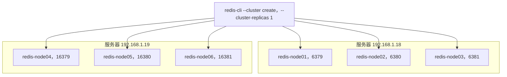

# 部署 Redis 集群：六节点、三主三从与跨槽读写验证

MySQL 侧已经全部收口，缓存层跟上。单台 Redis 顶不住写入也扛不住故障，这一课用 Redis 的 cluster 模式搭一套「三主三从」：六个节点摊在两台机器上，数据按插槽切分，主节点各管一段，从节点随时准备顶班。搭完用一条 set 命令验证数据怎么跨节点落位。

## 先给结论

- 六节点规划：node01 到 03 在 192.168.1.18，端口 6379、6380、6381，规划为主节点；node04 到 06 在 192.168.1.19，端口 16379、16380、16381，规划为从节点，主从分机部署。
- 容器用 `redis:5.0.2` 与 host 网络，关键参数三件套：`--cluster-enabled yes`、`--cluster-config-file nodes-node-0X.conf`、`--port`。
- 组建集群一条命令：`redis-cli --cluster create` 六个节点地址 `--cluster-replicas 1`，确认 yes 后集群成型。
- Redis 5.0 不按书写顺序定主从，而是随机挑三个主；本例 6379、6380、16379 当选，与规划表不同，但不影响使用。
- 验证看三处：`cluster nodes` 里主从与插槽段、`cluster info` 里状态 ok、`redis-cli -c` 下 set 被 MOVED 重定向后 get 照样取回。

## 一、规划、建卷、建容器

集群模式的 Redis 对「节点身份」有三个要求：每个节点开集群开关、指定自己的集群配置文件名、占一个端口。先按规划建好六个数据卷（1.18 上建 node01 到 03 的，1.19 上建 node04 到 06 的），再创建容器：

```bash
# 每个节点一个数据卷：1.18 建前三个，1.19 建后三个
docker volume create redis-node01
docker volume create redis-node02
# ... redis-node03 到 redis-node06 依规划创建

# 创建容器（host 网络，容器端口即宿主机端口）
docker create --name redis-node01 --net host -v redis-node01:/data redis:5.0.2 \
  --cluster-enabled yes --cluster-config-file nodes-node-01.conf --port 6379

# node02 到 node06 同款，只改三处：容器名、数据卷名、配置文件序号与端口
# 例如 1.19 上的 node04：端口 16379
docker create --name redis-node04 --net host -v redis-node04:/data redis:5.0.2 \
  --cluster-enabled yes --cluster-config-file nodes-node-04.conf --port 16379
```

`--cluster-config-file` 是节点记录集群状态的文件，六个节点必须各用各的名字，互相覆盖会把拓扑信息搅乱。启动分机器走：1.18 上 `docker start redis-node01 redis-node02 redis-node03`，1.19 上启动 node04 到 06，`docker ps` 核对六个全 Up。

课堂在这里踩了一个复制的坑：建 node04 到 06 时，命令是从 node03 那行复制的，数据卷与配置文件名忘改，容器起了但节点身份是错的，只能 `docker stop`、`docker rm` 删干净，连数据卷一起删掉重建。复制改不干净是批量建容器的头号事故源，建完逐行核对参数比事后排错便宜得多。

## 二、组建集群：一条命令，随机定主从

六个节点都跑起来只是六座孤岛，cluster 模式下它们还互相不认识。进入 node01 所在容器，先确认进程可用，再执行组集群命令：

```bash
docker exec -it redis-node01 bash
redis-cli
127.0.0.1:6379> ping
PONG
```

```bash
# 仍可在任意一个节点所在机器执行，六个地址都要写全
redis-cli --cluster create \
  192.168.1.18:6379 192.168.1.18:6380 192.168.1.18:6381 \
  192.168.1.19:16379 192.168.1.19:16380 192.168.1.19:16381 \
  --cluster-replicas 1
# 输出主从分配方案与插槽划分，确认无误后输入 yes
```

`--cluster-replicas 1` 的意思是每个主节点配一个从节点，六个节点正好三主三从。两处细节值得记：讲义里的节点 IP 有笔误，执行前按规划表逐个修正，地址写错握手就失败；主从的分配在 Redis 3.x 按书写顺序「前三主后三从」，5.0 则随机选主，本例最终 6379、6380、16379 当选主节点，16380、6381、16381 成为它们各自的从库，与规划表的设想不同，但每个主都带从、插槽全覆盖，集群功能不受影响。



图里是组建时的输入侧：命令把六个节点连成一个握手网络，握完手由集群自己挑主配从、切分插槽，机器分居两台保证了主从不会随单机故障一起消失。

## 三、验证：插槽、主从与跨槽读写

集群成型后先看全景：

```bash
redis-cli -c
127.0.0.1:6379> cluster info
# cluster_state:ok，known_nodes:6
127.0.0.1:6379> cluster nodes
# 每个节点的角色与插槽段：三个主各占一段，三段合起来覆盖 0~16383
```

再做一个最直观的测试。cluster 模式下数据按 key 算插槽（slot）落位，写入的 key 不属于当前节点时，节点会把请求重定向过去：

```bash
127.0.0.1:6379> set abc 123
-> Redirected to slot [7638] located at 192.168.1.19:16379
OK
127.0.0.1:16379> get abc
"123"
127.0.0.1:16379> del abc
```

在 6379 上写 `abc`，请求被 MOVED 重定向到 1.19 上的 16379，`get` 又原样取回，跨节点读写链路完整。这一步能通，说明插槽分配、节点互联、重定向协议全部正常，Redis 集群部署完成。至于高可用：某个主节点宕机，它对应的从节点会在集群内部晋升为主，插槽归属随之转移，读写不中断，这正是坚持「每个主都要有从、主从分机部署」的意义。

## 常见误区

- **复制建容器命令忘改参数。** 数据卷与 `--cluster-config-file` 还是别的节点的名字，节点身份错乱或配置互相覆盖。六个容器的三处参数（卷名、配置文件序号、端口）逐个核对。
- **不带 `-c` 连集群。** 普通 `redis-cli` 不跟随 MOVED 重定向，跨槽写入直接报 `(error) MOVED 7638 ...`，像是出了故障，其实是客户端参数问题。集群读写要加 `-c`。
- **主从节点塞进同一台机器。** 主和从同机时机器一挂，一对节点同时消失，插槽没有接盘的，集群直接降级。规划表上把主从错开到 1.18 与 1.19 就是为了这个。
- **凑不齐三主还想开集群。** `--cluster-replicas 1` 要求节点数是 3 的倍数，少于 6 个时分配不出三主三从，组建命令直接报错。

## 面试可能被问到的问题

1. 面试官追问：「Redis cluster 和主从加哨兵方案的区别是什么？」
   答：主从加哨兵解决的是高可用，写入仍然集中在一个主节点；cluster 在此之上做了数据分片，16384 个插槽按 key 分布到多个主节点，写入能力与容量随节点数扩展。数据量大、写入高时选 cluster，纯粹要主从热备时用哨兵方案。

2. 面试官追问：「一个 key 是怎么决定存到哪个节点的？」
   答：对 key 做 CRC16 校验后对 16384 取模得到插槽号，每个主节点负责一段插槽区间，客户端写 key 时由集群把请求重定向到该插槽所在的主节点。带 `-c` 参数的 redis-cli 会自动跟随 MOVED 重定向。

3. 面试官追问：「为什么插槽是 16384 个？」
   答：节点间心跳包要携带自己负责的插槽位图，16384 个槽的位图是 2K 字节，心跳里放得下；集群设计上限约 1000 个节点，16384 已经足够切分，再大只会白白加大心跳开销。

4. 面试官追问：「主节点挂了集群会怎样？」
   答：该主节点的从节点发起选举并晋升为主，接手它那段插槽，集群状态恢复；原主回归后以从节点身份加入。若一个主节点没有可用从节点，对应插槽不可写，集群会标记失败，所以每个主都要配从且主从分机。

5. 面试官追问：「`--cluster-replicas 1` 是什么意思，换个数字会怎样？」
   答：表示每个主节点配 1 个从节点，6 个节点即三主三从。配 2 则需要每个主带两个从，节点总数要相应增加；数字越大冗余越高，资源消耗也越大，按故障容忍度与成本权衡。

## 配套资料

- 本课无配套源码包：`materials/code/03/day18-项目发布以及各种服务集群搭建/` 目录下仅有解压清单
  `_extracted.json`（解压文件数为 1，内容为房源抓取测试数据 `data.json`）。
- 六节点规划表、建卷与 `docker create` 参数、组集群命令与 set/get 验证过程抄录自本课画面与讲解；
  未逐条展示的容器创建命令按 node01 同款写法补全，组集群命令中的节点地址按规划表修正
  （画面讲义中 IP 存在笔误）；`cluster info` 与 `cluster nodes` 的说明为按本课输出整理的示例。
