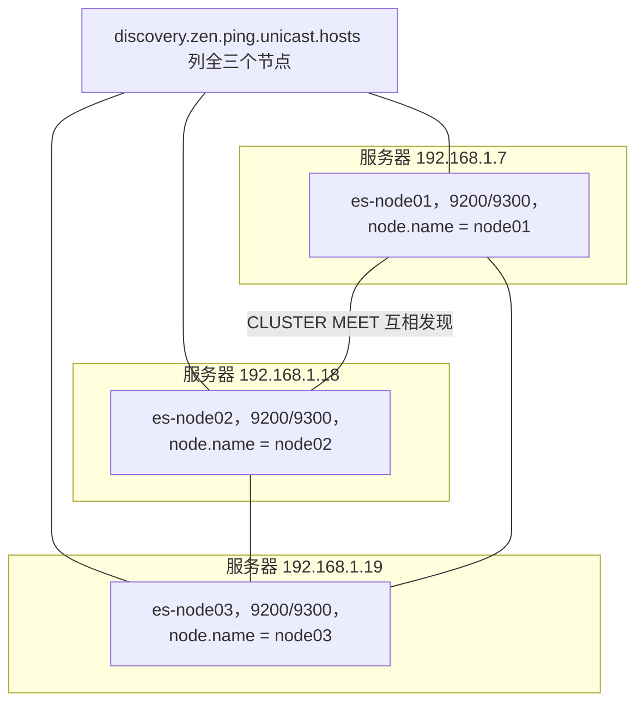

# 部署 Elasticsearch 集群：三节点规划、两处启动排障与索引库数据导入

MySQL 侧的主从、PXC、MyCat、HAProxy 已经部署完毕，Redis 集群也收了口，轮到搜索层。单节点的 Elasticsearch 扛不住生产环境的检索压力，这一课把之前单机跑着的 ES 扩成三节点集群，部署在 192.168.1.7、1.18、1.19 三台机器上，随后把房源搜索用的索引库建起来、测试数据灌进去，搜索服务才算真正具备上线条件。

## 先给结论

- 三节点规划：es-node01 在 192.168.1.7、es-node02 在 192.168.1.18、es-node03 在 192.168.1.19，每台机器一个节点，端口统一 9200 与 9300。
- 配置文件不用从零写：复用单机部署留下的 es-cluster 目录，保留 `elasticsearch.yml`、`jvm.options` 与 IK、拼音两个分词器插件，删掉旧 node 目录，改好配置后用 `scp` 整目录分发到另外两台。
- 集群配置三件事：`node.name` 各自命名；`discovery.zen.ping.unicast.hosts` 列全三个节点；`discovery.zen.minimum_master_nodes` 设为 2（3 个节点取 3 除以 2 加 1），防脑裂。
- 启动路上两个经典坑：data 目录权限不足要 `chmod -R 777`，内核参数 `vm.max_map_count` 太小要写入 `/etc/sysctl.conf` 并生效。
- Docker 部署时 `network.host` 必须写宿主机真实 IP，写 `0.0.0.0` 会让节点拿到 Docker 生成的错误地址，集群连不上；改完重启，head 界面集群绿色，node03 被选举为主节点。
- 索引库 haoke 建 6 个分片 1 个副本，配好拼音分词器；数据导入沿用之前的 bulk 批量逻辑，200 条一批，RestClient 地址改成三个节点的 9200。

## 第1部分：部署 Elasticsearch 集群

### 节点规划与目录整理

三个节点分布三台机器，每台一个节点：

| 服务 | 端口 | 服务器 | 容器名 |
|---|---|---|---|
| es-node01 | 9200, 9300 | 192.168.1.7 | es-node01 |
| es-node02 | 9200, 9300 | 192.168.1.18 | es-node02 |
| es-node03 | 9200, 9300 | 192.168.1.19 | es-node03 |

宿主机 `/haoke/es-cluster` 目录里躺着单机部署时的全部家当：旧 node01、node02、node03 三个节点目录，IK 分词器与拼音分词器两个插件，以及配置文件。整理动作是：把 `elasticsearch.yml` 与 `jvm.options` 移到 es-cluster 根目录，删掉三个旧 node 目录，两个分词器插件保留。这样根目录下剩四样东西：配置、JVM 参数、两个插件，正好是每个节点都需要的内容。

### 修改配置文件

按集群需求改 `elasticsearch.yml`，改完的完整配置：

```yaml
# 集群名，三个节点必须一致
cluster.name: es-haoke-cluster
# 节点名，每台机器各自命名
node.name: node01

# 允许被选举为 master 节点
node.master: true
# 允许作为数据节点
node.data: true

# 绑定地址：非 Docker 部署可写 0.0.0.0，Docker 部署必须写宿主机真实 IP
network.host: 192.168.1.7
# HTTP 服务端口
http.port: 9200

# 集群发现，列全三个节点
discovery.zen.ping.unicast.hosts: ["192.168.1.7", "192.168.1.18", "192.168.1.19"]
# 防脑裂：最小 master 候选节点数，3 个节点取 2
discovery.zen.minimum_master_nodes: 2

# 允许跨域，head 插件连接需要
http.cors.enabled: true
http.cors.allow-origin: "*"
```

几点说明：`network.host` 第一次可以先按 `0.0.0.0` 配，含义是所有 IP 都能访问，非 Docker 部署时这样最省事，Docker 环境的坑后面单独讲；`node.master` 与 `node.data` 声明节点既能参与选举也能存数据；`discovery.zen.minimum_master_nodes` 取 2 的依据是法定多数，3 个节点按「除以 2 加 1」算出 2，少于这个数选不出主。`jvm.options` 里初始堆与最大堆都是 512m，测试机资源有限，直接沿用。

### 创建容器与启动排障

容器继续用 host 网络与挂载配置的方式创建，先在 1.7 上建第一个节点（旧的同名容器先删除）：

```bash
docker create --name es-node01 --net host \
  -v /haoke/es-cluster/elasticsearch.yml:/usr/share/elasticsearch/config/elasticsearch.yml \
  -v /haoke/es-cluster/jvm.options:/usr/share/elasticsearch/config/jvm.options \
  -v /haoke/es-cluster/data:/usr/share/elasticsearch/data \
  -v /haoke/es-cluster/ik:/usr/share/elasticsearch/plugins/ik \
  -v /haoke/es-cluster/pinyin:/usr/share/elasticsearch/plugins/pinyin \
  elasticsearch:6.5.4
```

启动并不顺利，接连踩了两个坑。第一个坑是配置文件写重了，某个配置在文件里出现两次，ES 启动直接报配置解析错误，删掉重复项再启动，又换成新报错：`java.nio.file.AccessDeniedException`，进程想往 data 目录写数据但没有权限。data 目录是挂载的宿主机目录，属主不是容器内进程，给足权限：

```bash
chmod -R 777 /haoke/es-cluster/data
```

再启动，node01 正常跑起来了。

### 分发目录到另外两台机器

单机验证通过后，把整个 es-cluster 目录拷贝到另外两台机器，配置与插件一次到位：

```bash
# 在 1.7 上执行，拷贝到 1.18
scp -r /haoke/es-cluster root@192.168.1.18:/haoke/

# 拷贝到 1.19
scp -r /haoke/es-cluster root@192.168.1.19:/haoke/
```

每台机器拿到目录后做两件事：删掉 data 目录里的内容（目录本身保留，权限问题已经领教过），改 `node.name`。1.18 上改成 `node02`，容器名与挂载路径同步改为 es-node02；1.19 上同理改成 `node03`，其余配置不动。之后按同一份 `docker create` 命令分别创建容器。

node02 启动时又遇坑，这次是内核参数：ES 要求的 `vm.max_map_count` 没有配置，启动日志里有明确提示。按日志提示把参数写入系统配置并生效：

```bash
# 编辑 /etc/sysctl.conf，在最后一行加入
vm.max_map_count=262144

# 使配置生效，并确认参数已存在
sysctl -p
```

node03 需要同样的修改，一并配好。1.18 与 1.19 上的 data 目录权限也别忘了，与 1.7 相同处理。

### network.host 的坑与集群验证

三个节点全部启动后连接 head，却发现集群连不上。翻节点日志找到关键一行：节点没有拿到正确的 IP 地址，拿到的是 Docker 为容器生成的地址。原因正是前面埋下的伏笔：`network.host` 写成 `0.0.0.0` 时，Docker 环境下 ES 会取到容器内部那个不合适的地址，节点间用错误地址互相发现，集群自然组不起来。非 Docker 部署时 `0.0.0.0` 没问题，用 Docker 部署就必须写具体 IP。

三台机器分别改自己的真实地址：1.7 上写 `192.168.1.7`，1.18 上写 `192.168.1.18`，1.19 上写 `192.168.1.19`。三个容器全部停止后重新启动：



图里是集群成型的两条路径：发现配置让每个节点知道去哪找同伴，节点间经 `CLUSTER MEET` 互相发现后按法定多数选出主。刷新 head 界面，集群状态绿色，三个节点都在线，其中 node03 被选举为主节点，其余作为数据节点工作。集群部署完成。

## 第2部分：部署 Elasticsearch 集群之创建索引库以及导入数据

### 创建索引库与 mapping

集群有了，把搜索业务的索引库建起来。用 REST 客户端向集群发起 PUT 请求，请求体带 settings 与 mappings，重点是把之前装好的拼音分词器用上：

```json
{
    "settings": {
        "index": {
            "number_of_shards": 6,
            "number_of_replicas": 1,
            "analysis": {
                "pinyin_analyzer": {
                    "tokenizer": "my_pinyin"
                },
                "tokenizer": {
                    "my_pinyin": {
                        "type": "pinyin",
                        "keep_separate_first_letter": false,
                        "keep_full_pinyin": true,
                        "limit_first_letter_length": 16,
                        "lowercase": true,
                        "remove_duplicated_term": true
                    }
                }
            }
        }
    },
    "mappings": {
        "dynamic": false
    }
}
```

分片数 6、副本数 1：6 个分片摊到 3 个节点上，head 里能看到 node01 持有分片 1、2、3、5，node02 持有 0、2、4、5，node03 持有 0、1、3、4，每个主分片的副本都落在别的节点上。拼音分词器配置了全拼模式，供后面按拼音搜索房源使用。请求发送后返回 200，索引库 haoke 创建完成，此时还没有数据。

### 批量导入测试数据

导入逻辑沿用之前写的 ES 工程，改两处就能对准新集群：RestClient 的地址从单节点改成三个节点，各接 9200；数据文件还是之前抓取房源时留下的 `data.json`。批量写入用 bulk 风格，每行文档前拼一行索引动作描述，200 条发一批：

```java
@Test
public void testBulk() throws Exception {
    Request request = new Request("POST", "/haoke/house/_bulk");
    StringBuilder sb = new StringBuilder();
    String createStr = "{ \"index\": { \"_index\": \"haoke\", \"_type\": \"house\" } }";
    // 读取抓取好的房源数据，每行一个文档
    List<String> lines = FileUtils.readLines(new File("F:\\code\\data.json"), "UTF-8");
    int count = 0;
    for (String line : lines) {
        sb.append(createStr + "\n");
        sb.append(line + "\n");
        if (count >= 200) {
            // 每 200 条发送一批，避免单次请求体过大
            request.setJsonEntity(sb.toString());
            this.restClient.performRequest(request);
            count = 0;
            sb = new StringBuilder();
        }
        count++;
    }
    // 收尾：不足一批的剩余数据也要发送
    if (!sb.toString().isEmpty()) {
        request.setJsonEntity(sb.toString());
        this.restClient.performRequest(request);
    }
}
```

执行结束，到 head 里刷新索引 haoke，数据已经导入，文档数量与之前的单机版本一致，字段结构原样保留。集群搭建、索引创建、数据导入三步全部完成，整个 ES 集群到此才算部署结束，搜索服务可以切到这套集群上运行。

## 常见误区

- **Docker 部署时把 `network.host` 写成 `0.0.0.0`。** 裸机部署这样写没问题，Docker 环境下节点会取到容器生成的不合适地址，集群互认失败。Docker 部署一律写宿主机真实 IP。
- **data 目录不做权限处理。** 挂载进容器的宿主机目录属主与容器内进程不一致，`AccessDeniedException` 一启动就撞上；同理，内核参数 `vm.max_map_count` 不调，第二个节点就起不来。这两个坑每台机器都要过一遍。
- **`discovery.zen.minimum_master_nodes` 随手设成 1。** 3 个节点取 1 等于放弃防脑裂保护，两个分区各自选主、数据各写各的。取值按「节点数除以 2 加 1」，3 个节点就是 2。
- **索引库的副本数设 0 就上线。** 副本 0 时任何一台机器故障，它上面的分片数据直接不可用；集群环境至少 1 个副本，主分片与副本自动错开节点放置。

## 面试可能被问到的问题

1. 面试官追问：「为什么 master 候选数要设成节点数的一半加一？」
   答：这是法定多数原则。选主需要多数派同意，低于半数加一时网络分区两边的节点数可能都达到阈值，各自选出主，产生双主（脑裂）。设为多数后，少数派那边凑不够票数，永远选不出主，集群只有一个决策中心。

2. 面试官追问：「分片数和副本数怎么定，能不能改？」
   答：分片数决定并行度与容量上限，创建索引时定死，之后不能修改，只能重建索引或用别名切换；副本数可以随时动态调整。定分片数要结合数据量与节点数，单分片建议不超过几十 GB，且分片数是节点数的整数倍左右更利于均衡。

3. 面试官追问：「bulk 批量导入为什么按批发送，批多大合适？」
   答：bulk 请求在一次 HTTP 往返里处理多个写操作，按批发送能摊薄网络与索引刷新开销；单批过大又会占用过多内存与线程。常见参考值是单批 5 到 15 MB 或几千条文档，本课用 200 条一批属于保守设置，实际要压测定。

4. 面试官追问：「集群健康状态 yellow 和 green 分别代表什么？」
   答：green 表示所有主分片与副本分片都已分配；yellow 表示主分片全部正常，但有副本分片未分配，常见于单节点集群，副本无处安放；red 表示有主分片丢失，对应数据不可读写。集群部署后要看到 green 才算真正健康。

5. 面试官追问：「三节点集群中一个节点宕机，搜索服务会怎样？」
   答：该节点上的主分片不可用，它的副本在其他节点上会被提升为主，读写自动恢复；期间该分片短暂不可写，集群整体仍可用。前提是副本数至少为 1，这就是副本数不能设 0 的原因。

## 配套资料

- 数据：`materials/code/03/day18-项目发布以及各种服务集群搭建/day18-项目发布以及各种服务集群搭建 - 副本/资料/data.json`（导入用的房源测试数据，正文导入代码读取的正是这份文件）
- 本课无其他源码包：`materials/code/03/day18-项目发布以及各种服务集群搭建/` 目录除 data.json 外仅含解压清单 `_extracted.json`。
- 节点规划表、`elasticsearch.yml` 各配置项、scp 与 `sysctl` 命令抄录自本课讲义画面与讲解；`docker create` 命令按单机部署的挂载布局与本课讲解补全为完整形式；索引 settings JSON 与 bulk 导入代码取自课程讲义画面（bulk 路径按 ES bulk API 的正确格式 `/haoke/house/_bulk` 书写）。
