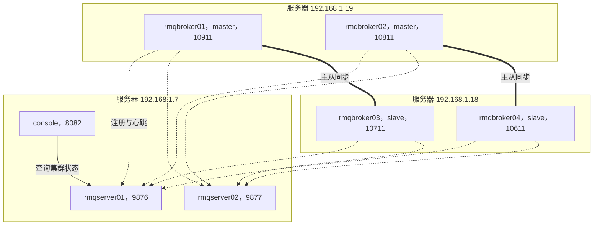

# 部署 RocketMQ 集群：2 主 2 从、双 NameServer 与控制台验证

项目里的 RocketMQ 从开发期就一直是单机单 Master，消息量小的时候它从不出错，可它一挂，房源消息、微聊通知全堵在发送端。上生产的方案在集群模式那一课已经定过型：2 主 2 从，同步双写加异步刷盘。这节课把纸面方案落到三台机器上，容器一台台建，broker.conf 一行行配，中途还会撞上一个「页面里少了一台 Slave」的现场问题。

## 先给结论

- 拓扑分工：两个 NameServer 都在 192.168.1.7（9876、9877）；两个 Master 在 192.168.1.19（10911、10811）；两个 Slave 在 192.168.1.18（10711、10611）；管理控制台也在 1.7，占 8082。
- 同组主从分机部署：broker01 对与 broker02 对都是「主在 1.19、从在 1.18」，机器宕机时同组数据不会一起消失。
- NameServer 是轻量无状态服务，容器用 `-p` 端口映射；Broker 用 host 网络直通宿主机端口（一个 Broker 实占 listenPort 加减 2 共三个端口）。
- broker.conf 四要素：`namesrvAddr` 分号分隔两个地址、`brokerClusterName` 全集群一致、同组主从 `brokerName` 相同、`brokerId` 0 是主非 0 是从。
- 验证看控制台 Cluster 页：两主两从全部在线才算成；Slave 的 `namesrvAddr` 配错时它不会上报，页面上就少一台。

## 一、规划：七件东西各就各位

| 服务 | 端口 | 服务器 | 容器名 |
|---|---|---|---|
| nameserver1 | 9876 | 192.168.1.7 | rmqserver01 |
| nameserver2 | 9877 | 192.168.1.7 | rmqserver02 |
| master broker01 | 10911 | 192.168.1.19 | rmqbroker01 |
| master broker02 | 10811 | 192.168.1.19 | rmqbroker02 |
| slave broker01 | 10711 | 192.168.1.18 | rmqbroker03 |
| slave broker02 | 10611 | 192.168.1.18 | rmqbroker04 |
| console | 8082 | 192.168.1.7 | rmqconsole |

把规划画成拓扑，箭头是注册与发现的方向：



四个 Broker 都向两个 NameServer 注册，同组主从之间另有一条数据同步通道。NameServer 之间互不通信，它们只是各自拿着一份全量路由表；客户端把两个地址都配上，问哪个都一样。

## 二、NameServer：两个轻容器

1.7 上执行，两个容器只差名字、端口与挂载目录：

```bash
# 创建第 1 个 NameServer（第 2 个只把 01 换成 02，端口换 9877）
docker create -p 9876:9876 --name rmqserver01 \
  -e "JAVA_OPT_EXT=-server -Xms128m -Xmx128m -Xmn128m" \
  -e "JAVA_OPTS=-Duser.home=/opt" \
  -v /haoke/rmq/rmqserver01/logs:/opt/logs \
  -v /haoke/rmq/rmqserver01/store:/opt/store \
  foxishwo/rocketmq:server-4.3.2
```

NameServer 不存消息，`store` 目录里只有路由元数据，堆内存 128m 就够跑。挂载 logs 与 store 两个目录，容器删了重建，日志与路由数据还在宿主机。`JAVA_OPTS=-Duser.home=/opt` 是镜像的惯例写法，把运行期用户目录钉在 /opt，避免往容器根目录写文件。

## 三、Broker：配置文件是灵魂

Master 与 Slave 用的是另一个镜像 `foxishwo/rocketmq:broker-4.3.2`，创建命令多一处关键挂载：容器内的 `/etc/rocketmq/broker.conf` 指向宿主机的配置文件。先建目录与文件，再建容器：

```bash
mkdir -p /haoke/rmq/rmqbroker01/conf
vim /haoke/rmq/rmqbroker01/conf/broker.conf
```

broker01（Master）的配置：

```ini
# broker01，master，落在 192.168.1.19
namesrvAddr=192.168.1.7:9876;192.168.1.7:9877
brokerClusterName=haokeCluster
brokerName=broker01
brokerId=0
fileReservedTime=48
brokerRole=SYNC_MASTER
flushDiskType=ASYNC_FLUSH
brokerIP1=192.168.1.19
brokerIP2=192.168.1.19
listenPort=10911
```

四个 Broker 的配置在这份基础上做减法，差异全部列出来：

| 容器 | 机器 | brokerName | brokerId | brokerRole | listenPort |
|---|---|---|---|---|---|
| rmqbroker01 | 192.168.1.19 | broker01 | 0 | SYNC_MASTER | 10911 |
| rmqbroker02 | 192.168.1.19 | broker02 | 0 | SYNC_MASTER | 10811 |
| rmqbroker03 | 192.168.1.18 | broker01 | 1 | SLAVE | 10711 |
| rmqbroker04 | 192.168.1.18 | broker02 | 1 | SLAVE | 10611 |

Slave 还要补一行 `deleteWhen=04`，与 `fileReservedTime=48` 搭配：数据保留 48 小时，每天凌晨 4 点清理过期文件。几个容易配错的键再敲一遍重点：`namesrvAddr` 两个地址用分号分隔，逗号不认；`brokerClusterName` 相同才算同一个集群；`brokerName` 相同才是配对的主从；`brokerId` 是角色开关，0 主非 0 从；`brokerIP1` 与 `brokerIP2` 必须显式写宿主机 IP，否则 Broker 往 NameServer 注册的是容器内网地址，远程生产者拿到的路由根本连不上。两个 Master 同在 1.19，又是 host 网络，`listenPort` 必须手工错开，10911 与 10811 就是这么来的。

Broker 容器的创建命令：

```bash
# 1.19 上创建 master broker01（broker02 只改容器名与挂载路径里的 01 为 02）
docker create --net host --name rmqbroker01 \
  -e "JAVA_OPT_EXT=-server -Xms128m -Xmx128m -Xmn128m" \
  -e "JAVA_OPTS=-Duser.home=/opt" \
  -v /haoke/rmq/rmqbroker01/conf/broker.conf:/etc/rocketmq/broker.conf \
  -v /haoke/rmq/rmqbroker01/logs:/opt/logs \
  -v /haoke/rmq/rmqbroker01/store:/opt/store \
  foxishwo/rocketmq:broker-4.3.2
```

1.18 上的两个 Slave 同款命令，挂载路径换成 rmqbroker03、rmqbroker04。课堂现场在配 Slave 时还差点出错：复制模板后 `brokerClusterName` 与 Master 的不一致，若不是当场发现改齐，这个 Slave 根本进不了集群；批量复制配置文件时，每一处名字类参数都要逐一核对。

## 四、启动、控制台验证与一个真实的现场问题

七个容器的启动有先后：先起两个 NameServer，再起四个 Broker，最后起 console：

```bash
# 1.7：先起两个 NameServer
docker start rmqserver01 rmqserver02
# 1.19：起两个 Master
docker start rmqbroker01 rmqbroker02
# 1.18：起两个 Slave
docker start rmqbroker03 rmqbroker04
# 任一节点跟日志确认
docker logs -f rmqbroker01
```

控制台在 1.7 上 run，镜像与管理工具那一课是同一个，不需要重新拉取：

```bash
docker run -d --name rmqconsole \
  -e "JAVA_OPTS=-Drocketmq.namesrv.addr=192.168.1.7:9876;192.168.1.7:9877" \
  -p 8082:8080 \
  styletang/rocketmq-console-ng:1.0.0
```

浏览器访问 8082 端口进 Cluster 页。课堂现场在这一页出了状况：两个 Master 都在，Slave 却只看到一个。排查方向很明确，某个 Slave 没有成功向 NameServer 注册，注册靠的是配置里的 `namesrvAddr`，逐台核对发现 broker04 的这一项把 NameServer 的 IP 写错了。修复三步：改 1.18 上的 broker.conf，把 `namesrvAddr` 修正为 1.7 的两个地址；停掉再启动容器；跟日志确认它连上了 9876 与 9877 两个 NameServer。刷新 Cluster 页，两主两从齐整，集群状态正常，RocketMQ 集群部署收尾。

## 常见误区

- **Slave 的 `brokerName` 或 `brokerClusterName` 与 Master 不一致。** 前者配不成主从对，后者整个进不了集群；这两项是身份标识，必须与 Master 逐字符一致。
- **`namesrvAddr` 用逗号分隔或只写一个地址。** RocketMQ 只认分号分隔的多地址写法；只写一个地址时，那个 NameServer 重启期间 Broker 的路由更新会断档。
- **两个 Master 沿用同一个 `listenPort`。** host 网络下没有端口隔离，同机多 Broker 端口冲突直接起不来；10911、10811、10711、10611 必须各占一个。
- **`brokerIP1` 留空交给自动探测。** 容器场景下自动探测到的是内网地址，生产者与消费者按注册信息回连必然失败，宿主机 IP 必须显式声明。
- **Master 在线就认为集群健康。** Slave 掉线时写入不中断，但副本已经少了一份，容灾能力悄悄降级；Cluster 页两主两从齐全才是真正的健康态。

## 面试可能被问到的问题

1. 面试官追问：「2 主 2 从里 Slave 能做什么，能写入吗？」
   答：写入只落在 Master，Slave 不接受生产者请求。Slave 持有全量副本，消费者在 Master 积压或不可用时可以从 Slave 读取；Master 宕机时数据不丢，等它恢复即可继续写入，4.3.2 这个版本没有自动主从切换。

2. 面试官追问：「`brokerRole=SYNC_MASTER` 加 `flushDiskType=ASYNC_FLUSH` 是什么取舍？」
   答：同步复制保证消息在主从两台机器上都写入成功才返回成功，单机掉电数据不丢；异步刷盘指消息先写内存页缓存、由后台线程批量落盘。组合下来是「机器级可靠、毫秒级窗口内可能丢少量消息、吞吐高」，要单条不丢可换 `SYNC_FLUSH`，代价是写入延迟明显上升。

3. 面试官追问：「NameServer 部署两个，它们之间同步数据吗？」
   答：不同步。NameServer 是无状态的，每个实例独立维护全量路由，Broker 向所有 NameServer 同时注册与心跳。一个实例宕机，客户端靠另一个照常拿路由；这与 ZooKeeper 那种强一致协调服务的定位完全不同，RocketMQ 故意选了无中心、实现简单的路由方案。

4. 面试官追问：「主从是怎么配对、怎么识别角色的？」
   答：`brokerName` 相同的节点配成一组，组内 `brokerId=0` 的是 Master，非 0 的是 Slave，角色由这个数字唯一决定。Slave 通过与 Master 的连接做增量同步，消费位点也从主侧对齐。

5. 面试官追问：「一个 Broker 实际占几个端口？」
   答：围绕 `listenPort` 展开三个：与客户端交互的 listenPort 本身、主从 HA 同步用的 listenPort + 1、VIP 通道用的 listenPort - 2。配 10911 实占 10909、10911、10912，host 网络下多 Broker 混布时这些暗端口也要避开。

6. 面试官追问：「控制台显示某台 Slave 不在集群里，你会怎么排查？」
   答：先看该 Broker 的日志有没有连上 NameServer，没有的话十有八九是 `namesrvAddr` 配错；再核对 `brokerClusterName`、`brokerName`、`brokerId` 三项身份配置；最后确认机器间 9876、9877 端口网络可达。本课现场就是 IP 写错，改配置重启后恢复注册。

## 配套资料

- 本课无源码包：`materials/code/03/day18-项目发布以及各种服务集群搭建/` 下仅有解压清单 `_extracted.json`（解压文件数为 1，内容为房源抓取测试数据 `data.json`）。
- 规划表、docker create 参数与 broker.conf 各键抄录自本课画面与讲解；broker02 与 broker04 的 listenPort 按讲解口述修正为 10811 与 10611；console 的 `docker run` 命令为按本课写法补全的示例，镜像与参数沿用管理工具一课（`styletang/rocketmq-console-ng:1.0.0`）。
