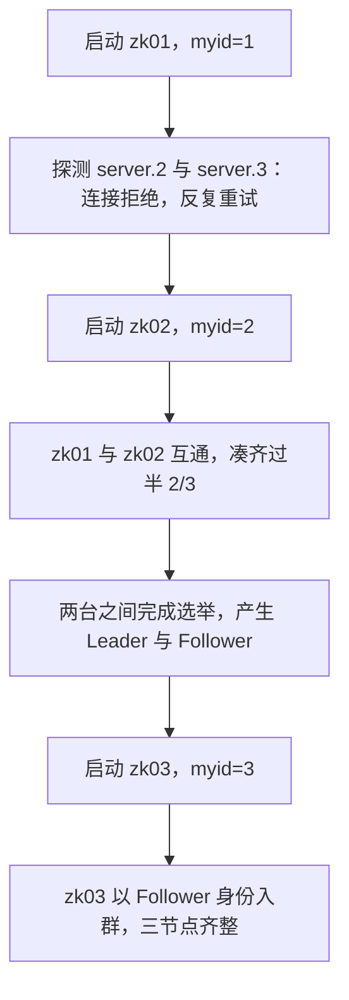

# 部署 ZooKeeper 集群：三节点组网与必须对齐的 3.4 版本

Dubbo 的注册中心从开发期到现在一直是单节点 ZooKeeper，注册中心一挂，服务列表无从查起，整个调用链瘫痪。生产部署要把它扩成三节点集群，命令本身不难，容易翻车的地方在版本号上：开发期用的 3.5 服务端照搬上生产，集群搭得起来却用不了。这节课把三节点集群立起来，也把这个版本陷阱讲透。

## 先给结论

- 三节点规划：zk01、zk02、zk03 落在 192.168.1.7、192.168.1.18、192.168.1.19，三个端口各司其职：2181 对客户端、2888 主从同步、3888 选举。
- 服务端版本从 3.5 降到 3.4：项目客户端驱动是 3.4.x，单节点混用侥幸能跑，集群模式下无法正常工作，两端必须对齐。
- 官方镜像把 zoo.cfg 与 myid 的编写压缩成两个环境变量：`ZOO_MY_ID` 就是 myid 文件的内容，`ZOO_SERVERS` 就是 zoo.cfg 里的 server.1/2/3 三行。
- 启动初期日志里的 `Connection refused` 多数不是故障：节点逐台启动时同伴还没就位，凑够过半自动成群。
- 验证两条路：ZooInspector 连 2181 能看到目录树；四字命令 `ruok`、`stat`、`mntr` 逐节点确认角色与指标。

## 一、规划与版本这个大前提

| 服务 | 端口 | 服务器 | 容器名 |
|---|---|---|---|
| zk01 | 2181, 2888, 3888 | 192.168.1.7 | zk01 |
| zk02 | 2181, 2888, 3888 | 192.168.1.18 | zk02 |
| zk03 | 2181, 2888, 3888 | 192.168.1.19 | zk03 |

动手前先解决版本问题。开发期项目里装的 ZooKeeper 服务端是 3.5，客户端驱动（依赖里的 zookeeper 客户端包）是 3.4.x，单节点下这两者互相兼容，读写都正常，于是很多人会把 3.5 的惯性带进集群。集群场景下结果完全不同：三节点服务端配 3.4.x 的客户端驱动，访问直接出问题，集群搭得起来却不能正常工作。解法只有一种：服务端退回 3.4，与驱动版本统一。这条是整个部署的前置条件，版本不齐，后面全白做。

三个端口也值得在动手前分清：2181 是客户端端口，应用与工具都连它；2888 是 Leader 与 Follower 之间的数据同步端口；3888 是选举端口，选主投票走它。后两个只在集群内部使用。

## 二、三条命令起三个节点

```bash
# 拉取镜像，注意是 3.4，不是开发期的 3.5
docker pull zookeeper:3.4

# 192.168.1.7 上创建 zk01
docker create --name zk01 --net host \
  -e ZOO_MY_ID=1 \
  -e ZOO_SERVERS="server.1=192.168.1.7:2888:3888 server.2=192.168.1.18:2888:3888 server.3=192.168.1.19:2888:3888" \
  zookeeper:3.4

# 192.168.1.18 上创建 zk02：只把 ZOO_MY_ID 换成 2
# 192.168.1.19 上创建 zk03：只把 ZOO_MY_ID 换成 3
```

三台机器各建一个容器，命令几乎一模一样，唯一的差别是 `ZOO_MY_ID`，分别取 1、2、3。`ZOO_SERVERS` 三台完全相同，每个节点都要把包括自己在内的三个成员写全。

这套环境变量背后是 ZooKeeper 集群配置的两个必备件。传统部署要先写 `/conf/zoo.cfg`：

```text
# zoo.cfg（容器内由环境变量生成，这里给出等价的手写版本）
clientPort=2181
dataDir=/data
server.1=192.168.1.7:2888:3888
server.2=192.168.1.18:2888:3888
server.3=192.168.1.19:2888:3888
```

再在 dataDir 下放一个 myid 文件，内容只有一个数字，1 号机器写 1，2 号机器写 2。节点启动后拿 myid 里的数字与 zoo.cfg 的 server.x 对号入座，才知道自己是谁、同伴是谁。官方镜像把这两件事自动化了：`ZOO_SERVERS` 渲染成 zoo.cfg 的 server 行，`ZOO_MY_ID` 写进 myid 文件。理解了对应关系，排查配置问题时就不会被这两个变量唬住。

## 三、启动日志：先报错、后成群

按 01、02、03 的顺序逐台启动，第一台的日志立刻刷出这样的告警：

```text
[myid:1] - WARN  [QuorumCnxManager@554] - Cannot open channel to 3 at election address /192.168.1.19:3888
java.net.ConnectException: Connection refused (Connection refused)
        at java.net.Socket.connect(Socket.java:589)
        at org.apache.zookeeper.server.quorum.QuorumCnxManager.connectOne(QuorumCnxManager.java:558)
        at org.apache.zookeeper.server.quorum.QuorumCnxManager.lookForLeader(FastLeaderElection.java:610)
```

zk01 起来时去敲 zk02、zk03 的 3888 选举端口，对方还没启动，连接被拒。这不是故障，是逐台启动的必然过程。三节点的集群要求过半存活，也就是至少 2 台，选主才能进行：



第三台启动完成，日志从连接告警转为角色确认，集群成型。判读这类日志的要点是看告警是否随节点到齐而停止：启动窗口期的拒绝连接属正常，节点全部启动后仍在滚动报错，才需要回头查网络与配置。

## 四、验证：可视化工具与四字命令

第一条路用资料包里带的可视化工具 ZooInspector，双击 start.bat 启动，连接框填 `192.168.1.7:2181`。连接成功后左侧树里出现 zookeeper 根节点与默认的 znodes，说明客户端到集群的读写通道是通的，开发期的项目把注册中心地址换成集群写法即可接入（dubbo 的 registry 地址按主地址加 backup 的格式写，如 `zookeeper://192.168.1.7:2181?backup=192.168.1.18:2181,192.168.1.19:2181`，为按本课写法补全的示例）。

第二条路是 ZooKeeper 自带的四字命令，向任意节点的 2181 端口发一个四个字母的单词就能拿到状态：

```bash
# 存活检查，返回 imok 即正常
echo ruok | nc 192.168.1.7 2181
# 角色信息，Mode 一行标明 leader 或 follower
echo stat | nc 192.168.1.7 2181
# 运行指标，对 Leader 而言 zk_followers 应为 2
echo mntr | nc 192.168.1.7 2181
```

三台挨个执行，`stat` 里应该看到一台 Mode 为 leader、两台为 follower，与启动日志的选举结果互相印证。两种手段一个面向人、一个面向脚本，生产巡检常用后者。

## 常见误区

- **服务端 3.5 配 3.4 客户端驱动上集群。** 单节点侥幸能跑，集群下无法正常工作，表现为连接异常或会话不稳定。服务端退到与驱动一致的 3.4，这是本课最大的坑。
- **`ZOO_SERVERS` 里漏写自己。** 三台机器的配置必须都包含 server.1、server.2、server.3 全部三行，只写同伴不写自己，节点对不上号，选主凑不齐。
- **myid 与 server.x 编号对不上。** myid 文件里的数字决定节点认领哪一行配置，编号错位时集群起不来，日志报配置不一致。
- **把启动初期的 `Connection refused` 当故障反复重启。** 逐台启动时这是正常现象，凑齐过半自动消失；反复重启反而把成群过程一次次打断。

## 面试可能被问到的问题

1. 面试官追问：「ZooKeeper 集群为什么通常部署 3 台或 5 台？」
   答：集群可用性由过半机制决定，写入需要过半节点确认才提交，选主也需要过半投票。3 台允许坏 1 台，5 台允许坏 2 台；偶数台不划算，4 台与 3 台的容忍度相同，却多花一台机器。

2. 面试官追问：「2181、2888、3888 三个端口分别是什么？」
   答：2181 是客户端端口，应用与命令行、图形工具都连它；2888 是 Leader 向 Follower 同步数据的端口；3888 是选举端口，节点间投票选主走它。后两个只在集群内部出现，对外只暴露 2181。

3. 面试官追问：「myid 文件和 zoo.cfg 里的 server.x 是什么关系？」
   答：server.x 的 x 是节点编号，myid 文件声明本节点的编号，节点启动时用自己的 myid 去 zoo.cfg 里认领对应那行，从而知道自己的角色候选资格与全部成员列表。两者对不上，节点无法确定身份，集群起不来。

4. 面试官追问：「客户端与服务端版本不一致会出什么问题？」
   答：单节点下 3.4 客户端连 3.5 服务端通常兼容，可以正常读写；集群模式下会话管理与服务端协议的差异暴露，访问无法正常工作。原则是客户端驱动与服务端大版本对齐，本课为此把服务端从 3.5 退回 3.4。

5. 面试官追问：「Leader 挂了会发生什么？」
   答：剩余节点发起重新选举，只要存活节点过半，很快选出新 Leader，服务继续；数据因为过半写入机制不会丢。若存活节点不过半，集群整体不可用，宁可拒绝服务也不返回可能不一致的数据。

6. 面试官追问：「ZooKeeper 集群和 RocketMQ 的 NameServer 有什么本质区别？」
   答：ZooKeeper 是强一致的协调服务，靠过半投票与选主保证一致，牺牲可用性换一致性；NameServer 是无状态的路由服务，实例间不同步，每个实例独立持有全量路由，实现简单、可用性高，但路由短暂不一致靠客户端容错兜底。一个管状态一致性，一个只管路由分发。

## 配套资料

- 本课无源码包：`materials/code/03/day18-项目发布以及各种服务集群搭建/` 下仅有解压清单 `_extracted.json`（解压文件数为 1，内容为房源抓取测试数据 `data.json`）。
- 三节点规划表与 `docker create` 参数抄录自本课画面；zoo.cfg 等价手写版、四字命令与 dubbo 集群 registry 地址为按本课写法补全的可运行示例。
- 验证所用可视化工具 ZooInspector 不随本课资料包提供，真实存放位置在另一项目资料包：`materials/code/07/day02 探花交友-实现首页功能/day02/资料/ZooInspector/`
