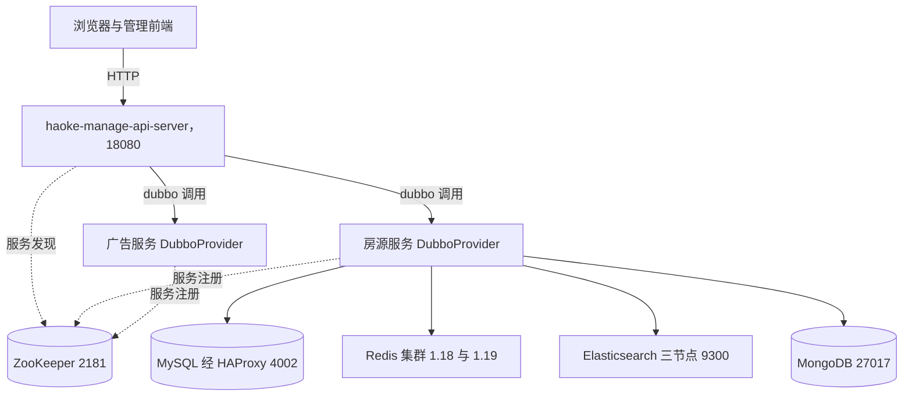

# 打包 haoke-manage 后台：打包插件、集群化配置与三个 jar 的首航

开发期所有服务都在 IDE 里点按钮启动：编译靠 IDE、运行靠 IDE、依赖也由 IDE 喂着。搬到生产环境，机器上只有 JDK 和 Maven，没有 IDE 帮你组装 classpath，一切都要靠一条命令把工程变成能独立运行的产物。这一课把后台系统 haoke-manage 正式打包：给每个要运行的 Spring Boot 模块配上打包插件，把配置从开发期地址换成 day17 与 day18 刚搭好的集群地址，源码上传服务器整体编译，再用 `java -jar` 把三个服务逐一拉起来，看着它们在注册中心报上名来。

## 先给结论

- Spring Boot 工程要打出可执行 jar，pom 里必须显式加 `spring-boot-maven-plugin`，`mainClass` 指到启动类的全限定名，并执行 `repackage` goal，缺一步产出的 jar 都跑不起来。
- 打包前先把 `application.properties` 按生产集群逐项替换：MySQL 走 HAProxy 的 4002 端口，Redis 集群只配 192.168.1.18 上的三个节点，Elasticsearch 三节点走 9300，ZooKeeper 在 1.7 的 2181。
- 编译在父工程根目录整体执行 `mvn install -Dmaven.test.skip=true`，不进各模块单独打包，依赖模块先装进本地仓库，后面的模块才有得引用。
- 真正要运行的是三个 jar：房源服务、广告服务与 api-server，统一拷到 `/haoke/publish/haoke`，`java -jar xxx.jar &` 后台启动。
- 验证看注册中心：ZooInspector 连 2181 能看到 dubbo 目录下注册的服务节点；api-server 启动时报 `haoke.graphqls` 读取失败，这个坑自成下一篇。

## 部署地图：域名与机器先对上号

动包之前把部署格局固定下来。三个要上线的应用各有自己的虚拟域名，后面统一交给 Nginx 做映射，当前阶段先按 IP 直连测试：

| 项目 | 域名 | 机器 |
|---|---|---|
| haoke-manage-api-server | api.manage.haoke.com | 192.168.1.7 |
| haoke-manage-web | www.haoke.com | 192.168.1.18 |
| haoke-im | im.haoke.com | 192.168.1.19 |

api-server 与全部 dubbo 服务都落在 192.168.1.7 上，域名只是给将来 Nginx 反向代理留的路标。三个服务之间的调用与依赖关系是这样的：



图里的实线是调用，虚线是注册与发现：dubbo 服务启动时把自己注册进 ZooKeeper，api-server 从注册中心拿地址列表发起调用，注册中心挂了只是新服务进不来，已建立的调用不受影响。

## 打包插件：把普通 jar 改造成可执行 jar

Spring Boot 项目的打包分两步，第一步就是在 pom 里加打包插件：

```xml
<build>
    <plugins>
        <plugin>
            <groupId>org.springframework.boot</groupId>
            <artifactId>spring-boot-maven-plugin</artifactId>
            <configuration>
                <!-- 指向本模块启动类的全限定名，按各服务实际类名替换 -->
                <mainClass>com.haoke.manage.dubbo.server.DubboProvider</mainClass>
            </configuration>
            <executions>
                <execution>
                    <goals>
                        <goal>repackage</goal>
                    </goals>
                </execution>
            </executions>
        </plugin>
    </plugins>
</build>
```

**第一，这个插件是「普通 jar」变「可执行 jar」的开关。** `mvn package` 默认产出的是普通 jar，只含本模块的 class，没有启动信息，`java -jar` 直接报错。`repackage` 在 package 之后介入，把原 jar 改造成自包含的 fat jar：依赖全部搬进 `BOOT-INF/lib`，manifest 里写进启动类信息，插件不知道启动类是谁时就换不来这一步，这就是必须显式指定 `mainClass` 的原因。

**第二，`mainClass` 是全限定名。** 从 `src/main/java` 下找到带 `main` 方法的引导类，把完整路径拷进来。房源服务与广告服务各自的模块里都有引导类，api-server 也要同样配置，三个将来要运行的模块一个不落。

**第三，配置写完要检查归属。** 插件加在 Service 模块的 pom 里，打出来的就是该服务的 jar；加错了模块，产物目录里就少一个能跑的东西，启动阶段才会暴露。

## 生产配置：把集群地址逐项替换

第二个动作是改配置。开发期的单机地址全部作废，day17 与 day18 部署的集群才是现在的真实环境。以房源服务的 `application.properties` 为例，逐项过一遍：

```properties
# dubbo 的应用名
dubbo.application.name = dubbo-provider-house-resources
# ZK 注册中心：集群入口写在 1.7
dubbo.registry.address = zookeeper://192.168.1.7:2181
dubbo.registry.client = zkclient

# MySQL：走 HAProxy 的 4002 代理端口（数据源键为按本课写法补全的示例）
spring.datasource.url = jdbc:mysql://192.168.1.19:4002/haoke?useUnicode=true&characterEncoding=utf8
spring.datasource.username = haoke
spring.datasource.password = haoke123

# Redis 集群：只配 1.18 上的三个节点，其余节点客户端自动发现
spring.redis.cluster.nodes = 192.168.1.18:6379,192.168.1.18:6380,192.168.1.18:6381
spring.redis.cluster.max-redirects = 5

# MongoDB：单节点先跑起来，集群化在后续课程
spring.data.mongodb.uri = mongodb://192.168.1.7:27017/testdb

# Elasticsearch：三节点集群，spring-data 走 9300 通信端口
spring.data.elasticsearch.cluster-name = es-haoke-cluster
spring.data.elasticsearch.cluster-nodes = 192.168.1.7:9300,192.168.1.18:9300,192.168.1.19:9300
```

几处改动值得单独说。**Redis 集群为什么只配三个节点：** 配置里的地址只是入口，客户端连上任意一个存活节点后，会通过集群协议拿到全量槽位映射，自动摸清另外三个从节点，`max-redirects` 负责兜底重定向次数。配得少不等于用得少。**Elasticsearch 为什么写 9300：** 9200 是 REST 端口，给 head 插件和 curl 用；spring-data-elasticsearch 走的是节点间通信的 9300，端口写错连不上集群。**ZooKeeper 只写一个地址：** 集群已扩到三节点，客户端靠入口即可发现全体，需要显式容灾时再按主地址加 `backup` 参数的写法补全。

广告服务的配置与房源服务一致，直接把改好的内容拷过去，不用逐行重敲。api-server 再过一遍：ZooKeeper 不动，Redis 从单机改集群，Elasticsearch 换三节点，MongoDB 保持单机，GraphQL 的 SDL 定义与 mock 数据与地址无关，都不用碰。

## 打包、分发与首航

源码上传到 1.7 的发布目录，解压后从父工程根目录整体安装：

```bash
# 服务器上解压源码包（打包成 zip 或 tar.gz 都行，zip 方便）
cd /haoke/publish
unzip haoke-manage.zip
cd haoke-manage

# 父工程根目录整体安装，跳过测试
mvn install -Dmaven.test.skip=true
```

**为什么不进各模块单独打包：** 服务模块依赖 interface 模块，单独编译时依赖要么缺失要么要重新安装一遍，而 reactor 会按依赖顺序逐个构建，父工程根目录一条 `install` 把所有模块按序装进本地仓库，之后各模块的 fat jar 陆续出现在各自的 `target` 目录里。

```bash
# 房源服务模块的产物
cd haoke-manage-dubbo-server/house-resources-dubbo-service/target
ls -lh
# -rw-r--r-- 1 root root 27M ... house-resources-dubbo-service-1.0-SNAPSHOT.jar

# 拷到发布目录并改成短名
cp house-resources-dubbo-service-1.0-SNAPSHOT.jar /haoke/publish/haoke/
cd /haoke/publish/haoke
mv house-resources-dubbo-service-1.0-SNAPSHOT.jar dubbo-house-resources-server-1.0.jar

# 后台启动
java -jar dubbo-house-resources-server-1.0.jar &

# 广告服务与 api-server 同样拷贝、重命名、启动
java -jar dubbo-ad-server-1.0.jar &
java -jar haoke-manage-api-server-1.0-SNAPSHOT.jar &
```

27M 的体积就是 fat jar 的直观证据：全部依赖都在包里，不需要在服务器上再配 maven 仓库。启动日志里能看到 MyBatis-Plus 与 Spring Boot 的横幅，随后是连接 ZooKeeper 的记录。三个 jar 从源码到进程的完整旅程如下：


确认进程在位用 `jps -l`：

```bash
jps -l
# 11774 org.springframework.boot.loader.JarLauncher   房源服务进程
# 12093 org.springframework.boot.loader.JarLauncher   广告服务进程
```

三个进程的显示名都是 `JarLauncher`，这是 fat jar 的启动器，分辨它们靠端口和注册中心，不靠进程名。

## 验证：注册中心里的两声回应

dubbo 服务起没起来，注册中心最有发言权。用资料包里的 ZooInspector 连接 `192.168.1.7:2181`，连接成功后在树上展开 dubbo 目录，能看到刚注册的服务节点，一个对应房源服务，一个对应广告服务。想给某个服务再起一个实例，把 `java -jar` 那条命令重新执行一遍就行，注册中心里同名服务会多一个地址，消费端自动负载。

api-server 的启动没那么顺利，日志当场抛出异常：

```text
2019-02-28 22:29:55.681 ERROR 11774 --- [main] o.s.boot.SpringApplication : Application run failed
org.springframework.beans.factory.UnsatisfiedDependencyException:
  Error creating bean with name 'graphQLController': ...
Caused by: java.io.FileNotFoundException:
  class path resource (haoke.graphqls) cannot be resolved as absolute file path
  because it does not reside in the file system:
  jar:file:/haoke/publish/haoke/haoke-manage-api-server-1.0-SNAPSHOT.jar!/BOOT-INF/classes!/haoke.graphqls
```

两个 dubbo 服务已经稳稳运行并完成注册，api-server 的这个错是下一课的主角：资源明明打进了 jar，却按读文件的方式去拿它，根因与修法值得单独一篇讲透。

## 常见误区

- **不加插件就想 `java -jar`。** 普通 jar 的 manifest 没有启动信息，运行直接报 `no main manifest attribute`。插件配上、`mainClass` 指对、`repackage` 执行，三个条件齐了才产出可执行 jar。
- **钻进单个模块里 mvn package。** 服务模块依赖 interface 模块，依赖没先进本地仓库时编译直接失败。从父工程根目录整体 `install`，让 reactor 按依赖顺序构建，一步到位。
- **前台启动，关终端服务就死。** 不带 `&` 或 `nohup` 的 `java -jar` 挂在当前会话上，SSH 一断进程跟着退出。后台启动后再用 `jps` 确认进程在位。
- **配置照抄开发期单机地址。** Redis 还指单机、Elasticsearch 端口还写 9200，服务能起来，业务一跑就连接异常。打包前把配置按集群部署逐项核对，这是打包工作里最花时间也最值钱的部分。

## 面试可能被问到的问题

1. 面试官追问：「spring-boot-maven-plugin 的 repackage 到底做了什么？」
   答：package 阶段先产出普通 jar，repackage 再把它改造成可执行 fat jar：原 jar 保留为 `.original` 文件，本模块 class 放进 `BOOT-INF/classes`，依赖放进 `BOOT-INF/lib`，manifest 的 Main-Class 指向启动器 JarLauncher，Start-Class 指向 mainClass 指定的启动类。`java -jar` 时由 JarLauncher 负责按嵌套结构加载类并拉起启动类。

2. 面试官追问：「fat jar 和普通 jar 有什么区别？」
   答：普通 jar 只含自身 class，运行时要靠外部 classpath 配齐依赖；fat jar 把依赖全部打进去，自包含、`java -jar` 直接跑，代价是体积大（本课单服务 27M）以及 jar 嵌套结构带来的限制，最典型的是 jar 内资源不能按文件方式读取。

3. 面试官追问：「dubbo 服务也打成 Spring Boot jar，为什么不用脚本直接跑 main？」
   答：引导类统一了启动方式与生命周期，dubbo 的服务暴露与引用都依托 Spring 容器管理，注册、优雅停机沿 Spring 的机制走。与 api-server 保持同一种交付形态，运维上也是一套命令、一套监控口径。

4. 面试官追问：「nohup 和 & 有什么区别？」
   答：`&` 只是把进程放到后台，终端关闭时 SIGHUP 仍可能杀掉它；`nohup` 忽略挂断信号并把输出重定向到 `nohup.out`，两者配合才是脱离会话的后台运行。课程演示用 `&` 简化，生产环境通常配 nohup 或 systemd、supervisor 这类进程管理工具。

5. 面试官追问：「Redis 集群客户端只配置部分节点为什么也能用？」
   答：配置里的节点只是发现入口。客户端连上任意存活节点后，通过集群协议获取全量槽位与节点映射，读写遇到不归当前节点管的键会收到 MOVED 响应，按提示重定向并更新本地拓扑。`max-redirects` 限制重定向次数，入口节点任意一个存活即可完成发现。

6. 面试官追问：「同一份 jar 要在多套环境跑，配置怎么外置？」
   答：Spring Boot 支持命令行参数、`spring.config.location` 指定的外部配置文件、环境变量等多种来源，优先级都高于 jar 内配置。改环境只换配置不换包，同一 jar 在开发、测试、生产各挂一份外部配置，这也是打包发布与配置管理解耦的基本功。

## 配套资料

- 本教学日无源码包：`materials/code/03/day18-项目发布以及各种服务集群搭建/` 下仅有解压清单 `_extracted.json`（解压文件数为 1，内容为房源抓取测试数据 `data.json`）。
- 打包插件 XML、服务配置与启动报错日志抄录自本课画面线，工程名、包名与 jar 名已改为本系列中性命名；数据源片段与 `jps` 输出为按本课写法补全的示例。
- 集群地址口径与 `0289-MySQL集群部署之部署HAProxy.md`、`0290-部署Redis集群.md`、`0291-部署Elasticsearch集群.md`、`0294-部署ZooKeeper集群.md` 一致。
- 验证所用 ZooInspector 工具：`materials/code/07/day02 探花交友-实现首页功能/day02/资料/ZooInspector/`。
