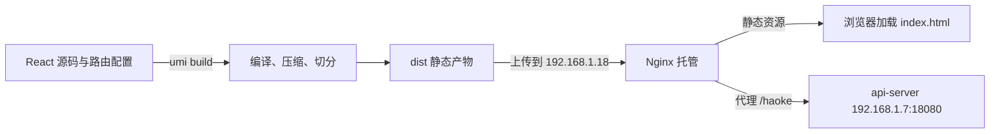

# umi build 交付静态站点：dist 产物、Nginx 托管与代理换位

后端的三个 jar 已经在服务器上跑了起来，前后端分离架构还剩最后一块拼图：后台管理的前端 haoke-manage-web。它的交付物不是 jar，而是一堆静态文件；它的上线方式不是 `java -jar`，而是交给 web 服务器托管。这一课把前端工程用 umi 构建成静态产物，并想清楚两个绕不开的问题：静态页面为什么必须配 web 服务器，开发期好用的接口代理为什么不能带进生产。

## 先给结论

- 前端工程基于 Ant Design Pro 脚手架，构建命令 `umi build`，产物落在 `dist` 目录：一个入口 `index.html` 加上按页面切分的异步 chunk。
- 静态产物必须由 web 服务器对外服务，课程选 Nginx；文件协议直接打开连跨域都过不去，谈不上支撑业务。
- 开发期 `config.js` 里的 `proxy` 只在 `umi dev` 起的本地开发服务器里生效，构建产物里没有这层东西，生产环境要在 Nginx 里用反向代理等价复刻。
- 代理语义为 `/haoke` 打头的请求转给 api-server 的 18080 端口并去掉前缀，Nginx 写法是 `location /haoke/` 配带尾斜杠的 `proxy_pass`。
- 部署位按域名规划落在 192.168.1.18，对应 `www.haoke.com`。

## 构建产物长什么样

前置条件只有一条：装好 Node.js 与 npm 环境，前端工程的依赖由 npm 安装进 `node_modules`，umi 的构建能力就建立在这套依赖上。 Ant Design Pro 工程的构建入口是 umi，讲义里的打包步骤把后端与前端并列：后端 `mvn install` 在打包 haoke-manage 那一课已经完成，前端只执行第二条：

```bash
# 前端工程根目录下执行构建
umi build
# 构建完成后产物在 dist 目录
```

构建结束后工程里多出 `dist` 目录，里面就是要部署的全部：

```text
dist
├── index.html          # 唯一入口页
├── umi.js              # 框架与公共代码
├── umi.css
├── 1.async.js          # 按页面与路由切分的异步模块
├── 2.async.js
├── 3.async.js
└── 52.chunk.js         # 被多个页面共享的代码块
```

文件名里的 `async` 已经说明了它的加载方式：umi 把每个页面编译成独立的异步模块，用户访问哪个页面就拉取对应的 `async.js`，公共代码被抽成共享 chunk 避免重复下载。入口页 `index.html` 负责引用这些产物，浏览器加载它之后，路由切换时按需补拉代码。整条构建管线的去向如下：



## 开发代理为什么不能上生产

开发期请求能落到后端，靠的是 `config.js` 里的一段代理配置：

```javascript
proxy: {
  '/haoke': {
    'target': 'http://127.0.0.1:18080',
    changeOrigin: true,
    pathRewrite: { '^/haoke': '' }
  }
},
```

三个字段各管一件事：`target` 指明转发目标，开发期 api-server 就在本机 18080；`changeOrigin` 把请求头里的 Host 改写成目标地址，免得后端按 Host 校验时翻脸；`pathRewrite` 把 `/haoke` 前缀去掉，前端发的 `/haoke/house/resources` 到后端变成 `/house/resources`。

关键认知是这段代理住在哪里：它不属于前端代码，属于 `umi dev` 启动时拉起的本地开发服务器。开发服务器是个 Node 进程，一边给浏览器吐页面，一边把 `/haoke` 打头的请求转发给后端，浏览器看到的永远是「同源请求」，跨域问题被这个中间人挡掉了。`umi build` 的产物只是静态文件，开发服务器和它的代理配置都不会跟着上线，生产环境里请求 `/haoke/house/resources` 时，如果没有别的东西接住并转发，得到的只能是 404。

## Nginx 托管与代理换位

静态产物交给 Nginx，代理能力在 Nginx 里补齐。配置思路是把开发期代理的两件事原样接过来：托管文件、转发请求（课程画面进行到构建产物为止，Nginx 安装与下述配置为按本课代理语义补全的可运行示例）：

```nginx
server {
    listen       80;
    server_name  www.haoke.com;

    # dist 目录整体上传到服务器，以它为站点根
    root   /haoke/publish/haoke-manage-web/dist;
    index  index.html;

    # 单页应用路由回落到入口页
    location / {
        try_files $uri $uri/ /index.html;
    }

    # 复刻开发期 proxy：/haoke 打头转发到 api-server，并去掉前缀
    location /haoke/ {
        proxy_pass http://192.168.1.7:18080/;
        proxy_set_header Host $host;
    }
}
```

两段 `location` 的分工就是两种资源的分流：命中静态文件的请求由 `root` 直接应答，`/haoke` 打头的接口请求被转发给 1.7 上的 api-server。`proxy_pass` 的尾斜杠在这里是语义的一部分：Nginx 会把 location 匹配到的前缀 `/haoke/` 替换掉再转发，与开发期 `pathRewrite` 的效果完全一致；少了这个斜杠，前缀原样透传，后端按 `/haoke/house/resources` 找路由，直接 404。`proxy_set_header Host $host` 对应开发期的 `changeOrigin`，让后端看到的 Host 与浏览器一致。

## 上线与验证

部署动作按清单走：`dist` 整体上传到 192.168.1.18 的站点根目录，Nginx 装好后加载这份配置（`nginx -t` 校验语法，`nginx -s reload` 热加载）。验证在浏览器里完成：解析好 `www.haoke.com` 后访问首页，`index.html` 与 `umi.js` 由 Nginx 吐出，登录、列表等操作发出的 `/haoke` 请求被代理到 api-server，页面出数据，前端到 dubbo 服务的完整链路就算打通了。至此项目发布篇的全部应用就位：三个 jar 承载后端，一个静态站点承载前端，Nginx 站在浏览器与所有服务之间。

## 常见误区

- **双击 `index.html` 就想用。** 文件协议打开没有域名、没有服务器，接口请求全部跨域失败，代理更无从谈起。静态产物必须交给 web 服务器，这是构建产物与开发环境的本质差异。
- **以为代理配置会跟着构建走。** `proxy` 是 `umi dev` 开发服务器的配置，`umi build` 的产物里没有这层东西。生产等价能力要在 Nginx 里配反向代理，语义逐项对齐：转发目标、Host 改写、前缀重写一个都不能少。
- **`proxy_pass` 丢了尾斜杠。** `/haoke` 前缀原样透传到后端，接口 404，而页面又能正常打开，问题极易被误判成后端故障。尾斜杠决定前缀是否被替换，排查时先看它。
- **只拷 `index.html` 不拷 chunk。** 异步模块与入口页是配套产物，少任何一个，首次加载或路由切换时对应的 js 404，页面白屏。`dist` 目录整体上传，一个文件都别省。

## 面试可能被问到的问题

1. 面试官追问：「前端构建产物为什么必须部署到 Nginx 这类 web 服务器？」
   答：产物是一堆静态文件，业务要的是「稳定地按 URL 提供文件、并转发接口请求」。web 服务器提供域名与端口、长连接、压缩、缓存与代理能力，这些都是文件协议双击打开给不了的。生产部署里 Nginx 还承担负载均衡与限流等入口职责。

2. 面试官追问：「开发环境的代理和生产环境的反向代理有什么区别？」
   答：能力相似、归属不同。开发代理是 `umi dev` 的开发服务器为单人开发提供的便利，浏览器视角全部同源；生产反向代理由 Nginx 承担，面向真实用户，要考虑稳定性、日志与性能。语义上一一对应：target 对 proxy_pass，changeOrigin 对 proxy_set_header，pathRewrite 对前缀替换。

3. 面试官追问：「umi build 产物里的 async 文件是什么，为什么要这么切？」
   答：按路由或页面切分的异步模块，配合共享的公共 chunk。切分后首屏只加载入口与首页代码，访问其他页面时按需拉取对应模块，首屏体积显著变小；公共代码只下载一次。这是构建工具的代码分割能力，路由即分割点。

4. 面试官追问：「proxy_pass 带尾斜杠和不带有什么区别？」
   答：带尾斜杠时，Nginx 会把 location 匹配到的前缀替换为 proxy_pass 的路径部分再转发，例如 `/haoke/xxx` 变成 `/xxx`；不带时原始 URI 原样透传，前缀保留。它是前缀重写最简洁的实现，写错一个斜杠就是一组 404。

5. 面试官追问：「前后端分离下接口与页面不同源，有哪些解法？」
   答：一是反向代理让页面与接口同源，本课的 Nginx 方案，生产最常用；二是后端开启 CORS，按域名放行跨域请求，适合前端独立域名部署；三是网关层统一路由。三者可以叠加，原则是让跨域治理收口在一个明确的层，不散落在业务代码里。

## 配套资料

- 本教学日无源码包：`materials/code/03/day18-项目发布以及各种服务集群搭建/` 下仅有解压清单 `_extracted.json`（解压文件数为 1，内容为房源抓取测试数据 `data.json`）。
- `config.js` 的 proxy 配置、`umi build` 命令与 dist 产物清单抄录自本课画面线；Ant Design Pro 脚手架与 umi 的入门背景见 `0016-ES6新特性之转码器(UmiJS入门).md` 与 `0032-Ant Design Pro入门之简介.md`。
- Nginx 站点与代理配置为按本课代理语义补全的可运行示例，课程画面至构建产物为止，Nginx 安装与域名映射在后续部署收尾内容中完成。
- 后端打包流程见 `0295-打包项目之打包-haoke-manage.md`，api-server 的 18080 接口链路见 `0296-解决读取haoke.graphqls文件失败的问题.md`。
