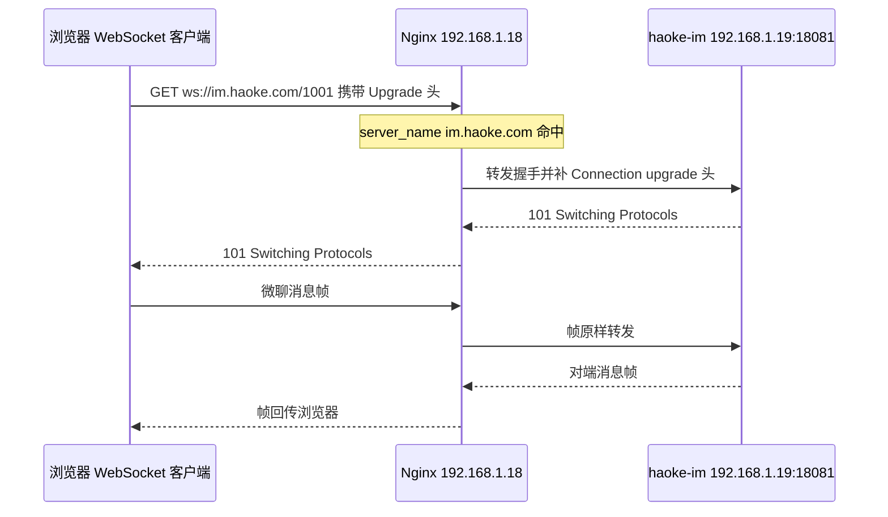

# Nginx 反向代理 WebSocket：Upgrade 头与微聊链路

微聊服务 haoke-im 早已在 1.19 的 18081 端口上线，部署那课的联调方式是浏览器里开两个 WebSocket 客户端直连 `ws://192.168.1.19:18081/1001`。直连 IP 在开发期没问题，生产环境里客户端应该连域名、走统一入口。这一课让 Nginx 把 `im.haoke.com` 的 WebSocket 流量代理到后端。

WebSocket 走的不是普通的请求响应，会话要先做一次协议升级握手。Nginx 默认把每个请求都当普通 HTTP 转发，握手要求的两个请求头不会自动带给后端，后端收不到升级信号，连接建立不起来。解决只需要两行配置，但这两行背后的原理值得讲透。

## 先给结论

- 在普通 http 代理配置的基础上加两行：透传 `Upgrade` 头，并把 `Connection` 头设为 `upgrade`。
- `proxy_read_timeout` 默认 60 秒，长连接静默超过它会被掐断，课程统一调到 600。
- hosts 把 `im.haoke.com` 指到 Nginx 所在的 18，由它转往 1.19，不是直指后端。
- 验证用 WebSocket 客户端把连接地址换成 `ws://im.haoke.com/1001`，状态变为 OPENED、消息互发即通。

## 握手为什么会被 Nginx 挡住

WebSocket 的建连过程是一次特殊的 HTTP 请求：客户端发出 GET，请求头里带着 `Upgrade: websocket` 与 `Connection: Upgrade`，意思是「我想把这条 HTTP 连接升级成 WebSocket」；服务端同意的话返回 101 Switching Protocols，此后这条 TCP 连接上跑的不再是 HTTP 报文，而是 WebSocket 帧。

Nginx 有两个默认行为挡住了这场升级：

**第一，`Connection` 头不透传。** 这个头在代理场景里有特殊职责，Nginx 用它管理自己与后端之间的连接复用，不会原样交给 upstream；后端收不到 `Connection: Upgrade`，就不会启动升级流程。

**第二，upstream 连接默认 HTTP/1.0。** 协议升级机制是 HTTP/1.1 引入的，Nginx 与后端之间的默认协议版本偏低。课程配置没写 `proxy_http_version`，这套环境下握手照样成功，但规范做法是显式声明 `proxy_http_version 1.1`，下面的增强示例里会补上。

## 两行头加一条超时的 server 配置

配置仍在 http 块里追加一个 server，课程实录如下：

```nginx
server {
    listen       80;
    server_name  im.haoke.com;

    proxy_set_header X-Forwarded-Host $host;
    proxy_set_header X-Forwarded-Server $host;
    proxy_set_header X-Forwarded-For $proxy_add_x_forwarded_for;

    location / {
        proxy_pass http://192.168.1.19:18081;
        proxy_connect_timeout 600;
        proxy_read_timeout 600;
        proxy_set_header Upgrade $http_upgrade;
        proxy_set_header Connection "upgrade";
    }
}
```

逐项看新增的部分：

**`proxy_set_header Upgrade $http_upgrade;`** 把客户端请求头里的 `Upgrade` 原样转发，`$http_upgrade` 是 Nginx 对该头的引用变量；客户端没带升级头时它是空串，普通请求不受影响。

**`proxy_set_header Connection "upgrade";`** 显式告诉后端这是一次连接升级。本 server 只服务 WebSocket，写死 `upgrade` 没有问题；如果同一个 server 里还混杂普通接口，就得按请求动态判断。

**`proxy_read_timeout 600;`** 代理读超时从默认 60 秒放宽到 600 秒。这个超时衡量的是「连续多久没从 upstream 读到数据」，WebSocket 长连接一旦静默超过它，Nginx 就会把连接切掉，表象是聊着聊着突然掉线。长期挂机还得靠应用层心跳，600 秒是把调试空间放大。

同一 server 混杂普通请求与 WebSocket 时，按 nginx 官方推荐写法补全的增强示例更稳，`map` 依据请求有无升级头动态给出 `Connection` 的取值：

```nginx
# 无升级头的普通请求给 close，升级请求给 upgrade
map $http_upgrade $connection_upgrade {
    default upgrade;
    ''      close;
}

server {
    listen       80;
    server_name  im.haoke.com;

    location / {
        proxy_pass http://192.168.1.19:18081;
        proxy_http_version 1.1;
        proxy_set_header Upgrade $http_upgrade;
        proxy_set_header Connection $connection_upgrade;
        proxy_read_timeout 600;
    }
}
```

## hosts 与微聊验证

hosts 里补上最后一行，三个域名都落在 18：

```text
192.168.1.18 manage.haoke.com
192.168.1.18 api.manage.haoke.com
192.168.1.18 im.haoke.com
```

`im.haoke.com` 不能直接指到 1.19：域名先把请求送到 Nginx，Nginx 才有机会做协议升级的转发，直指后端就把代理跳过去了。

reload 之后回到浏览器里的 WebSocket 客户端工具（部署微聊那课用过的 Simple WebSocket Client），把直连后端的地址换成域名形式：

```text
原地址  ws://192.168.1.19:18081/1001
新地址  ws://im.haoke.com/1001
```

发起连接，状态变为 OPENED；以 1001 与 1002 两个身份分别接入，互发 `{toId, msg}` 格式的 JSON，消息照常双向到达。链路已经从「客户端直连 IM 服务」变成「客户端、Nginx、IM 服务」三段式：



序列图里的关键节点是两次 101：升级应答从后端逐跳传回浏览器，之后这条连接对两端来说就是一条普通长连接，Nginx 居中只做帧的搬运。至此 `manage.haoke.com`、`api.manage.haoke.com`、`im.haoke.com` 三个域名全部在 Nginx 上就位，前端页面、接口服务、即时通讯各归其位，项目发布的最后一层壳也合上了。

## 常见误区

- **hosts 直指后端 1.19。** 看似也能连上，实际绕过了 Nginx，练不到代理链路；一旦后端换机器或多实例，客户端就得跟着改。域名永远指代理层。
- **location 里写了 `proxy_set_header`，server 级的头全数失效。** 它的继承规则是：当前层级只要出现任意一条，就不再继承上一层的任何头。本课配置里 server 级的 `X-Forwarded-*` 到了带 `Upgrade` 头的 location 其实已经丢了，要两者兼得就把头写全在同一层。
- **不调 `proxy_read_timeout`。** 默认 60 秒静默即断，微聊空闲一会儿就掉线，问题极其隐蔽。长连接服务的代理超时要显式调大，应用层再用心跳兜底。
- **以为 wss 需要后端改造。** HTTPS 在 Nginx 终结，Nginx 与后端之间仍走内网 http，后端代码零改动，客户端把 `ws://` 换成 `wss://` 即可。

## 面试可能被问到的问题

1. 面试官追问：「为什么 Nginx 反向代理 WebSocket 要加 Upgrade 和 Connection 头？」
   答：WebSocket 建连是一次 HTTP 协议升级，依赖请求头的 `Upgrade: websocket` 与 `Connection: Upgrade` 触发 101 响应。Nginx 对 upstream 默认不透传 Connection（它自己用它管理连接复用），Upgrade 也不自动转发，缺了任何一个后端都不会进入升级流程，握手失败。
2. 面试官追问：「proxy_read_timeout 对 WebSocket 连接意味着什么？」
   答：它表示连续多久没从 upstream 读到数据就关闭连接，默认 60 秒。长连接经常长时间无消息，会被反复掐断，表象是偶发掉线。解法是调大超时并配合应用层心跳，让连接上始终有数据流动。
3. 面试官追问：「map $http_upgrade $connection_upgrade 这段配置解决什么问题？」
   答：让 Connection 头按请求动态取值：带升级头的请求给 `upgrade`，普通请求给 `close`。同一个 server 里就能同时服务普通接口与 WebSocket，避免写死 `upgrade` 影响普通请求的连接复用。
4. 面试官追问：「代理 WebSocket 为什么要设 proxy_http_version 1.1？」
   答：协议升级机制是 HTTP/1.1 才有的，而 Nginx 与 upstream 之间默认用 HTTP/1.0。显式升到 1.1 才符合 WebSocket 的握手要求，也是官方文档给出的标准写法。
5. 面试官追问：「WebSocket 集群部署时，Nginx 要不要做会话粘滞？」
   答：粘滞能让同一用户固定连到同一节点，消息只走本地推送；更好的做法是像本项目一样用消息中间件广播跨节点投递，节点无状态、可任意扩缩容，代理层不必绑定会话。权衡的核心是把状态放在代理层还是节点间。
6. 面试官追问：「wss 场景证书配在哪，后端要改吗？」
   答：证书配在 Nginx 的 443 监听上，TLS 在代理层终结，Nginx 与后端之间走内网 http，后端零改动。这是把 TLS 收口在入口层的常见架构，证书续期也只动一处。

## 配套资料

- 本教学日无源码包：`materials/code/03/day18-项目发布以及各种服务集群搭建/` 下仅有解压清单 `_extracted.json`（解压文件数为 1，内容为房源抓取测试数据 `data.json`）。
- server 块配置与测试方式抄录自本课画面线；画面线中 hosts 行抄作 192.168.1.19，按口播「im 域名指向 Nginx 所在的 18、由 18 转往 1.19」取 18。`map` 与 `proxy_http_version 1.1` 增强示例为按 nginx 官方 WebSocket 代理写法补全。
- haoke-im 的部署与直连联调见 `0297-部署-haoke-im系统.md`，WebSocket 协议与 Spring Boot 整合的背景见 `0123-WebSocket简介.md`、`0126-使用SpringBoot整合WebSocket.md`。
