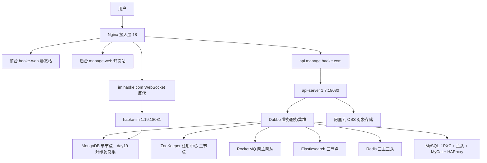

# 好客租房项目部署收官：一天搭五套集群、前后端打包上线，整个项目从开发态进入运行态

写代码和让代码跑在用户面前，是两种能力。好客租房这个项目，业务代码在前面的教学日里已经写完，dubbo 服务、前台 React、后台管理、即时通讯，样样齐备，可它们都只活在开发机里。day18 这一天做的全部事情，就是把这摊东西搬到服务器上，让用户敲一个域名就能访问。这既是 day18 的总结，也是整个项目从开发到上线这条线的收官。

这一天内容密度极高：一张部署架构图、一份部署计划、五套基础服务集群、两种打包方式、四类 Nginx 配置。把每一环的「为什么」串起来，比单独记住哪条命令重要得多，所以在逐项回顾之前，先把方法论和全景图立起来。

## 先给结论

- 部署自底向上：先基础服务集群，再服务层与业务系统，最后接入层 Nginx，顺序反了会反复返工。
- 基础服务全部集群化：MySQL 用 PXC 强一致加主从复制再套 MyCat 分片与 HAProxy 入口；Redis 三主三从；Elasticsearch 三节点；RocketMQ 两主两从；ZooKeeper 三节点。MongoDB 暂留单节点，复制集留到 day19 补齐。
- Spring Boot 项目打包三步：加 `spring-boot-maven-plugin` 插件并指定 `mainClass`、执行 repackage、`mvn install` 出可执行 jar，`java -jar` 启动。
- 前端两条构建路线殊途同归：Ant Design Pro 走 umi 构建，前台 React 工程走 `npm run build`，产物都是静态页面，本质没有区别。
- Nginx 是唯一入口：托管两套静态站，反代 api-server 的接口域名，反代 WebSocket 支撑即时通讯；虚拟域名必须配本机 hosts 才能访问。

## 一、部署架构与部署计划：先算清楚再动手

部署的第一步不是敲命令，是画图和算账。部署架构图回答「有哪些服务、谁依赖谁、哪些要集群」：用户从 `www.haoke.com` 进来，经 DNS 解析到 Nginx 接入层，往下分给后台管理系统、前台系统、即时通讯系统，服务层是 Dubbo 业务服务加 ZooKeeper 注册中心，最底层压着 MySQL、Redis、Elasticsearch、RocketMQ、MongoDB 这批基础服务。自上而下看是依赖关系，自下而上看就是部署顺序。

部署计划回答「落到哪台机器、占哪个端口、需要多少资源」。按架构图从最底层的基础服务开始列清单，每套集群要几个节点、每个节点吃多少内存，累加起来就是所需服务器的下限。企业里做正式项目，资源按计划申请；学习阶段资源有限，多套集群挤在少数几台机器上，个别机器偏卡是正常现象，这不影响方法论的价值：先规划、再分配、后实施，到了企业环境直接把资源放大即可。

## 二、五套基础服务集群：一天搭完

按依赖顺序，这一天依次搭了五套集群。MySQL 最复杂，PXC 集群保证强一致，主从复制做读写分离，MyCat 在上面做分片路由，HAProxy 给 MyCat 做负载均衡入口，四层叠出一个既可横向扩展又不丢数据的完整方案：

```bash
# 主从集群的从库配置（my.cnf），server-id 全局不可重复
[mysqld]
server-id=2
sql_mode=STRICT_TRANS_TABLES,NO_ZERO_IN_DATE,NO_ZERO_DATE,ERROR_FOR_DIVISION_BY_ZERO,NO_ENGINE_SUBSTITUTION

# 主库上建复制账号并授权
create user 'haoke'@'%' identified by 'haoke';
grant replication slave on *.* to 'haoke'@'%';
flush privileges;
```

其余四套都是容器化部署，ZooKeeper 三节点最有代表性，三台机器用 `--net host` 直连网络，靠 `ZOO_MY_ID` 区分身份：

```bash
docker create --name zk01 --net host -e ZOO_MY_ID=1 \
  -e ZOO_SERVERS="server.1=192.168.1.7:2888:3888 server.2=192.168.1.18:2888:3888 server.3=192.168.1.19:2888:3888" \
  zookeeper:3.4
docker create --name zk02 --net host -e ZOO_MY_ID=2 \
  -e ZOO_SERVERS="server.1=192.168.1.7:2888:3888 server.2=192.168.1.18:2888:3888 server.3=192.168.1.19:2888:3888" \
  zookeeper:3.4
docker start zk01 && docker logs -f zk01
```

Redis 搭了三主三从，同样可以在这套基础上继续扩组；Elasticsearch 是最基本的三节点集群；RocketMQ 用两主两从，加上 NameServer 总共六个节点。这些集群无一例外都保留了继续横向扩展的口子，加节点就是加容器加配置。

## 三、项目打包：后端出 jar，前端出静态页

Spring Boot 项目的打包围绕 `spring-boot-maven-plugin` 插件展开，关键是指定启动类全路径并执行 repackage，让普通 jar 变成可执行的 fat jar：

```xml
<plugin>
    <groupId>org.springframework.boot</groupId>
    <artifactId>spring-boot-maven-plugin</artifactId>
    <configuration>
        <!--替换成启动类全路径-->
        <mainClass>cn.example.haoke.dubbo.server.DubboProvider</mainClass>
    </configuration>
    <executions>
        <execution>
            <goals>
                <goal>repackage</goal>
            </goals>
        </execution>
    </executions>
</plugin>
```

```bash
mvn install -Dmaven.test.skip=true
java -jar haoke-dubbo-server.jar
```

打包过程现场还排掉一个坑：工程运行时读取 classpath 下的 GraphQL schema 文件失败，repackage 后资源路径变了，处理方式是调整文件的读取方式让它在 jar 里也能定位到，细节在专门那一课里展开过。

前端这边，后台 Ant Design Pro 工程走 umi 构建，前台 React 工程走 `npm run build`，产物都是一整套静态页面。两条路线看着是两个工具，本质完全一样：把源码编译打包成浏览器直接消费的静态资源，不依赖 Node 服务进程跑在线上。构建产物上传、Nginx 托管、虚拟域名与 hosts 配置，前后台各走过一遍完整流程。

## 四、Nginx 收口：一台机器四个域名

所有对外访问最终都收在 Nginx 上，四个 server 块各管一摊：`manage.haoke.com` 托管后台静态站并把 `/haoke` 前缀的请求代理给 api-server；`api.manage.haoke.com` 承接后台接口域名访问；`im.haoke.com` 反向代理 WebSocket，支撑即时通讯；`www.haoke.com` 托管前台静态站。WebSocket 那份配置最值得单独记：

```nginx
server {
    listen 80;
    server_name im.haoke.com;

    location / {
        proxy_pass http://192.168.1.19:18081;
        proxy_set_header Upgrade $http_upgrade;
        proxy_set_header Connection "upgrade";
    }
}
```

`Upgrade` 与 `Connection` 两个请求头是 WebSocket 反代的命门，少了它们协议升级失败，长连接建立不起来。这套 Nginx 配置在浏览器里全部验证过：后台按域名打开、房源管理数据正常；前台按域名打开、登录后轮播与房源数据照常返回；即时通讯的长连接稳定工作。本地开发环境和线上表现一致，部署才算真正完成。

## 五、全项目全景：从第一行 React 到最终上线

把视角再拉远，看看整个好客租房项目走过的路。这条技术栈的推进线，本身就是一个生活服务类项目从零到一的完整样本：



对应到技术清单，整个项目依次覆盖了这些板块：

| 教学日 | 技术与产出 |
|---|---|
| day01 至 day02 | ES6 与 React 入门，Ant Design 与 Ant Design Pro 后台骨架 |
| day04 至 day05 | Dubbo 服务实现，MyBatis-Plus 入门，OSS 文件上传，GraphQL 服务 |
| day06 至 day07 | GraphQL 服务落地，前台系统搭建，WebSocket 与微聊雏形 |
| day08 | MongoDB 入门，微聊即时通讯功能实现 |
| day09 至 day10 | RocketMQ 消息系统，分布式 WebSocket，地图找房 |
| day13 至 day16 | Elasticsearch 入门与进阶，房源抓取与搜索，Beats、Kibana、Logstash |
| day17 | MySQL 集群方案：主从复制、PXC、MyCat、HAProxy |
| day18 | 部署架构与计划，五套集群，前后端打包，Nginx 收口上线 |
| day19 | MongoDB 复制集与分片，日志与异常编码规范 |
| day20 | 区块链与 Hyperledger Fabric 了解 |

从表里能看出一条刻意的设计：业务开发（day04 至 day10）、数据与搜索（day13 至 day17）、上线部署（day18）、工程规范（day19）层层递进，每一块都为下一块铺路。部署里 MongoDB 留了单节点的尾巴，恰好由 day19 的复制集补上，两天的内容是咬合的。

## 常见误区

- **部署顺序颠倒。** 先起应用后搭基础服务，服务注册不上、数据库连不通，只能反复重启。正确做法永远是先底层后上层，按部署计划逐层向上。
- **只验证启动，不验证链路。** 每个服务进程都活着，不代表用户能访问：域名解析、Nginx 转发、代理前缀、hosts 映射，任何一环断了就是白屏。按用户的完整路径从浏览器一路点下来才算验证。
- **把虚拟域名当真域名。** `www.haoke.com`、`manage.haoke.com` 这类域名只在 hosts 映射后可用，忘了配就怀疑 DNS，方向完全错了。
- **把学习环境的混部当生产架构。** 资源受限把多套集群挤在几台机器上是妥协，企业里必须按部署计划把集群拆开落在独立资源上，容量估算与单机故障域都要重新算。

## 面试可能被问到的问题

1. 面试官追问：「让你负责一个微服务项目的上线，你的部署步骤是什么？」
   答：先出部署架构图理清服务依赖与集群形态，再做部署计划算出所需资源，然后自底向上实施：基础服务集群、注册中心与消息中间件、业务服务、接入层 Nginx，每层落地后做健康检查，最后按用户路径做全链路验证，域名、代理、数据逐项确认。
2. 面试官追问：「Spring Boot 打出的可执行 jar 为什么能直接 java -jar 启动？」
   答：`spring-boot-maven-plugin` 的 repackage 把原始 jar 作为嵌套 jar 重新打包，附带启动器与依赖库，清单里指定了启动类。启动时自定义类加载器加载嵌套依赖，随后调用 `mainClass` 指定的入口，内嵌容器随应用一起拉起。
3. 面试官追问：「为什么用 Nginx 做统一入口，而不是让用户直连各个服务？」
   答：统一入口把域名、证书、静态托管、反向代理、负载均衡收在一处，后端服务的扩容下线对用户透明；跨域问题在同源代理下自然消解；WebSocket 这类协议升级请求也能统一转发。入口收敛还让日志、限流、缓存这些横切能力有了统一的落点。
4. 面试官追问：「Nginx 代理 WebSocket 要注意什么？」
   答：必须显式传递 `Upgrade` 与 `Connection` 两个头，否则协议无法从 HTTP 升级到 WebSocket；代理超时要按长连接的实际情况放宽，避免空闲连接被提前切断；反代目标最好写全后端实例，多实例时还要解决会话粘性或改用消息中间件共享状态。
5. 面试官追问：「多套集群搭在同一台机器上有什么问题？」
   答：资源互相争抢，任何一个组件吃满 CPU 或内存都会拖垮同机的其他服务，故障域也没有隔离，一台机器宕机等于多个中间件同时不可用，高可用形同虚设。学习环境可以接受，生产环境必须按部署计划拆分资源并做好容量规划。
6. 面试官追问：「前端工程的构建产物为什么适合直接交给 Nginx？」
   答：产物是纯静态文件，Nginx 扛静态请求的能力远强于应用服务器；文件名带 hash 可以放心设置长缓存，配合入口页不缓存的策略，既快又能及时更新；后续要扩容或上 CDN，静态站的迁移成本也最低。

## 配套资料

- 本教学日无源码包：`materials/code/03/day18-项目发布以及各种服务集群搭建/` 下仅有解压清单 `_extracted.json` 与房源抓取测试数据 `data.json`（位于 `day18-项目发布以及各种服务集群搭建 - 副本/资料/data.json`）。
- 主从与 ZooKeeper 集群命令、Maven 插件配置、Nginx server 配置抄录自本课画面线；包名与模块名已改为中性命名，`mv` 等整理命令为按本课写法补全的示例。
- 以上是 day18 的收官总结，各环节细节分见 `0283-部署架构讲解.md` 至 `0303-部署-haoke-web项目.md` 各篇；MongoDB 复制集在 `0306-MongoDB复制集之简介.md` 展开。
