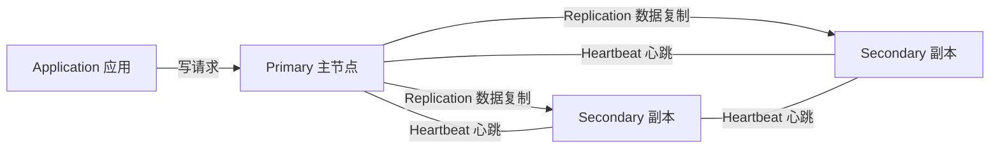
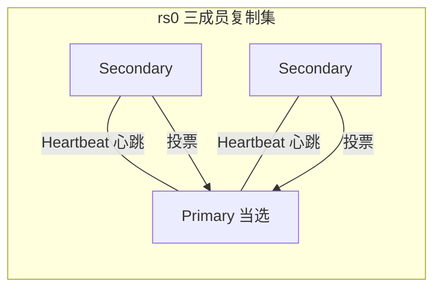
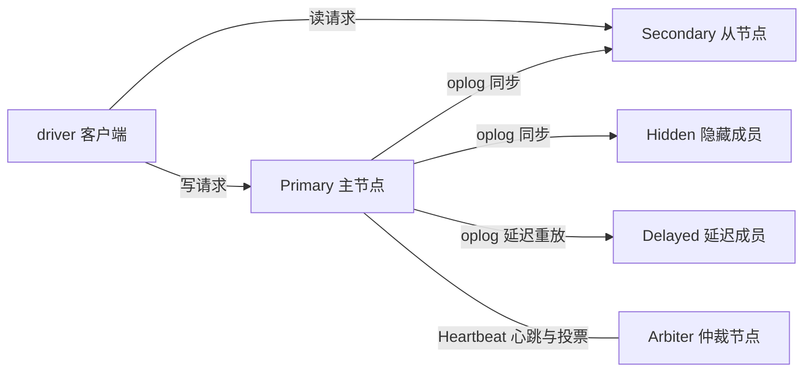
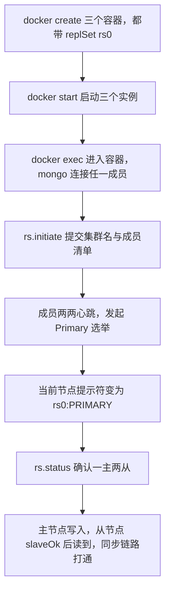
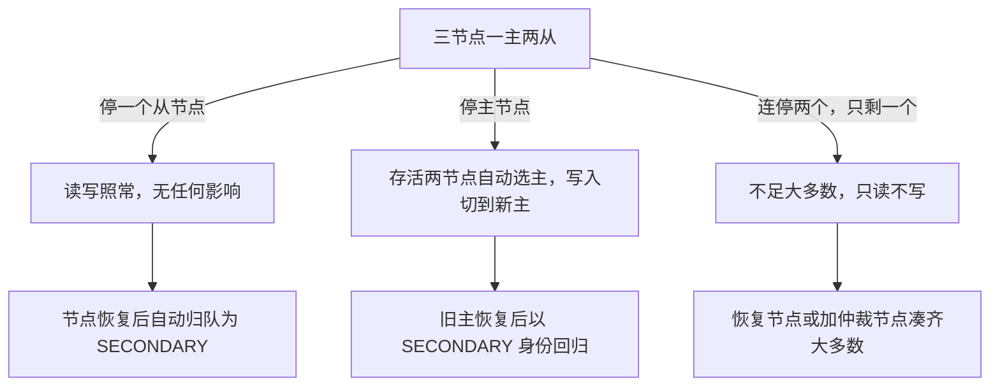
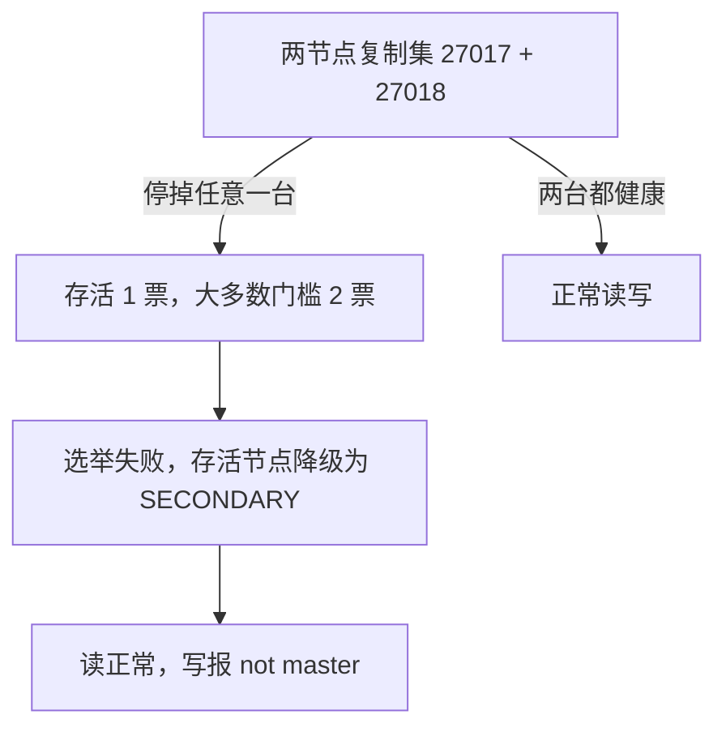

# MongoDB 复制集：从选举原理到搭建集群与故障转移实测

## 先给结论

- 微聊消息全存在单节点 MongoDB 里，机器一断电聊天记录当场失联；给 MongoDB 补高可用的答案是复制集（Replica Set），而且它比 MySQL 主从更进一步：故障切换不用人工干预，选主逻辑内置在数据库内核里。
- 复制集是一组 mongod 进程共同维护同一份数据集合的集群，三种角色各司其职：Primary 唯一接收写入，Secondary 复制数据可分担查询，Arbiter 不存数据只在选举时投票。
- 选举只认大多数：公式 N/2 + 1，三成员要 2 票，五成员要 3 票；存活成员凑不齐大多数，集群只读不写，写操作报 not master，这不是 bug 是机制。
- 成员配置有四种特殊形态：priority 0 放弃竞选、votes 0 放弃投票（投票上限 7 个）、hidden 对客户端不可见、Delayed 落后指定时间专用于误操作恢复，后两种都是特殊的 Secondary。
- 搭建主线用 Docker 起三个容器：每个实例带 replSet 名字启动，宿主机 27017、27018、27019 分别映射，rs.initiate 一条命令完成初始化，rs.status 验证谁主谁从。
- 从节点默认拒绝读，报 not master and slaveOk=false，rs.slaveOk() 放开即可，这不是搭建失败。
- 故障转移按三种宕机场景实测：从节点宕机集群无感，主节点宕机秒级自动选主，宕机过半连现任主都降级、集群只读不写。
- 偶数个数据节点是最差编成，任意一台宕机就凑不齐大多数；补救用 rs.addArb 加仲裁节点补上关键一票，但 Arbiter 补的是票不是数据，生产优先补第三个数据节点。

## 第1部分：MongoDB复制集之简介

MySQL 那几天刚搭完主从复制、PXC、MyCat、HAProxy 四件套，回过头看部署清单，MongoDB 还孤零零地跑在单节点上。微聊消息全存在它里面，这台机器一断电，聊天记录当场失联。给 MongoDB 补高可用的答案是复制集（Replica Set），而且它比 MySQL 主从更进一步：故障切换不用人工干预，选主逻辑内置在数据库内核里。

这一课从概念讲到架构：复制集由哪些角色组成、三种编成怎么选、主库宕机后集群里会发生什么、仲裁节点为什么存在。

### 一、复制集是什么，解决什么问题

复制集的定义一句话说清：由一组 MongoDB 进程（服务）组成的集群，共同维护同一个数据集合。关键字是「同一份」，多个节点上放的是同一份数据的多个副本。

单节点运行 MongoDB 时，风险清单不长但条条致命：进程宕机、机房断电、网络不通，任何一条都让服务直接不可用，数据是否受损还要看磁盘的造化。复制集用两件事回应这些风险：

**第一，数据冗余。** 副本保存在不同机器上，单台机器损坏不会丢数据，也不会让服务不可用。这正是生产环境必须部署复制集的原因，冗余不是优化项，是底线。

**第二，读取能力提升。** 组成集群后，多个节点都能对外提供查询服务，不同用户的读请求可以由不同服务器承接，整个系统的负载能力随之提高。写操作仍收口在主节点，读操作却天然可分散。

对照 MySQL 就很好理解：复制集在结构上就是 MongoDB 版的主从复制，一主多从、数据由主流向从。差别在故障处理：MySQL 主从的主库挂了，切换要靠人工或中间件；MongoDB 复制集把选举做进了内核，主挂了自动选出新主，故障转移不需要外部组件。

### 二、三种角色：Primary、Secondary 与 Arbiter

一个复制集里的成员分三种角色，术语上要注意 MongoDB 不叫 Master 与 Slave，而是 Primary 与 Secondary：

**Primary（主节点）**，整个集群唯一接收写入的节点。所有数据变更都发生在它上面，并且它会把这些写动作记录成变更日志（oplog），这是从节点同步的数据来源。

**Secondary（从节点，副本）**，从 Primary 拉取 oplog 并重放，让本机数据与主保持一致，同时可以对外提供查询服务。主从之间的数据流动就叫复制（Replication）。

**Arbiter（仲裁者）**，最特殊的角色：不存储数据、不同步数据，只通过心跳确认集群里活着的成员数量，在主节点需要选举时投出自己的一票。它存在的意义在选举规则里，后面单独展开。

请求与数据的流向画出来是这样：



图里有两类连线，职责完全不同：实线的 Replication 是数据流，oplog 沿着它从主流向从；虚线的 Heartbeat 是状态流，成员之间靠它互相确认「你还活着吗」。心跳断掉，才会触发下一节要讲的选举。

### 三、两种三节点编成与主库宕机推演

最基本的复制集由三台服务器组成，有两种编法。

**编成 A：三个数据节点**，一主两从。正常时主节点承接写入，两个从节点各留一份完整副本。主库宕机后，两个从节点通过心跳发现主失联，随后发起竞选，获得大多数投票的一个变成新 Primary，写请求切到新主上继续，数据继续复制到另一个从节点：


这里有一个值得记牢的细节：原主恢复回来后，是以从库的身份加入当前复制集的，并不会因为「我以前是主」就自动变回主。是否提升它的优先级，由配置决定，不是恢复动作的默认行为。这个设计避免了恢复瞬间的主从反复震荡。

**编成 B：两个数据节点加一个 Arbiter**，一主、一从、一仲裁。从节点照常从主同步数据；Arbiter 与主从之间只有心跳，没有复制，图上不会有从 Primary 指向它的数据箭头。

编成 B 引出复制集里最容易被问住的问题：为什么不干脆只部署一主一从？看起来两台机器也能活，主挂了把从升上去不就行了。实际上不行，卡点就是选举的门槛，大多数原则。两个成员的集群挂掉一个，只剩一个存活，一票不足大多数，选举根本不会发生，集群卡死在无主状态。Arbiter 的价值就在这里：它不占多少资源，却贡献了关键的第三票，让「只有两台数据机器」的预算也能凑齐大多数、完成选举。代价也要清楚：仲裁节点不存数据，这个编成里数据副本实际只有两份，冗余度低于编成 A。

### 四、选举怎么发起：初始化、心跳与大多数

复制集的生命从初始化开始。通过 `replSetInitiate` 命令（mongo shell 里就是 `rs.initiate()`）完成初始化后，各成员之间开始互发心跳消息，并触发 Primary 选举，获得大多数成员投票支持的节点当选 Primary，其余节点成为 Secondary。

大多数的定义值得背下来：假设复制集成员数量为 N，大多数就是 N/2 + 1；当存活成员数量不足大多数时，选举失败。代入几个数字感受一下：三成员需要 2 票，五成员需要 3 票；三成员挂掉一个还剩 2 票，能选；四成员挂掉两个只剩 2 票，不足 3，选不出来。成员数量用奇数是有道理的，四节点的容错能力与三节点相同，纯粹浪费一台机器。

机制层面还有两个默认值值得知道：成员间心跳默认每 2 秒一次，判定主节点失联并发起选举的超时默认 10 秒（官方默认值，均可配置）。也就是说，从主宕机到新主接管，正常情况下是秒级的事，应用感知到的只是一次短暂抖动。

### 五、动手前的配置雏形

day19 资料包无源码，下面这份按本课写法补全的示例给出三数据节点复制集的最小骨架：

```bash
# 三个 mongod 实例，关键参数是 --replSet 指定复制集名字
mongod --dbpath /data/rs0-0 --port 27017 --replSet rs0
mongod --dbpath /data/rs0-1 --port 27018 --replSet rs0
mongod --dbpath /data/rs0-2 --port 27019 --replSet rs0
```

```javascript
// 在任一节点进入 mongo shell，初始化复制集并列出全部成员
rs.initiate({
  _id: "rs0",
  members: [
    { _id: 0, host: "192.168.1.7:27017" },
    { _id: 1, host: "192.168.1.18:27017" },
    { _id: 2, host: "192.168.1.19:27017" }
  ]
});
// 换成「两数据节点 + 一仲裁」编成时，第三个成员改用仲裁写法：
// rs.add({ host: "192.168.1.19:27017", arbiterOnly: true })
```

初始化完成后用 `rs.status()` 查看各成员状态，谁是 Primary、谁是 Secondary、心跳是否正常，一目了然。

应用侧的连接串同样有讲究，地址要写全所有成员并声明复制集名，由驱动自己去发现谁是主：

```yaml
# 示例：Spring Boot 连接复制集，驱动自动发现主节点并在切换时跟随
spring:
  data:
    mongodb:
      uri: mongodb://192.168.1.7:27017,192.168.1.18:27017,192.168.1.19:27017/haoke?replicaSet=rs0
```

连接串不写死「谁是主」，主切换时驱动按成员列表重新探查，故障转移对业务代码完全透明。若只写主节点一个地址，切换那一刻应用就连不上了。

## 第2部分：MongoDB复制集之Primary选举

复制集初始化命令敲下去，三台 mongod 里谁当 Primary？这不是随机指定，而是一场规则明确的投票。规则没弄清，故障演练时集群突然「只读不写」，很容易当成 bug 排查半天，其实那正是选举机制在按原则办事：写入入口没了，是因为大多数凑不齐了。

### 一、选举从初始化那一刻开始

组建集群的动作是初始化：执行 `replSetInitiate` 命令，或者用 mongo shell 提供的 `rs.initiate()` 方法，两者等价。初始化本质上是在给集群登记户口：复制集叫什么名字、有哪些成员。登记完成之后，两件事同时发生，成员之间建立心跳连接，集群发起 Primary 选举。

为什么初始化后必须立刻选主？复制集的写入模型是单点写：所有写操作只能落在 Primary 上，Secondary 只负责同步数据与承接读。集群里没有 Primary，等于没有写入入口，任何 insert 都无处安放。选举因此不是仪式，而是集群「能写」的前置条件。

day19 资料包无源码，下面是按本课写法补全的三成员初始化示例：

```javascript
// 在任一成员的 mongo shell 中执行，登记复制集名与成员清单
rs.initiate({
  _id: "rs0",
  members: [
    { _id: 0, host: "172.16.55.185:27017" },
    { _id: 1, host: "172.16.55.185:27018" },
    { _id: 2, host: "172.16.55.185:27019" }
  ]
})
// 返回 { "ok" : 1 } 表示初始化成功；稍等片刻再敲回车，
// 提示符由 SECONDARY 变为 rs0:PRIMARY，说明当前节点已当选
```

返回值里的 `ok` 是判断成败的唯一标准，为 1 成功，为 0 失败。初始化瞬间所有成员先以 Secondary 身份示人，选举结束后才有节点亮出 PRIMARY 提示符。

### 二、大多数原则：N/2 + 1

选举规则一句话：获得大多数成员投票支持的节点当选 Primary，其余节点变成 Secondary。

「大多数」有精确公式。设投票成员数为 N，大多数就是 N/2 + 1，按整数除法理解。代入数字感受一下：四成员集群，4 除以 2 得 2，加 1，必须 3 票才够大多数；三成员集群，3 除以 2 取整得 1，加 1，门槛是 2 票；五成员集群同样取整后加 1，要 3 票。过半的直觉是「严格多于一半」，三成员拿 2 票已经占 2/3，符合过半。

三成员集群里的当选过程如图：



这张图在讲三成员集群的投票分布：A 与 B 把票投给 C，C 手握 2 票达到门槛当选，A、B 落选转为 Secondary，顶部对应的结果就是 NEW Primary Elected。图里另一层信息同样关键：成员两两之间保持心跳，投票的前提是心跳先确认谁还活着，失联成员不在受邀之列。

为什么门槛卡在过半，而不是随便一个多数？这是分布式系统的通用防御。设想五成员集群被网络分区劈成两半，一边两个成员、一边三个成员：三分区凑齐 3 票可以选主，两分区只有 2 票永远凑不齐，同一时刻只存在一个多数派。假如门槛低于过半，两个分区就可能各自选出 Primary、同时接受写入，同一份数据出现两条分叉，这就是脑裂。过半原则从机制上封死了这种可能，ZooKeeper 与 Raft 用的也是同一套 Quorum 思想。

### 三、凑不齐大多数：只读不写

原则反过来用，就是集群的降级行为。三成员集群挂掉一个，剩 2 个存活，2 票恰好过半，选举照常进行；挂掉两个，只剩 1 个存活，1 票不足 2 票的门槛，选举无法完成。此时集群的表现是：不能写，但可以读。存活 Secondary 上的数据还在，读请求照常响应；写请求则会被拒绝，因为没有 Primary 接收。

这也是复制集投票成员数推荐奇数的原因。四成员集群要 3 票才能选主，挂掉两个只剩 2 票，选不出来；三成员集群挂掉一个还剩 2 票，照样能选。四成员的容错能力与三成员完全相同，多一台机器没换来任何收益，纯粹浪费预算。

无主状态下的读还有个前提：Secondary 默认不承接读请求，mongo shell 里要先执行 `rs.slaveOk()` 打开从节点读，应用程序侧由驱动的 readPreference 决定读落在哪类节点上。搭建集群一篇会实际演示这个开关。

## 第3部分：MongoDB复制集之成员说明

提起复制集，多数人脑子里只有主从两种节点。真到了配置成员属性的时候，priority、votes、hidden、slaveDelay 这些字段一一冒出来，不明白各自含义就敢改，轻则选不出主，重则把对客户端的服务整个掐断。这一课把复制集里的七种成员一次说透。

### 一、三个基本角色

**Primary 的职责是收口写与分发数据。** 全部写操作落在它身上，它再把数据变更同步给各 Secondary，一进一出，集群的数据以此为中心流动。

**Secondary 是集群众数最多的角色。** 它从 Primary 同步最新写入以保证数据一致，同时提供读服务，增加 Secondary 节点，数据冗余能力与集群可用性一起涨：主宕机时，Secondary 还能参与 Primary 选举，自身也可能当选。MongoDB 对 Secondary 支持非常灵活的配置，以适应不同场景，这就是下一节四种特殊成员的由来。

**Arbiter 是只有一票的旁观者。** 它不参与数据读写，不存储数据，不同步数据，只在选举时投票。它的价值要用一个两节点的例子说明：部署一个只有 Primary 加 Secondary 的集群，任意一个节点宕机，剩下一个成员凑不齐大多数，选不出主，集群就不能对外提供写服务；此时加一个 Arbiter，它投出关键一票，过半原则满足了，主就能选出来，集群恢复可写。仲裁节点本身不存储数据，对机器几乎没有要求，找一台配置不高的机器部署即可。

七种成员的数据流与心跳关系如图：



图里实线是数据流，oplog 从 Primary 流向各数据节点；虚线只有心跳没有数据，那是 Arbiter 的全部世界。Hidden 与 Delayed 照常从主同步数据，只是不面向客户端，读请求的箭头不会伸到它们那里。

### 二、四种特殊成员配置

这四种配置作用在 Secondary 身上，可以叠加理解。

**Priority 0：放弃竞选。** priority 表示选举优先级，设为 0 的节点放弃选举权，永远不会被选为 Primary，但数据照常同步、投票照常参与。典型场景是跨机房：集群横跨机房 A 与机房 B，要求 Primary 必须落在机房 A，那就把机房 B 中所有成员的 priority 设为 0，竞选资格取消，主只能从机房 A 的成员里产生。这里藏着一个必须注意的推论：希望主在机房 A，就必须让满足大多数条件的节点都部署在机房 A，否则投票凑不齐，主可能根本选不出来，集群直接失去写入能力。

```javascript
// 示例：机房 B 的成员（members[2]）放弃竞选，主节点固定在机房 A
cfg = rs.conf()
cfg.members[2].priority = 0
rs.reconfig(cfg)
```

**Vote 0：放弃投票。** votes 决定成员是否参与投票。MongoDB 3.0 以后复制集成员最多 50 个，而参与 Primary 选举投票的成员最多 7 个，超出的成员 votes 必须设为 0。不投票自然也不会成为主，这类成员纯做数据副本，为的是冗余而不是选票。

**Hidden：对客户端隐身。** hidden 节点不能被选为主，并且对 driver 不可见，客户端无法连接它做操作，它也不接受 driver 的请求。既然客户端看不见它，留着有什么用？备份、统计计算这类任务可以放在 hidden 节点上跑：它不提供读服务，抢不走线上流量，又不影响集群的正常服务，相当于一个跟着主实时更新的「影子副本」。

**Delayed：故意慢一拍。** delayed 节点必须是 hidden 节点，它重放 oplog 时刻意落后 Primary 一段时间，时长可配置，比如一小时。它看到的永远是「一小时前的数据」。这个时间差就是它的价值：Primary 上如果发生了误写、无效操作等错误，正常副本几秒内就跟着错了，而 delayed 节点还没执行到那条 oplog，可以拿它把数据恢复到误操作之前的状态。

```javascript
// 示例：把 members[3] 配置为延迟一小时的隐藏成员（字段单位为秒）
cfg = rs.conf()
cfg.members[3].priority = 0      // delayed 成员必须放弃竞选
cfg.members[3].hidden = true     // delayed 成员必须对客户端隐藏
cfg.members[3].slaveDelay = 3600 // 延迟 3600 秒重放 oplog
rs.reconfig(cfg)
```

### 三、一张表收拢七种成员

| 成员 | 关键属性 | 能否当选主 | 是否投票 | 是否存数据 | 定位 |
|---|---|---|---|---|---|
| Primary | 默认 | 是 | 是 | 是 | 唯一写入口，向从节点分发数据 |
| Secondary | 默认 | 是 | 是 | 是 | 同步数据、承接读、参与选举 |
| Arbiter | arbiterOnly | 否 | 是 | 否 | 轻量投票节点，补齐大多数 |
| Priority 0 成员 | priority=0 | 否 | 是 | 是 | 固定主的机房位置 |
| Vote 0 成员 | votes=0 | 否 | 否 | 是 | 超过 7 票后的纯数据副本 |
| Hidden 成员 | hidden=true | 否 | 是 | 是 | 备份与离线计算的影子副本 |
| Delayed 成员 | slaveDelay>0 | 否 | 是 | 是 | 误操作恢复的时间保险 |

前三种是「正常」角色，后四种全部属于特殊的 Secondary，每一种都对应一个明确的场景需求，搭建集群时按需取用即可，不必为了齐全而齐全。

## 第4部分：MongoDB复制集之搭建集群

选举规则和成员类型都清楚了，剩下的问题是怎么把三个孤立的 mongod 拼成一个能自动选主的集群。动手之前最常见的卡点有两个：三个实例凭什么认出彼此，以及从节点上查询为什么报错。这两关一过，复制集就算真正跑通了。

### 一、规划与启动三个实例

课程用 Docker 起三个 MongoDB 4.0.3 容器，一个容器一个实例，宿主机端口 27017、27018、27019 分别映射到各容器内的 27017。三条 `docker create` 长得几乎一样，只有两个差别：容器名与端口，另外各挂一个独立的数据卷：

```bash
#创建Mongo容器
docker create --name mongo01 -p 27017:27017 -v mongo-data-01:/data/db mongo:4.0.3 --replSet "rs0" --bind_ip_all
docker create --name mongo02 -p 27018:27017 -v mongo-data-02:/data/db mongo:4.0.3 --replSet "rs0" --bind_ip_all
docker create --name mongo03 -p 27019:27017 -v mongo-data-03:/data/db mongo:4.0.3 --replSet "rs0" --bind_ip_all

#启动容器
docker start mongo01 mongo02 mongo03

#进入容器操作
docker exec -it mongo01 /bin/bash

#登录到Mongo服务
mongo 172.16.55.185:27017
```

有几个参数值得逐个点名。`--replSet "rs0"` 就是复制集的名字（ID），三个实例必须完全一致，它是集群成员之间互相认同的凭证；`--bind_ip_all` 的意思是绑定所有 IP 而不是只绑 localhost，去掉它，远程客户端连不进来。数据卷不需要提前创建，容器第一次启动时会自动生成，分别叫 mongo-data-01 到 03。进入 mongo01 容器后，用 `mongo 172.16.55.185:27017` 连接服务，其实连任意一个成员的地址都可以，后续命令在哪个成员上执行都行。

整条搭建路径如图：



图里前四步是纯手工操作，第五步开始就是 MongoDB 内核接管：心跳建立、选举、角色分配，全部自动完成。搭建的成败在前四步，尤其是三个实例的 replSet 名字是否一致。

### 二、初始化复制集

在 mongo shell 里提交初始化配置，`_id` 填复制集名，必须与启动参数 `--replSet` 的值一致；`members` 列出全部成员，`_id` 从 0 递增，`host` 写对方可达的 IP 加端口：

```javascript
//初始化复制集配置
rs.initiate({
  _id : "rs0",
  members : [
    { _id : 0, host : "172.16.55.185:27017" },
    { _id : 1, host : "172.16.55.185:27018" },
    { _id : 2, host : "172.16.55.185:27019" }
  ]
})
```

返回 `{ "ok" : 1 }` 表示初始化成功，`ok` 为 0 就是失败，原因多半藏在配置与启动参数的对应关系里。初始化完成前，提示符只是一个普通的 `>`；提交之后，成员之间开始心跳并选举，稍等片刻敲一下回车，提示符会先变成 `rs0:SECONDARY`，再变成 `rs0:PRIMARY`。前缀 rs0 就是复制集的 ID，看到 PRIMARY 就说明当前节点当选，这场选举与我们之前讲的大多数原则完全一致：三成员拿到 2 票即过半。

### 三、验证状态与数据同步

用 `rs.status()` 查看集群状态，输出里最值得关注的是 members 数组，每个成员有 `_id`、host 与 `stateStr` 三个字段：

```javascript
// rs.status() 输出节选，stateStr 描述成员当前角色
{
  set : "rs0",
  members : [
    { _id : 0, name : "172.16.55.185:27017", stateStr : "PRIMARY" },
    { _id : 1, name : "172.16.55.185:27018", stateStr : "SECONDARY" },
    { _id : 2, name : "172.16.55.185:27019", stateStr : "SECONDARY" }
  ]
}
```

一主两从的架构就此成立。接下来验证复制链路。在主节点写一条数据：

```javascript
use test
db.user.insert({ _id : 1001, name : "张三" })
db.user.find()   // 主节点立刻可查
```

退出后连接从节点 27018，切换到 test 库执行同样的 `db.user.find()`，这次会报错，`ok` 为 0，错误信息是 `not master and slaveOk=false`。翻译过来：从节点默认不提供读服务，想读要显式放开：

```javascript
rs.slaveOk()
db.user.find()   // 放开后能查到 _id 为 1001 的数据
```

能查到，说明主节点的写入已经同步到这个从节点。再连 27019，同样的 `rs.slaveOk()` 加查询，数据同样在。到这里，写走主、数据自动流向两个从的完整链路验证完毕，复制集搭建收工。

从节点默认拒绝读是个容易吓到人的设计，实际是权限开关问题：shell 里靠 `rs.slaveOk()` 打开，应用程序则靠驱动连接串的 readPreference 决定读请求落在哪类节点，连接复制集的写法在简介篇的配置示例里已经出现过。

## 第5部分：MongoDB复制集之故障转移

「主库挂了集群自动切换」是复制集最响亮的卖点，但真到线上，你可能更想知道：切得有多快？切完旧主回来会怎样？挂到什么程度集群会彻底摆烂？与其背概念，不如按课程的三组实验走一遍，每种宕机的表现立刻清清楚楚。

### 一、实验基线：一主两从

沿用搭建篇的集群：三个容器 mongo01、mongo02、mongo03，宿主机端口 27017、27018、27019 对应三个成员，当前 27017 是 PRIMARY，18 与 19 都是 SECONDARY，库里已有 `_id` 为 1001 的数据。三组实验依次做减法：先停一个从节点，再停主节点，最后连停两个节点，观察每次集群的反应。

```bash
# 测试一：停掉从节点 mongo02
docker stop mongo02

# 测试二：停掉主节点 mongo01（当前主在 27017）
docker stop mongo01

# 测试三：在测试二基础上再停一个，只剩 mongo02 存活
docker stop mongo03
```

三组实验的结局可以先记成一张图：



图里三条分支对应三种可用性等级：无损、秒级自愈、降级保读。判断走哪条分支的依据只有一条，存活成员能否凑齐大多数。

### 二、测试一：从节点宕机，集群无感

停掉 mongo02 后重新进入 mongo01，连接 27017 查看状态：主节点照常，mongo02 的成员显示连接失败（已下线），mongo03 的从节点正常。这时执行 `db.user.find()` 查询照常返回，写入也照样成功：

```javascript
use test
db.user.insert({ _id : 1002, name : "lisi" })   // 从节点下线，写入不受影响
db.user.find()                                   // 1001 与 1002 都能查到
```

结论符合直觉：写只走主，读有主和另一个从兜底，一台从节点下线动不了大局。随后 `docker start mongo02` 恢复它，再看状态，该节点已恢复并保持 SECONDARY 角色，期间漏掉的数据会通过 oplog 自动补齐，不需要任何人工介入。

### 三、测试二：主节点宕机，自动选主

停掉 mongo01，连接断开是预期内的。重新进入存活的容器，连接 27018 查看集群状态：18 这个节点已经从从节点身份转变为 PRIMARY，由它继续承担集群的写操作，19 依然是从节点。查询与写入一起验证：

```javascript
db.user.find()                                   // 新主上能查到全部数据
db.user.insert({ _id : 1003, name : "wangwu" }) // 写入切到新主，照常成功
db.user.find()                                   // 三条数据完整
```

从主宕机到新主接管，中间发生的事是：存活成员与旧主的心跳超时（官方默认判定窗口 10 秒，心跳间隔默认 2 秒），两个 Secondary 发起选举，按大多数原则拿到 2 票过半者当选。整个过程不需要人工，应用侧只要连接串列全了成员地址，驱动会自动跟随新主，业务层基本无感。

还有一个容易被忽略的细节值得单独说：恢复 mongo01 后查看状态，它回来时是 SECONDARY，而不是 PRIMARY。复制集不会因为某台机器「曾经是主」就还给它主位，当选只看当下的投票。旧主会根据自身记录的同步位置，从新主的 oplog 里补放宕机期间落下的数据，追平之后就是一个普通从节点。

### 四、测试三：宕机过半，只读不写

在 mongo01 已停的基础上再停 mongo03，集群只剩 mongo02 一个存活节点。连接 27018 后会发现一个此前没见过的现象：这个在测试二里刚当选的 PRIMARY，角色已经自己降回了 SECONDARY。查看状态，17 与 19 都是下线、连接失败，18 虽活着但只是从节点。原因就是大多数原则：三个成员只剩一个，1 票远不到 2 票的门槛，谁也选不出主，连现任主都要让位。此时集群的可用性是半残状态：

```javascript
rs.slaveOk()
db.user.find()     // 读正常，三条数据都在
db.user.insert({ _id : 1004, name : "zhaoliu" })   // 写失败，ok 为 0，报 not master
```

读服务照常，因为从节点的数据还在；写操作被拒绝，因为没有主。这个场景对应的报错就是 `not master`，看到它先别怀疑网络，数一数存活成员是不是不足大多数了。

怎么救？两条路：把停掉的节点重新启动，凑回大多数；或者给集群加一个仲裁节点。讲义里对应的操作是再起一个容器并把端口 27020 加进复制集：

```bash
docker create --name mongo04 -p 27020:27017 -v mongo-data-04:/data/db mongo:4.0.3 --replSet "rs0" --bind_ip_all
docker start mongo04
```

然后在节点上执行一条命令把它登记为仲裁者：

```javascript
rs0:PRIMARY> rs.addarbitrator("172.16.55.185:27020")
```

Arbiter 不存数据、只投票，加入后投票成员数变多，大多数的门槛更容易凑齐，集群恢复可写。它解决的是「票不够」的问题，替代不了数据节点：宕机的两台里如果有数据节点长期不回来，数据冗余还是要靠补齐数据实例。

## 第6部分：MongoDB复制集之增加arbiter节点

故障转移实验停在一个尴尬的现场：三节点复制集连停两台，集群只读不写，写操作报 `not master`。当时留下的补救线索是加一个仲裁节点（Arbiter）。这一课把这条线索走完：两节点集群到底差在哪一票，Arbiter 加进去前后集群行为差多少，以及它救不了什么。

### 一、实验设计：把三节点拆成两节点

复制集推荐奇数节点，但线上经常出现只剩两个数据节点的局面：机器报废、资源不足，或者像课程这样主动拆掉一个做验证。实验基线沿用搭建篇的集群：mongo01、mongo02、mongo03 三个容器对应 27017、27018、27019 三个成员，三台全部健康，数据同步正常。

节点的添加与移除都要在主节点上执行。把 27019 这个成员移出复制集：

```javascript
rs0:PRIMARY> rs.remove("172.16.55.185:27019")
{ "ok" : 1 }
```

返回 `ok : 1` 表示移除成功。再看 `rs.status()`，成员只剩 27017 与 27018，27018 是 PRIMARY，27017 是 SECONDARY。一个标准的两节点复制集就位，正好用来复现偶数节点的困境。

### 二、两节点集群实测：任意一台宕机就只读

先停掉从节点所在的 mongo01（27017）：

```bash
docker stop mongo01
```

连着 27018 的 shell 里执行 `rs.status()`，会先看到一段重连日志，随后提示符直接从 `rs0:PRIMARY>` 掉成 `rs0:SECONDARY>`：

```text
2019-03-05T11:04:42.058+0000 I NETWORK  [js] trying reconnect to 172.16.55.185:27018 failed
2019-03-05T11:04:42.059+0000 I NETWORK  [js] reconnect 172.16.55.185:27018 ok
rs0:SECONDARY>
```

刚才还是 PRIMARY 的 18 号成员，在对手失联之后自己降级了。这时写入请求会被拒绝，而读取照常：

```javascript
rs0:SECONDARY> db.user.insert({ "id" : 1003, "name" : "wangwu" })
WriteCommandError({
  "ok" : 0,
  "errmsg" : "not master",
  "code" : 10107,
  "codeName" : "NotMaster"
})
rs0:SECONDARY> rs.slaveOk()
rs0:SECONDARY> db.user.find()      // 读正常，数据都在
```

原因回到大多数原则：两成员集群的大多数门槛是 2 票，只剩 1 个成员时手里只有 1 票，凑不齐过半，谁也当不了主。反方向把主节点停掉，结果一模一样：剩下的从节点同样凑不齐大多数，集群只读不写。也就是说两节点集群里任意一台宕机都会失去写服务，这不是概率问题，是必然。



把停掉的 mongo01 重新 `docker start` 拉起来，集群才恢复健康。两次实验（停从节点、停主节点）都指向同一个结论：偶数数据节点状态下，集群的写入可用性悬在一台机器上。

### 三、增加仲裁节点：rs.addArb 实操

Arbiter 本质还是一个 mongod 进程，只是角色上声明了「只投票、不存数据」。新起一个容器 mongo04，宿主机端口 27020，复制集 ID 沿用 rs0：

```bash
docker create --name mongo04 -p 27020:27017 -v mongo-data-04:/data/db mongo:4.0.3 --replSet "rs0" --bind_ip_all
docker start mongo04
```

进入主节点，把它登记为仲裁者：

```javascript
rs0:PRIMARY> rs.addArb("172.16.55.185:27020")
{ "ok" : 1 }
```

返回 `ok : 1` 即添加成功。等价的写法是把它当普通成员加入，再标记 `arbiterOnly`：

```javascript
rs0:PRIMARY> rs.add({ "_id" : 3, "host" : "172.16.55.185:27020", "arbiterOnly" : true })
```

两种写法效果相同；课程讲义里出现的 `rs.addarbitrator` 指向的也是这个动作，shell 里的标准方法名是 `rs.addArb`。再看 `rs.status()`，成员列表变成三个：27017、27018、27020，其中 27020 的 `stateStr` 显示为 `ARBITER`，不存数据，也不出现在 oplog 同步链路里。

### 四、验证：再停一台数据节点，主不降级

Arbiter 加入后做同样的破坏测试。当前主节点是 17（27017），把 18（27018）停掉：

```bash
docker stop mongo02
```

再查状态：27018 已下线，27017 依然是 PRIMARY。对比没加 Arbiter 时的表现，同样停一台，主节点当时已经降级成从节点、写入被拒；现在集群里还有一个从节点加一个仲裁者，2 票的大多数凑齐了，主节点不用让位，写操作照常：

```javascript
rs0:PRIMARY> db.user.insert({ "id" : 1004, "name" : "zhaoliu" })   // 主未降级，写入照常成功
```

把 mongo02 重新启动，它以 SECONDARY 身份归队，继续提供数据副本。整个动作的逻辑可以用一句话概括：Arbiter 把成员数从 2 抬到 3，存活方无论怎么坏一台，手里都还握着 2 票，大多数原则始终能满足，选举随时能出主。

### 五、仲裁节点的代价与适用边界

**第一，票凑齐了，数据还是两份。** Arbiter 不存业务数据，也不参与 oplog 复制。加它之后数据冗余没有任何增加，两台数据节点挂掉一台期间，全量数据只剩一份在跑，这段时间再坏一台数据节点，数据就真的没了。

**第二，多数派里有一票是空壳。** 主节点故障需要重新选举时，Arbiter 能帮忙凑票让选举完成，但新主只能从存数据、有完整副本的成员里产生。它保证「选得出主」，不增加「可选的主」。

**第三，资源占用小，但不建议和应用抢机器。** Arbiter 只跑选举相关的逻辑，内存与磁盘开销远小于数据节点，官方仍建议部署在独立机器上。学习环境里一个容器了事，生产环境至少别和数据库主业务混部署。

什么时候用：机器预算有限、又要保住偶数数据节点集群的写入可用性，两数据节点加一仲裁是经典编成。什么时候不用：对数据安全有硬要求时，第三台机器应该跑数据节点而不是仲裁节点，冗余永远优先于凑票。

## 常见误区

- **把 Arbiter 当数据备份。** 仲裁节点不存数据、不同步数据，只有投票权；指望它提供冗余是致命误解，数据冗余只由数据节点承担。
- **只搭两个数据节点跑复制集。** 挂一个不足大多数，选举失败，集群卡在无主状态。要高可用至少三个投票成员：三个数据节点，或两个数据节点加一个 Arbiter。
- **连接串只写主节点地址。** 主会变，写死主地址等于把故障转移废掉；正确写法是列全成员并带上 `replicaSet` 参数。
- **以为原主恢复后会自动夺回主位。** 恢复后以从库身份加入，角色不由历史决定；需要固定主从关系时靠 priority 配置表达，而不是靠重启顺序。
- **成员数取偶数还觉得更稳。** 四成员挂两个就选不出主，容错能力与三成员相同，多花一台机器不换任何收益，投票成员数用奇数。
- **偶数成员更稳。** 四成员要 3 票，挂两个即瘫痪，容错能力与三成员相同，多花的机器没换到可用性；投票成员数取奇数。
- **以为无主时集群整个不可用。** 选不出 Primary 只封死写入，Secondary 的数据还在，读服务照常（shell 里先 `rs.slaveOk()`），别急着重启集群。
- **把 Arbiter 当数据节点用。** 仲裁节点有投票权但不能当选 Primary，也不存数据不同步数据；它能帮忙凑够大多数，不能提供数据冗余。
- **以为先启动或 IP 小的当主。** 当选靠投票过半，不靠启动顺序；priority 只影响竞选资格与优先次序，改不了过半门槛。
- **把 Arbiter 当数据备份。** 它不存数据、不同步数据，指望它提供冗余是致命误解；两数据节点加一个 Arbiter 的编成里，数据副本仍然只有两份。
- **以为 priority 0 的节点彻底弃权。** 它放弃的只是竞选资格，同步数据与投票照旧；跨机房方案里它是普通数据副本，不是摆设。
- **给机房 B 设了 priority 0 却把大多数节点留在机房 B。** 票数凑不齐大多数，主选不出来，整个集群不能写入；大多数节点必须落在期望出主的机房。
- **把 delayed 当普通读节点。** 它的数据落后主一段配置的时长，拿它读到的全是旧数据；它必须同时是 hidden 成员，客户端本来也连不上它。
- **三个实例的 replSet 名字不一致。** 成员互不认识，`rs.initiate` 直接失败或集群永远凑不齐；复制集 ID 是成员互认的凭证，必须逐字一致。
- **去掉 `--bind_ip_all`。** mongod 默认只绑 localhost，宿主机外的客户端一律连接被拒，表现很像网络问题，其实是一个启动参数的事。
- **host 写成容器内部地址。** members 里的 host 会被其他成员与驱动记录使用，填只有本机可达的地址，从节点就同步不到、客户端也连不上；要填所有参与方都可达的 IP 加映射端口。
- **把从节点的读报错当搭建失败。** `not master and slaveOk=false` 是默认行为而非故障，执行 `rs.slaveOk()` 或在驱动里配置读偏好即可。
- **不挂数据卷。** 容器一删数据全没，复制集三份副本的冗余意义也就没了；每个实例挂独立卷。
- **以为主宕机必须人工切换。** 复制集把选举做在内核里，心跳超时加大多数投票即可自动完成切换，人工要做的只有恢复宕机节点本身。
- **以为旧主恢复会抢回主位。** 恢复后以 SECONDARY 加入并补齐落后数据，主位只由当下的投票决定；想固定主从关系应配置 priority，而不是靠重启顺序。
- **看到 `not master` 就去查网络。** 三节点停两个后写操作报的就是这个错，成因是凑不齐大多数；先数存活节点，再决定恢复实例还是加仲裁。
- **以为只读状态要重启集群才能恢复。** 重启不解决票数问题，把宕机成员拉回来或加 Arbiter 凑齐大多数，写入能力自然回来。
- **把 Arbiter 当宕机节点的替身。** 仲裁节点不存数据，补的是票，不是数据副本；数据冗余缺口必须用数据节点补。
- **把 Arbiter 当宕机数据节点的替身。** 它不存数据、不参与复制，宕机那台留下的数据冗余缺口不会因为加仲裁而补上。
- **在从节点上执行 `rs.addArb`。** 成员的添加、移除属于复制集配置变更，都要在主节点执行，从节点上操作会报错。
- **以为加了 Arbiter 数据更安全。** 它只是抬高了成员计数，数据副本数、oplog 保留都与它无关。
- **只读之后急着加 Arbiter 却不恢复宕机节点。** 凑票恢复写入只是应急，长期方案仍是把数据节点补齐。

## 面试可能被问到的问题

1. 面试官追问：「MongoDB 复制集与 MySQL 主从复制最大的区别是什么？」
   答：结构上都是一主多从、数据由主流向从，但 MongoDB 复制集把选主做进了内核，主宕机后存活成员按大多数原则自动选出新主；MySQL 主从的主库故障后，切换要靠人工或借助 MHA 这类外部工具，原生不具备自动选主。
2. 面试官追问：「大多数原则是什么，为什么这样设计？」
   答：N 个成员的复制集需要 N/2 + 1 票才能选出主，存活成员不足大多数则选举失败。这样设计保证同一时刻最多只有一个多数派存在，避免网络分区时两个分区各自选出主、产生脑裂与数据分叉。
3. 面试官追问：「Arbiter 与 Secondary 的区别？」
   答：Secondary 存储完整数据副本、从主同步 oplog、可提供查询，有投票权也能当选主；Arbiter 不存任何业务数据、不参与复制，只在选举时投票，永远不会成为主。它的定位是用最小资源补齐大多数所需的票数。
4. 面试官追问：「三节点复制集主库宕机后，集群里依次发生什么？」
   答：从节点与主的心跳在超时后判定主失联，两个 Secondary 发起选举，获得大多数投票者成为新 Primary，写请求切到新主，oplog 复制关系重建；原主恢复后以 Secondary 身份加入并追平落后数据，不会自动变回主。
5. 面试官追问：「原主恢复后，宕机期间它落下的数据怎么补？」
   答：数据同步靠 oplog，主节点把写操作记录在 oplog 集合里，从节点拉取并重放。恢复后的原主会根据自身记录的位置，从当前主的 oplog 中补放落后的部分；落后超出 oplog 窗口时则需要全量重同步。
6. 面试官追问：「应用连接复制集要注意什么？」
   答：连接串列出全部成员地址并带 `replicaSet` 参数，由驱动维护拓扑、发现主节点并在切换时自动跟随；写操作走主，读操作可按 readPreference 决定走主还是从。写死单一主地址、或读写不区分的策略，都会让故障转移失去意义。
7. 面试官追问：「Primary 是怎么选出来的？」
   答：初始化时执行 replSetInitiate 或 rs.initiate() 后发起选举，成员两两通过心跳确认存活状态，获得大多数成员投票的节点成为 Primary，其余成为 Secondary。此后主节点宕机触发的心跳超时，也会重新走这套选举流程。
8. 面试官追问：「大多数怎么计算，为什么必须过半？」
   答：大多数即 N/2 + 1（N 为投票成员数），三成员要 2 票、四成员要 3 票、五成员要 3 票。卡在过半保证任何时刻最多只有一个多数派，网络分区时不可能两个分区同时选主，从机制上杜绝脑裂与数据分叉。
9. 面试官追问：「三成员集群挂掉两个还能用吗？」
   答：写不可用，读可用。剩余一个成员不足大多数，选举不出 Primary，集群拒绝写入；存活节点上的数据仍可提供读服务，Secondary 需要开启 slaveOk 或由驱动配置读偏好。
10. 面试官追问：「为什么复制集推荐奇数个投票成员？」
   答：容错能力由能否凑齐大多数决定。四成员挂两个凑不齐 3 票，三成员挂一个还剩 2 票照样能选，两者容错都是 1 台，奇数用更少的机器达到同样的容错，偶数纯属浪费。
11. 面试官追问：「Arbiter 在选举里扮演什么角色？」
   答：它不存数据、不能当选，只有一票投票权。两数据节点的集群挂掉任意一台就凑不齐大多数，加一个 Arbiter 补上关键一票，两台数据机也能完成选举，代价是数据副本仍只有两份。
12. 面试官追问：「Arbiter 和 Secondary 的区别是什么？」
   答：Secondary 存储完整数据副本、从主同步 oplog、可承接读，也能当选主；Arbiter 不存任何数据、不同步、不能当选，唯一作用是在选举中投票。它用最小资源帮集群凑齐大多数，低配机器即可部署。
13. 面试官追问：「priority 0 的成员还有什么用？」
   答：它仍有投票权、仍同步数据，只是放弃竞选。典型用法是跨机房部署时把非目标机房的成员 priority 设为 0，保证 Primary 只在目标机房产生；前提是大多数投票成员要部署在目标机房，否则选不出主。
14. 面试官追问：「hidden 节点客户端连不上，部署它图什么？」
   答：图它对 driver 不可见又不影响集群服务。备份、统计、离线计算这类任务放在 hidden 节点上跑，不抢线上读流量，同时数据紧跟主节点，相当于一份随时可用的影子副本。
15. 面试官追问：「delayed 节点为什么能救误操作？」
   答：它重放 oplog 时落后主一段可配置时间，比如一小时。主上发生误写后，正常副本立刻跟着错，delayed 节点还没执行到那条记录，可以从它恢复到误操作之前的数据。它是 hidden 成员，不会把旧数据暴露给读请求。
16. 面试官追问：「复制集最多多少成员，为什么投票成员限 7 个？」
   答：3.0 以后成员上限 50 个，投票成员上限 7 个，其余成员 votes 必须为 0。投票成员越多，心跳与选举通信的开销越大，收敛也越慢，7 个投票成员已经能覆盖绝大多数高可用场景，其余成员做纯数据副本。
17. 面试官追问：「什么情况下要加 Arbiter？」
   答：集群成员为偶数时最好加一个。比如两个数据节点的集群，任意一台宕机就凑不齐大多数、无法选主；补一个不存数据的仲裁节点，过半原则即可满足，代价几乎可以忽略。
18. 面试官追问：「搭建复制集时哪些参数是决定性的？」
   答：每个 mongod 启动时的 --replSet 名字必须一致，这是成员互认的基础；mongod 要 --bind_ip_all 监听所有网卡；rs.initiate 的 members 清单要与实际地址一致。三者对不上，集群就组不起来。
19. 面试官追问：「rs.initiate 之后立刻就是 PRIMARY 吗？」
   答：不是。初始化提交后所有成员先处于 SECONDARY 状态，成员间建立心跳并发起选举，获得大多数投票的节点才转为 PRIMARY，整个过程通常在秒级完成，可通过 rs.status 的 stateStr 观察。
20. 面试官追问：「在从节点上执行查询为什么报 not master and slaveOk=false？」
   答：这是默认权限，从节点默认不承接读写，防止客户端无感知地读到未同步完的数据。shell 里执行 rs.slaveOk() 放开，应用程序则在连接串上配置 readPreference 指定读偏好。
21. 面试官追问：「怎么确认数据真的同步到了从节点？」
   答：主节点插入后在从节点放开 slaveOk 再查询，能查到即证明 oplog 同步生效；更系统的做法是看 rs.status 里各成员的 optime 与 replication lag，确认从节点重放位置紧跟主节点。
22. 面试官追问：「rs.status 里最该盯哪些字段？」
   答：members 数组里每个成员的 stateStr（PRIMARY、SECONDARY 或异常态）、health 与 lastHeartbeat；排查故障时再看 optime 与 heartbeat 的时延，判断谁掉线、谁落后。
23. 面试官追问：「复制集的故障转移是怎么完成的？」
   答：成员间通过心跳确认存活，主节点失联超过判定窗口后，存活的 Secondary 发起选举，按大多数原则选出新主，写请求切到新主，oplog 复制关系在新主与剩余从节点之间重建，全程无需人工干预。
24. 面试官追问：「从节点宕机和主节点宕机的区别？」
   答：从节点宕机集群无感，读写照常，恢复后自动归队补数据；主节点宕机会触发选举，存活成员过半则秒级选出新主继续服务，不过半则集群只读不写。
25. 面试官追问：「旧主恢复回来是什么角色？」
   答：SECONDARY。主位由当下投票决定，不看历史身份；旧主会按自身记录的同步位置从新主的 oplog 补放宕机期间落下的数据，追平后作为普通从节点参与集群，不会自动夺回主位。
26. 面试官追问：「三节点停掉两个，集群还能做什么，为什么？」
   答：只能读不能写。存活一个成员凑不齐 2 票的大多数，选不出 Primary，连存活的原主都会降级为从节点；读服务不受影响，因为从节点数据仍在，写请求会报 not master。
27. 面试官追问：「客户端在主从切换时会受影响吗？」
   答：连接串列出全部成员并声明 replicaSet 参数时，驱动维护拓扑、自动发现并跟随新主，切换期间通常只有一次短暂重试；如果只写死旧主地址，切换后就连不上了。
28. 面试官追问：「仲裁节点在故障场景里起什么作用？」
   答：它只投票不存数据。当数据节点数量不足以凑齐大多数时，比如两数据节点挂了一台，加一个 Arbiter 就能补上关键一票完成选举，恢复写入；但它不提供数据冗余，缺口仍要数据节点来补。
29. 面试官追问：「Arbiter 和 Secondary 的区别是什么？」
   答：Secondary 存完整数据副本、通过 oplog 与主保持同步、可承担读请求，有投票权也能当选主；Arbiter 不存任何业务数据、不参与复制，只在选举中投票，永远不会成为主。它的定位是用最小资源补齐大多数所需的票数。
30. 面试官追问：「为什么两节点复制集反而比三节点更脆弱？」
   答：大多数门槛是成员数的一半向上取整。两节点需要 2 票，任意一台宕机后存活方只剩 1 票，选举必然失败，主节点会主动降级，集群只读；三节点门槛是 2 票，挂一台还剩 2 票，选举照常完成。
31. 面试官追问：「添加仲裁节点的命令在哪个节点上执行？」
   答：在主节点上执行 `rs.addArb("IP:端口")`，等价于 `rs.add` 时带上 `arbiterOnly: true`。成员的增删都要在主节点操作，从节点上执行会失败。
32. 面试官追问：「加了 Arbiter 之后，主节点挂了集群会怎样？」
   答：Arbiter 负责补票让选举能完成，剩余的数据节点当选新主，写入恢复；但候选者只有数据节点，Arbiter 本身永远不会被选为主。
33. 面试官追问：「什么场景该用 Arbiter，什么场景不该用？」
   答：机器紧张又要保证写入可用性时，两数据节点加一仲裁是常见编成；对数据冗余有硬要求时不该用它凑数，应补第三个数据节点，因为 Arbiter 不提供任何数据保障。

## 配套资料

- 本教学日无源码包：`materials/code/03/day19-MongoDB集群以及日志、异常规范/` 下仅有解压清单 `_extracted.json`，解压文件数为 0；`mongod` 启动、`rs.initiate` 初始化与 Spring Boot 连接串均为按本课写法补全的可运行示例。
- 复制集定义、三节点架构、含仲裁节点的编成、Primary 选举流程与「大多数」的定义抄录自本课画面线（讲义 1.1 简介、1.2 架构、1.3 Primary 选举三节）。
- 延伸阅读：MySQL 主从复制的部署对照见 `0287-MySQL集群部署之部署MS集群(主从复制).md`；MongoDB 在项目中的单节点使用见 day08 相关篇目；复制集实操搭建见本阶段后续篇目。
- 本教学日无源码包：`materials/code/03/day19-MongoDB集群以及日志、异常规范/` 下仅有解压清单 `_extracted.json`，解压文件数为 0；文中 `rs.initiate()` 初始化示例为按本课写法补全的可运行示例。
- 选举流程、「大多数」公式（N/2 + 1）、不足大多数时只读不写的结论抄录自本课画面线（讲义 1.3 Primary 选举一节）；Primary 与 Arbiter 通过 Heartbeat 交互、NEW Primary Elected 的架构示意同见该节。
- 概念铺垫见 `0306-MongoDB复制集之简介.md`；动手搭建与 rs.status 验证见 `0309-MongoDB复制集之搭建集群.md`；三组故障演练见 `0310-MongoDB复制集之故障转移.md`。
- 本教学日无源码包：`materials/code/03/day19-MongoDB集群以及日志、异常规范/` 下仅有解压清单 `_extracted.json`，解压文件数为 0；文中 `rs.conf()` 修改 priority、hidden、slaveDelay 的两段示例为按官方主流写法补全，可在 mongo shell 直接执行（`slaveDelay` 单位为秒，适配本课使用的 MongoDB 4.0）。
- Primary、Secondary、Arbiter 的职责描述与「增加 Secondary 提升冗余与可用性」「对 Secondary 灵活配置」的表述抄录自本课画面线（讲义 1.4 成员说明一节的成员表格）；Priority 0、Vote 0、Hidden、Delayed 四种成员的行为与示例同见该节。
- 选举与大多数原则见 `0307-MongoDB复制集之Primary选举.md`；Arbiter 的实际添加与验证见 `0310-MongoDB复制集之故障转移.md`。
- 本教学日无源码包：`materials/code/03/day19-MongoDB集群以及日志、异常规范/` 下仅有解压清单 `_extracted.json`，解压文件数为 0；三条 `docker create`、启动与进入容器命令，以及 `rs.initiate` 配置均抄录自本课画面线（讲义 1.5 搭建复制集一节），`rs.status()` 输出为按实际返回结构精简的示例。
- 宿主机端口 27017、27018、27019 映射与 mongo 4.0.3 版本、数据卷自动生成的说明来自本课声音线；从节点 `not master and slaveOk=false` 报错与 `rs.slaveOk()` 放开操作来自本课的实操演示。
- Docker 安装单节点 MongoDB 的基础见 `0131-MongoDB入门之通过Docker安装MongoDB.md`；选举规则见 `0307-MongoDB复制集之Primary选举.md`；故障转移演练复用这套三节点集群，见 `0310-MongoDB复制集之故障转移.md`。
- 本教学日无源码包：`materials/code/03/day19-MongoDB集群以及日志、异常规范/` 下仅有解压清单 `_extracted.json`，解压文件数为 0；三组 `docker stop` 实验与 `rs.addarbitrator` 命令的操作过程来自本课声音线的实操演示，`mongo04` 创建命令与 `rs.addarbitrator("172.16.55.185:27020")` 抄录自本课画面线（讲义 1.6 故障转移、1.7 增加仲裁节点两节）。
- 心跳间隔与选举判定超时的默认值（2 秒、10 秒）为官方默认配置，已在简介篇说明；文中 `rs.status()` 状态描述与 `not master` 报错为按实操过程整理的示例。
- 集群搭建过程见 `0309-MongoDB复制集之搭建集群.md`；大多数原则见 `0307-MongoDB复制集之Primary选举.md`；Arbiter 成员属性见 `0308-MongoDB复制集之成员说明.md`。
- 本教学日无源码包：`materials/code/03/day19-MongoDB集群以及日志、异常规范/` 下仅有解压清单 `_extracted.json`，解压文件数为 0；`docker create`、`rs.addArb` 命令与降级日志、`not master` 报错抄录自本课画面线（讲义 1.7 增加仲裁节点一节），两次宕机实验的过程与结论来自本课声音线的实操演示。
- `rs.remove` 移除成员与 `rs.add({ ..., arbiterOnly: true })` 等价写法为按本课写法补全的示例。
- 延伸阅读：故障转移三场景见 `0310-MongoDB复制集之故障转移.md`；大多数原则见 `0307-MongoDB复制集之Primary选举.md`；Arbiter 成员属性说明见 `0308-MongoDB复制集之成员说明.md`。
