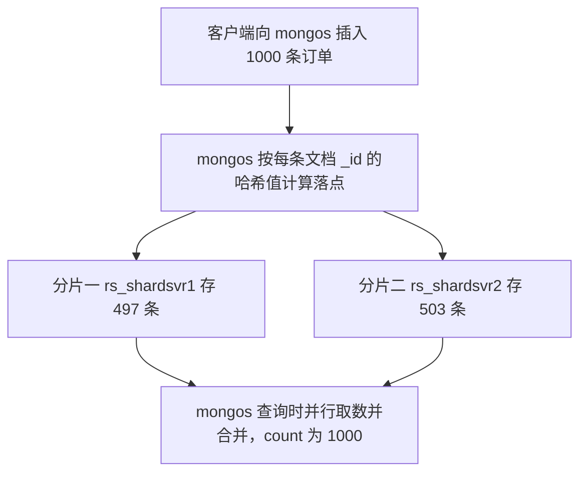

# 分片集群使用实操：启用分片、摊入数据、验证分布

上一节把 10 个容器的分片集群搭了起来：3 个 config server、两个分片复制集、1 个 mongos。骨架搭完还不算能用，数据库没开分片、集合没定分片规则，插入的数据只会老老实实待在一个分片上。这一节把集群真正用起来：启用分片、插入 1000 条数据、亲眼看着它摊到两个分片上，再看懂 config 库里的分片元数据。

## 先给结论

- 所有操作都走 mongos：连接 6666 端口，`sh.status()` 总览分片、数据库与集合的分片状态，前缀是 `sh` 而不是复制集时代的 `rs`。
- 启用分片两步走：`sh.enableSharding("test")` 开库，`sh.shardCollection("test.order", {"_id": "hashed"})` 给集合定规则，缺一不可。
- 分片键是 `_id` 的哈希：按每条文档 `_id` 的哈希值决定落点，与业务字段 `id` 无关，两者是不同字段。
- 1000 条数据插入后，mongos 上 `count` 是 1000，两个分片分别 497 条与 503 条，哈希分布只保证大致均匀。
- 分片元数据在 config 库里：`db.databases.find()` 看哪些库启用了分片，`db.collections.find()` 看集合的分片键。

## 一、mongos 是唯一入口：先看状态，再开分片

分片集群里一切读写都发生在 mongos 上，连 6666 端口进入 shell。查看集群状态用 `sh.status()`，它把分片列表、数据库分片状态、集合分片键与 chunk 分布整理成一份总览：

```javascript
sh.status()
```

启用数据库分片：

```javascript
sh.enableSharding("test")     // { "ok" : 1 }
```

返回 `ok : 1` 表示开启成功，`test` 库从此允许分片。但允许归允许，具体哪个集合怎么切，还要给集合声明分片规则。

## 二、给集合定分片规则

```javascript
sh.shardCollection("test.order", { "_id" : "hashed" })     // { "ok" : 1 }
```

这条命令声明：`test` 库的 `order` 集合按 `_id` 字段的哈希值分片。之后每插入一条文档，MongoDB 都会计算 `_id` 的哈希值，据此找到目标分片。哈希是范围与哈希两种策略里最常用的一种，分布最均匀，课程实操也选它。

## 三、插入 1000 条，看着数据摊开

```javascript
use test
for (i = 1; i <= 1000; i = i + 1) {
    db.order.insert({ "id" : i, "price" : 100 + i })
}
db.order.count()      // mongos 上查询：1000
db.order.find()       // 结果完整，mongos 替你合并了两个分片的数据
```

循环里的字段 `id` 只是普通业务字段，分片路由用的是 `_id`，这两个字段长得像但完全是两回事，别混为一谈。mongos 上 `count` 返回 1000，只能说明数据写进去了，看不出是不是真的分了片。登录到两个分片的数据节点分别查：

```bash
mongo 172.16.55.185:37000      # 分片一 rs_shardsvr1 的节点
mongo 172.16.55.185:37003      # 分片二 rs_shardsvr2 的节点
```

```javascript
db.order.count()      // 分片一：497
db.order.count()      // 分片二：503
```

分片一 497 条，分片二 503 条，加起来正好 1000。数据确实被哈希值摊到了两个分片上，而 mongos 上的查询又把它们合并成一个完整视图：



497 与 503 不是刻意各分 500：哈希只保证散列均匀，不承诺绝对平均，两个分片相差几条属于正常现象。

## 四、到 config 库里看分片元数据

哪些库开了分片、每个集合用什么分片键，这些信息都记在 config 库里，在 mongos 上查询：

```javascript
use config
show tables
db.databases.find()      // 能看到 test 已启用分片，primary 字段标明主分片
db.collections.find()    // 能看到 test.order 的分片键是 { "_id" : "hashed" }
```

`db.databases.find()` 列出每个数据库的分片状态，`db.collections.find()` 列出每个分片集合的分片键定义。想再看一次全貌，`sh.status()` 随时可用，它查的正是这些 config 库的数据，只是排版更易读。

## 五、chunk 的分裂与迁移：自动为主，手动兜底

数据持续写入后，chunk 会超过 64MB 上限自动分裂；各分片块数失衡时，balancer 进程在后台自动把块从多的分片迁到少的分片，平时不需要人工介入。确实需要定向控制数据位置时，可以用 `sh.moveChunk` 把某个块挪到指定分片：

```javascript
// 示例（按本课写法补全）：把 test.order 中命中 _id 值的 chunk 迁到 rs_shardsvr2
sh.moveChunk("test.order", { _id : ObjectId("5c7e47b24b6a894337b0b0e7") }, "rs_shardsvr2")
```

手动迁移的意义在于精细控制数据分布，比如把特定数据集中到指定分片；常规场景交给 balancer 即可，自动迁移本身就是为了免去人工平衡的负担。

## 常见误区

- **直连分片节点查数据。** 37000 上查 `count` 只有 497，那是本分片的本地视图；只有 mongos 才有全量视图，应用永远应该连 mongos。
- **把业务字段 `id` 当成分片依据。** 分片键是 `_id` 的哈希，循环里插入的 `id` 只是普通字段，同名相似但没有关系。
- **期待两个分片精确各 500 条。** 哈希分片只是散列均匀，497 加 503 的分布就是正常结果。
- **以为 `enableSharding` 之后集合自动分片。** 开库只是允许分片，还必须 `shardCollection` 指定分片键，否则集合整体落在某个分片上。

## 面试可能被问到的问题

1. 面试官追问：「`sh.enableSharding` 和 `sh.shardCollection` 各自做了什么？」
   答：前者在集群层面声明某个数据库允许分片；后者给具体集合指定分片键与分片方式（哈希或范围），集合自此按 chunk 拆分到各分片。两步缺一不可。
2. 面试官追问：「在 mongos 上查询和在分片节点上查询有什么区别？」
   答：mongos 拿着 config server 的元数据，把请求路由到相关分片并合并结果，是全量视图；直连分片节点只能看到该分片的本地数据，绕过 mongos 的查询结果不完整。
3. 面试官追问：「哈希分片为什么做不到两分片精确对半？」
   答：哈希分片按分片键的哈希值把键空间切块分配，数据落点由哈希值决定，只保证统计意义上的大致均匀，条数差几个百分点是正常现象。
4. 面试官追问：「分片键选错了怎么办？」
   答：4.0 版本里集合的分片键确定后不能直接修改，只能新建集合重新导入数据，所以选键要在上线前结合查询模式定好。
5. 面试官追问：「chunk 迁移什么时候需要人工介入？」
   答：绝大多数情况 balancer 会自动迁移保持均衡；需要定向控制数据位置时才手动 moveChunk，比如把特定数据集中到指定分片。

## 配套资料

- 本教学日无源码包：`materials/code/03/day19-MongoDB集群以及日志、异常规范/` 下仅有解压清单 `_extracted.json`，解压文件数为 0；`sh.status`、`sh.enableSharding`、`sh.shardCollection`、插入循环、config 库查询等命令抄录自本课画面线（分片集群的配置和操作步骤文档），497 与 503 的分布结果来自本课声音线的实操演示。
- `sh.moveChunk` 手动迁移为按本课写法补全的示例，本课只讲了 balancer 自动迁移的概念。
- 集群搭建与 chunk 分裂迁移机制见 `0312-MongoDB分片集群之简介.md`；复制集基础见本阶段 `0306-MongoDB复制集之简介.md` 起的系列。
