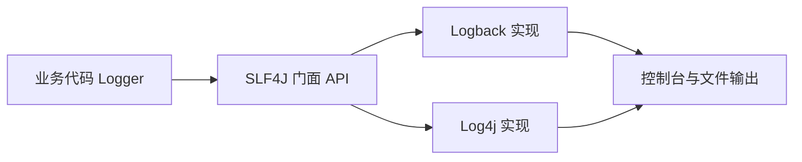

# 日志为什么绕不开 SLF4J：门面模式给日志框架上个统一接口

项目里打日志，有人一路 `System.out.println` 到底，有人引入了 Logback 又直接 import 它的类。前一种在生产排障时两眼一抹黑，后一种等哪天要换日志框架，几十个类一起改。《阿里巴巴 Java 开发手册》的日志规约部分把这件事定为强制条款：应用中不可直接使用日志系统（Log4j、Logback）中的 API，而应依赖使用日志框架 SLF4J 中的 API。这一节就把「为什么是强制」讲清楚。

## 先给结论

- SLF4J（Simple Logging Facade for Java）是日志门面，只定义接口不输出日志；真正的输出由 Logback、Log4j 这类实现完成。
- 强制走 SLF4J 的根本原因：业务代码面向门面编程，换日志实现只换依赖和配置，业务代码一行不动。
- `System.out.println` 没有级别、没法关闭、不能落文件、没有时间与上下文，生产环境基本不可用。
- 标准组合是门面加实现：依赖 `slf4j-api` 与 `logback-classic`，代码里用 `LoggerFactory.getLogger` 拿 `Logger`。
- 输出日志用 `{}` 占位符，而不是字符串拼接，级别不够时连拼接开销都省了。

## 一、日志重要，但框架选择让人纠结

日志的重要性不用论证：应用在生产环境一旦出问题，没有日志就无从定位，线上排障基本靠日志说话。麻烦的是选择太多：JDK 自带的 JUL、极简的 Simple、老牌的 Log4j、后起之秀 Logback，各有拥趸。真正让人纠结的问题有两个：到底用哪个？今天用了 Log4j，明天想换成 Logback，代码要重写多少？

这些问题在《阿里巴巴 Java 开发手册》里有明确答案。手册由国内一线 Java 团队编写发布，覆盖编程规约、异常日志、单元测试等维度，对日常开发的参考价值极高。它的异常与日志一章里，日志规约第一条就是强制条款：

> 【强制】应用中不可直接使用日志系统（Log4j、Logback）中的API，而应依赖使用日志框架SLF4J中的API，使用门面模式的日志框架，有利于维护和各个类的日志处理方式统一。

条款里的 SLF4J 名字拗口，圈内给了它两个外号：一个按发音叫「沙拉芬」，另一个干脆按谐音叫「酸辣粉」。叫什么都行，指的都是同一个东西。

## 二、SLF4J 到底是什么：门面，不是实现

SLF4J 全称 Simple Logging Facade for Java，Java 简易日志门面。门面模式（Facade Pattern）的意思是：给一组复杂的子系统提供一个统一的高层接口，外部只跟接口打交道。放到日志场景里就是下面这层关系：



SLF4J 只是一层接口约定，自己不产生任何日志输出；真正的输出动作由绑定在它下面的日志框架完成。它的作者 Ceki Gülcü 正是 Log4j 和 Logback 的作者，他宣称 SLF4J 比 Log4j 更高效，也比 Apache Commons Logging（JCL）这套更早的门面方案更简单、稳定。

手册那条强制条款的逻辑由此就通了：直接用 Log4j 的 API，日志能力确实有了，但业务代码与具体实现焊死在一起；面向 SLF4J 编程，实现可以随时替换。

## 三、System.out.println 输在哪里

拿 `System.out.println` 跟日志框架对比，差距是全方位的：

**第一，没有级别。** 日志框架的 DEBUG、INFO、WARN、ERROR 可以按级别过滤，`println` 打出来的每一条都是平等的，排障时无法快速抓重点。

**第二，没有开关。** 上线前想关掉调试日志，日志框架改一行配置；`println` 只能满代码删除或注释。

**第三，没有格式与落盘。** `println` 没有时间戳、线程名、调用位置，输出到控制台就没了，不写文件，也没有滚动、归档这些机制。

**第四，没有性能优化。** 日志框架支持占位符延迟拼接，级别不满足时连字符串都不拼；`println` 的拼接是实打实执行的。

对比着看代码：

```java
// 反例：直接 println
System.out.println("订单 " + orderId + " 支付成功，金额 " + amount);

// 正例：门面 + 占位符
private static final Logger logger = LoggerFactory.getLogger(PayService.class);
logger.info("订单 {} 支付成功，金额 {}", orderId, amount);
```

## 四、SLF4J 加 Logback：推荐的标准组合

引入两个依赖即可（示例为按本课写法补全的 Maven 配置）：

```xml
<dependency>
    <groupId>org.slf4j</groupId>
    <artifactId>slf4j-api</artifactId>
    <version>1.7.25</version>
</dependency>
<dependency>
    <groupId>ch.qos.logback</groupId>
    <artifactId>logback-classic</artifactId>
    <version>1.2.3</version>
</dependency>
```

业务代码统一从门面拿 Logger：

```java
import org.slf4j.Logger;
import org.slf4j.LoggerFactory;

public class PayService {

    private static final Logger logger = LoggerFactory.getLogger(PayService.class);

    public void pay(String orderId, long amount) {
        logger.info("订单 {} 支付成功，金额 {}", orderId, amount);
        try {
            // 业务处理
        } catch (Exception e) {
            logger.error("订单 {} 支付失败", orderId, e);   // 异常对象放最后一个参数
        }
    }
}
```

这两段代码里没有出现任何 Logback 的类。输出行为交给 `logback.xml` 配置（示例）：

```xml
<configuration>
    <appender name="CONSOLE" class="ch.qos.logback.core.ConsoleAppender">
        <encoder>
            <pattern>%d{yyyy-MM-dd HH:mm:ss.SSS} [%thread] %-5level %logger{36} - %msg%n</pattern>
        </encoder>
    </appender>
    <root level="info">
        <appender-ref ref="CONSOLE"/>
    </root>
</configuration>
```

哪天要把 Logback 换成 Log4j，业务代码原样保留，换依赖、换配置文件就行。这就是门面模式的价值，也是手册把它定为强制的原因。

## 常见误区

- **直接 import Log4j 或 Logback 的 Logger 类。** 看起来也能打日志，但业务代码与实现绑死，换框架时每个类都要改，违背强制条款的初衷。
- **用字符串拼接代替占位符。** `logger.info("id=" + id)` 无论级别是否生效都会执行拼接，`logger.info("id={}", id)` 在级别不足时直接跳过。
- **以为只加 `slf4j-api` 就有日志输出。** SLF4J 是门面，没绑定任何实现时日志无声无息；要配上 `logback-classic` 或其他实现的绑定。
- **Logger 声明成非 `static final`。** 每个实例都会重复创建 Logger，也留下了被运行时替换的风险，统一按 `private static final` 声明。

## 面试可能被问到的问题

1. 面试官追问：「SLF4J 和 Logback 是什么关系？」
   答：SLF4J 是日志门面，只定义接口；Logback 是具体实现，负责真正的日志输出。业务代码面向 SLF4J 编程，底层实现可替换，两者出自同一作者 Ceki Gülcü，Logback 与 SLF4J 配合最自然。
2. 面试官追问：「为什么开发手册强制要求用 SLF4J 而不是直接用日志框架 API？」
   答：门面模式让业务代码与日志实现解耦，换实现不动业务代码；同时统一了各个类的日志处理方式，声明方式、级别用法、输出格式都归口一处，有利于维护。
3. 面试官追问：「`System.out.println` 打日志有什么问题？」
   答：没有级别与开关、没有时间戳等上下文、不能落文件与滚动归档、每次都执行字符串拼接，既不便排障也影响性能，生产环境不可用。
4. 面试官追问：「`{}` 占位符相比字符串拼接好在哪？」
   答：占位符在日志级别不满足时不执行拼接，省掉无效开销；日志语句中消息与参数分离，可读性也更好。
5. 面试官追问：「引入了 slf4j-api 却看不到日志输出，可能是什么原因？」
   答：只引入了门面没有绑定实现。SLF4J 运行时会寻找类路径上的绑定，找不到就没有输出；补上 logback-classic 或对应实现的依赖即可。

## 配套资料

- 本教学日无源码包：`materials/code/03/day19-MongoDB集群以及日志、异常规范/` 下仅有解压清单 `_extracted.json`，解压文件数为 0；手册强制条款、SLF4J 定义与 `LoggerFactory.getLogger` 示例抄录自本课画面线（讲义 3.1 阿里巴巴开发手册、3.2 了解 SLF4J 两节）。
- Maven 依赖、`logback.xml` 与正反对比示例为按本课写法补全的可运行示例。
- SLF4J 的绑定机制与各实现整合见本章节后续篇目（了解 slf4j、slf4j 整合 JDK14 与 Simple、slf4j 整合 Log4j 与 Logback）。
