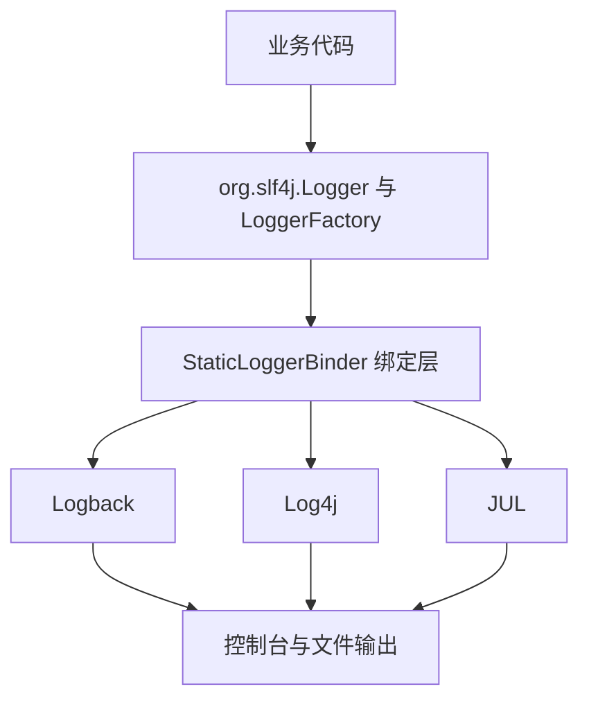
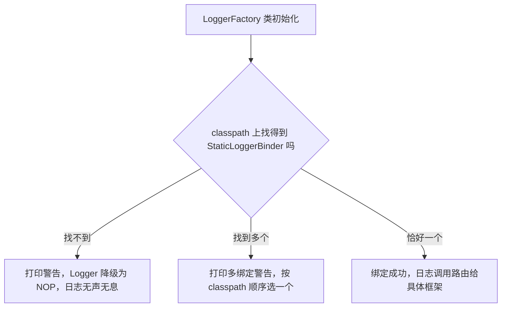

# SLF4J 深入：门面结构、绑定过程与占位符写法

「日志要用 SLF4J 门面」这句话都听过，落到代码里疑问却更多：`slf4j-api` 明明只是一个接口包，`LoggerFactory.getLogger` 凭什么返回一个真能输出日志的 `Logger`？不引任何实现包时，日志去了哪里？`{}` 占位符又凭什么说比字符串拼接省性能？

这一节把门面本身拆开看：它的结构长什么样，`LoggerFactory` 背后做了什么绑定，占位符的机制是什么。

## 先给结论

- SLF4J 全称 Simple Logging Facade for Java，Java 的简易日志门面，以 MIT 授权发布；作者 Ceki Gülcü 同时是 Log4j 与 Logback 的作者。
- 它是门面不是实现：自己不产生任何日志输出，真正的输出由 JUL、Log4j、Logback 这些具体框架完成。
- slf4j 1.7.x 的绑定发生在 `LoggerFactory` 类初始化时：到 classpath 上找 `org.slf4j.impl.StaticLoggerBinder`，找到谁的绑定包，底层就换成谁。
- classpath 上同时存在多个绑定包会打印警告，实际绑定到谁由类加载顺序决定，属于必须排掉的依赖冲突。
- 输出统一走 `{}` 占位符，参数攒起来延迟拼接，级别不达标时连字符串都不拼。

## 一、门面模式：给一堆日志框架装同一块面板

门面模式一句话就能说清：给复杂的子系统提供一个统一的对外接口，调用方只认接口，不关心背后是谁在干活。SLF4J 就是日志世界的门面，它在后端可以接 JUL、Log4j、Logback 等多种框架，部署时再决定用哪一个。

作者的身份让这套门面更有分量：Ceki Gülcü 先写了 Log4j，后来又造了 SLF4J 和 Logback，他宣称 SLF4J 比 Log4j 更高效，也比更早的门面方案 Apache Commons Logging 更简单、更稳定。Log4j 与 Logback 出自同一人之手，门面与实现的衔接自然比第三方适配顺滑得多。

整个结构一张图：



关键在中间那层绑定：业务代码只看到上面的 SLF4J API，下面接哪个框架，对调用方完全透明。这也正是开发手册强制使用门面 API 的结构基础。

## 二、LoggerFactory.getLogger 背后的绑定过程

代码里拿 Logger 永远是同一句（示例按本课写法给出）：

```java
import org.slf4j.Logger;
import org.slf4j.LoggerFactory;

private static final Logger logger = LoggerFactory.getLogger(Abc.class);
```

import 里只有 `org.slf4j`，看不到任何具体框架的类名，那 `logger` 对象是从哪来的？slf4j 1.7.x 的做法是：`LoggerFactory` 类首次加载时尝试加载 `org.slf4j.impl.StaticLoggerBinder`，这个类不在 slf4j-api 里，只存在于各实现提供的绑定包中。查找有三种结局，差别巨大：



**找不到绑定是最迷惑的一种。** 工程里只引 `slf4j-api` 不引任何实现，编译、运行都不报错，控制台只提一句 `Failed to load class org.slf4j.impl.StaticLoggerBinder`，此后所有日志进入 NOP（No Operation）Logger，无声无息地消失。很多人以为代码没执行，其实是门面后面空无一人。

**绑定成功后，`getLogger` 返回的实际是具体框架造出来的 Logger。** slf4j-api 内部拿到绑定包提供的 `ILoggerFactory`，由它创建真正的 `Logger` 实例，之后的每一次 `info`、`debug`、`error` 调用都会被路由过去。这也解释了换日志框架为什么可以零代码改动：接口没变，变的只是 classpath 上的绑定包。

## 三、{} 占位符：把拼接推迟到真正要打印的那一刻

```java
// 反例：级别不够，拼接照样执行，白白消耗 CPU
logger.debug("Processing trade with id: " + id + " and symbol: " + symbol);

// 正例：占位符，门面先判断级别，达标才格式化
logger.debug("Processing trade with id: {} and symbol: {}", id, symbol);
```

占位符的工作方式：SLF4J 先判断 debug 级别当前是否生效，生效才把 `{}` 按顺序替换成参数完成格式化；不生效则直接返回，参数只是一个没被碰过的引用，拼接和 `toString` 都不会发生。参数多于占位符时，多余的参数被忽略。

还有一个实用细节：最后一个参数如果是 `Throwable`，它不参与占位符替换，而是作为异常堆栈单独输出，日志里能拿到完整堆栈：

```java
// 异常对象放最后一位，堆栈完整带出，orderId 仍然填进占位符
logger.error("订单 {} 处理失败", orderId, e);
```

## 常见误区

- **只引 `slf4j-api` 就期待有日志输出。** 门面没有绑定就是 NOP Logger，不报错也不输出，必须再引一个实现的绑定包。
- **多个绑定包同时留在 classpath。** `logback-classic` 与 `slf4j-log4j12` 共存时控制台会出现 `Class path contains multiple SLF4J bindings` 警告，实际绑定谁不可控，换框架时旧绑定包要注释或删除。
- **占位符数量和参数对不上。** 多出来的 `{}` 会原样出现在日志文本里，容易误判成输出格式配错。
- **异常对象不放最后一个参数。** 放在中间会被当成普通占位符参数参与替换，堆栈信息直接丢失。

## 面试可能被问到的问题

1. 面试官追问：「SLF4J 是什么，为什么叫门面？」
   答：Simple Logging Facade for Java，Java 简易日志门面。它只定义 Logger、LoggerFactory 等接口，不实现日志输出，输出交给 JUL、Log4j、Logback 等具体框架，是门面模式在日志领域的典型应用。
2. 面试官追问：「LoggerFactory.getLogger 是怎么决定用哪个日志框架的？」
   答：slf4j 1.7.x 在 LoggerFactory 类初始化时到 classpath 上找 org.slf4j.impl.StaticLoggerBinder，这个类由各实现的绑定包提供，找到谁就绑定谁；2.x 起改为 ServiceLoader 机制发现实现。
3. 面试官追问：「工程里只引 slf4j-api 会发生什么？」
   答：编译运行都不报错，但绑定找不到，Logger 降级为 NOP，所有日志静默丢弃，控制台只有一条 Failed to load class 提示。
4. 面试官追问：「classpath 上有多个绑定会怎样？」
   答：SLF4J 会打印 multiple bindings 警告，并按类加载顺序选其中一个，实际行为不确定。这是依赖冲突，要用 Maven 依赖树排掉多余的绑定包。
5. 面试官追问：「占位符和字符串拼接的性能差别在哪？」
   答：拼接在调用处无条件执行，对象参数还要走 toString；占位符先判级别，级别不满足时参数保持引用原样返回，省掉全部拼接与格式化开销。

## 配套资料

- 本教学日无源码包：`materials/code/03/day19-MongoDB集群以及日志、异常规范/` 下仅有解压清单 `_extracted.json`，解压文件数为 0；SLF4J 定义、MIT 授权、作者信息与 `LoggerFactory.getLogger` 写法抄录自本课画面线（讲义 3.2 了解 SLF4J 一节）。
- 绑定过程与占位符示例为按本课写法补全的可运行示例，依赖版本与本课一致（slf4j-api 1.7.26）。
- 为什么要用门面见 `0314-日志规范之为什么要使用SLF4J.md`；JUL、Simple、Log4j、Logback 的实际整合见本系列后续三篇。
