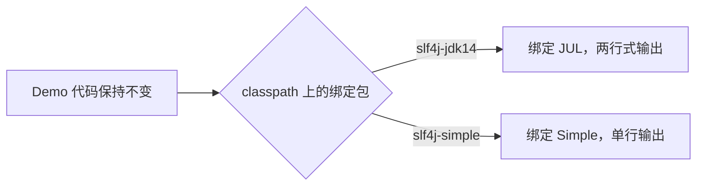

# 给 SLF4J 找绑定：JUL 与 Simple 的切换实测

工程里只有 `slf4j-api` 时，`logger.info` 调了等于没调：编译通过、运行不报错，日志一条都不出来。想让门面真的干活，就得给它找一个具体实现。这一节动手绑两个最轻的实现，JDK 自带的 JUL 和 SLF4J 自带的 Simple，顺便验证一件事：换绑定到底要不要改代码。

## 先给结论

- 门面加绑定才出日志：`slf4j-api` 1.7.26 之上，加 `slf4j-jdk14` 就绑定 JUL，加 `slf4j-simple` 就绑定 Simple。
- 绑定包版本要与 `slf4j-api` 保持一致，两者由同一套内部接口连接，版本错位容易出现方法找不到。
- 换绑定只改 pom：注释旧绑定、加新绑定，Demo 代码一行不动，输出格式立刻变化。
- JUL 输出两行式（时间与类名方法一行，日志内容一行）；Simple 输出单行（线程、级别、类名、消息），默认写到 System.err。
- Simple 只适合学习与小工具，生产环境不要用它。

## 一、先把只有门面的空转状态摆出来

新建 Maven 工程（示例用中性坐标 `com.example.slf4j`），引入门面依赖：

```xml
<dependency>
    <groupId>org.slf4j</groupId>
    <artifactId>slf4j-api</artifactId>
    <version>1.7.26</version>
</dependency>
```

代码完全按手册推荐的方式写：`Logger` 通过 SLF4J 的 `LoggerFactory` 获取，模拟业务前后各打一条日志：

```java
package com.example.slf4j;

import org.slf4j.Logger;
import org.slf4j.LoggerFactory;

public class Demo {

    private static final Logger LOGGER = LoggerFactory.getLogger(Demo.class);

    public static void main(String[] args) {
        LOGGER.info("这是info日志信息，代码之前进行打印信息。");
        System.out.println("测试代码");
        LOGGER.error("这是error日志信息，代码之后进行打印信息。");
    }
}
```

运行结果只有中间那句「测试代码」。两条日志凭空消失，原因是上一节说过的绑定机制：classpath 上没有 `StaticLoggerBinder`，Logger 降级为 NOP，全部调用被无声吞掉。接下来开始补绑定。

## 二、绑定 JUL：slf4j-jdk14

JUL（java.util.logging）是 JDK 原生日志框架，不需要额外引日志包，但 SLF4J 与它之间需要一个适配层，对应绑定包 `slf4j-jdk14`：

```xml
<dependency>
    <groupId>org.slf4j</groupId>
    <artifactId>slf4j-jdk14</artifactId>
    <version>1.7.26</version>
</dependency>
```

版本与 `slf4j-api` 保持一致。刷新 Maven 后直接运行，Demo 代码一个字没改，日志出来了，示例输出长这样：

```text
十一月 03, 2026 10:00:00 上午 com.example.slf4j.Demo main
INFO: 这是info日志信息，代码之前进行打印信息。
测试代码
十一月 03, 2026 10:00:00 上午 com.example.slf4j.Demo main
SEVERE: 这是error日志信息，代码之后进行打印信息。
```

JUL 的风格一目了然：时间、类名、方法名占一行，`INFO:`、`SEVERE:` 带着日志内容占另一行，一条日志拆两行显示。

适配层的存在是因为 JUL 的 API 早在 SLF4J 之前就定型了，它无法主动实现 SLF4J 的接口，只能由绑定包在中间做一层翻译：SLF4J 的 Logger 调用被转成 `java.util.logging.Logger` 的对应方法，`error` 映射到 JUL 里语义最接近的 `SEVERE`，这也是输出里没有出现 ERROR 字样的原因。

## 三、换成 Simple：只动 pom，不碰代码

把 `slf4j-jdk14` 注释掉，换成 Simple 绑定：

```xml
<dependency>
    <groupId>org.slf4j</groupId>
    <artifactId>slf4j-simple</artifactId>
    <version>1.7.26</version>
</dependency>
```

再次强调：**代码不做任何修改**，import 还是 `org.slf4j` 的那两个类。直接运行，输出变成单行格式：

```text
[main] INFO com.example.slf4j.Demo - 这是info日志信息，代码之前进行打印信息。
测试代码
[main] ERROR com.example.slf4j.Demo - 这是error日志信息，代码之后进行打印信息。
```

输出格式与 JUL 完全不同，说明底层真正干活的框架已经换成 Simple。两种绑定摆在一起对比：

| 对比项 | JUL（slf4j-jdk14） | Simple（slf4j-simple） |
|---|---|---|
| 来源 | JDK 自带，绑定包做适配 | SLF4J 项目自带 |
| 输出格式 | 两行式：时间与位置一行，内容一行 | 单行：线程、级别、类名、消息 |
| 输出流 | 默认 System.err | 默认 System.err |
| 配置能力 | 有独立的 JUL 配置体系 | 仅少量系统属性可调 |
| 适用场景 | 不想引第三方日志包的场景 | 教学、小工具 |

这次切换的完整链路：



图里最重要的是左边的节点：业务代码在两次切换中没有任何改动，变的只有 pom 里的一个依赖。以后选了某个日志框架想再换别的，代码修改量为零，这正是门面模式的价值所在。

再读一下 Simple 的单行格式：方括号内是线程名，级别后面的类名是打印日志的类，中划线之后才是消息正文。一行就能读完一条日志的全部要素，比 JUL 的两行式更容易贴进日志平台做检索，这也是两者输出上最直观的差别。

## 四、为什么生产环境不推荐 Simple

Simple 的定位是 SLF4J 的「自带最小实现」，保证只引一个绑定包也能立刻看到日志，但它的能力配不上生产环境的要求：输出目标固定为 System.err，没有配置文件体系，只提供几个系统属性微调级别与输出流，文件输出、滚动归档、按包分级这些生产必备能力一概没有。它的价值在于演示绑定机制，真实项目应该选 Logback、Log4j 这类完整实现。

## 常见误区

- **新旧绑定没有注释干净。** `slf4j-jdk14` 和 `slf4j-simple` 同时在 classpath，会触发 multiple bindings 警告，实际绑定到谁不可控，日志行为难以解释。
- **在控制台里找不到 Simple 的输出。** Simple 默认写 System.err，某些终端面板里 err 流与 out 流是分开显示的，别误判成日志没生效。
- **绑定包版本与 `slf4j-api` 不一致。** 绑定包实现的是 slf4j 内部接口，版本错位可能抛 `NoSuchMethodError`，升级时两者一起升。
- **以为 JUL 的绑定叫 slf4j-jul。** 绑定包名是 `slf4j-jdk14`，名字来自 JDK 1.4 引入 JUL 的年代。

## 面试可能被问到的问题

1. 面试官追问：「换一个日志实现需要改业务代码吗？」
   答：不需要。业务代码面向 SLF4J API 编程，换实现只需要替换 pom 里的绑定依赖，例如把 slf4j-jdk14 换成 slf4j-simple，输出立即切换。
2. 面试官追问：「slf4j-jdk14 这个依赖是干什么的？」
   答：它是 SLF4J 到 JUL 的适配绑定包，内部实现了 SLF4J 的绑定接口，把 Logger 调用转交给 JDK 自带的 java.util.logging 执行。
3. 面试官追问：「Simple 适合用在生产环境吗？」
   答：不适合。它只输出到 System.err，没有配置文件与滚动归档能力，仅适合教学演示和小工具；生产应选 Logback、Log4j 等完整实现。
4. 面试官追问：「怎么确认当前工程实际绑定到了哪个日志实现？」
   答：看启动时 SLF4J 的绑定提示与警告，看依赖树里实际存在的绑定包，再结合输出格式判断，例如两行式是 JUL、单行方括号格式是 Simple。
5. 面试官追问：「绑定包版本为什么要和 slf4j-api 一致？」
   答：绑定包实现的是 slf4j 内部的 StaticLoggerBinder 接口，版本错位时接口对不上，可能出现绑定失败或运行期 NoSuchMethodError。

## 配套资料

- 本教学日无源码包：`materials/code/03/day19-MongoDB集群以及日志、异常规范/` 下仅有解压清单 `_extracted.json`，解压文件数为 0；`slf4j-api`、`slf4j-jdk14`、`slf4j-simple` 三个依赖与 Demo 类写法抄录自本课画面线（pom 截图与 Demo.java 代码），包名统一改为中性的 `com.example.slf4j`。
- 两段控制台输出为按绑定包默认行为整理的示例（JUL 与 Simple 的真实格式随 JDK 与版本略有差异）。
- 绑定机制的原理见 `0315-日志规范之了解slf4j.md`；Log4j 与 Logback 的整合见下一篇。
