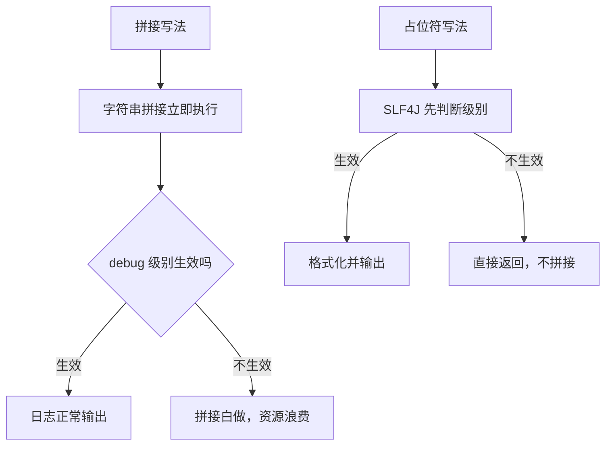

# Java 开发手册里的日志规范：拼接、级别与堆栈

Java 开发手册（公开版）是国内某大厂公开发布的行业规范书，日志规约部分共八条条款。第一条「必须使用 SLF4J 门面 API」在前几节已经用代码验证过，剩下七条覆盖了从日志文件保存天数到异常堆栈写法的细节，每一条都能对应到具体的代码或配置。逐条过一遍。

## 先给结论

- 日志文件至少保存 15 天：不少异常以「周」为频次出现，保存期不足两周，上一轮的现场就没了。
- 扩展日志按 `appName_logType_logName.log` 命名，错误日志与业务日志分开存放。
- trace、debug、info 级别的输出必须用条件输出或占位符，占位符是更推荐的写法。
- 用 `additivity="false"` 切断日志向父 Logger 的重复传播，别让一条日志打两遍。
- 异常日志必须同时有案发现场与堆栈；生产环境禁用 debug，warn 记录用户参数错误，error 只留给系统逻辑出错。

## 一、文件留 15 天，名字要望文生义

**第二条【强制】日志文件至少保存 15 天。** 理由是有些异常具备以「周」为频次发生的特点：这次出了问题，想追溯上一周同时间段的日志，文件已经被清理就无从对比，所以窗口必须覆盖两个完整的周期。落到工程上，通常配合按天滚动的日志文件策略实现：每天生成一个新文件，滚动策略里把保留窗口设到 15 天以上。

**第三条【强制】扩展日志的命名方式。** 打点、临时监控、访问日志这类扩展日志，统一按 `appName_logType_logName.log` 命名，`logType` 是日志类型，推荐分类有 stats、desc、monitor、visit 等，`logName` 是日志描述。手册举的例子 `mppserver_monitor_timezoneconverter.log`，一眼就能读出三个信息：某个服务的日志、monitor 监控类型、时区转换模块产生。这样命名的价值在于通过文件名就知道日志属于什么应用、什么类型、什么目的，归类查找都方便；如果都叫 1.log、2.log，等排障时只能一个个打开翻。

手册在这一条里还给了建议：错误日志和业务日志分开存放。习惯上很多人把所有日志丢进同一个目录，拆开后开发查看与系统监控都更顺。

## 二、拼接是隐形浪费：条件输出与占位符

**第四条【强制】对 trace、debug、info 级别的日志输出，必须使用条件输出形式或占位符方式。** 手册给的反例值得逐字看：

```java
logger.debug("Processing trade with id: " + id + " and symbol: " + symbol);
```

如果当前日志级别是 warn，这行 debug 最终不会出现在日志里，但引号里的字符串拼接已经执行过了；`symbol` 是对象时连 `toString()` 都被调用一遍。资源花了，日志一行没落，纯属浪费。两种正例：

```java
// 正例一：条件输出，先确认级别生效再拼接
if (logger.isDebugEnabled()) {
    logger.debug("Processing trade with id: " + id + " and symbol: " + symbol);
}

// 正例二：占位符，把拼接的决定权交给门面
logger.debug("Processing trade with id: {} and symbol: {}", id, symbol);
```

条件输出的思路是手动加一道级别判断，判断通过才执行拼接；占位符的思路是把这道判断挪进 SLF4J 内部，级别生效才格式化，不生效直接返回。两者效果一致，更推荐占位符：少写一层 if，代码更干净。

两种写法的执行路径差异：



顺带澄清一个常见误解：条件输出只对 debug、trace 这种默认关闭的级别有收益，info 级别几乎常开，给 `logger.info` 外面套一层 `isInfoEnabled` 判断没有意义，纯属无效防御。

## 三、additivity：别让同一条日志打两遍

第五条【强制】避免重复打印日志，浪费磁盘空间，务必在 log4j.xml 中设置 `additivity="false"`。
```xml
<logger name="com.example.rpc.config" additivity="false">
    <appender-ref ref="CONSOLE"/>
</logger>
```

原理在 Logger 的树形结构上：Logger 按包名层级组织，`com.example.rpc.config` 是 `com.example.rpc` 的子节点。默认情况下子 Logger 打印一条日志后，事件会沿着树向上传播，交给祖先 Logger 关联的 appender 再输出一遍，同一条日志就这样在多个位置落盘。`additivity="false"` 切断这条向上传播的链路，只保留当前节点的这一次输出。日志量大时，重复打印吃掉的磁盘和 IO 都是成倍的。

## 四、异常日志：案发现场加堆栈，缺一不可

**第六条【强制】异常信息应包括两类信息：案发现场的信息和异常堆栈的信息；如果不处理，那么通过关键字 throws 向上抛出。** 手册的正例是一个模板：

```java
logger.error(各类型参数或者对象 toString + "_" + e.getMessage(), e);
```

前半段是案发现场：出事时的参数、对象状态；后半段是异常对象本身，放在最后一个参数位，SLF4J 会把完整堆栈带进日志。落到真实代码里就是这样的形态（示例按本课写法补全）：

```java
try {
    orderService.pay(order);
} catch (Exception e) {
    logger.error("下单失败, order={}, msg={}", order, e.getMessage(), e);
}
```

只打一句「下单失败」或者只打 `e.getMessage()`，都不合格：前者没有现场，后者没有堆栈，排障时两者都要靠它还原。

## 五、级别纪律：生产禁 debug、warn 记参数、error 留给系统错误

**第七条【推荐】谨慎地记录日志。** 生产环境禁止输出 debug 日志，它属于开发环境；info 日志有选择地输出；刚上线的业务如果用 warn 做观察记录，一定要控制输出量，避免把服务器磁盘撑爆，业务稳定后要及时清掉这些观察日志。手册的说明部分点透了代价：大量输出无效日志，既拖累系统性能，也淹没有效信息，让错误定位变慢。落笔之前问自己三个问题：这条日志真的有人看吗？看到它你能做什么？它能不能给问题排查带来好处？三个问题都答得上来，这条日志才值得打。

**第八条【参考】warn 与 error 的分工。** 用户输入参数错误用 warn 记录，用户投诉时能还原他当时输入了什么，不至于无所适从；error 级别只记录系统逻辑出错、异常等重要错误信息，如非必要不要打 error。原因很直接：生产环境对异常的监控和告警都盯着 error，调试信息混进 error 等于给告警系统灌噪声，真正的故障反而容易被淹没。

## 常见误区

- **给 info 日志套 `isInfoEnabled` 判断。** 条件输出只对 debug、trace 这类默认关闭的级别有性能收益，info 几乎常开，判断白加；更直接的替代是占位符。
- **异常只打 `e.getMessage()`。** 一句话换不来堆栈，定位问题还得复现；异常对象放最后一个参数，让框架把堆栈带全。
- **additivity 保持默认。** 子 Logger 的日志沿树向上重复输出，磁盘与 IO 双倍消耗，公共中间件包的 Logger 尤其要显式关闭。
- **调试信息用 error 打。** error 被监控与告警依赖，混入调试噪声后告警可信度直线下降。

## 面试可能被问到的问题

1. 面试官追问：「日志文件为什么要求至少保存 15 天？」
   答：有些异常以周为频次出现，保存不足两周时，第二轮异常发生后无法追溯上一轮的日志做对比，15 天是覆盖两个完整周期的经验值。
2. 面试官追问：「debug 日志怎么写才不浪费性能？」
   答：用占位符把参数交给 SLF4J 延迟拼接，或用 isDebugEnabled 包住条件输出；直接字符串拼接在级别不生效时也会执行，白白消耗资源。
3. 面试官追问：「additivity 是干什么的？」
   答：控制日志事件是否沿 Logger 树向父节点传播，默认开启导致同一条日志在子节点与父节点各输出一次，设为 false 只在当前 Logger 输出，避免重复打印浪费磁盘。
4. 面试官追问：「一条合格的异常日志应该包含什么？」
   答：案发现场信息和异常堆栈信息，前者是出错时的参数与对象状态，后者通过把异常对象放在日志方法最后一个参数带入；不处理该异常时就用 throws 向上抛出，不能吞掉。
5. 面试官追问：「warn 和 error 分别在什么场景使用？」
   答：warn 记录用户输入参数错误这类可恢复、需还原现场的情况；error 只记录系统逻辑出错等重大错误，因为生产监控与告警都依赖 error，混入噪声会影响故障响应。
6. 面试官追问：「扩展日志为什么要按 appName_logType_logName.log 命名？」
   答：文件名直接携带应用、类型、目的三个维度，不需要打开文件就能归类查找，也便于按类别对日志做采集与监控。

## 配套资料

- 本教学日无源码包：`materials/code/03/day19-MongoDB集群以及日志、异常规范/` 下仅有解压清单 `_extracted.json`，解压文件数为 0；八条规约条款原文、Processing trade 正反例、`additivity="false"` 正例与异常日志正例抄录自本课画面线（讲义 3.4 手册中的其它规范一节），示例中的包名按通用写法改为 `com.example.rpc.config`。
- 落地到真实代码的异常日志与按天滚动的保留策略为按本课写法补全的示例。
- 第一条强制条款的代码验证见本章节 `0314-日志规范之为什么要使用SLF4J.md` 至 `0317-日志规范之slf4j整合Log4j以及Logback.md` 四篇。
