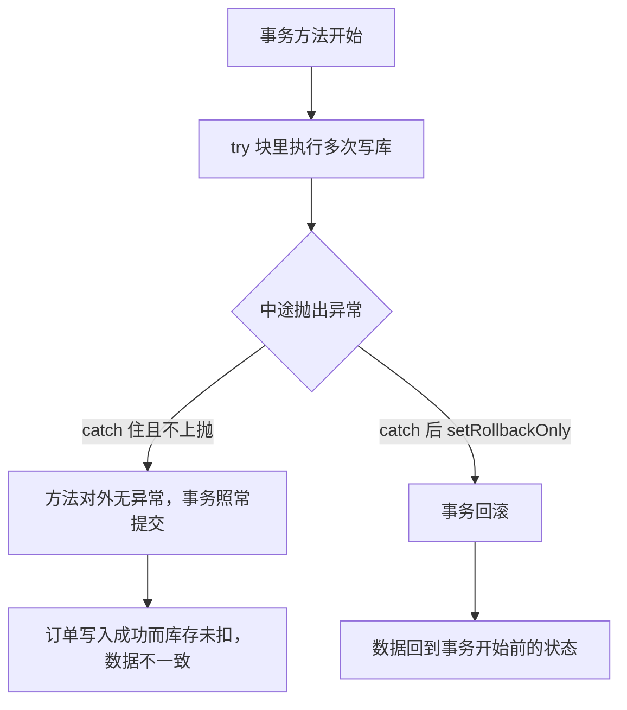

# Java 开发手册异常规约 13 条：预检查、事务回滚与错误码取舍

概念复习完，进入规约正文。Java 开发手册（公开版）的异常处理章节共 13 条，8 条强制、3 条推荐、2 条参考，每一条都对着一种真实写错的代码：catch 兜空指针、用异常走分支、事务里吞异常、finally 里写 return。本课用上下两讲逐条过完，这里按条款顺序整理成篇。

## 先给结论

- 运行时异常靠预检查规避，不靠 catch 兜底；异常也不许当流程控制用，它的开销高于条件分支。
- try 只包非稳定代码，catch 要按异常类型分别处理；捕获的每个异常都要有去处，不想处理就向上抛给调用者。
- 事务代码里 catch 异常后必须手动回滚，否则事务照常提交、业务数据出错，这是 13 条里代价最高的一条。
- finally 必须关闭资源对象与流对象，JDK 7 起推荐 try-with-resources；finally 里禁止写 return。
- 防 NPE 是调用方的责任，拆箱、数据库查询、集合元素、远程调用、Session、级联调用是六大高发场景；异常要抛有业务含义的自定义异常，对外接口用错误码，跨应用 RPC 优先返回 Result。

## 一、13 条规约全景

| 条款 | 级别 | 一句话要点 |
|---|---|---|
| 1 | 强制 | 运行时异常用预检查规避，不用 catch 处理 |
| 2 | 强制 | 异常不要用于流程控制、条件控制 |
| 3 | 强制 | 不对大段代码 try-catch，要区分稳定与非稳定代码 |
| 4 | 强制 | 捕获异常是为了处理它，不处理就抛给调用者 |
| 5 | 强制 | 事务代码中 catch 异常后，需要回滚就手动回滚 |
| 6 | 强制 | finally 块必须关闭资源对象、流对象 |
| 7 | 强制 | 不能在 finally 块中使用 return |
| 8 | 强制 | 捕获异常与抛出异常必须类型匹配或为其父类 |
| 9 | 推荐 | 返回值可为 null，但必须注释说明什么情况返回 null |
| 10 | 推荐 | 防 NPE 是程序员的基本修养，牢记六大场景 |
| 11 | 推荐 | 用有业务含义的自定义异常，不抛 Exception、Throwable |
| 12 | 参考 | 对外用错误码，内部推荐抛异常，RPC 优先 Result |
| 13 | 参考 | 避免重复代码，DRY 原则 |

强制条款全部压在「怎么对待异常」这件事上：不乱 catch、不乱抛、不在 finally 里做小动作。

## 二、预检查优先：前三条强制规约

**第 1 条，运行时异常靠预检查。** 正反例对照：

```java
// 反例：运行时异常不该靠 catch 兜底
try {
    obj.method();
} catch (NullPointerException e) {
    // 处理逻辑
}

// 正例：调用前先判断，让异常根本不发生
if (obj != null) {
    obj.method();
}
```

`IndexOutOfBoundsException`、`NullPointerException` 这类异常都能在写代码时预检查规避。例外是无法预检查的场景：解析外部传来的数字字符串，格式对不对只有解析那一刻才知道，catch `NumberFormatException` 是合理做法。

**第 2 条，异常不做流程控制。** 有人把 try-catch 写成 if-else 的替身：出异常走这边、没异常走那边。异常的构造、抛出与栈回溯开销远高于一次条件判断，分支逻辑就该用条件语句表达，这个习惯必须掐掉。

**第 3 条，不对大段代码 try-catch。** 几十行代码整体包进 try，是一种不负责任的表现。catch 时要分清稳定代码与非稳定代码：稳定代码无论如何不会出错，没必要进 try；非稳定代码要尽可能区分异常类型，不同的异常做不同的处理，一个 `catch (Exception e)` 全收，所有问题就长得一模一样了。

## 三、捕获就要负责：吞异常与事务回滚

**第 4 条，捕获的异常必须有去处。** catch 下来只打印一行甚至什么都不做，等于把问题藏进日志堆里；不想处理，就把它抛给调用者。最外层的业务使用者必须处理异常，并转化为用户能理解的内容：直接给用户抛一个空指针没有意义，应该给「系统繁忙请稍后再试」这类提示，或者返回一个错误代码如 001、002，凭代码再查具体原因。

**第 5 条，事务里 catch 之后手动回滚，这是全篇最要命的一条。** 事务回滚的触发条件是方法抛出异常，异常一旦被 catch，方法对外就「没有异常」，事务照常提交：

```java
// 示例按主流写法补全：事务方法里 catch 之后手动标记回滚
@Transactional
public void createOrder(Order order) {
    try {
        orderMapper.insert(order);
        stockService.deduct(order.getSkuId());
    } catch (Exception e) {
        log.error("下单失败, order={}", order, e);
        // 异常被 catch，事务感知不到，必须手动标记回滚
        TransactionAspectSupport.currentTransactionStatus().setRollbackOnly();
        throw new ServiceException("下单失败");
    }
}
```



图里上面那条路径就是事故本身：库存扣减失败被吞掉，订单却落了库。Service 层直接写 try-catch 导致事务不回滚，已经不只是异常规范问题，是业务逻辑出错。

## 四、finally 的两条铁律

**第 6 条，finally 必须关闭资源对象与流对象**，关闭动作自身出异常也要 try-catch。JDK 7 及以上更推荐 try-with-resources，把关闭交给语法：

```java
// 示例按本课写法补全：try-with-resources 自动关闭资源
try (InputStream in = new FileInputStream(file)) {
    in.read();
} catch (IOException e) {
    log.error("读取文件失败, file={}", file, e);
}
```

**第 7 条，finally 里禁止写 return。** finally 块的 return 一旦执行，方法立即结束，try 块中的 return 不会再执行：

```java
// 反例：finally 里的 return 会吞掉 try 的返回值
public int bad() {
    try {
        return 1;              // 永远返回不出去
    } finally {
        return 2;              // 方法在这里直接返回 2
    }
}
```

try 里辛苦算好的结果被一句 return 覆盖，这类问题编译器不报错，只能靠规范拦住。

## 五、抛接匹配与 null 契约

**第 8 条，捕获异常与抛出异常必须完全匹配，或者捕获的是抛出异常的父类。** 手册的比喻很直白：预期对方抛的是绣球，实际接到的是铅球，就会产生意外情况。方法声明抛 `IOException`，调用方按声明来 catch，运行期却冒出一个没声明过的类型，就会漏接。

**第 9 条，方法返回值可以为 null，不强制返回空集合或空对象，但必须添加注释充分说明什么情况下会返回 null。** 手册同时明确：防止 NPE 是调用方的责任。即使被调用方返回的是空集合或空对象，调用方也不可高枕无忧，远程调用失败、序列化失败、运行时异常这些场景都可能让结果变成 null。注释把 null 契约写清楚，调用方才知道在哪一步要做判断。

## 六、防 NPE 六大场景与自定义异常

**第 10 条，防止 NPE 是程序员的基本修养**，六个高发场景逐一记下：返回类型为基本数据类型、return 包装类型对象时自动拆箱可能产生 NPE；数据库查询结果可能为 null；集合里的元素即使 `isNotEmpty`，取出的元素也可能为 null；远程调用返回对象一律先做空指针判断；Session 中获取的数据建议做 NPE 检查；`obj.getA().getB().getC()` 这类级联调用极易产生 NPE。拆箱场景最隐蔽：

```java
// 反例：Integer 为 null 时拆箱抛 NPE
public int count(Order order) {
    return order.getCount();   // getCount() 返回 Integer，为 null 时直接抛 NPE
}
```

JDK 8 的 `Optional` 是防 NPE 的正解工具：

```java
// 正例：用 Optional 收敛空值判断（示例按本课写法补全）
Optional.ofNullable(userDao.findById(id))
        .map(User::getAddress)
        .map(Address::getCity)
        .orElse("未知城市");
```

**第 11 条，定义时区分 unchecked 与 checked 异常**，避免直接抛 `new RuntimeException()`，更不允许抛 `Exception` 或 `Throwable`，应使用有业务含义的自定义异常，如 `DAOException`、`ServiceException`。抛一个大 `Exception` 等于什么都没说，调用方无从判断发生了什么、该按哪条分支处理：

```java
// 示例按本课写法补全：业务异常带上语义
public class ServiceException extends RuntimeException {
    public ServiceException(String message) {
        super(message);
    }
}
```

## 七、错误码还是异常，以及 DRY

**第 12 条，抛异常与返回错误码分场景选。** 对公司外的 http/api 开放接口必须使用错误码；应用内部推荐抛异常，定位更直接；跨应用间 RPC 调用优先使用 Result 方式，封装 `isSuccess()` 方法、错误码与错误简短信息。理由有三：抛异常返回时，调用方没捕获就产生运行时错误；不加栈信息、只 new 自定义异常塞自己的 error message，对调用端解决问题帮助不大；加了栈信息，频繁调用出错时序列化与传输的性能损耗又是问题。

**第 13 条，避免重复代码，即 DRY 原则（Don't Repeat Yourself）。** 随意复制粘贴，后续修改要改所有副本，漏掉一处就埋一颗雷；必要时抽取共性方法、抽象公共类甚至组件化。手册的正例：一个类有多个 public 方法都要做参数校验，抽成一个私有方法：

```java
// 示例按本课写法补全：公共校验收敛到一个方法
private boolean checkParam(DTO dto) {
    return dto != null && dto.getId() != null;
}
```

这条虽标为参考，实际项目里值得按强制执行。

## 常见误区

- **`catch (Exception e)` 一把梭。** 所有异常长得一样，稳定代码也被包进去；按类型分开 catch，只包非稳定代码。
- **catch 之后不管事务。** 方法没抛出异常，事务照常提交，半截数据落库；需要回滚就 `setRollbackOnly` 或把异常重新抛出。
- **finally 里写 return。** try 的返回值被直接覆盖，方法结果与阅读直觉不符。
- **对外接口把异常直接抛给用户。** 用户看不懂 NPE，对外应返回错误码加简短信息，异常只留在应用内部。

## 面试可能被问到的问题

1. 面试官追问：「为什么运行时异常不建议用 catch 处理？」
   答：空指针、下标越界这类异常可以通过预检查规避，catch 兜底掩盖了编码缺陷，还多付异常构造与栈回溯的开销；无法预检查的场景如解析数字字符串，才用 catch 处理。
2. 面试官追问：「事务方法里 catch 了异常，事务还会回滚吗？」
   答：不会。事务回滚依赖方法抛出异常，catch 之后方法对外没有异常，事务照常提交；需要回滚必须手动调用 setRollbackOnly 标记，或把异常重新抛出。
3. 面试官追问：「finally 里写 return 会怎样？」
   答：finally 块的 return 执行后方法立即结束，try 块中的 return 不会再执行，返回值被覆盖，属于规范明令禁止的写法。
4. 面试官追问：「防止 NPE 要注意哪些场景？」
   答：自动拆箱、数据库查询结果、集合元素、远程调用返回对象、Session 数据、级联调用六个高发场景；防止 NPE 是调用方的责任，JDK 8 起可以用 Optional 收敛判断。
5. 面试官追问：「为什么不建议方法直接抛 Exception 或 RuntimeException？」
   答：异常要表达业务语义，直接抛顶层异常时调用方无法区分发生了什么、该按哪条分支处理；应定义 ServiceException、DAOException 这类有业务含义的自定义异常。
6. 面试官追问：「对外接口和内部调用，错误传递方式怎么选？」
   答：对外的 http/api 开放接口必须用错误码；应用内部推荐抛异常；跨应用 RPC 优先返回 Result，封装 isSuccess、错误码与简短错误信息，避免异常未捕获和堆栈序列化的开销。

## 配套资料

- 本教学日无源码包：`materials/code/03/day19-MongoDB集群以及日志、异常规范/` 下仅有解压清单 `_extracted.json`，解压文件数为 0；13 条规约条款原文、预检查正反例、checkParam 正例抄录自本课画面线（讲义 4.2 异常规范一节），包名按通用写法改为 `com.example`，事务回滚、try-with-resources、Optional、自定义异常为按本课写法补全的示例。
- 条款 1 的概念铺垫见 `0319-异常规范之异常的概念.md`；日志侧八条规约见本章节上一篇（0318）。
