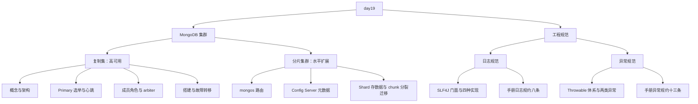

# day19 收束：一张地图复习 MongoDB 复制集、分片集群与日志异常规范

day19 的信息量在整门课里排得上前列：前半段从 MongoDB 复制集讲到分片集群，后半段从 SLF4J 门面讲到 Java 开发手册（公开版）的异常规约 13 条。每一节都有对应博客展开，复习时真正的问题是「散」：集群命令、日志配置、异常条款混在一页笔记里，考前想快速过一遍没有抓手。

一张地图把一整天收拢，按「集群保数据、规范保代码」两条主线重新压实，每块只留核心结论、关键命令和最容易被追问的点。

## 先给结论

- MongoDB 集群两条线：复制集解决高可用（数据多副本、自动故障转移），分片集群解决海量存储（水平扩展）；两者叠加使用，分片集群里每个 Shard 本身就是一个复制集。
- 复制集靠心跳与选举运转：Primary 收全部写入，Secondary 通过 oplog 同步，主节点宕机后剩余成员自动选出新主；arbiter 只投票、不存数据。
- 分片集群三大件：mongos 路由接入、Config Server 存路由元数据、Shard 存数据；chunk 超过 chunkSize 自动分裂，balancer 进程负责迁移均衡，chunkSize 默认 64MB。
- 日志规范主线：面向 SLF4J 门面编程，Simple、JDK14、Log4j、Logback 只是可插拔的实现，业务代码一行不动。
- 异常规约 13 条（8 强制、3 推荐、2 参考）里代价最高的三条：运行时异常预检查规避、事务中 catch 后手动回滚、finally 里禁止 return。

## 一、全章知识地图



左半棵树管数据：机器会坏，靠复制集；数据会多，靠分片。右半棵树管代码：日志怎么打、异常怎么抛。复习时先看主干定位，哪块发虚再回到对应展开篇。

## 二、复制集：机器会坏这件事的答案

**它是什么。** 同一份数据的多台副本组成的小集群，目的是保证数据可靠性、提高读写能力。经典结构是一个 Primary 加两个 Secondary：写请求全走 Primary，Secondary 通过回放 oplog 保持一致，成员之间两两心跳维持感知。

**故障转移怎么发生。** Primary 宕机后，其余成员在心跳超时后发起选举，选出新 Primary，读写请求切到新主，应用侧由驱动自动感知，连接串不用改。这个「无需人工干预的切换」就是复制集存在的核心价值。

**搭建现场。** Docker 起三个 mongo 容器，端口 27017、27018、27019：

```bash
# 创建三个 mongo 容器，都声明加入 rs0 复制集
docker create --name mongo01 -p 27017:27017 -v mongo-data-01:/data/db mongo:4.0.3 --replicSet "rs0" --bind_ip_all
docker create --name mongo02 -p 27018:27017 -v mongo-data-02:/data/db mongo:4.0.3 --replicSet "rs0" --bind_ip_all
docker create --name mongo03 -p 27019:27017 -v mongo-data-03:/data/db mongo:4.0.3 --replicSet "rs0" --bind_ip_all

docker start mongo01 mongo02 mongo03
```

```bash
# 进入容器后初始化复制集，一次声明三个成员
rs.initiate({
  _id: "rs0",
  members: [
    { _id: 0, host: "172.16.55.185:27017" },
    { _id: 1, host: "172.16.55.185:27018" },
    { _id: 2, host: "172.16.55.185:27019" }
  ]
})
```

**arbiter 的角色。** 仲裁节点不存数据、只参与投票。两个数据节点再加一个 arbiter，用最小成本凑够选举的多数派：

```bash
# 创建仲裁节点容器
docker create --name mongo04 -p 27020:27017 -v mongo-data-04:/data/db mongo:4.0.3 --replicSet "rs0" --bind_ip_all
docker start mongo04

# 在主节点上执行，把仲裁节点加入复制集
rs.addArb("172.16.55.185:27020")
```

## 三、分片集群：数据会多这件事的答案

扩容两条路：垂直扩展是换更强的机器，天花板明显且越来越贵；水平扩展是加普通机器把数据摊开，分片集群就是 MongoDB 给出的水平扩展方案。1TB 数据分 4 片，每片约 256GB，单机压力直接除以分片数。

三大组件各司其职：

| 组件 | 职责 |
|---|---|
| mongos | 路由节点，应用统一从它进出，本身不持久化数据 |
| Config Server | 存集群节点与分片路由信息，默认配置 3 个节点 |
| Shard | 存应用数据，一般由复制集组成，达到分片目的 |

**chunk 是数据分布的单位。** Splitting 指一个 chunk 的大小超过 chunkSize 时，后台进程把它切成更小的 chunk；Balancing 指 balancer 后台进程在分片之间迁移 chunk，均衡各 Shard 的负载。chunkSize 默认 64MB：设小了数据分布均匀，但分裂迁移频繁，路由节点消耗大；设大了迁移少，分布可能不均。chunk 只分裂不合并，把 chunkSize 调大后已有 chunk 数量不会减少，只影响后续写入。没有特殊要求就保持默认值。

**搭建顺序。** 分片集群建立在复制集之上：先把每个 Shard 配成复制集，再起 Config Server 与 mongos，最后对库和集合开启分片、指定片键。day19 的实操正是按这个顺序走完的，两个集群都建议亲手搭一遍再进项目。

## 四、日志规范：一套门面，多种实现

SLF4J 是日志门面，Log4j、Logback 这些是日志实现。业务代码只面向门面：

```xml
<dependency>
    <groupId>org.slf4j</groupId>
    <artifactId>slf4j-api</artifactId>
    <version>1.7.26</version>
</dependency>
```

```java
import org.slf4j.Logger;
import org.slf4j.LoggerFactory;

private static final Logger LOGGER = LoggerFactory.getLogger(OrderService.class);
```

换实现只换类路径上的绑定：Simple、JDK14 是自带的轻量实现，Log4j 需要配套 `log4j.properties`，Logback 由对应绑定模块接入，业务代码里的 `LoggerFactory.getLogger` 一行不改。

```properties
log4j.rootLogger=DEBUG, A1
log4j.appender.A1=org.apache.log4j.ConsoleAppender
log4j.appender.A1.layout=org.apache.log4j.PatternLayout
log4j.appender.A1.layout.ConversionPattern=%d{yyyy-MM-dd HH:mm:ss} [%c] %p %m%n
```

手册日志八条里最常被违反的三处：debug 与 info 级别用占位符而不是字符串拼接；公共包的 Logger 设 `additivity="false"` 防止重复打印；异常日志必须同时有案发现场信息与堆栈信息。

## 五、异常规范：13 条规约的复习骨架

概念部分三句话收束：Throwable 下分 Error 与 Exception，Error 是 JVM 级严重错误，不处理；RuntimeException 及其子类是非受检异常，IOException、ClassNotFoundException 这类是受检异常，编译器强制处理；处理路径只有抛出与捕获两条，抛出由运行时系统沿调用栈找处理器，捕获靠类型匹配的 catch。

规约部分按档位记：8 条强制、3 条推荐、2 条参考。复习时抓代价最高的三条：

**第一，事务方法里 catch 异常后必须手动回滚。** 回滚的触发条件是方法抛出异常，异常被 catch 住不上抛，事务照常提交，订单落库而库存未扣这类事故就是这么来的，需要回滚就标记回滚或重新抛出。

**第二，finally 必须关闭资源，且禁止写 return。** 资源与流的关闭动作放进 finally，JDK 7 起推荐 try-with-resources；finally 里的 return 会直接终结方法，try 中的返回值被覆盖。

**第三，运行时异常靠预检查规避。** 空指针、数组越界用 if 判断挡在发生之前，catch 只留给无法预检查的场景；捕获的异常要么处理、要么向上抛，唯独不能吞。

推荐档里防 NPE 六大场景（自动拆箱、数据库查询结果、集合元素、远程调用返回、Session 数据、级联调用）与有业务含义的自定义异常（ServiceException、DAOException），参考档里对外错误码、对内异常、RPC 优先 Result 的取舍，细则见异常规范两篇正文。

## 六、手册当工具书用

课程结尾给出的延伸建议值得单独记一条：日志与异常只是 Java 开发手册（公开版）中的两章，编程规约、MySQL 数据库规约、单元测试规约同样值得逐条过，最好整本通读。条文本身是抛砖引玉，真正的消化发生在代码评审与自查里：每写一个 catch、每打一行日志，回去对一对条款，写高质量代码才不是一句口号。

## 常见误区

- **给复制集加节点求容量。** 复制集每个成员都是全量数据，加节点只加冗余不加容量，容量问题要靠分片集群。
- **把 arbiter 当数据节点。** 它不存数据、不承载读写，故障转移时只投票，不能替代数据副本。
- **绕过门面直接用日志实现。** `import org.apache.log4j.Logger` 这类写法把代码焊死在实现上，换日志框架要改业务代码，统一走 `org.slf4j.Logger`。
- **以为 catch 之后事务会自动回滚。** 回滚依赖异常抛出，catch 住不上抛，事务照常提交，半截数据直接落库。

## 面试可能被问到的问题

1. 面试官追问：「MongoDB 复制集和分片集群分别解决什么问题？」
   答：复制集把同一份数据存多份，主节点可写、从节点同步，主故障自动选举切换，解决数据可靠性与高可用；分片集群把数据按片键水平拆到多个分片，解决单机存储与写入瓶颈。生产环境常两者叠加，每个分片内部就是一个复制集。
2. 面试官追问：「Primary 宕机后复制集如何完成故障转移？」
   答：成员之间靠心跳维持感知，主节点宕机后其余成员心跳超时，满足多数派的成员发起选举选出新主，驱动自动切到新主，全程无需人工干预。
3. 面试官追问：「arbiter 节点解决什么问题，代价是什么？」
   答：arbiter 不存数据、只参与投票，用于在两个数据节点的部署里凑够选举多数派，避免偶数节点选不出主。代价是它不提供数据冗余，仲裁结果也可能偏向某个数据节点。
4. 面试官追问：「分片集群中 mongos 与 Config Server 的分工是什么？」
   答：mongos 是统一接入的路由层，本身不持久化数据，负责把请求按片键路由到对应分片；Config Server 存集群节点与分片路由元数据，默认 3 个节点，mongos 依赖它才知道数据在哪。
5. 面试官追问：「chunkSize 设置过大或过小分别有什么影响？」
   答：默认 64MB。设小则分裂迁移频繁，数据分布更均衡但路由节点消耗大；设大则迁移少但分布可能不均。chunk 只分裂不合并，调整只影响后续写入。
6. 面试官追问：「为什么要面向 SLF4J 门面写日志？」
   答：门面把 API 与实现解耦，Simple、JDK14、Log4j、Logback 通过类路径绑定切换，业务代码不改；直接用实现类会把项目焊死在某个日志框架上，也难以统一管理第三方依赖的日志输出。

## 配套资料

- 本教学日无源码包：`materials/code/03/day19-MongoDB集群以及日志、异常规范/` 下仅有解压清单 `_extracted.json`，解压文件数为 0；Docker 命令、`rs.initiate` 与 `rs.addArb`、SLF4J 依赖坐标、`log4j.properties` 抄录自本章节视频画面线，`OrderService` 日志示例为按本课写法补全。
- 分块复习入口：复制集见本章节 `0306` 至 `0311` 各篇，分片集群见 `0312` 与 `0313`，日志规范见 `0314` 至 `0318`，异常规范见 `0319` 与 `0320`。
